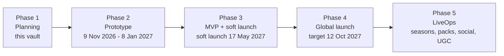

# 00 Home: Relivable Phase 1 Planning Vault

*Purpose:* The entry point to the Relivable Phase 1 plan: what each note answers, the order to read them in, and what a client reviewer should confirm.

> [!note] How to use this vault
> Copy the whole `phase-1` folder into your Obsidian vault. Every note links to the others with Obsidian wikilinks, so the graph view shows the full plan. Start at [[_Concept Brief]]; every other note follows it.

## Read in this order
| # | Note | What it answers |
|---|---|---|
| — | [[_Concept Brief]] | The source of truth: pillars, locked decisions, phases |
| 01 | [[01 Executive Summary]] | The one-page pitch for clients |
| 02 | [[02 Market and Competitors]] | Market size, BitLife's trend, rivals, SWOT |
| 03 | [[03 Player Research and Wishlist]] | Personas, complaints, the features players want added |
| 04a | [[04 App Breakdown - Core Life Systems]] | Every core feature in detail (stats, school, careers, money, crime, health, world, world legacy and history) |
| 04b | [[04 App Breakdown - Social, Meta and Premium]] | Every social, meta and premium feature in detail (relationships, family, dynasty, activities, achievements, social, premium, AI) |
| 05 | [[05 UX and Screen Map]] | Screens, navigation, wireframes, onboarding, visual style, accessibility |
| 06 | [[06 Monetization and Economy]] | Store catalogue, ad rules, revenue scenarios |
| 07 | [[07 Retention and LiveOps]] | Loops, retention targets, 12-month event calendar |
| 08 | [[08 Technical Architecture]] | Stack, architecture, storylet schema, pipelines |
| 09 | [[09 Compliance and Ratings]] | Age ratings, privacy, 2026 age laws, AI rules, IP |
| 10 | [[10 Go-to-Market]] | Soft launch, ASO, UA, creators, PR |
| 11 | [[11 Roadmap Team and Budget]] | Phases, team, budget, Phase 2 checklist |
| 12 | [[12 Risks and KPIs]] | Risk register, KPI framework, stage gates |
| 13 | [[13 Client Pitch Script and FAQ]] | What to say on each slide and how to answer client questions |

## Other formats in this phase
- **Feature matrix spreadsheet:** `Relivable Feature Matrix.xlsx` (every feature, BitLife equivalent, priority, phase, free/Plus, effort)
- **Client pitch deck:** Relivable Phase 1 Pitch (12 slides with speaker notes; shared separately)
- **Background research:** `research_notes/Life sim game phase 1/`, `research_notes/BitLife complete feature guide/` and `reports/BitLife complete feature guide.md` in the repo

## Phase map

> [!warning] Evidence quality
> The research was gathered through web search (full reports and Reddit could not be reviewed directly), and the most time-sensitive claims were re-checked on 26 Oct 2026 (see the change log in [[_Concept Brief]]). Market figures, prices and benchmarks are cited estimates. Check them again before quoting them in a contract.

## Review checklist
What a client reviewer should confirm before signing off Phase 1 (Gate 1). Items are gathered from every note's open questions and decisions, with duplicates merged.

**Confirm the settled baseline**
- [ ] The pillars, scope, locked decisions and the 20 resolved decisions in [[_Concept Brief]], including the 8-generation dynasty cap (free to Generation 4, Plus to Generation 8) and the new World Legacy and History feature (one world per player, one continuous history).
- [ ] The 9-product store catalogue and ad rules in [[06 Monetization and Economy]].
- [ ] The Phase 2 approval: 8 weeks, ~$25–60K, with go/no-go playtest gates ([[01 Executive Summary]], [[12 Risks and KPIs]]).

**Open client decisions**
- [ ] **Age-rating stance and ages 13–15:** launch at Apple 16+ / Google Mature 17+ and block under-16s where required, or fund a softened 13+ "Teen" profile ([[09 Compliance and Ratings]], [[04 App Breakdown - Social, Meta and Premium]]).
- [ ] **Team model:** hybrid/offshore or US team, which sets the budget band ([[11 Roadmap Team and Budget]]).
- [ ] **Name clearance:** start the trademark and store-name search for "Relivable" plus backups, and for the fictional in-game platform names (Vybe, Lenso, Murmur, Hearthcast, Inkwell, Kindling) ([[09 Compliance and Ratings]], [[04 App Breakdown - Social, Meta and Premium]]).
- [ ] **Community now:** open the official Discord and start the creator shortlist at the start of Phase 2 ([[10 Go-to-Market]]).
- [ ] **Action budget:** a per-year Energy budget or unlimited "Classic" actions, to be tested in the prototype ([[04 App Breakdown - Core Life Systems]]).
- [ ] **Religion representation:** real traditions with expert review (recommended) or fictional faiths ([[04 App Breakdown - Core Life Systems]]).
- [ ] **Country scope at MVP:** the recommended 25 countries against soft-launch and language markets ([[04 App Breakdown - Core Life Systems]]).
- [ ] **Mature-content defaults:** murder, drugs and gambling defaults per age signal and rating target ([[04 App Breakdown - Core Life Systems]], [[09 Compliance and Ratings]]).
- [ ] **Suicide and self-harm handling:** never a player action, non-graphic, with helpline links ([[09 Compliance and Ratings]]).
- [ ] **Cloud AI fallback:** Plus-only with a per-user budget, or not offered ([[04 App Breakdown - Social, Meta and Premium]], [[08 Technical Architecture]]).
- [ ] **Story Pack refunds:** what stays readable after a refund, to confirm with legal ([[08 Technical Architecture]]).
- [ ] **Scope exclusions:** polygamy, dowry and bride price out of scope for now; fantastical rare animals optional; creator revenue sharing out of scope; real-time multiplayer evaluated after soft launch ([[04 App Breakdown - Social, Meta and Premium]], [[07 Retention and LiveOps]]).
- [ ] **UX questions for Phase 2 playtests:** optional swipe input, command-bar style, 3 vs 5 suggestion cards, Recap auto-play ([[05 UX and Screen Map]]).
