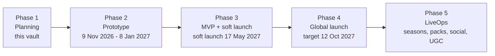

# EverLife — Phase 1 Planning Vault

> [!note] How to use this vault
> Copy the whole `phase-1` folder into your Obsidian vault. Every note links to the others with `[[wikilinks]]`, so the graph view shows the full plan. Start at [[_Concept Brief]]; every other note follows it.

## Read in this order
| # | Note | What it answers |
|---|---|---|
| — | [[_Concept Brief]] | The source of truth: pillars, locked decisions, phases |
| 01 | [[01 Executive Summary]] | The one-page pitch for clients |
| 02 | [[02 Market and Competitors]] | Market size, BitLife's trend, rivals, SWOT |
| 03 | [[03 Player Research and Wishlist]] | Personas, complaints, the features players want added |
| 04a | [[04 App Breakdown - Core Life Systems]] | Every core feature in detail (stats, school, careers, money, crime, health, world) |
| 04b | [[04 App Breakdown - Social, Meta and Premium]] | Every social, meta and premium feature in detail (relationships, family, dynasty, activities, achievements, social, premium, AI) |
| 05 | [[05 UX and Screen Map]] | Screens, navigation, wireframes, onboarding, visual style, accessibility |
| 06 | [[06 Monetization and Economy]] | Store catalogue, ad rules, revenue scenarios |
| 07 | [[07 Retention and LiveOps]] | Loops, retention targets, 12-month event calendar |
| 08 | [[08 Technical Architecture]] | Stack, architecture, storylet schema, pipelines |
| 09 | [[09 Compliance and Ratings]] | Age ratings, privacy, 2026 age laws, AI rules, IP |
| 10 | [[10 Go-to-Market]] | Soft launch, ASO, UA, creators, PR |
| 11 | [[11 Roadmap Team and Budget]] | Phases, team, budget, Phase 2 checklist |
| 12 | [[12 Risks and KPIs]] | Risk register, KPI framework, stage gates |
| 13 | [[13 Client Pitch Script and FAQ]] | What to say on each slide and how to answer client questions |

## Other formats in this phase
- **Feature matrix spreadsheet:** `EverLife Feature Matrix.xlsx` (every feature, BitLife equivalent, priority, phase, free/Plus, effort)
- **Client pitch deck:** [EverLife Phase 1 Pitch](https://claude.ai/artifact/TEn1vpqBdRUxMBjiAJW23Q) (12 slides with speaker notes; private until shared)
- **Background research:** `research_notes/Life sim game phase 1/`, `research_notes/BitLife complete feature guide/` and `reports/BitLife complete feature guide.md` in the repo

## Phase map

> [!warning] Evidence quality
> The research came from web-search results; direct page reads and Reddit were blocked. Market figures, prices and benchmarks are cited estimates. Check them again before quoting them in a contract.
