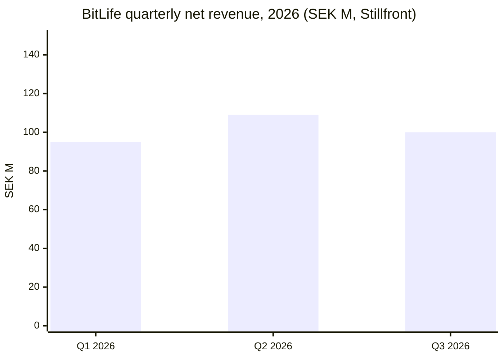
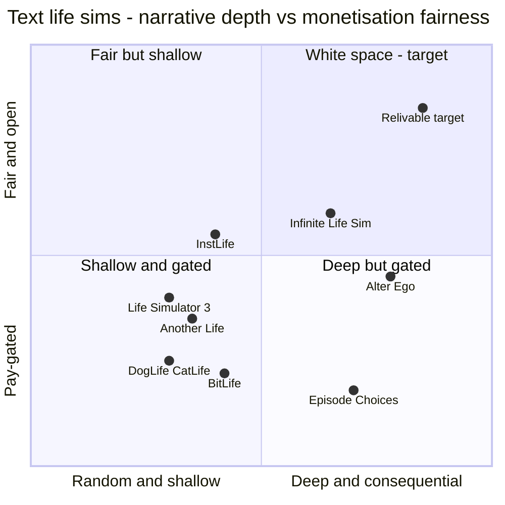

# Market and Competitors

> [!note] Method and confidence
> All figures come from web-search snippets gathered 2026-10-25. Page fetching was blocked, so primary reports (Sensor Tower, AppMagic) could not be opened in full. Several Sensor Tower numbers come from short auto-generated quarterly blog posts, so they are approximate. **No public source isolates "life sim" as a mobile category.** Market size below is built from adjacent anchors, and every derived number is marked *(estimate)* or *(inference)*. This note is consistent with [[_Concept Brief]] and feeds [[01 Executive Summary]] and [[10 Go-to-Market]].

> [!warning] IP stance
> Relivable is *inspired by the genre*. It is not affiliated with BitLife, Candywriter or Stillfront. Competitor names here are used only for analysis. Relivable's store listing, text, characters and assets will be original, and store metadata will not use competitor trademarks.

## 1. Market size

### 1.1 Anchors

| Layer | Figure | Date | Source |
|---|---|---|---|
| Global mobile game IAP | $81.75B (+1.3% YoY) | 2025 | [Sensor Tower via gamedevreports](https://gamedevreports.substack.com/p/sensor-tower-state-of-gaming-2026) |
| Hybrid-casual IAP | $4.2B (+20% YoY) | 2025 | same |
| Mobile game ad revenue (19 countries) | ~$12B | 2025 | [wnhub](https://wnhub.io/news/analytics/item-51349) |
| Mobile **Simulation** genre revenue | $4.9B (2021 peak), $4.5B (2022); $2.7B Jan–Jul 2023, 43% from the US | 2021–23 | [GameDevReports / Sensor Tower](https://gamedevreports.substack.com/p/sensor-tower-simulation-mobile-games) |
| Simulation downloads | ~6.8B per year, post-pandemic | 2023 | same |
| Mobile D2C (web shop) share of IAP | ~$17B, about 15% of $113.3B | 2025 | [FoxData / Appcharge](https://foxdata.com/en/blogs/mobile-game-d2c-revenues-hit-17-billion-why-publishers-are-pushing-beyond-app-stores/) |
| Life Simulator subgenre ARPU (US Android) | $11.08–14.83, a top-3 hybrid-casual subgenre | Jun 2024–Jan 2025 | [Appodeal via gameindustrylibrary](https://gameindustrylibrary.com/documents/mobile-casual-benchmarks-report-2025) |

### 1.2 Serviceable market *(inference)*
The text-life-sim niche is essentially BitLife plus a long tail of clones. BitLife's annualised revenue is about SEK 400M (~US$38–42M) *(inference from quarterly reports, ~10 SEK/USD)*, so the leader alone sets a floor of roughly $40M per year in directly comparable spend. Add the clones, Candywriter's spin-offs and the vacancy left by The Sims Mobile. A reasonable planning view is a **$50–80M/yr serviceable niche *(estimate)*** inside a ~$4.5B simulation genre. Relivable does not need to win the niche. At an illustrative 5–10% share it would be a $2.5–8M/yr title *(illustrative, not a forecast)*.

## 2. BitLife revenue trend (Stillfront reporting)

| Period | BitLife net revenue | Organic growth | Note | Source |
|---|---|---|---|---|
| 2019 (pre-acquisition) | ~US$26M (Candywriter total), 59% EBIT margin; >62% of BitLife revenue from ads | — | Acquired 2020 for $74.4M upfront, up to $195M | [PocketGamer.biz](https://www.pocketgamer.biz/news/73190/stillfront-group-acquires-bitlife-developer-candywriter/); [Stillfront PDF](https://www.stillfront.com/en/wp-content/uploads/sites/2/2020/04/stillfront-stillfront-group-acquires-candywriter-llc-and-discloses-updated-pro-forma-figures-for-2-200423.pdf) |
| Q2 2025 | — | -2% | CEO calls BitLife a "cornerstone franchise"; account system enables a webshop | [Seeking Alpha](https://seekingalpha.com/article/4802930-stillfront-group-ab-publ-stlff-q2-2025-earnings-call-transcript) |
| **Q1 2026** | **SEK 95M** | **-19%** | Organic decline | [Yahoo Finance Q1 2026](https://finance.yahoo.com/markets/stocks/articles/stillfront-group-ab-stlff-q1-070405250.html) |
| **Q2 2026** | **SEK 109M** (prior year 141M) | **-19%** | "Stricter user acquisition approach and challenging comparison numbers" | [Stillfront Q2 2026](https://www.stillfront.com/en/stillfronts-interim-report-q2-2026-strengthened-profitability-and-continued-revenue-stability/) |
| **Q3 2026** | **~SEK 100M** | **-2%** | Like-for-like on UA strategy; figure from the call transcript only | [Yahoo Finance Q3 2026 call](https://finance.yahoo.com/quote/SFS.XC/earnings/SFS.XC-Q3-2026-earnings_call-537398.html) |

**US Sensor Tower snapshots (estimates):**
- Q4 2023: peak weekly revenue $479K, WAU peak 2.78M ([Sensor Tower](https://sensortower.com/blog/2023-q4-unified-top-5-simulator%20games-units-us-60416e41241bc16eb8905c2f)).
- Q1 2024: weekly peak $552K ([Sensor Tower](https://sensortower.com/blog/2024-q1-unified-top-5-simulator%20games-revenue-us-60416e41241bc16eb8905c2f)).
- Q2 2025: weekly peak ~$497K, downloads 94K per week, WAU 1.0–1.4M. iOS took $414K of that weekly peak ([Sensor Tower](https://sensortower.com/blog/2025-q2-unified-top-5-simulator%20games-revenue-us-60416e41241bc16eb8905c2f)).

> [!note] Reading the trend *(inference)*
> - BitLife earns more today than at acquisition, but growth has stalled, and revenue falls when paid UA is cut. That points to a franchise that buys its growth rather than earning it organically.
> - The US WAU drop from a 2.78M peak (Dec 2023) to 1.0–1.4M (Q2 2025) is the clearest sign of audience fatigue. The two figures come from different auto-posts, so the comparison is approximate.
> - iOS carries most US revenue, so price and UA tests should start on iOS.

## 3. Competitor table

| Name | Model | Pricing (latest found) | Strengths | Weaknesses | What we **take** / **avoid** |
|---|---|---|---|---|---|
| **BitLife** (Candywriter / Stillfront) | F2P, ads + one-time IAPs + paid packs/Modes | Remove Ads $2.99; Bitizenship $7.99; God Mode $9.99; bundle $15.99; Boss Mode $20.99; expansions $7.99; Time Machine $0.99/use ([App Store](https://apps.apple.com/app/1374403536)) | Huge breadth; instantly readable loop; weekly challenges; 50M+ installs; 2–4 week update cadence | Paywall creep; ads after no-ads purchase; lost purchases; repetitive random events; VoiceOver regressions; nested menus | **Take:** one-tap year, breadth, challenges, generations. **Avoid:** fragmented SKUs, per-use rewind, gated generations, ads in paid tiers |
| **DogLife / CatLife** (Candywriter) | F2P spin-offs on the same engine | Separate purchases, no transfer ([App Store](https://apps.apple.com/us/app/-/id1589129140)) | Cheap reskin reach | "The same game with a cat veneer" ([TryHardGuides](https://tryhardguides.com/catlife-has-just-released-for-apple-and-android-devices/)) | **Take:** themed scenarios. **Avoid:** splitting purchases across apps; we use in-game scenario packs instead |
| **Alter Ego** (Choose Multiple) | Paid premium | $4.99 iOS; free web demo ([App Store](https://apps.apple.com/us/app/id329703516)) | Authored depth: 1,000+ questions, ~220K words, serious tone | Thin breadth (no pets, surgery); continuity bugs | **Take:** authored storylines and consequence. **Avoid:** premium-only paywall at the door |
| **Another Life** | F2P, ads + currency IAP | LifePoints $0.99–16.99; Remove Ads $4.99 ([App Store](https://apps.apple.com/app/id1501803368)) | Swipe choices, modes, challenges | "An extension of BitLife"; currency obscures price | **Take:** fast swipe micro-choices. **Avoid:** premium currency |
| **InstLife** | F2P (unofficial listings only) | Unknown | Tabbed stats; art/sports lessons; sell paintings and albums; offline mode | Bare-bones visuals | **Take:** skill-to-income loops, tabbed stats, offline play |
| **Life Simulator 3 / SimLife / Life is a Game** | F2P ads + IAP | Unknown or small | "More professions and complexity" | Weak interface, slow years, tiny scale (e.g. 197 ratings) | **Avoid:** cluttered UI; shows clones alone can't displace the leader |
| **100 Years – Life Simulator** | F2P ads | Unknown | Genre reach | Rating fell from 4.58 to 4.4 on ad frequency ([Marlvel](https://marlvel.ai/api/llm/apps/games/100-years-life-simulator)) | **Avoid:** ad-heavy design |
| **Infinite Life Simulation** (and Lifespans, Altworld) | F2P + subscription; LLM-driven | Pro $0.99/mo; Lifetime $9.99 ([App Store](https://apps.apple.com/us/app/id6503607456)) | "Type any action"; NPCs remember and hold grudges | Unvalidated (self-reported claims); LLM inconsistency, moderation exposure | **Take:** memory as the headline. **Avoid:** letting the LLM decide outcomes or accept unmoderated free text |
| **The Sims Mobile** (EA) | F2P | Closed Jan 20, 2026 ([Outlook Respawn](https://respawn.outlookindia.com/gaming/gaming-news/ea-shuts-the-sims-mobile-moves-ahead-with-project-rene)) | Avatars, home building | Gone; EA's Project Rene has no date | **Take:** light avatar and home layer to claim the vacancy |
| **Pocket Love** (HyperBeard) | F2P, timers + IAP | Unknown | Cute couple and home décor | Timers; narrow scope | **Take:** home customisation as cosmetic spend |
| **Episode / Choices** | F2P, chapter currency + premium choices | Currency-based | Weekly authored chapters; UGC precedent (Episode) | Episode US weekly revenue slid from ~$312K to $223K in Q1 2025 ([Sensor Tower](https://sensortower.com/blog/2025-q1-ios-top-5-interactive%20story%20games-revenue-us-6019ed6a241bc16eb869f511)) | **Take:** content cadence, Creator Mode later. **Avoid:** paid premium choices |
| **inZOI** (Krafton, PC) / **Proxi** (upcoming) | Premium PC / TBD | — | AI-driven NPC behaviour and memory | inZOI's generative-AI announcement drew negative reviews ([Wikipedia](https://en.wikipedia.org/wiki/InZOI)) | **Take:** AI only as optional flavour, with opt-out |

## 4. Positioning map

The axes are the two dimensions players complain about most: **how fair and open the monetisation is**, and **how deep and consequential the narrative is**. Placements are *qualitative judgements from the research*, not measured scores.

## 5. White space

1. **Consequence over randomness.** No mass-market text sim combines BitLife's breadth with authored, remembered consequences. Alter Ego has depth without breadth, and AI newcomers have memory without reliability. Relivable's storylet engine with NPC memory sits in the gap ([[04 App Breakdown - Core Life Systems]]).
2. **A fair, unfragmented offer.** The incumbent ladder runs from $0.99 per use up to $20.99 per bundle, plus $7.99 per expansion. One clear premium unlock, account-tied restore and ads that never appear in paid tiers is a message competitors cannot easily copy without cannibalising their catalogue ([[06 Monetization and Economy]]).
3. **First-class accessibility.** A loyal, vocal blind-gamer community has petitioned and been let down repeatedly ([AppleVis](https://www.applevis.com/comment/135452)). In a text-first game, accessibility is cheap and makes a credible differentiator. It also supports European Accessibility Act readiness ([[09 Compliance and Ratings]]).
4. **The visual-sim vacancy.** With The Sims Mobile closed, a light aging avatar and home layer gives a visual hook without 3D cost.
5. **Shareability.** BitLife's tombstone and ribbon are a share artefact waiting for an upgrade. Wrapped-style recaps and scenario seeds give Relivable organic reach ([[07 Retention and LiveOps]], [[10 Go-to-Market]]).
6. **An official community home.** The largest BitLife Discord is unofficial (~3.2K members) ([Discord](https://discord.com/servers/coral-eclipse-or-formerly-bitlife-792224999581810720)).

## 6. SWOT

| | Helpful | Harmful |
|---|---|---|
| **Internal** | **Strengths** • Clear, evidence-backed differentiation (memory, clarity, fairness, sharing, accessibility) • Text-first means low art cost and fast content iteration via remote storylets • Fair-pricing story is itself marketing • Accessibility built in from day 1 • Light backend (Firebase + RevenueCat) keeps run-cost low | **Weaknesses** • New brand with no installed base vs a 50M+ install leader • Content volume (1,500+ events at MVP, thousands at launch) is the critical path • Fair model leaves less monetisation headroom per user • No proprietary audience data yet; personas are hypotheses |
| **External** | **Opportunities** • Incumbent fatigue: -19% organic in H1 2026, petitions, paywall resentment • The Sims Mobile exit leaves a visual-sim gap • 0% US iOS link-out fee (for now) and Google alternative billing improve web-shop margin • Creator and UGC-style marketing (UGC lifts IPM by 152% on average, per [Liftoff](https://www.newswire.ca/news-releases/liftoff-s-2025-mobile-ad-creative-index-reveals-ugc-is-a-key-differentiator-for-top-apps-837345804.html)) • Localisation (BitLife's DE/BR/ES editions drove 72M lives in a year) | **Threats** • Incumbent response: Stillfront has accounts and a webshop and could cut prices or bundle • Rising CPIs (Meta and TikTok +15–20% YoY per [Admiral Media](https://admiral.media/mobile-game-marketing-benchmarks/)) make paid UA marginal • AI backlash (inZOI, Peridot shutdown) • Age-rating and US state app-store laws limit the teen reach that drives virality • IP or trade-dress claims if the UI or text looks too close to BitLife |

## Gaps to close in Phase 2
- No life-sim-specific TAM. Buy a Sensor Tower or AppMagic category cut before investor conversations.
- No download or revenue data for most clones, Alter Ego or the AI newcomers.
- No BitLife age or gender split. See [[03 Player Research and Wishlist]] for the proxy evidence.

Related: [[12 Risks and KPIs]] · [[13 Client Pitch Script and FAQ]] · [[00 Home]]
