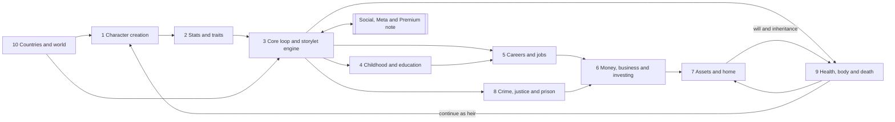
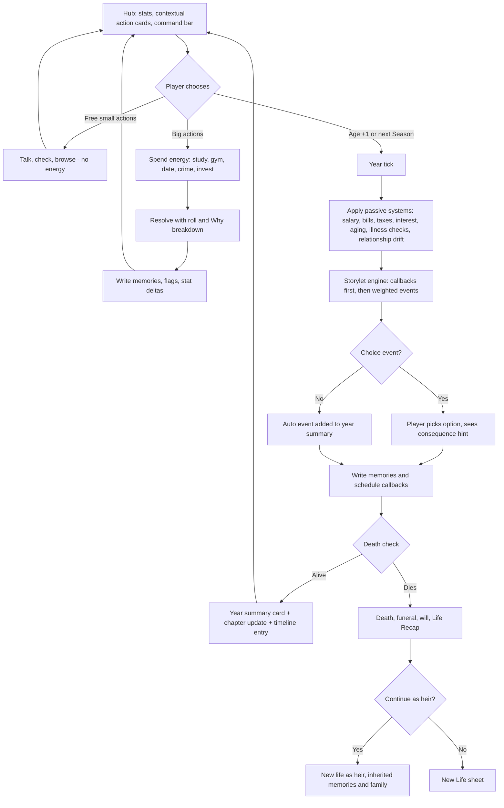
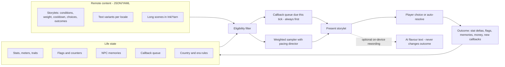

# 04 App Breakdown: Core Life Systems

> [!abstract] What this note is
> A module-by-module breakdown of every **core life system** in EverLife (working title): the systems that simulate one person from birth to death. For each module it gives the purpose, what BitLife does today, how EverLife redesigns it, what is new, a detailed sub-feature list, the rules, formulas and data behind it, where it lives in the UI, its priority and free/Plus status, its dependencies, and acceptance criteria.
>
> **Companion note:** relationships, romance, children, fame and social media, pets, Activities hub, achievements, challenges, editor tools, rewind, Life Recap and async social are covered in [[04 App Breakdown - Social, Meta and Premium]].
> **Source of truth:** [[_Concept Brief]]. Where this note proposes something the brief does not decide, it is marked **Proposal**.

> [!warning] Evidence and number caveats
> - "BitLife equivalent" descriptions come from the research report and notes (`reports/BitLife complete feature guide.md`, `research_notes/BitLife complete feature guide/`), which were built from **search-result snippets of fan guides**, not from the live 2026 build. Treat them as "last documented" behaviour.
> - Every number in EverLife's rules (stat ranges, odds, formulas, prices in game currency) is a **starting design value for tuning** in the Phase 2 prototype and the life-simulator bot (see [[08 Technical Architecture]]). None of them is final balance.
> - **IP-clean:** all event text, clique names, trait names, mini-game designs and example storylets in this note are original. No BitLife text, ribbon names, faction names or UI copy is reused. BitLife features are described only so the client can see parity.

---

## How to read this note

### Priority legend
| Tag | Meaning | Phase (from [[_Concept Brief]]) |
|---|---|---|
| **Proto** | Must exist in the Phase 2 vertical slice (birth → age 30, ~150 events) | Phase 2 |
| **MVP** | Must exist at soft launch (full life cycle, core careers, 1,500+ events) | Phase 3 |
| **Launch** | Must exist at global launch (full parity + "better" features, 5 languages) | Phase 4 |
| **LiveOps** | Ships after launch via remote content, seasons or Story Packs | Phase 5 |

Proto items are always also MVP.

### Free vs Plus legend
| Tag | Meaning |
|---|---|
| **Free** | In the base game for everyone. All careers and all core systems are Free (pillar 3, "Fair forever"). |
| **Plus** | Part of the one-time **EverLife Plus** unlock (~$9.99): no ads, unlimited generations, editor tools, rewind. Plus never unlocks a career, a country or a core system. |
| **Pack** | Optional **Story Pack** (~$2.99–3.99) or **Season Pass** content: extra storylines and cosmetics on top of a system that is already complete for free. A pack never locks a career or a mechanic. |
| **Ad** | An optional, frequency-capped rewarded ad gives a small convenience. Never mid-action, never forced. See [[06 Monetization and Economy]]. |

> [!important] Global rules that apply to every module
> 1. **No silent failure.** Any locked action stays visible with a reason and a path ("Needs: Driver's licence · Age 16+ · $120"). This is pillar 2.
> 2. **Every outcome explains itself.** Rolls with real stakes (admissions, heists, trials, surgery, promotions) show a short "Why it went this way" breakdown of the 2–4 biggest factors. No hidden "too early" messages.
> 3. **Memory over randomness.** Major choices write memories and flags that later storylets read (see Module 3).
> 4. **Accessible by default.** Every mini-game has a fully equivalent text/decision mode and a "Resolve automatically" option, both with no penalty. Every stat change is announced to screen readers. See [[05 UX and Screen Map]].
> 5. **Data-driven.** Countries, careers, crimes, illnesses, schools and storylets are remote content (JSON/YAML), validated and tested by the simulator bot before release, so content can ship without app updates ([[08 Technical Architecture]]).
> 6. **Mature content is gated and toggleable.** Crime detail, drugs, romance and gambling follow the content settings and the age signal in [[09 Compliance and Ratings]] (target Apple 16+ / Google Mature 17+).

### System map


---

## Module 1: Character creation

### Purpose
Get the player into a life in under 15 seconds (random) or let them craft a very specific starting point (custom) without menus that hide options. Creation also sets the **seed**, which makes lives reproducible and shareable (pillar 4).

### BitLife equivalent (today)
- "New Life" rolls a random person, or opens a custom builder ("Custom People") for name, gender, country and city, with saved custom characters. Version 1.18 added a Scenario Creator, but no source documents how scenario starts work today.
- A random chance of same-sex parents (since v1.38).
- Paid God Mode edits appearance and stats, including hidden ones, mostly at creation. Appearance edits are limited to certain ages.
- Era/historical starts, trait picking and shareable seeds are not documented.

### EverLife redesign
- **One screen, three doors:** a single "New Life" sheet with three large buttons in the thumb zone: **Surprise me** (fully random, one tap), **Build a life** (custom), **Play a seed** (enter or scan a code, or pick today's Daily Seed).
- **Progressive custom builder:** a short vertical stepper (Identity → Place and time → Family → Traits → Review). Every step has a dice button that re-rolls just that step, so a player can customise one thing and randomise the rest.
- **Live preview card:** the baby avatar, family summary and a one-line "life forecast" ("Born in Porto, 1987, to a nurse and a taxi driver. Modest means, close family.") update as choices change.
- **Seeds are first-class.** Every life, random or custom, has a human-readable seed code shown on the Review step, the death screen and Life Recap cards.

### New features (vs BitLife)
- **Era mode** start year (see Module 10).
- **Traits** picked or rolled at birth (see Module 2).
- **Family setup presets:** wealthy, modest, struggling, single parent, two mums, two dads, grandparents raising you, foster care, adopted at birth, twins and triplets.
- **Scenario seeds:** curated starts (for example "Third child of a failing restaurant family"), the Daily Seed, weekly-challenge seeds, and player-shared seeds.
- **Cast library:** save custom people (yourself, friends, invented characters) and place them as parents, siblings or future NPCs in any life. Free, up to a cap (Proposal: 20 free, unlimited with Plus).
- **Accessible avatar builder:** every appearance choice has a text label and spoken description, and "Describe my avatar" reads the full look.

### Detailed sub-features
| Area | Sub-features |
|---|---|
| Identity | First and last name (with locale-aware random name generator per country and era), gender (female, male, non-binary, with pronoun picker: she, he, they, or custom), birthday (random or chosen), name pronunciation hint for screen readers |
| Appearance | Skin tone (full range), face shape, eyes, hair colour/texture/style, freckles, birthmarks, glasses, a visible disability option (for example wheelchair user, hearing aid, limb difference) shown respectfully, with no negative stat effect unless the player opts into a challenge storyline |
| Place | Country (from the full country list, Module 10), city or region (3–12 per country), urban/suburban/rural toggle, which affects school options, crime rates, job pool |
| Time | Start year: Modern (default, current year) or Era mode (1900–2040 in decade steps; see Module 10). Era locks unavailable tech, jobs and laws |
| Family | Parent generation (random NPCs, Cast library people, or "none: born into foster care"), parents' jobs and wealth band, relationship status of parents (together, married, separated, never together), number and ages of siblings, twins/triplets toggle, adoption at birth, family religion (or none), family values (strict, relaxed, chaotic) |
| Traits | 2 starting traits + 1 flaw (picked or rolled), optional "Hidden trait" roll revealed later in life |
| Talents | Optional starting talent hint (music, sport, art, maths, languages): this raises the cap of one hidden stat; it is not a guaranteed skill |
| Seed | Seed code (for example `EL-7KQ2-M9XR`), generated or entered; Daily Seed; challenge seed; QR scan |
| Rules | Difficulty presets: Gentle (fewer harsh random events), Standard, Harsh (more misfortune, tighter money); Ironman toggle (no rewind for this life; earns an Ironman badge); content filters for this life (inherits global settings) |
| Review | Summary card, life forecast line, edit links per step, "Start life" button |

### Key rules, formulas and data
- **Seed format:** `EL-` + 8 base-32 characters. It encodes the RNG seed, content-version id, country, city, start year, family preset, traits and difficulty. If a seed references content that no longer exists, the game says what changed and offers the closest match. It never silently changes the life.
- **Determinism:** the same seed with the same player choices gives the same events. RNG draws are split into streams (events, NPC generation, economy, health) so that one extra action in one system does not reshuffle everything else. See [[08 Technical Architecture]].
- **Random-life distribution (Standard):** wealth band low 30% / modest 45% / comfortable 18% / wealthy 6% / very wealthy 1%. Royal birth happens only in monarchies and at about 0.2% there. Same-sex parents and single parents follow per-country, per-era tables (data, not hard-coded).
- **Starting stat roll:** visible stats are drawn from `clamp(normal(mean=55, sd=18), 5, 95)`, then adjusted by parents' genetics (Looks and Athleticism get 40% of the parents' average, Smarts 30%) and by traits. Health starts at `max(60, roll)` unless a congenital-condition storyline is rolled (about 2%, and never on Gentle).
- **Hidden caps:** each hidden stat gets a cap (potential) of 40–100. A talent hint raises one cap by +15 (to a maximum of 100).

**Example scenario seeds (original):**
| Seed name | Setup | Hook |
|---|---|---|
| The Lighthouse Kid | Rural coastal town, 1962, single father keeps a lighthouse | Automation will close the lighthouse when you are 12 |
| Second Generation | Born in Toronto to parents who emigrated the year before | Parents' visas, two languages at home, a grandparent who wants you to "come home" |
| The Understudy | Parents run a struggling theatre in Manchester | Inherit the theatre or let it close |
| Lottery Baby | Parents won a mid-sized lottery prize the week you were born | Will the money last until you are 18? |
| Heir Apparent | Born third in line in a fictional constitutional monarchy | Respect, scandal, and two older siblings |
| Clean Slate | Age 18, no family contact, $400, a bus ticket | A homelessness-to-stability arc (handled sensitively) |

### UI entry point
Main menu → **New Life** sheet (three doors). Also from the death screen ("New life" or "Continue as heir"), from a challenge card ("Play this challenge seed"), and from a shared link or QR. See [[05 UX and Screen Map]].

### Priority and access
| Feature | Priority | Access |
|---|---|---|
| Random life, basic custom (name, gender, country, city) | Proto | Free |
| Family setup presets, twins/triplets, traits | MVP | Free |
| Seeds (code, share, enter), Daily Seed | MVP | Free |
| Era mode start year | Launch | Free |
| Cast library (20 slots) | MVP | Free; unlimited slots with Plus |
| Editing hidden stats and caps at creation | Launch | Plus (editor tools) |
| Curated scenario packs | LiveOps | Free rotation + Pack |

### Dependencies
Module 2 (stats, traits), Module 10 (country/era data), the RNG/seed service and content versioning ([[08 Technical Architecture]]), the avatar system (Module 9 aging), and the editor tools and Cast library in [[04 App Breakdown - Social, Meta and Premium]].

### Acceptance criteria
- A player can start a random life in **2 taps or fewer** from the main menu, and a fully custom life in under 90 seconds.
- Replaying the same seed and the same choices reproduces the same life events (verified by the simulator bot across 1,000 seeds).
- Every creation control is reachable and labelled with VoiceOver/TalkBack, and "Describe my avatar" reads the full appearance.
- Picking a country and era only offers options valid for that place and time (for example no smartphone-era careers in 1955), and explains anything greyed out.
- A shared seed opens the same start on another device and platform, or explains clearly why it cannot.

---

## Module 2: Stats and traits

### Purpose
Give the player a readable picture of who their character is, while keeping hidden depth that makes lives surprising. Stats are the inputs to almost every roll in the game, so they must be legible, explainable and moddable through content.

### BitLife equivalent (today)
- Four visible bars, 0–100: **Happiness, Health, Smarts, Looks**.
- Hidden attributes visible only through the paid God Mode: **Karma, Willpower, Discipline, Fertility, Athleticism, Craziness**, plus newer ones such as a wiliness stat tied to drug-test detection (2026). Context meters appear inside systems: Fame, Respect (royalty), Street Cred (fighting), Grades and Popularity (school), Stress (jobs).
- Relationship bars without numbers. Players ask for percentages.
- No trait system is documented.

### EverLife redesign
- **Four visible core stats** stay, as large, colour-blind-safe bars **with numbers** (for example "Health 72"), and a trend arrow showing the last year's change.
- **Hidden stats are discoverable, not paywalled.** They start hidden, but the player learns them through play: a school report hints at Discipline, a coach says "you have real speed" (Athleticism), a fortune-teller event hints at Karma. Once discovered, a hidden stat appears on the **Character sheet** as a band ("High", "Average", "Low"). Exact numbers are shown with Plus editor tools, or free after the life ends (on the Life Recap).
- **Context meters** (Grades, Popularity, Fame, Respect, Notoriety, Stress, Fitness, Credit) appear on the hub only when relevant, so the screen stays clean.
- **Relationship %** shown everywhere with a band label (see table below), per the player wishlist.
- **Traits** replace invisible tendencies. They are named, explained, and change over a life.
- **Customisable HUD:** the player can pin up to 2 extra stats or meters next to the core four (a player request).

### New features (vs BitLife)
- Charisma, Creativity, Luck, Cunning, Stress, Resilience as hidden stats.
- Trait system: starting traits, acquired traits, legacy (inherited) traits, trait conflicts.
- "Why did this change?" tap on any stat shows the last 5 changes with causes.
- Discoverable hidden stats (no paywall to know your own character).
- Relationship percentages with bands, trends and memory reasons ("−8: you missed her wedding").

### Detailed sub-features
**Visible core stats (0–100)**
| Stat | What it drives | Main raisers | Main drainers |
|---|---|---|---|
| Happiness | Event tone, motivation, mental-health risk, relationship decay | Close relationships, hobbies, vacations, achievements, pets | Loneliness, debt, prison, illness, bereavement, Stress |
| Health | Lifespan, illness resistance, recovery, sports/military eligibility | Gym, diet, doctors, sleep, quitting addictions | Age, addictions, injuries, Stress, poverty |
| Smarts | Grades, admissions, white-collar performance, some crime planning | Study, library, reading, puzzles, school | Dropping out, some addictions, head injuries |
| Looks | First impressions, dating, modelling/acting, some interviews | Grooming, gym, fashion, surgery | Age, Stress, addictions, injuries |

**Hidden stats**
| Stat | Range | Discovered by | Drives |
|---|---|---|---|
| Karma | −100 to +100 | Fortune-teller, near-death, religious events | Luck of random events (small), afterlife flavour, certain storylet weights. Never a large mortality effect (Proposal: ±5% at most) |
| Willpower | 0–100 | Resisting a temptation event | Resisting addiction, cheating, impulse spending; rehab success |
| Discipline | 0–100 | School report, boss review | Grades and job performance growth, training gains, prison behaviour |
| Fertility | 0–100 | Doctor check-up from 18 | Conception odds (see [[04 App Breakdown - Social, Meta and Premium]]) |
| Craziness (shown to players as **Impulsivity**) | 0–100 | Wild-choice events | Unlocks wild options, raises chaos-event weights. Renamed in the UI so it is never confused with mental illness |
| Athleticism | 0–100 (cap from genetics) | Coach or PE events | Sports teams, athlete career, military, fighting, escape odds |
| Charisma | 0–100 | Debate, audition, first date | Persuasion choices, politics, sales, interviews, lawsuits, trials |
| Creativity | 0–100 | Art class, writing contest | Art, music, writing, acting, director, chef, business products |
| Cunning | 0–100 | Getting away with a lie | Crime success, detection evasion, negotiation, spy work |
| Luck | 0–100 (rerolled each decade ±10) | Winning a small raffle | Small modifier on every random roll (±3% at most) |
| Resilience | 0–100 | Recovering from a setback | How fast Happiness recovers after shocks; mental-health protection |
| Musicality | 0–100 | Music lesson | Musician career, band storylets |

**Context meters (shown only when relevant)**
| Meter | Range | Appears when |
|---|---|---|
| Grades | 0–100 (shown as letter grade) | In school or university |
| Popularity | 0–100 | In school |
| Stress | 0–100 | Has a job, school exams, legal trouble, caregiving |
| Fitness | 0–100 | After first gym/sport activity |
| Fame | 0–100 | After first public exposure (see social note) |
| Respect | 0–100 | Royalty, politics, prison, crime organisations |
| Notoriety | 0–100 | After first crime known to police or press |
| Credit score | 300–850 in countries with credit bureaus, a 5-band label elsewhere | From age 18 |
| Faith | 0–100 | If affiliated with a religion (Module 10) |

**Relationship % (all NPCs)**
| Band | % | Typical behaviour |
|---|---|---|
| Estranged | 0–19 | Refuses contact, may sabotage, may sue (Module 8 retaliation) |
| Cold | 20–39 | Short answers, rarely helps, may argue |
| Okay | 40–59 | Neutral, helps for a price |
| Close | 60–79 | Helps, gives gifts, invites you |
| Devoted | 80–100 | Defends you, lends money, cares for you when ill, testifies for you |

**Trait system**
- **Slots:** 2 starting traits + 1 flaw at birth, up to **6 traits** total by adulthood. Traits can be **acquired** (earned through repeated behaviour), **lost** (by acting against them for years), or **inherited** (legacy traits, 25% chance per trait to pass to each child, or 50% with a "Family tradition" dynasty goal).
- **Conflicts:** opposite traits cannot coexist (for example Frugal vs Big Spender). Acquiring one removes the other, with a message explaining why.

| Trait (original) | Type | Effect (starting values) |
|---|---|---|
| Sunny Disposition | Positive | Happiness drifts toward 65 instead of 50; +10% recovery after bad events |
| Bookworm | Positive | +20% gains from studying; unlocks library-only storylets |
| Silver Tongue | Positive | +8 effective Charisma in persuasion rolls |
| Natural Athlete | Positive | Athleticism cap +10; +15% training gains |
| Green Thumb | Positive | Gardening hobby income; garden storylets; +2 Happiness/year with a garden |
| Animal Whisperer | Positive | Pets bond 2× faster; better zookeeper/vet outcomes |
| Steady Hands | Positive | +10% surgery, pilot, craft and heist-tool outcomes |
| Night Owl | Neutral | +Creativity at night activities, −5% grades in early-start schools |
| Homebody | Neutral | Bonus Happiness from home activities, penalty for long travel |
| Thrill-Seeker | Neutral | Unlocks risky options; +Happiness from extreme sports; higher accident risk |
| Old Soul | Neutral | Gets on with elders; slower trend adoption on social media |
| Hot-Headed | Flaw | Arguments escalate 30% more often; +10% violent-crime temptations |
| Big Spender | Flaw | Impulse-purchase events; −Savings rate |
| Frugal | Positive | +10% savings, haggling bonus; partners may call you stingy |
| Gossip | Flaw | Learns secrets more easily, but relationships take −5 when found out |
| Clumsy | Flaw | +Minor-injury events; comic storylets |
| Workaholic | Acquired | +15% job performance, +Stress, −relationship decay protection |
| Couch Potato | Acquired | Fitness decays faster; comfort bonuses from home |
| Survivor | Acquired (after a near-death event) | +Resilience; unique memoir storylets |
| Jaded | Acquired (after repeated betrayals) | −Happiness from romance; harder to scam |
| Pillar of the Community | Acquired (charity, volunteering) | +Karma, +political support, +jury sympathy |
| Born Leader | Legacy | +Respect gains, better at running a business, politics |
| Family Black Sheep | Legacy | Family events skew dramatic; inheritance disputes |

### Key rules, formulas and data
- **Clamping:** all stats clamp to their range. A change shown to the player is the clamped amount.
- **Drift:** each year, Happiness moves 15% of the way back toward its baseline (50 by default, adjusted by traits). This stops a single event from defining a whole decade.
- **Age curves for Health and Looks (Standard difficulty):**
  - Health: `ΔHealth/year = lifestyle − ageDecay`, with `ageDecay = 0` before 30, `0.4` for 30–49, `0.9` for 50–64, `1.6` for 65–79 and `2.5` for 80+. Lifestyle comes from activities, diet, addictions and Stress (`−Stress/25`).
  - Looks: rises through puberty (+0–6/year from 11–18), stable 18–35, then `−0.3 to −1.0/year` after 35, slowed by grooming and fitness.
- **Smarts growth:** `ΔSmarts/year = schoolBase(2–4) × (0.6 + Discipline/250) + studyActions − neglect`, capped by the hidden Smarts potential.
- **Stress:** `Stress_{t+1} = 0.7 × Stress_t + workLoad + debtPressure + legalPressure + caregiving − (rest, hobbies, therapy, vacation)`. Stress above 70 gives −2 Health and −3 Happiness per year and raises burnout events.
- **Relationship drift:** with no interaction for a year, a relationship moves 4 points toward 50. Memories can pin it (a severe betrayal sets a floor or ceiling until resolved).
- **Roll formula used across systems:** `successChance = clamp(base + Σ(weight_i × (stat_i − 50)/50) + traitMods + itemMods + luckMod, 2%, 98%)`. There is never a guaranteed 0% or 100% unless the content says so explicitly. The top 2–4 contributions are shown as the "Why" breakdown.

### UI entry point
Hub top strip: the four core stats (tap to open **Character sheet**). Character sheet tabs: Stats · Traits · Meters · History ("Why did this change?"). The relationship % is shown on every NPC card ([[05 UX and Screen Map]]).

### Priority and access
| Feature | Priority | Access |
|---|---|---|
| Four visible stats with numbers and trends | Proto | Free |
| Core hidden stats (Karma, Willpower, Discipline, Fertility, Impulsivity, Athleticism) | Proto | Free (discoverable) |
| Charisma, Creativity, Cunning, Luck, Resilience, Musicality | MVP | Free |
| Relationship % with bands | Proto | Free |
| Traits (starting + flaws) | MVP | Free |
| Acquired and legacy traits | Launch | Free |
| Exact hidden values during a life; editing stats/traits | Launch | Plus (editor tools) |
| Pinned HUD stats | MVP | Free |

### Dependencies
Module 3 (stat changes are applied by storylet outcomes), all other modules (they read stats), the generations system in the social note (legacy traits), accessibility announcements ([[05 UX and Screen Map]]).

### Acceptance criteria
- Every visible stat and relationship shows a numeric value and a text band, both read correctly by screen readers.
- Tapping any stat shows at least the last 5 changes and their causes.
- A free player can discover every hidden stat in normal play. No hidden stat is visible only by paying.
- The simulator bot shows that no single stat dominates outcomes: across 10,000 lives, median lifespan, net worth and career spread stay inside the target bands set in [[08 Technical Architecture]].
- Trait conflicts are never present at the same time, and each trait's effect is explained in plain language in the Traits tab.

---

## Module 3: Core loop, life stages and the storylet engine

### Purpose
This is the heart of the game: the "Age +1" rhythm players love, rebuilt around **memory and consequence** (pillar 1). It decides which events happen, remembers what the player did, and brings those choices back years later.

### BitLife equivalent (today)
- One tap on **Age** advances a full year and may show random event pop-ups with choices. Activities can be used an unlimited number of times per year.
- Events are mostly self-contained. Players criticise the game for "passive decision-making" and repetition after many lives.
- No documented NPC memory, life chapters or life timeline. A "Lazy" ribbon punishes spamming Age.

### EverLife redesign
- **Age +1 stays one tap**, the biggest button in the thumb zone, so the classic rhythm is untouched.
- **Year summary card:** after Age +1, a compact card lists what happened (events, stat changes, money in and out, relationship changes) instead of a stack of pop-ups. Choice events still stop and ask.
- **Optional finer time steps (Proposal):** in certain chapters the player can switch to **Seasons** (4 steps per year) for more control: university semesters, a political campaign, prison, a pregnancy, a business launch year, a sports season. Seasons are always optional, never required.
- **Action budget per year:** to reduce spam and make choices matter, each year has **Energy** (default 10 points). Big actions cost energy (for example gym 1, studying hard 2, a vacation 3, a heist 6). Small actions (talk, compliment, check the bank) are free. Energy is shown, explained and cannot be bought. (Proposal; tune in Phase 2. A "Classic" setting removes the budget for players who want unlimited actions.)
- **Storylet engine** replaces flat random pop-ups: each event is a storylet with conditions, weights, cooldowns and follow-ups, and it reads and writes NPC memories and flags.
- **Life chapters** group years into named chapters, give each one goals, and feed the Life Timeline and Life Recap.

### New features (vs BitLife)
- Storylet engine with scheduled consequences ("callbacks") 1–40 years later.
- NPC memory (each NPC remembers specific things you did).
- Life chapters with chapter goals and chapter titles.
- **Life Timeline:** a scrollable history of every year, filterable (Love, Money, Career, Crime, Family), with "jump to" for rewind (Plus) and shareable moments.
- **Optional AI flavour text:** on-device rewording of event text for variety. It only rewords; it never changes outcomes, odds or choices, can be switched off, and is moderated with a report button ([[_Concept Brief]], [[08 Technical Architecture]]).
- Pacing director that balances calm years and dramatic years.

### Life stages and chapters
| Stage | Ages | Default chapter title template | Unlocks (examples) |
|---|---|---|---|
| Infancy | 0–4 | "Early Days" | Parent-driven events, first words, temperament hints |
| Childhood | 5–11 | "School Days" | Primary school, hobbies and lessons, friendships, pets with parents' permission |
| Teen | 12–17 | "Growing Up" | Secondary school, cliques, Mind & Body (12+), freelance (13+), part-time job (14/16+ by country), dating (14+, non-explicit), driving (country age) |
| Young adult | 18–29 | "Finding My Way" | University, full careers, renting, loans, crime with full penalties, fertility options, emigration |
| Adult | 30–49 | "Building a Life" | Mortgages, senior roles, children growing up, midlife events |
| Midlife | 50–64 | "The Long Middle" | Caregiving for parents, career peak, health checks, grandchildren |
| Elder | 65+ | "Later Years" | Retirement, pension, wills, memoir, legacy goals |

- **Dynamic chapter titles:** when a strong theme dominates a span of years, the chapter is renamed from a title template ("The Prison Years", "The Startup Years", "Life in Lisbon"). These feed Life Recap ([[04 App Breakdown - Social, Meta and Premium]]).
- **Chapter goals:** each chapter offers 3 optional goals generated from the character's situation (for example "Get into a university of your choice", "Pay off your student loan", "Reconcile with your brother"). Completing them gives small Happiness boosts and counts toward dynasty goals. Goals are suggestions, never required.

### Core loop


### The storylet engine
A **storylet** is a small, self-contained piece of content: a condition set, a weight, text, choices and outcomes. The engine picks storylets each year (or season) from everything eligible. Long, hand-written scenes (a wedding, a trial, a coronation) can use Ink/Yarn scripts embedded in a storylet ([[_Concept Brief]]).



**Storylet schema (simplified, original example):**
```yaml
id: teen.borrowed_bike
chapter: [teen]
conditions:
  age: [12, 16]
  has_npc: { role: neighbour_kid, relationship_min: 30 }
  not_flag: borrowed_bike_done
weight: 8            # base weight
weight_mods:
  - { if: "trait:Thrill-Seeker", x: 1.5 }
cooldown_years: 99   # once per life via flag
text: storylets.teen.borrowed_bike.intro   # localised key
choices:
  - id: return_it
    label: storylets.teen.borrowed_bike.return
    outcome:
      stats: { karma: +3 }
      memory: { npc: neighbour_kid, tag: kept_promise, valence: +2, intensity: 2 }
  - id: keep_it
    label: storylets.teen.borrowed_bike.keep
    requires: { stat: cunning, min: 20 }      # shown greyed with reason if unmet
    outcome:
      stats: { happiness: +4, karma: -6 }
      flags: [stole_bike]
      memory: { npc: neighbour_kid, tag: stole_from_me, valence: -4, intensity: 4 }
      callback: { id: adult.bike_reunion, delay_years: [15, 25], chance: 0.6 }
set_flags: [borrowed_bike_done]
```
*Text (original, English):* "Your neighbour lends you his new bike for the afternoon. It is faster than anything you have ever ridden. At sunset, he still has not asked for it back."
*Callback (original):* 20 years later, at a job interview, the hiring manager looks familiar: "You still owe me a bike." The interview odds depend on the memory.

**Engine rules**
| Rule | Value (starting) |
|---|---|
| Events per year | Pacing director targets **1–3** storylets per Age +1 (0–1 per Season step), plus any callbacks due |
| Callback priority | Due callbacks always fire first (at most 2 per tick; extras roll over to the next tick) |
| Weighted sampling | `effectiveWeight = baseWeight × Π(weight_mods) × freshness × chapterFit × pacing` |
| Freshness | Storylets seen in the player's last 5 lives get ×0.4; last 20 lives ×0.7 (stops repetition across lives) |
| Cooldowns | Per storylet (years) and per category (for example at most one "accident" storylet in any 3 years) |
| Pacing director | Tracks a "drama meter". After 2 high-drama years it boosts calm, character-building storylets; after 3 quiet years it boosts hooks and opportunities |
| Choice transparency | Each choice shows a hint icon for its main risk or stat ("risky", "costs money", "hurts a relationship"). Exact odds appear in the Why breakdown afterwards; Plus can show odds before choosing (Proposal) |
| Locked choices | Shown greyed with the unmet requirement in plain language, never hidden (unless the content marks them as "secret", for example a surprise option) |
| Validation | Every storylet passes schema, reachability, localisation and content-rating checks, and the simulator bot plays 10,000 lives per content release ([[08 Technical Architecture]]) |

**NPC memory**
- Each NPC stores up to **24 memories** (oldest low-intensity ones are pruned first). Memory record: `{npcId, tag, valence (−5..+5), intensity (1..5), year, decayRate, resolved}`.
- `opinion = baseAffinity + Σ(valence × intensity × decay(age_of_memory))`, where `decay = 0.5^(years / halfLife)`, with halfLife 4 years for intensity 1–2, 12 years for 3–4 and "never" for 5 (life-defining events: saving a life, betrayal at a wedding, a crime against them).
- Relationship % (Module 2) is derived from opinion plus recent interaction.
- **Memory surfacing:** NPC cards show the top 3 memories as plain sentences ("Remembers you lied to her about the car, 2009"). Storylets can quote memories in text.
- **Shared memories:** family members can learn of memories by gossip (chance based on closeness), so a betrayal can spread.
- **Resolution:** apologies, amends, therapy and gifts can mark a memory "resolved" (its weight halves) if the NPC accepts. Acceptance depends on intensity and traits.

**Consequences and the Life Timeline**
- Every year writes one timeline entry: age, year, chapter, main events, key choices, money delta, and an auto-generated one-line headline (template-based, optionally reworded by AI).
- Life-defining moments are starred automatically (first job, marriage, prison, child born, death of a parent) and can be starred by the player. Starred moments feed Life Recap cards.
- **Rewind (Plus):** jump to any past year from the timeline. Free players get a limited rewind (Proposal: 1 per life, see [[06 Monetization and Economy]]). No pay-per-use rewind exists. Ironman lives disable rewind.

### Example events (original)
| Age | Event | Choices | Consequence |
|---|---|---|---|
| 4 | Your grandmother teaches you a card game and lets you win | Gloat / Ask to play again | Memory with grandmother; unlocks "card sharp" storylets at 30 if you kept playing |
| 9 | A classmate's lunch keeps disappearing; you saw who did it | Tell the teacher / Confront them / Stay quiet | Teacher trust +, bully grudge, or guilt flag that a callback can reopen at a reunion |
| 15 | Your older sister asks you to cover for her missing curfew | Cover / Tell parents | Sibling loyalty memory (intensity 3); parents' trust |
| 23 | A flatmate leaves without paying the last two months of rent | Pay it / Chase them / Take them to small-claims court | Money, or a lawsuit storylet (Module 8) |
| 41 | An old school friend asks to invest in your business | Accept / Decline | Business cash; their opinion depends on how the business goes |
| 58 | Your father, now frail, asks to move in with you | Yes / Find a care home / Ask a sibling | Caregiving Stress, sibling memories, inheritance attitudes |
| 76 | A journalist wants to interview you about the event you witnessed at 9 | Tell the truth / Decline | Callback payoff from the childhood flag |

### UI entry point
Hub (centre) with the **Age +1** button in the thumb zone; year summary card; the **Timeline** tab; the command bar ("What do you want to do?") for any action ([[05 UX and Screen Map]]).

### Priority and access
| Feature | Priority | Access |
|---|---|---|
| Age +1, year summary, storylet engine with conditions, weights, cooldowns | Proto | Free |
| NPC memory (basic: tags, valence, decay) | Proto | Free |
| Callbacks (delayed consequences) | Proto | Free |
| Life chapters and chapter goals | MVP | Free |
| Life Timeline (view, filter, star) | MVP | Free |
| Pacing director, cross-life freshness | MVP | Free |
| Seasons (finer time steps) | Launch | Free |
| Energy budget with Classic toggle | Proto (to test) | Free |
| Rewind from timeline | MVP | Plus (unlimited); free limited rewind per [[06 Monetization and Economy]] |
| Optional AI flavour text | Launch | Free, opt-in |
| Ink/Yarn long scenes | MVP (a few), Launch (more) | Free; Story Packs add more |

### Dependencies
Content pipeline, validator and simulator bot ([[08 Technical Architecture]]); save system and cloud saves; Module 2 (stats); Module 10 (country and era conditions); localisation; Life Recap and generations in [[04 App Breakdown - Social, Meta and Premium]]; content rating tags ([[09 Compliance and Ratings]]).

### Acceptance criteria
- Age +1 resolves and shows the year summary in **under 300 ms** on a mid-range 2022 Android phone, with no more than one modal for non-choice events.
- In simulator runs, at least **30% of lives see 3 or more callbacks** that reference choices made at least 10 years earlier.
- No storylet repeats within a life unless flagged repeatable, and cross-life repetition drops as designed (measured: under 20% of storylets in a life were seen in the previous 3 lives, once the library has 1,500+ storylets).
- Each NPC card shows its top memories in plain sentences, and those memories measurably change that NPC's behaviour in later events.
- The Life Timeline lists every year and every key choice, and works fully with screen readers (headings per chapter, rotor/landmark navigation).

---
