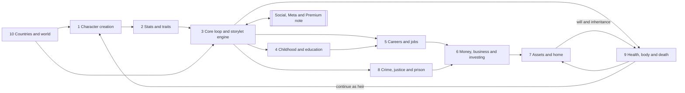
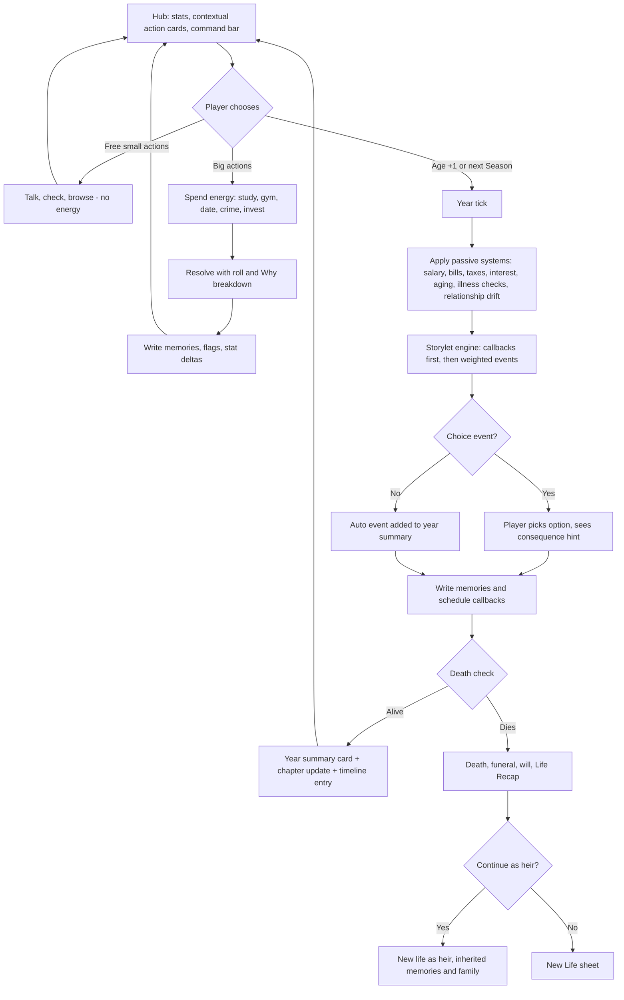
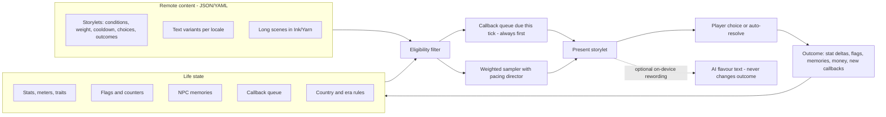
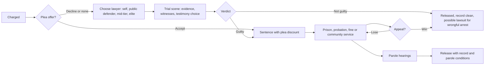

# 04 App Breakdown: Core Life Systems

> [!abstract] What this note is
> A module-by-module breakdown of every **core life system** in EverLife (working title): the systems that simulate one person from birth to death. For each module it gives the purpose, what BitLife does today, how EverLife redesigns it, what is new, a detailed sub-feature list, the rules, formulas and data behind it, where it lives in the UI, its priority and free/Plus status, its dependencies, and acceptance criteria.
>
> **Companion note:** relationships, romance, children, fame and social media, pets, Activities hub, achievements, challenges, Destiny Mode (editor), Rewind, Life Recap and async social are covered in [[04 App Breakdown - Social, Meta and Premium]].
> **Source of truth:** [[_Concept Brief]]. Where this note proposes something the brief does not decide, it is marked **Proposal**.

> [!warning] Evidence and number caveats
> - "BitLife equivalent" descriptions come from the research report and notes (`reports/BitLife complete feature guide.md`, `research_notes/BitLife complete feature guide/`), which were built from **search-result snippets of fan guides**, not from the live 2026 build. Treat them as "last documented" behaviour.
> - Every number in EverLife's rules (stat ranges, odds, formulas, prices in game currency) is a **starting design value for tuning** in the Phase 2 prototype and the life-simulator bot (see [[08 Technical Architecture]]). None of them is final balance.
> - **IP-clean:** all event text, clique names, trait names, mini-game designs and example storylets in this note are original. No BitLife text, ribbon names, faction names or UI copy is reused. BitLife features are described only so the client can see parity.

---

## How to read this note

### Priority legend
| Tag | Meaning | Phase (from [[_Concept Brief]]) |
|---|---|---|
| **Proto** | Must exist in the Phase 2 vertical slice (birth → age 30, ~150 events) | Phase 2 |
| **MVP** | Must exist at soft launch (full life cycle, core careers, 1,500+ events) | Phase 3 |
| **Launch** | Must exist at global launch (full parity + "better" features, 5 languages) | Phase 4 |
| **LiveOps** | Ships after launch via remote content, seasons or Story Packs | Phase 5 |

Proto items are always also MVP.

### Free vs Plus legend
| Tag | Meaning |
|---|---|
| **Free** | In the base game for everyone. All careers and all core systems are Free (pillar 3, "Fair forever"). |
| **Plus** | Part of the one-time **EverLife Plus** unlock (~$9.99): no ads, unlimited generations, Destiny Mode (editor), unlimited Rewind. Plus never unlocks a career, a country or a core system. |
| **Pack** | Optional **Story Pack** (~$2.99–3.99) or **Season Pass** content: extra storylines and cosmetics on top of a system that is already complete for free. A pack never locks a career or a mechanic. |
| **Ad** | An optional, frequency-capped rewarded ad gives a small convenience. Never mid-action, never forced. See [[06 Monetization and Economy]]. |

> [!important] Global rules that apply to every module
> 1. **No silent failure.** Any locked action stays visible with a reason and a path ("Needs: Driver's licence · Age 16+ · $120"). This is pillar 2.
> 2. **Every outcome explains itself.** Rolls with real stakes (admissions, heists, trials, surgery, promotions) show a short "Why it went this way" breakdown of the 2–4 biggest factors. No hidden "too early" messages.
> 3. **Memory over randomness.** Major choices write memories and flags that later storylets read (see Module 3).
> 4. **Accessible by default.** Every mini-game has a fully equivalent text/decision mode and a "Resolve automatically" option, both with no penalty. Every stat change is announced to screen readers. See [[05 UX and Screen Map]].
> 5. **Data-driven.** Countries, careers, crimes, illnesses, schools and storylets are remote content (JSON/YAML), validated and tested by the simulator bot before release, so content can ship without app updates ([[08 Technical Architecture]]).
> 6. **Mature content is gated and toggleable.** Crime detail, drugs, romance and gambling follow the content settings and the age signal in [[09 Compliance and Ratings]] (target Apple 16+ / Google Mature 17+).

### System map


---

## Module 1: Character creation

### Purpose
Get the player into a life in under 15 seconds (random) or let them craft a very specific starting point (custom) without menus that hide options. Creation also sets the **seed**, which makes lives reproducible and shareable (pillar 4).

### BitLife equivalent (today)
- "New Life" rolls a random person, or opens a custom builder ("Custom People") for name, gender, country and city, with saved custom characters. Version 1.18 added a Scenario Creator, but no source documents how scenario starts work today.
- A random chance of same-sex parents (since v1.38).
- Paid God Mode edits appearance and stats, including hidden ones, mostly at creation. Appearance edits are limited to certain ages.
- Era/historical starts, trait picking and shareable seeds are not documented.

### EverLife redesign
- **One screen, three doors:** a single "New Life" sheet with three large buttons in the thumb zone: **Surprise me** (fully random, one tap), **Build a life** (custom), **Play a seed** (enter or scan a code, or pick today's Daily Seed).
- **Progressive custom builder:** a short vertical stepper (Identity → Place and time → Family → Traits → Review). Every step has a dice button that re-rolls just that step, so a player can customise one thing and randomise the rest.
- **Live preview card:** the baby avatar, family summary and a one-line "life forecast" ("Born in Porto, 1987, to a nurse and a taxi driver. Modest means, close family.") update as choices change.
- **Seeds are first-class.** Every life, random or custom, has a human-readable seed code shown on the Review step, the death screen and Life Recap cards.

### New features (vs BitLife)
- **Era mode** start year (see Module 10).
- **Traits** picked or rolled at birth (see Module 2).
- **Family setup presets:** wealthy, modest, struggling, single parent, two mums, two dads, grandparents raising you, foster care, adopted at birth, twins and triplets.
- **Scenario seeds:** curated starts (for example "Third child of a failing restaurant family"), the Daily Seed, weekly-challenge seeds, and player-shared seeds.
- **Cast library:** save custom people (yourself, friends, invented characters) and place them as parents, siblings or future NPCs in any life. Free, up to a cap (Proposal: 20 free, unlimited with Plus).
- **Accessible avatar builder:** every appearance choice has a text label and spoken description, and "Describe my avatar" reads the full look.

### Detailed sub-features
| Area | Sub-features |
|---|---|
| Identity | First and last name (with locale-aware random name generator per country and era), gender (female, male, non-binary, with pronoun picker: she, he, they, or custom), birthday (random or chosen), name pronunciation hint for screen readers |
| Appearance | Skin tone (full range), face shape, eyes, hair colour/texture/style, freckles, birthmarks, glasses, a visible disability option (for example wheelchair user, hearing aid, limb difference) shown respectfully, with no negative stat effect unless the player opts into a challenge storyline |
| Place | Country (from the full country list, Module 10), city or region (3–12 per country), urban/suburban/rural toggle, which affects school options, crime rates, job pool |
| Time | Start year: Modern (default, current year) or Era mode (1900–2040 in decade steps; see Module 10). Era locks unavailable tech, jobs and laws |
| Family | Parent generation (random NPCs, Cast library people, or "none: born into foster care"), parents' jobs and wealth band, relationship status of parents (together, married, separated, never together), number and ages of siblings, twins/triplets toggle, adoption at birth, family religion (or none), family values (strict, relaxed, chaotic) |
| Traits | 2 starting traits + 1 flaw (picked or rolled), optional "Hidden trait" roll revealed later in life |
| Talents | Optional starting talent hint (music, sport, art, maths, languages): this raises the cap of one hidden stat; it is not a guaranteed skill |
| Seed | Seed code (for example `EL-7KQ2-M9XR`), generated or entered; Daily Seed; challenge seed; QR scan |
| Rules | Difficulty presets: Gentle (fewer harsh random events), Standard, Harsh (more misfortune, tighter money); Ironman toggle (no rewind for this life; earns an Ironman badge); content filters for this life (inherits global settings) |
| Review | Summary card, life forecast line, edit links per step, "Start life" button |

### Key rules, formulas and data
- **Seed format:** `EL-` + 8 base-32 characters. It encodes the RNG seed, content-version id, country, city, start year, family preset, traits and difficulty. If a seed references content that no longer exists, the game says what changed and offers the closest match. It never silently changes the life.
- **Determinism:** the same seed with the same player choices gives the same events. RNG draws are split into streams (events, NPC generation, economy, health) so that one extra action in one system does not reshuffle everything else. See [[08 Technical Architecture]].
- **Random-life distribution (Standard):** wealth band low 30% / modest 45% / comfortable 18% / wealthy 6% / very wealthy 1%. Royal birth happens only in monarchies and at about 0.2% there. Same-sex parents and single parents follow per-country, per-era tables (data, not hard-coded).
- **Starting stat roll:** visible stats are drawn from `clamp(normal(mean=55, sd=18), 5, 95)`, then adjusted by parents' genetics (Looks and Athleticism get 40% of the parents' average, Smarts 30%) and by traits. Health starts at `max(60, roll)` unless a congenital-condition storyline is rolled (about 2%, and never on Gentle).
- **Hidden caps:** each hidden stat gets a cap (potential) of 40–100. A talent hint raises one cap by +15 (to a maximum of 100).

**Example scenario seeds (original):**
| Seed name | Setup | Hook |
|---|---|---|
| The Lighthouse Kid | Rural coastal town, 1962, single father keeps a lighthouse | Automation will close the lighthouse when you are 12 |
| Second Generation | Born in Toronto to parents who emigrated the year before | Parents' visas, two languages at home, a grandparent who wants you to "come home" |
| The Understudy | Parents run a struggling theatre in Manchester | Inherit the theatre or let it close |
| Lottery Baby | Parents won a mid-sized lottery prize the week you were born | Will the money last until you are 18? |
| Heir Apparent | Born third in line in a fictional constitutional monarchy | Respect, scandal, and two older siblings |
| Clean Slate | Age 18, no family contact, $400, a bus ticket | A homelessness-to-stability arc (handled sensitively) |

### UI entry point
Main menu → **New Life** sheet (three doors). Also from the death screen ("New life" or "Continue as heir"), from a challenge card ("Play this challenge seed"), and from a shared link or QR. See [[05 UX and Screen Map]].

### Priority and access
| Feature | Priority | Access |
|---|---|---|
| Random life, basic custom (name, gender, country, city) | Proto | Free |
| Family setup presets, twins/triplets, traits | MVP | Free |
| Seeds (code, share, enter), Daily Seed | MVP | Free |
| Era mode start year | Launch | Free |
| Cast library (20 slots) | MVP | Free; unlimited slots with Plus |
| Editing hidden stats and caps at creation | Launch | Plus (editor tools) |
| Curated scenario packs | LiveOps | Free rotation + Pack |

### Dependencies
Module 2 (stats, traits), Module 10 (country/era data), the RNG/seed service and content versioning ([[08 Technical Architecture]]), the avatar system (Module 9 aging), and Destiny Mode (editor) and the Cast library in [[04 App Breakdown - Social, Meta and Premium]].

### Acceptance criteria
- A player can start a random life in **2 taps or fewer** from the main menu, and a fully custom life in under 90 seconds.
- Replaying the same seed and the same choices reproduces the same life events (verified by the simulator bot across 1,000 seeds).
- Every creation control is reachable and labelled with VoiceOver/TalkBack, and "Describe my avatar" reads the full appearance.
- Picking a country and era only offers options valid for that place and time (for example no smartphone-era careers in 1955), and explains anything greyed out.
- A shared seed opens the same start on another device and platform, or explains clearly why it cannot.

---

## Module 2: Stats and traits

### Purpose
Give the player a readable picture of who their character is, while keeping hidden depth that makes lives surprising. Stats are the inputs to almost every roll in the game, so they must be legible, explainable and moddable through content.

### BitLife equivalent (today)
- Four visible bars, 0–100: **Happiness, Health, Smarts, Looks**.
- Hidden attributes visible only through the paid God Mode: **Karma, Willpower, Discipline, Fertility, Athleticism, Craziness**, plus newer ones such as a wiliness stat tied to drug-test detection (2026). Context meters appear inside systems: Fame, Respect (royalty), Street Cred (fighting), Grades and Popularity (school), Stress (jobs).
- Relationship bars without numbers. Players ask for percentages.
- No trait system is documented.

### EverLife redesign
- **Four visible core stats** stay, as large, colour-blind-safe bars **with numbers** (for example "Health 72"), and a trend arrow showing the last year's change.
- **Hidden stats are discoverable, not paywalled.** They start hidden, but the player learns them through play: a school report hints at Discipline, a coach says "you have real speed" (Athleticism), a fortune-teller event hints at Karma. Once discovered, a hidden stat appears on the **Character sheet** as a band ("High", "Average", "Low"). Exact numbers are shown with Destiny Mode (Plus), or free after the life ends (on the Life Recap).
- **Context meters** (Grades, Popularity, Fame, Respect, Notoriety, Stress, Fitness, Credit) appear on the hub only when relevant, so the screen stays clean.
- **Relationship %** shown everywhere with a band label (see table below), per the player wishlist.
- **Traits** replace invisible tendencies. They are named, explained, and change over a life.
- **Customisable HUD:** the player can pin up to 2 extra stats or meters next to the core four (a player request).

### New features (vs BitLife)
- Charisma, Creativity, Luck, Cunning, Stress, Resilience as hidden stats.
- Trait system: starting traits, acquired traits, legacy (inherited) traits, trait conflicts.
- "Why did this change?" tap on any stat shows the last 5 changes with causes.
- Discoverable hidden stats (no paywall to know your own character).
- Relationship percentages with bands, trends and memory reasons ("−8: you missed her wedding").

### Detailed sub-features
**Visible core stats (0–100)**
| Stat | What it drives | Main raisers | Main drainers |
|---|---|---|---|
| Happiness | Event tone, motivation, mental-health risk, relationship decay | Close relationships, hobbies, vacations, achievements, pets | Loneliness, debt, prison, illness, bereavement, Stress |
| Health | Lifespan, illness resistance, recovery, sports/military eligibility | Gym, diet, doctors, sleep, quitting addictions | Age, addictions, injuries, Stress, poverty |
| Smarts | Grades, admissions, white-collar performance, some crime planning | Study, library, reading, puzzles, school | Dropping out, some addictions, head injuries |
| Looks | First impressions, dating, modelling/acting, some interviews | Grooming, gym, fashion, surgery | Age, Stress, addictions, injuries |

**Hidden stats**
| Stat | Range | Discovered by | Drives |
|---|---|---|---|
| Karma | −100 to +100 | Fortune-teller, near-death, religious events | Luck of random events (small), afterlife flavour, certain storylet weights. Never a large mortality effect (Proposal: ±5% at most) |
| Willpower | 0–100 | Resisting a temptation event | Resisting addiction, cheating, impulse spending; rehab success |
| Discipline | 0–100 | School report, boss review | Grades and job performance growth, training gains, prison behaviour |
| Fertility | 0–100 | Doctor check-up from 18 | Conception odds (see [[04 App Breakdown - Social, Meta and Premium]]) |
| Craziness (shown to players as **Impulsivity**) | 0–100 | Wild-choice events | Unlocks wild options, raises chaos-event weights. Renamed in the UI so it is never confused with mental illness |
| Athleticism | 0–100 (cap from genetics) | Coach or PE events | Sports teams, athlete career, military, fighting, escape odds |
| Charisma | 0–100 | Debate, audition, first date | Persuasion choices, politics, sales, interviews, lawsuits, trials |
| Creativity | 0–100 | Art class, writing contest | Art, music, writing, acting, director, chef, business products |
| Cunning | 0–100 | Getting away with a lie | Crime success, detection evasion, negotiation, spy work |
| Luck | 0–100 (rerolled each decade ±10) | Winning a small raffle | Small modifier on every random roll (±3% at most) |
| Resilience | 0–100 | Recovering from a setback | How fast Happiness recovers after shocks; mental-health protection |
| Musicality | 0–100 | Music lesson | Musician career, band storylets |

**Context meters (shown only when relevant)**
| Meter | Range | Appears when |
|---|---|---|
| Grades | 0–100 (shown as letter grade) | In school or university |
| Popularity | 0–100 | In school |
| Stress | 0–100 | Has a job, school exams, legal trouble, caregiving |
| Fitness | 0–100 | After first gym/sport activity |
| Fame | 0–100 | After first public exposure (see social note) |
| Respect | 0–100 | Royalty, politics, prison, crime organisations |
| Notoriety | 0–100 | After first crime known to police or press |
| Credit score | 300–850 in countries with credit bureaus, a 5-band label elsewhere | From age 18 |
| Faith | 0–100 | If affiliated with a religion (Module 10) |

**Relationship % (all NPCs)**
| Band | % | Typical behaviour |
|---|---|---|
| Estranged | 0–19 | Refuses contact, may sabotage, may sue (Module 8 retaliation) |
| Cold | 20–39 | Short answers, rarely helps, may argue |
| Okay | 40–59 | Neutral, helps for a price |
| Close | 60–79 | Helps, gives gifts, invites you |
| Devoted | 80–100 | Defends you, lends money, cares for you when ill, testifies for you |

**Trait system**
- **Slots:** 2 starting traits + 1 flaw at birth, up to **6 traits** total by adulthood. Traits can be **acquired** (earned through repeated behaviour), **lost** (by acting against them for years), or **inherited** (legacy traits, 25% chance per trait to pass to each child, or 50% with a "Family tradition" dynasty goal).
- **Conflicts:** opposite traits cannot coexist (for example Frugal vs Big Spender). Acquiring one removes the other, with a message explaining why.

| Trait (original) | Type | Effect (starting values) |
|---|---|---|
| Sunny Disposition | Positive | Happiness drifts toward 65 instead of 50; +10% recovery after bad events |
| Bookworm | Positive | +20% gains from studying; unlocks library-only storylets |
| Silver Tongue | Positive | +8 effective Charisma in persuasion rolls |
| Natural Athlete | Positive | Athleticism cap +10; +15% training gains |
| Green Thumb | Positive | Gardening hobby income; garden storylets; +2 Happiness/year with a garden |
| Animal Whisperer | Positive | Pets bond 2× faster; better zookeeper/vet outcomes |
| Steady Hands | Positive | +10% surgery, pilot, craft and heist-tool outcomes |
| Night Owl | Neutral | +Creativity at night activities, −5% grades in early-start schools |
| Homebody | Neutral | Bonus Happiness from home activities, penalty for long travel |
| Thrill-Seeker | Neutral | Unlocks risky options; +Happiness from extreme sports; higher accident risk |
| Old Soul | Neutral | Gets on with elders; slower trend adoption on social media |
| Hot-Headed | Flaw | Arguments escalate 30% more often; +10% violent-crime temptations |
| Big Spender | Flaw | Impulse-purchase events; −Savings rate |
| Frugal | Positive | +10% savings, haggling bonus; partners may call you stingy |
| Gossip | Flaw | Learns secrets more easily, but relationships take −5 when found out |
| Clumsy | Flaw | +Minor-injury events; comic storylets |
| Workaholic | Acquired | +15% job performance, +Stress, −relationship decay protection |
| Couch Potato | Acquired | Fitness decays faster; comfort bonuses from home |
| Survivor | Acquired (after a near-death event) | +Resilience; unique memoir storylets |
| Jaded | Acquired (after repeated betrayals) | −Happiness from romance; harder to scam |
| Pillar of the Community | Acquired (charity, volunteering) | +Karma, +political support, +jury sympathy |
| Born Leader | Legacy | +Respect gains, better at running a business, politics |
| Family Black Sheep | Legacy | Family events skew dramatic; inheritance disputes |

### Key rules, formulas and data
- **Clamping:** all stats clamp to their range. A change shown to the player is the clamped amount.
- **Drift:** each year, Happiness moves 15% of the way back toward its baseline (50 by default, adjusted by traits). This stops a single event from defining a whole decade.
- **Age curves for Health and Looks (Standard difficulty):**
  - Health: `ΔHealth/year = lifestyle − ageDecay`, with `ageDecay = 0` before 30, `0.4` for 30–49, `0.9` for 50–64, `1.6` for 65–79 and `2.5` for 80+. Lifestyle comes from activities, diet, addictions and Stress (`−Stress/25`).
  - Looks: rises through puberty (+0–6/year from 11–18), stable 18–35, then `−0.3 to −1.0/year` after 35, slowed by grooming and fitness.
- **Smarts growth:** `ΔSmarts/year = schoolBase(2–4) × (0.6 + Discipline/250) + studyActions − neglect`, capped by the hidden Smarts potential.
- **Stress:** `Stress_{t+1} = 0.7 × Stress_t + workLoad + debtPressure + legalPressure + caregiving − (rest, hobbies, therapy, vacation)`. Stress above 70 gives −2 Health and −3 Happiness per year and raises burnout events.
- **Relationship drift:** with no interaction for a year, a relationship moves 4 points toward 50. Memories can pin it (a severe betrayal sets a floor or ceiling until resolved).
- **Roll formula used across systems:** `successChance = clamp(base + Σ(weight_i × (stat_i − 50)/50) + traitMods + itemMods + luckMod, 2%, 98%)`. There is never a guaranteed 0% or 100% unless the content says so explicitly. The top 2–4 contributions are shown as the "Why" breakdown.

### UI entry point
Hub top strip: the four core stats (tap to open **Character sheet**). Character sheet tabs: Stats · Traits · Meters · History ("Why did this change?"). The Bond % is shown on every NPC card ([[05 UX and Screen Map]]).

### Priority and access
| Feature | Priority | Access |
|---|---|---|
| Four visible stats with numbers and trends | Proto | Free |
| Core hidden stats (Karma, Willpower, Discipline, Fertility, Impulsivity, Athleticism) | Proto | Free (discoverable) |
| Charisma, Creativity, Cunning, Luck, Resilience, Musicality | MVP | Free |
| Relationship % with bands | Proto | Free |
| Traits (starting + flaws) | MVP | Free |
| Acquired and legacy traits | Launch | Free |
| Exact hidden values during a life; editing stats/traits | Launch | Plus (editor tools) |
| Pinned HUD stats | MVP | Free |

### Dependencies
Module 3 (stat changes are applied by storylet outcomes), all other modules (they read stats), the generations system in the social note (legacy traits), accessibility announcements ([[05 UX and Screen Map]]).

### Acceptance criteria
- Every visible stat and relationship shows a numeric value and a text band, both read correctly by screen readers.
- Tapping any stat shows at least the last 5 changes and their causes.
- A free player can discover every hidden stat in normal play. No hidden stat is visible only by paying.
- The simulator bot shows that no single stat dominates outcomes: across 10,000 lives, median lifespan, net worth and career spread stay inside the target bands set in [[08 Technical Architecture]].
- Trait conflicts are never present at the same time, and each trait's effect is explained in plain language in the Traits tab.

---

## Module 3: Core loop, life stages and the storylet engine

### Purpose
This is the heart of the game: the "Age +1" rhythm players love, rebuilt around **memory and consequence** (pillar 1). It decides which events happen, remembers what the player did, and brings those choices back years later.

### BitLife equivalent (today)
- One tap on **Age** advances a full year and may show random event pop-ups with choices. Activities can be used an unlimited number of times per year.
- Events are mostly self-contained. Players criticise the game for "passive decision-making" and repetition after many lives.
- No documented NPC memory, life chapters or life timeline. A "Lazy" ribbon punishes spamming Age.

### EverLife redesign
- **Age +1 stays one tap**, the biggest button in the thumb zone, so the classic rhythm is untouched.
- **Year summary card:** after Age +1, a compact card lists what happened (events, stat changes, money in and out, relationship changes) instead of a stack of pop-ups. Choice events still stop and ask.
- **Optional finer time steps (Proposal):** in certain chapters the player can switch to **Seasons** (4 steps per year) for more control: university semesters, a political campaign, prison, a pregnancy, a business launch year, a sports season. Seasons are always optional, never required.
- **Action budget per year:** to reduce spam and make choices matter, each year has **Energy** (default 10 points). Big actions cost energy (for example gym 1, studying hard 2, a vacation 3, a heist 6). Small actions (talk, compliment, check the bank) are free. Energy is shown, explained and cannot be bought. (Proposal; tune in Phase 2. A "Classic" setting removes the budget for players who want unlimited actions.)
- **Storylet engine** replaces flat random pop-ups: each event is a storylet with conditions, weights, cooldowns and follow-ups, and it reads and writes NPC memories and flags.
- **Life chapters** group years into named chapters, give each one goals, and feed the Life Timeline and Life Recap.

### New features (vs BitLife)
- Storylet engine with scheduled consequences ("callbacks") 1–40 years later.
- NPC memory (each NPC remembers specific things you did).
- Life chapters with chapter goals and chapter titles.
- **Life Timeline:** a scrollable history of every year, filterable (Love, Money, Career, Crime, Family), with "jump to" for rewind (Plus) and shareable moments.
- **Optional AI flavour text:** on-device rewording of event text for variety. It only rewords; it never changes outcomes, odds or choices, can be switched off, and is moderated with a report button ([[_Concept Brief]], [[08 Technical Architecture]]).
- Pacing director that balances calm years and dramatic years.

### Life stages and chapters
| Stage | Ages | Default chapter title template | Unlocks (examples) |
|---|---|---|---|
| Infancy | 0–4 | "Early Days" | Parent-driven events, first words, temperament hints |
| Childhood | 5–11 | "School Days" | Primary school, hobbies and lessons, friendships, pets with parents' permission |
| Teen | 12–17 | "Growing Up" | Secondary school, cliques, Wellbeing activities (12+), freelance (13+), part-time job (14/16+ by country), dating (14+, non-explicit), driving (country age) |
| Young adult | 18–29 | "Finding My Way" | University, full careers, renting, loans, crime with full penalties, fertility options, emigration |
| Adult | 30–49 | "Building a Life" | Mortgages, senior roles, children growing up, midlife events |
| Midlife | 50–64 | "The Long Middle" | Caregiving for parents, career peak, health checks, grandchildren |
| Elder | 65+ | "Later Years" | Retirement, pension, wills, memoir, legacy goals |

- **Dynamic chapter titles:** when a strong theme dominates a span of years, the chapter is renamed from a title template ("The Prison Years", "The Startup Years", "Life in Lisbon"). These feed Life Recap ([[04 App Breakdown - Social, Meta and Premium]]).
- **Chapter goals:** each chapter offers 3 optional goals generated from the character's situation (for example "Get into a university of your choice", "Pay off your student loan", "Reconcile with your brother"). Completing them gives small Happiness boosts and counts toward Dynasty Ambitions. Goals are suggestions, never required.

### Core loop


### The storylet engine
A **storylet** is a small, self-contained piece of content: a condition set, a weight, text, choices and outcomes. The engine picks storylets each year (or season) from everything eligible. Long, hand-written scenes (a wedding, a trial, a coronation) can use Ink/Yarn scripts embedded in a storylet ([[_Concept Brief]]).



**Storylet schema (simplified, original example):**
```yaml
id: teen.borrowed_bike
chapter: [teen]
conditions:
  age: [12, 16]
  has_npc: { role: neighbour_kid, relationship_min: 30 }
  not_flag: borrowed_bike_done
weight: 8            # base weight
weight_mods:
  - { if: "trait:Thrill-Seeker", x: 1.5 }
cooldown_years: 99   # once per life via flag
text: storylets.teen.borrowed_bike.intro   # localised key
choices:
  - id: return_it
    label: storylets.teen.borrowed_bike.return
    outcome:
      stats: { karma: +3 }
      memory: { npc: neighbour_kid, tag: kept_promise, valence: +2, intensity: 2 }
  - id: keep_it
    label: storylets.teen.borrowed_bike.keep
    requires: { stat: cunning, min: 20 }      # shown greyed with reason if unmet
    outcome:
      stats: { happiness: +4, karma: -6 }
      flags: [stole_bike]
      memory: { npc: neighbour_kid, tag: stole_from_me, valence: -4, intensity: 4 }
      callback: { id: adult.bike_reunion, delay_years: [15, 25], chance: 0.6 }
set_flags: [borrowed_bike_done]
```
*Text (original, English):* "Your neighbour lends you his new bike for the afternoon. It is faster than anything you have ever ridden. At sunset, he still has not asked for it back."
*Callback (original):* 20 years later, at a job interview, the hiring manager looks familiar: "You still owe me a bike." The interview odds depend on the memory.

**Engine rules**
| Rule | Value (starting) |
|---|---|
| Events per year | Pacing director targets **1–3** storylets per Age +1 (0–1 per Season step), plus any callbacks due |
| Callback priority | Due callbacks always fire first (at most 2 per tick; extras roll over to the next tick) |
| Weighted sampling | `effectiveWeight = baseWeight × Π(weight_mods) × freshness × chapterFit × pacing` |
| Freshness | Storylets seen in the player's last 5 lives get ×0.4; last 20 lives ×0.7 (stops repetition across lives) |
| Cooldowns | Per storylet (years) and per category (for example at most one "accident" storylet in any 3 years) |
| Pacing director | Tracks a "drama meter". After 2 high-drama years it boosts calm, character-building storylets; after 3 quiet years it boosts hooks and opportunities |
| Choice transparency | Each choice shows a hint icon for its main risk or stat ("risky", "costs money", "hurts a relationship"). Exact odds appear in the Why breakdown afterwards; Plus can show odds before choosing (Proposal) |
| Locked choices | Shown greyed with the unmet requirement in plain language, never hidden (unless the content marks them as "secret", for example a surprise option) |
| Validation | Every storylet passes schema, reachability, localisation and content-rating checks, and the simulator bot plays 10,000 lives per content release ([[08 Technical Architecture]]) |

**NPC memory**
- Each NPC stores up to **24 memories** (oldest low-intensity ones are pruned first). Memory record: `{npcId, tag, valence (−5..+5), intensity (1..5), year, decayRate, resolved}`.
- `opinion = baseAffinity + Σ(valence × intensity × decay(age_of_memory))`, where `decay = 0.5^(years / halfLife)`, with halfLife 4 years for intensity 1–2, 12 years for 3–4 and "never" for 5 (life-defining events: saving a life, betrayal at a wedding, a crime against them).
- Relationship % (Module 2) is derived from opinion plus recent interaction.
- **Memory surfacing:** NPC cards show the top 3 memories as plain sentences ("Remembers you lied to her about the car, 2009"). Storylets can quote memories in text.
- **Shared memories:** family members can learn of memories by gossip (chance based on closeness), so a betrayal can spread.
- **Resolution:** apologies, amends, therapy and gifts can mark a memory "resolved" (its weight halves) if the NPC accepts. Acceptance depends on intensity and traits.

**Consequences and the Life Timeline**
- Every year writes one timeline entry: age, year, chapter, main events, key choices, money delta, and an auto-generated one-line headline (template-based, optionally reworded by AI).
- Life-defining moments are starred automatically (first job, marriage, prison, child born, death of a parent) and can be starred by the player. Starred moments feed Life Recap cards.
- **Rewind (Plus):** jump to any past year from the timeline. Free players get 1 Rewind per life plus 1 per day via an opt-in rewarded ad (see [[06 Monetization and Economy]]); Plus is unlimited. No pay-per-use rewind exists. Ironman lives disable rewind.

### Example events (original)
| Age | Event | Choices | Consequence |
|---|---|---|---|
| 4 | Your grandmother teaches you a card game and lets you win | Gloat / Ask to play again | Memory with grandmother; unlocks "card sharp" storylets at 30 if you kept playing |
| 9 | A classmate's lunch keeps disappearing; you saw who did it | Tell the teacher / Confront them / Stay quiet | Teacher trust +, bully grudge, or guilt flag that a callback can reopen at a reunion |
| 15 | Your older sister asks you to cover for her missing curfew | Cover / Tell parents | Sibling loyalty memory (intensity 3); parents' trust |
| 23 | A flatmate leaves without paying the last two months of rent | Pay it / Chase them / Take them to small-claims court | Money, or a lawsuit storylet (Module 8) |
| 41 | An old school friend asks to invest in your business | Accept / Decline | Business cash; their opinion depends on how the business goes |
| 58 | Your father, now frail, asks to move in with you | Yes / Find a care home / Ask a sibling | Caregiving Stress, sibling memories, inheritance attitudes |
| 76 | A journalist wants to interview you about the event you witnessed at 9 | Tell the truth / Decline | Callback payoff from the childhood flag |

### UI entry point
Hub (centre) with the **Age +1** button in the thumb zone; year summary card; the **Timeline** tab; the command bar ("What do you want to do?") for any action ([[05 UX and Screen Map]]).

### Priority and access
| Feature | Priority | Access |
|---|---|---|
| Age +1, year summary, storylet engine with conditions, weights, cooldowns | Proto | Free |
| NPC memory (basic: tags, valence, decay) | Proto | Free |
| Callbacks (delayed consequences) | Proto | Free |
| Life chapters and chapter goals | MVP | Free |
| Life Timeline (view, filter, star) | MVP | Free |
| Pacing director, cross-life freshness | MVP | Free |
| Seasons (finer time steps) | Launch | Free |
| Energy budget with Classic toggle | Proto (to test) | Free |
| Rewind from timeline | MVP | Plus (unlimited); free limited rewind per [[06 Monetization and Economy]] |
| Optional AI flavour text | Launch | Free, opt-in |
| Ink/Yarn long scenes | MVP (a few), Launch (more) | Free; Story Packs add more |

### Dependencies
Content pipeline, validator and simulator bot ([[08 Technical Architecture]]); save system and cloud saves; Module 2 (stats); Module 10 (country and era conditions); localisation; Life Recap and generations in [[04 App Breakdown - Social, Meta and Premium]]; content rating tags ([[09 Compliance and Ratings]]).

### Acceptance criteria
- Age +1 resolves and shows the year summary in **under 300 ms** on a mid-range 2022 Android phone, with no more than one modal for non-choice events.
- In simulator runs, at least **30% of lives see 3 or more callbacks** that reference choices made at least 10 years earlier.
- No storylet repeats within a life unless flagged repeatable, and cross-life repetition drops as designed (measured: under 20% of storylets in a life were seen in the previous 3 lives, once the library has 1,500+ storylets).
- Each NPC card shows its top memories in plain sentences, and those memories measurably change that NPC's behaviour in later events.
- The Life Timeline lists every year and every key choice, and works fully with screen readers (headings per chapter, rotor/landmark navigation).

---

## Module 4: Childhood and education

### Purpose
Make childhood and school a real part of the game rather than years to skip. School is where traits form, friendships and rivalries start, and where most career paths are set up. Players asked for more school depth (electives, teacher interactions, sports).

### BitLife equivalent (today)
- Primary and secondary school with **Grades** (seeded from Smarts) and **Popularity** (v1.23), cheating on tests, bullying and student-teacher interactions.
- **Cliques** unlocked by popularity, which can reject you (one requires high Looks); sports teams as the easy popularity route.
- University paid by parents, student loans or scholarships; graduate schools (law, medical, business, dental, pharmacy, nursing, vet) with requirements that guides disagree on (Smarts 80–85+ advised).
- An intelligence-test mini-game (v1.22). Private and boarding schools appear only in low-quality sources. Community college, dropping out and a high-school-equivalency exam are not documented in research.

### EverLife redesign
- **School becomes a hub**, not a menu: the **School card** shows this year's classes, grades as letters, teachers with Bond %, clique standing, clubs and upcoming exams.
- **Grades are explained:** each grade shows contributions (Smarts, study effort, attendance, teacher relationship, Stress).
- **Major → graduate school → career requirements are one clear table in-game** ("Pathways" view), ending the guesswork that fan guides argue about.
- **Admissions show their reasons** (GPA, test score, essay, extracurriculars, interview) and give a waitlist or second-chance path.
- **Every path is open to free players**, including boarding school, community college and all graduate schools.

### New features (vs BitLife)
- Electives and side classes (music, art, drama, coding, shop, languages, debate), which raise admission odds and hidden stats.
- Teacher NPCs with memory (favourite teacher, a teacher who believed in you, a feud with the maths teacher).
- Clubs and sports seasons with tryouts.
- Boarding school, military academy, arts school, religious school, homeschooling.
- Community college with a transfer path; high-school-equivalency exam; adult education at any age.
- Scholarships of several types; student-loan servicing with real consequences; study abroad.
- School events: field trips, prom (non-explicit), science fair, talent show, graduation speech, reunions (callbacks).
- Bullying handled with care, including an option to report, get support or stand up for others.

### Detailed sub-features
**Early childhood (0–4)**: temperament hints, first words, toddler events, parent-chosen daycare or home care, early reading with parents (+Smarts), playdates, sibling dynamics (new baby at home, twins competing).

**Primary school (5–11)**
- Classes shown as subjects with letter grades (Reading, Maths, Science, Art, PE, Music).
- Activities: study, ask a teacher for help, play at break, join a club, after-school lessons (paid by parents: instrument, sport, art, language, coding, dance, martial arts).
- Events: show and tell, school play, spelling contest, playground conflict, lost tooth, sleepovers.
- Report card each year: grades, teacher comment (original templates that hint at hidden stats), attendance.

**Secondary school (12–17/18, country-dependent)**
- Core subjects + **2 electives per year** (from music, art, drama, coding, woodwork/shop, home economics, second language, debate, journalism, PE specialisation, business studies).
- **Cliques** (original names): **Bookworms**, **Varsity Crew**, **Stage Kids**, **Gamers' Table**, **Trendsetters**, **Skate Lot**, **Activists**, **Band Room**, **Art Corner**, **Outsiders**. Each has an entry rule (for example Varsity Crew needs a sports-team place or Athleticism 60+; Trendsetters needs Popularity 65+ and Looks or Charisma 60+; Outsiders accepts anyone and protects against bullying). Members get perks and storylets. Leaving or switching cliques writes memories.
- **Teachers:** 4–6 named teachers per school with relationship %, subject, temperament trait. Interactions: ask for help, ask for an extension, compliment, argue, report (for misconduct storylets), request a recommendation letter (needed for top universities).
- **Clubs and teams:** tryouts (Athleticism/Musicality/Charisma roll), seasons with match results, captaincy, championships.
- **Exams:** mid-year and end-of-year exams, national exams in countries that have them (data-driven), optional study-session choices before them.
- **Cheating:** copy, crib notes, buy answers. Detection = `teacherVigilance − Cunning`; consequences scale from a warning to suspension to expulsion, and are remembered by teachers.
- **Bullying:** bullied (support options: tell a trusted adult, counsellor, friends, stand up, switch cliques, change schools) or bullying others (consequences, Karma, callbacks). Sensitive copy rules from [[09 Compliance and Ratings]].
- **Skipping school, detention, suspension, expulsion** with parent reactions.
- **Popularity** (0–100): from clique status, sports, looks/charisma, social media (teen), events. It decays 10%/year toward 40 without effort.
- **Special schools:** private day school (parents' wealth band ≥ comfortable or scholarship), **boarding school** (parent decision after behaviour events, or the player can ask; away from family, so family relationships drift faster, with new friend groups), military academy (from 14, discipline focus; a route into officer careers), performing-arts school (audition), religious school (if the family is affiliated), homeschooling (family values or remote rural setting).
- **Dropping out:** allowed at the country's legal minimum leaving age (data, typically 16). Leads to lower job tiers; the **high-school-equivalency exam** can be taken at any later age (Smarts-based pass chance, retakes allowed).
- **Graduation:** class rank, an optional speech choice event, yearbook superlative (original, data-driven list).

**Post-secondary**
- **Gap year**, workforce, military, apprenticeship/trade school (electrician, plumber, mechanic, chef, beautician; 1–3 years), community college, university.
- **Community college (2 years):** open admission; associate degree; **transfer** to university with a GPA of 3.0+ (or local equivalent), keeping credits (so it saves money).
- **University (3–5 years, by country):** apply to up to 5 universities in 3 tiers (Ivy-like "Elite", "Strong", "Open"; fictional names per country). Choose a major; can change major once without delay, later with +1 year.
- **Study abroad semester**, internships (summer, career-bound), fraternity/sorority-style societies (original names), campus jobs, student government.
- **Graduate school** (see table), PhD (3–6 years) and postdoc storylets, residency for doctors.
- **Adult education:** night school, online degrees and retraining at any age, for second-career storylines.

**Majors → graduate schools → careers (in-game "Pathways" table; starting design)**
| Undergraduate major (examples) | Eligible graduate schools | Key careers unlocked |
|---|---|---|
| Biology, Chemistry, Biochemistry | Medical, Dental, Pharmacy, Veterinary, PhD (Science) | Doctor → Surgeon/Specialist, Dentist, Pharmacist, Vet, Researcher |
| Nursing | Nursing (advanced practice), Medical (with pre-med credits) | Nurse → Nurse Practitioner, Midwife |
| Psychology | Medical (psychiatry track, with pre-med credits), PhD (Psychology), Law | Psychologist, Therapist, Psychiatrist |
| Political Science, History, Philosophy, English | Law, PhD (Humanities), Journalism | Lawyer → Judge, Politician (advantage), Professor, Journalist |
| Criminal Justice | Law, Police Academy (fast track) | Detective, Lawyer, Probation Officer |
| Economics, Finance, Business, Accounting | Business (MBA), Law | Banker, Accountant, CEO track, Financial Advisor |
| Computer Science, Mathematics | Engineering/CS master's, PhD, MBA | Software Engineer, Data Scientist, Astronaut (advantage), Founder |
| Engineering (Mechanical, Aerospace, Electrical, Civil) | Engineering master's, PhD, MBA | Engineer, Astronaut, Pilot (advantage), Architect (with Architecture school) |
| Physics, Astronomy | PhD (Physics), Engineering master's | Astronaut, Researcher, Professor |
| Architecture | Architecture (professional degree) | Architect |
| Education | Teaching certification | Teacher → Head Teacher, Principal |
| Film, Theatre, Music, Fine Art | Film School, Conservatory (MFA) | Director, Actor (advantage), Musician (advantage), Artist |
| Journalism, Communications | Journalism (master's), MBA | Journalist, PR, Influencer (advantage), News Anchor |
| Culinary Arts (or trade school) | none required | Chef → Head Chef → Restaurant Owner |
| Aviation (or flight school) | Commercial pilot licence | Pilot → Captain |
| Agriculture, Zoology | Veterinary, PhD (Science) | Zookeeper → Zoo Director, Vet, Farmer |
| Any major | Business, Law (with LSAT-like test), Teaching certification | Most office careers |

**Graduate school admission requirements (starting design values)**
| Graduate school | Min GPA | Min Smarts | Other | Length |
|---|---|---|---|---|
| Medical | 3.6 | 80 | Health 60+, pre-med major or credits, entrance test, interview (Charisma) | 4 years + residency 3–7 |
| Law | 3.4 | 78 | Law admissions test | 3 years + bar exam (retakes allowed) |
| Business (MBA) | 3.0 | 65 | 2+ years work experience improves odds | 2 years |
| Dental | 3.4 | 75 | Science major | 4 years |
| Pharmacy | 3.2 | 72 | Chemistry or biology | 3–4 years |
| Nursing (advanced) | 3.2 | 65 | Registered nurse licence | 2 years |
| Veterinary | 3.5 | 75 | Animal-care experience helps | 4 years |
| Engineering/CS master's | 3.0 | 70 | STEM major | 1–2 years |
| PhD | 3.5 | 82 | Research experience, professor recommendation | 4–6 years |
| Film/Conservatory | 2.5 | — | Portfolio/audition (Creativity or Musicality 70+) | 2–3 years |

> [!note] Why this table matters
> The research shows fan guides disagree about which majors qualify for which grad school. EverLife puts **its own** requirements in a single in-game Pathways view, so players never need an external wiki. The values above are design proposals, not taken from BitLife.

### Key rules, formulas and data
- **Grade per subject (0–100 → letter):** `grade = 0.45 × Smarts + 0.25 × effort + 0.10 × teacherRel + 0.10 × Discipline − 0.10 × Stress + noise(±8)`. Effort is set by study actions (0, 50 or 100). Letter bands: A 85+, B 70–84, C 55–69, D 40–54, F under 40. Countries with other systems (for example 1–6 or 0–20 scales) show a local display layer.
- **GPA** (university and secondary) is a running average converted to the 4.0 scale for admissions.
- **Admission score:** `admit = 0.40 × GPA_norm + 0.25 × Smarts + 0.15 × testScore + 0.10 × extracurriculars + 0.10 × essay/interview (Charisma, Creativity)` (each normalised 0–100). Thresholds: Elite 85, Strong 70, Open 50. A legacy (parent alumnus) adds +3; a recommendation letter from a teacher with relationship 70+ adds +4. The rejection message lists the two weakest factors.
- **Scholarships:**
  | Type | Rule | Value |
  |---|---|---|
  | Merit | GPA 3.7+ and admit score 80+ | 50–100% tuition |
  | Athletic | Varsity captain or athletic rating 75+ | 25–100% tuition, with a duty to play |
  | Arts | Portfolio/audition 80+ | 25–75% |
  | Need-based | Family wealth band low/modest | 25–100% (country-dependent) |
  | Community | Volunteering events, Karma 30+ | Fixed amount |
- **Tuition:** country table (free, low, high). Example US-like defaults: Open $9,000/yr, Strong $25,000/yr, Elite $55,000/yr (in-game dollars, scaled by era).
- **Student loans:** interest 4–8% (country/era table), repayment over 10 years starting 6 months after graduation or dropping out. Missing payments lowers credit score by 30–60 points and can lead to wage garnishment (10% of salary) after 2 missed years. Some countries offer income-contingent repayment (data).
- **Dropping out of university:** allowed any year; debt remains; can return within 5 years without losing credits.
- **Popularity:** `ΔPop = cliqueBonus + teamBonus + (Looks−50)/25 + (Charisma−50)/20 + events − 10% decay`.

### Example events (original)
| Stage | Event | Hook |
|---|---|---|
| Age 7 | Your class hamster escapes and you are the last one seen near the cage | Honesty vs blame; teacher memory |
| Age 13 | The drama teacher offers you the lead role, but it clashes with football tryouts | Clique path fork |
| Age 16 | A friend asks to copy your homework "just this once"; the teacher has noticed similar answers | Loyalty memory vs teacher trust |
| Age 17 | Your favourite teacher offers to write your university recommendation, but only if you enter the science fair | Callback: teacher reappears at your graduation from grad school |
| Age 20 | Your flatmate is selling last year's exam papers | Academic misconduct risk, Karma |
| Age 26 | Your PhD supervisor takes credit for your discovery | Confront, publish anyway, or a lawsuit storylet |

### UI entry point
**School card** on the hub during school years (tap for the School screen: Classes · Teachers · Cliques · Clubs · Exams). **Pathways** view from the School screen and the Career screen. Admissions and scholarships appear as decision cards at the right ages ([[05 UX and Screen Map]]).

### Priority and access
| Feature | Priority | Access |
|---|---|---|
| Primary and secondary school, grades, report cards, popularity | Proto | Free |
| Cliques, teachers with %, bullying, cheating | Proto | Free |
| University, majors, loans, scholarships | MVP | Free |
| Graduate schools (all) and Pathways view | MVP | Free |
| Electives, clubs, sports seasons | MVP | Free |
| Community college, trade school, dropout, equivalency exam | MVP | Free |
| Boarding school, military academy, arts school, homeschooling | Launch | Free |
| Study abroad, prom, reunions, adult education | Launch | Free |
| Extra school storylines (for example a boarding-school mystery) | LiveOps | Pack |

### Dependencies
Module 2 (Smarts, Discipline, Charisma, Creativity, Athleticism), Module 3 (storylets, memory), Module 5 (careers read degrees), Module 6 (tuition, loans, credit), Module 10 (country school systems, leaving ages, tuition tables), friends and family in [[04 App Breakdown - Social, Meta and Premium]].

### Acceptance criteria
- Every career with an education requirement lists it in the Pathways view, and the simulator confirms each graduate school is reachable by a free player.
- Every admission, scholarship and grade result shows its top contributing factors.
- A player who drops out of secondary school can still reach a professional career through the equivalency exam plus community college plus transfer (simulator-verified).
- Bullying storylets include a support option and pass sensitive-content review ([[09 Compliance and Ratings]]).
- School screens are fully usable with screen readers, including the exam and tryout mini-moments (decision-mode alternatives).

---

## Module 5: Careers and jobs

### Purpose
Work is the main way most lives earn money, status and story. EverLife's position: **every career is free**, including all "special" careers that BitLife sells as job packs (pillar 3).

### BitLife equivalent (today)
- Free ordinary jobs: work harder, ask for a raise, request hours, resign; promotions more likely with tenure; interviews (v1.21); retirement plans, work hours and Stress (v1.22); co-worker and supervisor relationships and HR reports (Office update). Pension historically after about 20 years in one job.
- Age gates: freelance from about 13–14, part-time from 14 (more at 16), full careers at 18.
- **Special careers mostly paid**: ten job packs (Actor, Astronaut, Athlete, Business, Mafia, Musician, Politician, Street Hustler, Model, Dealer) bundled in **Boss Mode** (about $20.99) or sold one by one. Secret Agent, Zoo, Movie Director, Ultimate Fighter, Political and others are separate paid packs or Modes. Royalty is by birth or marriage.

### EverLife redesign
- **One Career screen** with a clear ladder for each job (rank, salary range, requirements for the next rank, performance bar).
- **Performance is a visible meter** (0–100) with the factors that move it.
- **All special careers are free**, each with a signature mechanic so it feels distinct, not just a renamed office job.
- **Story Packs add storylines** to careers (for example a festival-season arc for musicians), never the career itself.
- **No dead ends:** every rejection shows what to improve and how ("Needs Musicality 60: you are at 48. Try lessons or open-mic nights").

### New features (vs BitLife)
- Job board with filters (salary, hours, education, location, remote), and a **command bar** shortcut ("find a job as a nurse").
- Interviews as a 3-question decision scene with the score explained.
- Freelance marketplace (gigs that grow into a business), side hustles while employed.
- Workplace storylets with co-worker and boss memory, office politics, unions and strikes, workplace injuries, harassment reporting (sensitive handling).
- Career changes, retraining, sabbaticals, remote work, relocating for a job.
- Retirement planning: pensions, retirement accounts, part-time work after retiring.
- Police academy and detective, military with ranks, deployments and draft (country data), all free.

### Detailed sub-features
**Job types**
| Type | Age | How it works |
|---|---|---|
| Chores and allowance | 6–12 | Parents pay small amounts; teaches money storylets |
| Freelance gigs | 13+ | One-off jobs (babysitting, lawn care, tutoring, design, coding, delivery). Set your own rate; success depends on stats; reviews build a reputation score |
| Part-time | 14+ or 16+ (country data) | Ongoing hours (10–25/week); can be combined with school; affects grades via Stress |
| Full-time | 18+ (16+ in some trades) | Salary, ladder, performance, promotions, benefits |
| Apprenticeship | 16+ | Paid training into trades |
| Self-employed / business owner | 18+ (teen side hustles from 13) | See Module 6 |
| Gig platforms | 18+ | Ride-share, delivery, tasks; flexible; low pay; era-gated (2010+) |
| Volunteering | 10+ | No pay; Karma, résumé points, storylets |

**Inside any job**
- Actions: work normally / work hard (+performance, +Stress) / slack off (−performance), ask for a raise (Charisma + performance roll), ask for a promotion, request more/fewer hours, request remote work, go on sabbatical, take sick leave, report a colleague to HR, join or start a union, quit (with notice or abruptly), retire.
- **Performance meter:** `ΔPerf/year = 6 × effort + (keyStat − 50)/10 + bossRel/20 − Stress/20 + events`. Each job has 1–2 key stats.
- **Promotion chance per year:** `p = clamp(0.05 + (Perf − 60)/100 + tenureYears × 0.03 + bossRel/400, 0, 0.6)`, only if the next-rank requirements are met (degree, licence, years).
- **Firing risk:** if Perf < 25 for 2 years, or after a serious misconduct event; the dismissal message gives the reason.
- **Salary:** each rank has a band, scaled by country cost-of-living index and era. Raises 0–8%.
- **Co-workers and boss:** 3–6 named NPCs with relationship %, memories and traits. Storylets: credit-stealing, office romance (with HR rules), a mentor, a rival, a lunch-thief mystery, layoffs.
- **Retirement:** at country pension age or by choice. Employer pension = `0.015 × yearsAtEmployer × finalSalary` per year (if the employer offers one), plus the state pension (country data) and any retirement account (Module 6).

**Special careers (all Free)**
| Career | Entry requirements | Ladder (example) | Signature mechanic | Key stats/meters |
|---|---|---|---|---|
| Actor | Drama electives or acting lessons, auditions (18+; child actor via parents 6+) | Extra → Bit part → Supporting → Lead → Star | Audition scenes, role offers, typecasting, award season | Looks, Charisma, Creativity, Fame |
| Musician | Musicality 50+, instrument/voice lessons | Busker → Open mic → Band or solo → Signed → Headliner | Write songs (quality roll), releases, tours, band member NPCs with memories | Musicality, Creativity, Fame |
| Athlete | School team → college/academy → draft or trial | Amateur → Semi-pro → Pro → All-star → Hall of fame | Season sim with match results, injuries, contracts, retirement age by sport | Athleticism, Fitness, Discipline |
| Model | Looks 70+ (or niche categories: plus-size, older model, hand model), agency signing | Catalogue → Runway → Campaign → Supermodel | Castings, brand deals, body-image storylets handled carefully | Looks, Fame, Charisma |
| Politician | 18+ (local), country minimum ages for higher office | School board/council → Mayor or MP/State rep → Governor/Minister → Head of government (where the system allows) | Campaigns (Seasons step), fundraising, debates, polls, scandals, term limits by country | Charisma, Respect, Karma, money |
| Royalty | Born or married into a monarchy (Module 10) | Royal → Heir → Monarch | Respect meter, duties, scandals, succession, abdication | Respect, Charisma, Karma |
| Astronaut | STEM degree (master's preferred), Health 75+, Fitness 70+, pilot or research background | Candidate → Astronaut → Mission specialist → Commander | Selection rounds, training, missions with risk and fame | Smarts, Health, Discipline |
| Military | 17–18+ (country data), enlist or officer route (academy/degree) | Enlisted ranks / Officer ranks | Deployments, medals, injuries, draft (Module 10), veteran benefits | Athleticism, Discipline, Health |
| Police officer → Detective | 18–21+, police academy (fitness + written test + background check: no serious record) | Cadet → Officer → Sergeant → Detective → Captain/Chief | Case files: solve cases with clue choices; internal affairs; corruption temptations | Smarts, Discipline, Cunning, Karma |
| Lawyer → Judge | Law degree + bar exam | Associate → Senior associate → Partner; or Prosecutor/Public defender → Judge (appointed or elected by country) | Represent NPCs and the player (Module 8), case wins, rulings with Karma effects | Smarts, Charisma |
| Doctor → Surgeon | Medical school + residency | Resident → Attending → Specialist/Surgeon → Chief of medicine | Diagnosis and surgery decision scenes; malpractice risk; plastic-surgeon specialty | Smarts, Steady Hands trait, Health |
| Pilot | Flight school + commercial licence (40+ hours of training) | First officer → Captain → Chief pilot | Flight events (weather, emergencies), schedules, licence medicals | Smarts, Discipline, Health |
| Influencer | 13+ (accounts restricted by age; see [[09 Compliance and Ratings]]) | Creator → Rising → Verified → Star | Content posts, brand deals, controversy, platform algorithm changes (detail in the social note) | Charisma, Creativity, Looks, Fame |
| Chef | Culinary school or work up from kitchen porter | Line cook → Sous chef → Head chef → Owner | Menu creation (Creativity roll), critic reviews, kitchen drama, restaurant business link | Creativity, Discipline, Stress |
| Business owner / CEO | 18+, capital or a loan (Module 6) | Founder → CEO; or executive ladder into CEO | Full business simulation (Module 6) | Smarts, Charisma, Cunning |
| Street hustler | 14+ (non-criminal options at 14; illegal options 18+ and toggle-gated) | Busker / street seller / card tricks / hustling | Daily earnings roll, police risk on illegal hustles, Street Cred | Charisma, Cunning |
| Secret agent | Degree + clean record + language skill, or recruited by a storylet | Analyst → Field agent → Senior agent → Station chief | Missions as decision scenes with cover identity, double-agent risk | Cunning, Charisma, Athleticism |
| Zookeeper | Animal-care work, zoology/agriculture helpful | Keeper → Senior keeper → Curator → Zoo director (or own a zoo via business) | Animal welfare meter, escapes, breeding programmes, visitors | Animal Whisperer trait, Discipline |
| Movie director | Film school or a viral short film | Short films → Indie feature → Studio films → Auteur | Choose genre, script, cast (actors with memory), budget; festival and awards circuit | Creativity, Charisma, money |
| Fighter (combat sports) | Gym/martial-arts training, Fitness 60+ | Amateur → Regional → National → Title contender → Champion | Fight camp, move set choices, injuries, drug-test risk (Cunning) | Athleticism, Fitness, Willpower |
| Writer / author | Creativity 55+; writing electives | Freelance → Published → Bestselling | Manuscript quality, publishers, film-rights callbacks | Creativity, Smarts |
| Artist | Art classes, Creativity 60+ | Hobbyist → Exhibited → Represented → Renowned | Create works (quality roll), sell, galleries, collectors (Module 7) | Creativity |
| Firefighter | 18+, fitness test | Recruit → Firefighter → Captain → Chief | Call-outs, rescues (Karma, Hero-type badges in the social note) | Athleticism, Discipline |
| Clergy (monk, nun, priest, imam, rabbi, etc.) | Faith 70+ (Module 10), religious training | Novice → Ordained → Senior | Community events, vows, crises of faith (respectful handling) | Faith, Charisma, Karma |
| Comedian | Charisma 55+, open-mic nights | Open mic → Club regular → Touring → Special | Write sets, heckler scenes | Charisma, Creativity |
| Fashion designer | Art/fashion school | Assistant → Designer → Label owner | Collections, runway shows, trend cycles | Creativity, Looks |
| Detective (private) | Former police or licence | Investigator → Agency owner | Client cases, surveillance, ethics | Cunning, Smarts |
| Organised-crime member | 18+, toggle-gated (Module 8) | Associate → Soldier → Lieutenant → Boss (original factions) | Respect, territory, loyalty tests, betrayal | Cunning, Respect, Notoriety |
| Teacher / professor | Teaching certification or PhD | Teacher → Head of department → Principal; Lecturer → Professor | Students as NPCs with callbacks (they remember you decades later) | Smarts, Charisma |

> [!tip] What Story Packs add to careers
> A Story Pack adds a **storyline arc** inside a free career (for example a reality-show arc for chefs, a "world tour" arc for musicians, or an "Oscar campaign" arc for directors). The career, its ladder, salary and signature mechanic are always complete without the pack. See [[06 Monetization and Economy]].

### Key rules, formulas and data
- **Job applications:** `hireChance = clamp(0.25 + reqFit × 0.35 + interviewScore × 0.3 + (Charisma − 50)/200 + referral(0.1), 0.02, 0.95)`. `reqFit` is 1.0 when all requirements are met and falls by 0.25 per missing soft requirement. Hard requirements (licences, degrees) block applying and are explained.
- **Interview:** 3 questions drawn from a pool per job family, each with 3–4 answers. Each answer is scored by job-relevant stats and traits. The final score and the best and worst answers are shown afterwards.
- **Special-career "big break" events:** about 3–8% per year when stats and meters are near the next tier, raised by networking actions. They are always explained ("A casting director saw you at the festival").
- **Career collecting:** completed careers (reached any senior rank) are logged across lives for collection badges (social note).
- **Workplace Stress** adds to Module 2 Stress. Burnout event if Stress stays above 80 for 2 years: forced leave or a performance drop.
- **Unemployment:** benefits per country table (for example 40–70% of salary for 6–12 months).

### UI entry point
Hub **Work card** (job, rank, performance bar, next payday) → **Career screen** (Ladder · Colleagues · Job board · Special careers · Retirement). The command bar ("become an astronaut") jumps to the right requirements view ([[05 UX and Screen Map]]).

### Priority and access
| Feature | Priority | Access |
|---|---|---|
| Freelance, part-time, full-time jobs, performance, promotions, raises, firing | Proto | Free |
| Interviews, colleagues and boss with memory, retirement and pensions | MVP | Free |
| Special careers wave 1: Actor, Musician, Athlete, Model, Politician, Military, Police/Detective, Lawyer/Judge, Doctor/Surgeon, Pilot, Influencer, Chef, Business owner, Street hustler | MVP | Free |
| Special careers wave 2: Royalty duties, Astronaut, Secret agent, Zookeeper, Movie director, Fighter, Writer, Artist, Firefighter, Clergy, Comedian, Fashion designer, PI, Organised crime, Teacher/Professor | Launch | Free |
| Unions, strikes, sabbaticals, remote work | Launch | Free |
| Extra career storylines | LiveOps | Pack (storylines only) |

### Dependencies
Module 4 (degrees, licences), Module 6 (salary, taxes, business), Module 8 (criminal record blocks some careers; organised crime), Module 9 (health requirements, injuries), Module 10 (country job pools, minimum ages, draft, monarchies), fame and social media in [[04 App Breakdown - Social, Meta and Premium]].

### Acceptance criteria
- Every career in the special-careers table is reachable by a free player with no purchase, verified by the simulator bot.
- Every rejection, firing and promotion result lists its main reasons and at least one improvement path.
- Each special career has at least one unique mechanic and at least 25 career-specific storylets at its launch priority.
- Salaries and ladders are data-driven per country and era, and a remote content update can add a career without an app update.
- Retirement correctly pays employer and state pensions, and the payments appear on the year summary.

---

## Module 6: Money, business and investing

### Purpose
Make money feel like a system with trade-offs, not a number that only goes up. Reviews say BitLife's money system is "painfully easy to beat". EverLife adds living costs, budgets, taxes, credit and market cycles so that wealth has texture, while keeping it quick to manage.

### BitLife equivalent (today)
- Bank balance and net worth; salary paid automatically; taxes in some form.
- **Business** job pack (paid, 25 industries): found or take over a company, create products, manage pay and morale.
- **Investor** pack (paid, December 2022): stocks, crypto, bonds, penny stocks, funds, a financial advisor and a liquidate-all button.
- Free casino (blackjack, horse racing; status unclear) and a paid **Casino** pack with 8 more games. Lottery tickets.
- Loans and mortgages exist; budgeting and credit scores are not documented.

### EverLife redesign
- **Money screen** with four tabs: **Overview** (net worth, cash flow chart), **Budget**, **Accounts and debts**, **Investments**. Business and Assets link out.
- **Annual cash flow is shown on every year summary** (income, taxes, living costs, debt payments, savings), so players understand why money changes.
- **Business and investing are free**, fully featured, and use fictional companies and coins.
- **Gambling is simulated, opt-in and age-gated**, uses only in-game money, and never links to any purchase (see [[09 Compliance and Ratings]]).

### New features (vs BitLife)
- Budget with lifestyle tiers that affect Happiness and Health.
- Country tax rules (data-driven brackets), tax-advantaged accounts, tax evasion as a risky crime option.
- Credit score and loan types (personal, auto, payday, business, mortgage, student), with default consequences, bankruptcy and recovery.
- Market cycles (boom, bust, recession), sector news events, fictional tickers with personalities.
- Business founding wizard, products, staff with memory, marketing, competitors, investors, IPO, acquisition, bankruptcy, franchising, passing the business to heirs.
- Financial scams as storylets (Cunning and Smarts help you spot them).
- Charitable giving and foundations (Karma, legacy).

### Detailed sub-features
**Bank and accounts**
- Current/chequing account, savings account (interest by country and era), retirement account (tax-advantaged where the country has one), joint accounts with a spouse, child savings accounts.
- Allowance and pocket money in childhood, first bank account at 12 with a parent, full account at 18.
- Cash-on-hand vs bank: robbery and pickpocket events affect cash only.

**Budget (annual)**
| Category | Tiers | Effects |
|---|---|---|
| Housing | From your home/rent (Module 7) | Happiness, Health (poor housing) |
| Food | Frugal / Normal / Healthy / Luxury | Health ±1–2/yr, Happiness |
| Lifestyle | Minimal / Comfortable / Lavish | Happiness, relationship events, Stress if over budget |
| Transport | Public / Car / Multiple cars | Time, accident risk, Happiness |
| Savings rate | 0–50% | Net worth growth |
| Giving | 0–20% | Karma, community storylets |
| Childcare / education | Auto from children | Children's outcomes |
| Insurance | Health, home, car, life | Covers shocks (Module 9 medical bills, Module 7 disasters) |

If annual spending exceeds income and savings, the shortfall becomes debt (credit card at 18–25%), with a warning before it happens.

**Taxes**
- Each country has data: income tax brackets (simplified to 3–6 bands), payroll/social contributions, capital gains, property tax, sales/VAT (folded into living costs), inheritance/estate tax (Module 7), wealth tax where it exists. Era mode uses historical simplifications.
- **Tax filing** is automatic. Optional: hire an accountant (reduces tax by 2–6% legally, costs a fee), or **evade taxes** (crime, Module 8): audit chance `= 3% + 0.5% per $100k hidden − Cunning/50 %`.

**Loans and credit**
| Loan | Age | Typical rate (default design) | Notes |
|---|---|---|---|
| Student | 17+ | 4–8% | Module 4 |
| Personal | 18+ | 8–18% by credit score | Up to 1× annual income |
| Auto | 18+ | 5–12% | Secured on the car (repossession) |
| Mortgage | 18+ | 3–8% (era/country) | Module 7 |
| Business | 18+ | 6–14% | Needs a business plan score |
| Payday | 18+ | Very high (shown as an annual rate) | Toggleable storyline; debt-spiral warning |
| Family loan | Any | 0% | Relationship-based; memories if unpaid |
- **Credit score** (300–850 or bands): starts unrated; +on-time payments, −missed payments (−30 to −60), −defaults (−100), −bankruptcy (−200, recovers over 7–10 years).
- **Bankruptcy:** clears most debts, loses non-exempt assets, blocks loans for 7 years, Stress event, storylets about starting over.

**Business**
- **Founding wizard:** pick industry (25+ at MVP: café, restaurant, bakery, tech app, games studio, clothing brand, gym, salon, cleaning, construction, real estate agency, law firm, clinic, dental practice, farm, brewery, car dealership, logistics, media/podcast, fashion label, beauty brand, security firm, travel agency, pet care, zoo, film studio, record label), name, location, starting capital (savings, loan, investors, family), business model (budget, mid-market, premium).
- **Management (yearly, or per Season in launch year):** set prices, product quality, marketing spend, staff count and pay, expansion, R&D. Key meters: **Revenue, Profit, Customer satisfaction, Staff morale, Brand awareness, Competition pressure**.
- **Products:** create products (Creativity + R&D spend → quality 0–100), launch, discontinue, recall (if quality < 20, chance of a scandal).
- **Staff:** hire named NPCs with stats and memories (a loyal first employee who later becomes your rival founder; a manager who embezzles). Pay and conditions affect morale; low morale can trigger strikes and lawsuits (Module 8).
- **Growth:** open more locations, franchise, take investor money (gives up equity and adds board pressure), IPO (valuation 50M+, two years of profit), acquisition offers, merge.
- **Failure:** cash below zero for 2 years → insolvency choices (loan, sell, close, bankruptcy). The closing screen explains the top reasons.
- **Inheritance:** a business can be left in the will (Module 7) to an heir or a manager, or sold. (Improves on BitLife, where startups reportedly could not be inherited.)

**Business economics (starting design)**
- `revenue = marketSize × marketShare × price`, with `marketShare = f(quality, brand, price vs competitors, location)`.
- `profit = revenue − (staff costs + rent + materials + marketing + loan interest + tax)`.
- Market size grows or shrinks with the economy cycle (below).

**Investing**
- **Instruments:** fictional stocks (about 60 at launch, across 10 sectors, each with a volatility personality), index funds (low risk), bonds (government and corporate), fictional crypto coins (very volatile, era-gated to 2009+), commodities (gold), real estate funds, a startup angel-investing storyline.
- **Market model:** each year the economy is in a state (Boom, Normal, Slowdown, Recession, Crash) chosen by a Markov chain (for example Normal → Recession 10%/year; Recession lasts 1–3 years). Asset returns are drawn from per-state distributions plus sector events ("Battery breakthrough: EV sector +18%"). Era mode can replay stylised historical cycles without real company names.
- **Tools:** buy/sell (fractional), auto-invest a percentage of salary, rebalance, a **financial advisor** NPC (fee 1%/yr; good or bad, revealed over time), liquidate everything (with a confirm), insider-trading temptation (crime).
- **Explanations:** every year shows returns by holding and the main market news that caused them.

**Lottery and casino (opt-in, 18+ or country gambling age, content-toggle)**
- **Lottery:** a ticket costs a small fee; odds are shown honestly (for example jackpot 1 in 10,000,000; small prizes 1 in 50). Big wins trigger storylets (long-lost relatives, lump sum vs annuity, sudden-wealth stress).
- **Casino:** simulated card and table games (blackjack with split and double, roulette, slots, a dice game, high-low, keno-style numbers, poker night storyline, horse racing). All are free in the base game.
- **Safeguards:** game-world only; **no purchases can buy casino chips or in-game money**; no near-miss animation tricks; a gambling-addiction risk is simulated (Module 9) and explained; a global content toggle can hide gambling entirely. See [[09 Compliance and Ratings]].
- Addiction risk per session: `p = 0.02 + 0.03 × (sessionsThisYear) − Willpower/2000`, higher with the Thrill-Seeker trait.

### Key rules, formulas and data
- **Net worth** = cash + bank + investments (market value) + assets (Module 7, appraised) + business equity − debts.
- **Interest:** savings at `baseRate(country, era) − 0.5%`; debt at `baseRate + riskPremium(creditScore)`.
- **Inflation:** era and country table (default 2–3% a year). All prices are scaled by a cost-of-living index, so wages and prices stay comparable across countries and eras.
- **Allowance:** `parentsWealthBand × age × small constant`, changed by parent relationship %.
- **Economy tick order** (each Age +1): income → taxes → living costs → debt payments → interest → investment returns → business results → net worth update → warnings.

### Example events (original)
| Event | Hook |
|---|---|
| A cousin offers you a "guaranteed" 40% return in his friend's fund | Scam spotting (Smarts + Cunning), family memory either way |
| Your café's espresso machine breaks the week a food critic is due | Repair cost vs reputation roll |
| Your star employee asks for equity or she will start a rival company | Callback: rival business 5 years later |
| A recession hits and your mortgage rate resets higher | Budget choices, Stress |
| You win a medium lottery prize and your estranged brother calls the next day | Relationship memories, Karma |

### UI entry point
Hub **Money card** (cash, net worth trend) → **Money screen** (Overview · Budget · Accounts and debts · Investments). **Business screen** from the Money screen or the Work card if self-employed. Casino and lottery live in Activities → Leisure (hidden if toggled off) ([[05 UX and Screen Map]]).

### Priority and access
| Feature | Priority | Access |
|---|---|---|
| Bank, salary, living costs, simple taxes, net worth | Proto | Free |
| Budget tiers, loans, credit score | MVP | Free |
| Country tax tables | MVP (launch countries), Launch (all) | Free |
| Business founding and management | MVP | Free |
| Stocks, funds, bonds, market cycles | MVP | Free |
| Crypto, advisor, IPO, franchising | Launch | Free |
| Lottery, casino games (with safeguards and toggle) | Launch | Free |
| Business storylines (for example a family bakery feud) | LiveOps | Pack |
| No ads, plus an optional rewarded-ad "starting cash boost" on new lives | MVP | Ad / Plus (removes ads) |

### Dependencies
Module 5 (income), Module 7 (assets, mortgage, estate), Module 8 (financial crimes, lawsuits), Module 9 (medical bills, gambling addiction), Module 10 (tax, currency, inflation, gambling laws), [[06 Monetization and Economy]] (real money must never convert to in-game money used for gambling), [[09 Compliance and Ratings]].

### Acceptance criteria
- Every year summary shows a cash-flow breakdown that adds up exactly to the change in cash.
- Business and investing are complete for free players, and the simulator shows a range of business outcomes (no single strategy wins more than 60% of the time in the simulator's benchmark).
- Gambling can be hidden with one toggle, shows true odds, and cannot be funded by any real-money purchase.
- Taxes and estate rules come from country data and change correctly when the player emigrates.
- Loans, defaults and bankruptcy have explained consequences and a recovery path.

---

## Module 7: Assets and home

### Purpose
Give players things to own, care about, show off and pass on. Assets connect money to happiness, status, story and inheritance. Players asked for clearer listings, home activities and home customisation.

### BitLife equivalent (today)
- Buy houses with cash or a mortgage; renovate and sell to flip.
- Renting to tenants needs the paid **Landlord** pack (March 2023).
- Cars, boats, aircraft (with licences), jewelry that loses value every year.
- **Heirlooms** from a daily attic mini-game (v1.21) that count toward net worth and pass to heirs.
- Will in Activities: leave money to one child, a partner or charity, or split; estate tax where real countries have it; heirs inherit houses and cars, but if the heir is under 18 the assets are auctioned and the heir gets cash.

### EverLife redesign
- **Assets screen** with a visual card per asset (condition bar, value trend, yearly cost) and clear listings (bedrooms, garden, pool, area, condition, neighbourhood, commute).
- **Landlord and flipping are free.**
- **Home customisation:** rooms and style upgrades with real effects (Happiness, value, party capacity), shown on a simple illustrated home card.
- **Inheritance improves:** trusts for under-18 heirs instead of forced auctions; percentage splits; specific items to specific people; disputes as storylets.

### New features (vs BitLife)
- Renting as a tenant (landlord NPC with memory, deposits, eviction).
- House-hunting with filters and viewings; bidding wars; surveys that reveal problems.
- Home customisation and hosting (party guest lists live in [[04 App Breakdown - Social, Meta and Premium]]).
- Natural disasters and insurance (country-dependent).
- Collectibles with appreciation (art, cards, vinyl, watches, wine, antiques, cars as classics).
- Heirlooms with backstories that remember previous owners across generations.
- Wills with trusts, executors, contests and family memory effects.

### Detailed sub-features
**Real estate**
| Feature | Details |
|---|---|
| Listings | 6–12 listings per year in your city, filters (price, type, bedrooms, pool, garden, area, condition), era-appropriate types (flat, terrace, semi, detached, farmhouse, mansion, penthouse, houseboat, castle in some countries) |
| Viewing | Optional viewing reveals 1–2 hidden traits (damp, great neighbours, haunted-rumour storylet) |
| Survey | Pay to reveal all condition issues before buying |
| Buying | Cash or mortgage; offer below/at/above asking; bidding war mini-decision |
| Mortgage | Deposit 5–40% (country), term 15–35 years, fixed or variable rate |
| Renting (tenant) | Lease 1–2 years, deposit, rent rises, landlord NPC memory, eviction for missed rent |
| Landlord | Buy-to-let; list a property; screen tenants (NPCs with traits: reliable, party animal, pet owner); set rent; repairs; tenant storylets (late rent, damage, long-term tenant becomes a friend); eviction (legal process by country) |
| Flipping | Buy, renovate (choose upgrades with cost and value effect), stage, sell; market timing via economy cycle |
| Maintenance | Condition 0–100 falls 2–5/year; repair events; neglect causes value loss and Health events (mould) |
| Disasters | Flood, fire, storm, earthquake by region (data); insurance covers per policy |
| Selling | Estate agent fee, market price, time on market based on condition and economy |

**Mortgage formula:** monthly payment `M = P × r × (1 + r)^n / ((1 + r)^n − 1)`, with P = principal, r = monthly rate, n = number of months. Shown yearly in the game (12 × M). Missing 2 years of payments starts repossession.

**Property value:** `value_{t+1} = value_t × (1 + cityGrowth(economyState) + conditionEffect + upgrades + neighbourhoodEvent)`. City growth is −10% to +12% a year depending on the economy state and city tier.

**Home customisation**
- Rooms: living room, kitchen, bedrooms, bathroom, garden, garage, home office, gym, studio, nursery, pool, home cinema, library, workshop.
- Style themes (original): Cosy Cottage, Clean Modern, Industrial Loft, Retro Seventies, Coastal, Maximalist, Minimal Zen.
- Upgrades have effects. For example a home gym gives +1 Fitness/year from home workouts; a library +Smarts from reading; a studio +Creativity and unlocks music/art at home; a nursery is needed for some fertility storylets; a garden +Happiness with Green Thumb; a pool unlocks pool-party guest capacity.
- **Hosting capacity** = f(rooms, garden, pool) and is used by the party system (social note).
- Cosmetic décor items can be part of the Season Pass (cosmetic only, never a stat advantage beyond what a free equivalent gives). See [[06 Monetization and Economy]].

**Vehicles**
| Asset | Requirement | Notes |
|---|---|---|
| Bikes, scooters | Any age (parents buy for children) | Fitness, accidents |
| Cars | Driver's licence (country age), test (decision mode), insurance | Condition, depreciation 10–20%/yr, classic cars appreciate after 25 years, theft, crashes, gifting cars to children who pass their test (a player request) |
| Motorbikes | Licence | Higher accident risk |
| Boats | Boating licence | Mooring fees, sinking/storm events |
| Aircraft | Pilot licence (40+ training hours) | Hangar fees, crash risk tied to Health and skill |
| Road trips | Car + time | Storylets (a player request) |

**Valuables, collectibles and heirlooms**
- **Jewelry:** depreciates (resale 40–60% of price), except rare antique pieces.
- **Collectibles:** art (from galleries, auctions or artist NPCs, including your own work in the Artist career), trading cards, vinyl, watches, wine, antiques, memorabilia. Each category has a value trend; items have rarity (common to legendary) and authenticity risk (fakes, appraisal).
- **Heirlooms:** found through family events (an attic box when a grandparent dies, a gift at a wedding, a dig in the garden) instead of a daily mini-game. Each heirloom stores its **owner history** across generations ("Pocket watch: owned by Elsa Moreau 1931–1988, then by you"). Losing or selling one creates family memories. Appraisal can reveal a surprise value.

**Will and inheritance**
- Create or update a will at 18+ (or when diagnosed with a serious illness, the game prompts you).
- **Beneficiaries:** any NPC (children including adopted and step-children, spouse, siblings, friends, charity, a pet trust), with **percentage splits**, **specific bequests** (this house to Ana, the watch to Tom), and an **executor**.
- **Trust for minors:** heirs under 18 receive assets in trust, held by a guardian or executor until 18–25 (player sets). Homes can be rented out by the trust. (BitLife reportedly forces an auction.)
- **Estate tax:** country data (rate bands, thresholds, spouse exemption). Planning options: gifts during life (with country look-back rules), trusts, charitable bequests.
- **Intestacy:** with no will, the country's default rules split the estate (data).
- **Contests and disputes:** an NPC left out with a high expectation and low relationship may contest the will (lawsuit, Module 8), and siblings remember who got what (memory callbacks in the heir's life).
- **Continue as heir:** the heir starts with inherited assets, debts (if the country passes them), heirlooms and family memories. See Module 9 and the generations section in [[04 App Breakdown - Social, Meta and Premium]].

### Key rules, formulas and data
- **Depreciation:** cars `value × (1 − d)` per year with d = 0.10–0.20 (economy, luxury, sports), boats 0.08, aircraft 0.06, jewelry one-time −45% at purchase then −2%/yr.
- **Upkeep:** each asset has yearly costs (insurance, tax, fuel, mooring, hangar) that appear in the budget.
- **Happiness from assets:** diminishing returns, `ΔHappiness = 4 × log10(1 + assetValue / incomeAnnual)`, capped at +6/yr for all assets combined, so buying things is not a reliable happiness engine.
- **Gift giving:** gifting assets changes relationship % by value relative to the giver's wealth.

### Example events (original)
| Event | Hook |
|---|---|
| Your tenant, a retired music teacher, offers lessons to your child instead of rent this month | Accept (child Musicality +) or insist on rent (memory) |
| The survey finds a sealed room behind the kitchen | Heirloom or storylet discovery |
| Your daughter passes her driving test and hints about the car in the drive | Gift, loan or refuse; callback when she has a teenager of her own |
| A storm floods the basement, and you skipped flood insurance | Cost, Stress, a memory with the neighbour who helped |
| Your late uncle left his vintage motorbike to you, not to his son | Will dispute, family memories |

### UI entry point
Hub **Home card** (current home, condition, hosting) → **Assets screen** (Homes · Vehicles · Valuables · Collections · Will). Real-estate listings from the command bar ("buy a house") or the Assets screen ([[05 UX and Screen Map]]).

### Priority and access
| Feature | Priority | Access |
|---|---|---|
| Buy/sell homes, mortgage, renting as tenant, cars | MVP | Free |
| Will (basic: splits, beneficiaries), inheritance to heir | MVP | Free |
| Landlord, flipping, renovation | Launch | Free |
| Home customisation (rooms, upgrades) | Launch | Free; extra cosmetic décor via Season Pass |
| Boats, aircraft, jewelry, collectibles | Launch | Free |
| Heirlooms with owner history | Launch | Free |
| Trusts, estate planning, will contests | Launch | Free |
| Disasters and insurance | Launch | Free |

### Dependencies
Module 6 (cash, loans, taxes, economy), Module 8 (will contests, theft), Module 9 (death triggers inheritance), Module 10 (estate tax, property law, driving ages, disasters), generations, parties and gifts in [[04 App Breakdown - Social, Meta and Premium]], cosmetics in [[06 Monetization and Economy]].

### Acceptance criteria
- Every listing shows all attributes players asked for (pool, garden, bedrooms, condition) and the full yearly cost before purchase.
- Landlord and flipping are available to free players and produce profit or loss outcomes with explained reasons.
- An heir under 18 inherits through a trust and receives the assets at the set age (no forced auction).
- Heirlooms keep their full owner history across at least 10 generations in saves.
- Asset happiness gains have diminishing returns, verified in the simulator (top-1% asset owners are not automatically the happiest lives).

---

## Module 8: Crime, justice and prison

### Purpose
Crime is one of the most-played "wild" sides of the genre. EverLife keeps it, makes it fair and explainable, and builds a full justice system around it (arrest, trial, lawyers, appeals, parole, lawsuits), which players asked for. All mature detail follows the content settings and rating gates.

### BitLife equivalent (today)
- Activities → Crimes: shoplifting, porch theft, pickpocketing, burglary, car theft, drug dealing, murder, hiring a hitman, embezzlement (v1.31); bank robbery (18+) with disguise, weapon and getaway choices; train robbery that only works when a train runs and only succeeds once (players complain it always says "too early").
- Organised crime pack with six families and ranks, extortion.
- Prison (v1.21): prison jobs, bribing guards, gangs, a swipe-chain **riot** mini-game, a grid-maze **escape** mini-game (the guard moves twice per player move; getting caught adds years). Appeals cost lawyer fees; better lawyers have better odds. Caught serial killers almost always get the death penalty.
- Emigrating to flee justice exists. Lawsuits appear only with a valid grievance.
- Sentence lengths, trials and parole are not documented in research.

### EverLife redesign
- **Crime card** groups crimes by type with **risk shown as a band** and the factors behind it. Nothing fails without a reason.
- **Heists have a planning phase** (crew, intel, tools, timing, escape route) and an **after-action report** that explains failure ("Your lookout left early: crew loyalty 31 vs needed 45").
- **A real justice pipeline:** investigation → arrest → charge → bail → plea or trial → sentence → prison → parole or appeal → release with a record.
- **Lawsuits work both ways**, with retaliation driven by NPC memory.
- **Prison is a chapter**, with its own Seasons step, routines, relationships and goals.
- **Accessible mini-games:** each has a full decision-mode alternative and an auto-resolve option, with identical odds.

### New features (vs BitLife)
- Evidence and witness model; police investigation over time (crimes can be solved years later as callbacks).
- Trial scene (jury or judge by country), plea bargains, witness choices, lawyer quality tiers, public defenders.
- Civil lawsuits (sue or be sued) with settlement, verdict and retaliation.
- Parole hearings, good-behaviour credit, appeals, pardons (where the country has them), expungement.
- Rehabilitation path: prison education and jobs that change post-release outcomes.
- Criminal record with real effects on jobs, travel and emigration.
- Content toggles for crime detail.

### Detailed sub-features
**Crimes (starting list; original framing)**
| Crime | Min age | Base risk | Typical gain | Notes |
|---|---|---|---|---|
| Shoplifting | 10 | Low | Item | Juvenile warnings under 14 |
| Vandalism / graffiti | 10 | Low | Notoriety, Happiness | Can become street-art career storyline |
| Porch-parcel theft | 12 | Low | Random item | Doorbell-camera era (2015+) raises risk |
| Pickpocketing | 12 | Low–Med | Small cash | Cunning-based |
| Fare dodging, trespass | 12 | Low | — | Minor offences |
| Burglary | 16 | Med | Cash, valuables | Optional stealth mini-game or decision mode |
| Car theft | 16 | Med | Car to sell or keep | Era affects difficulty |
| Drug dealing | 18 | Med–High | Cash | Toggle-gated; addiction and violence storylets |
| Fraud / scams | 18 | Med | Cash | Cunning + Charisma; victims remember |
| Embezzlement | 18 (employed) | Med, grows over time | Cash from employer | Audit risk rises each year |
| Tax evasion | 18 | Low per year, cumulative | Tax saved | Module 6 audit formula |
| Insider trading | 18 | Med | Market gains | Module 6 |
| Cybercrime / hacking | 16 | Med | Cash, data | Smarts + Cunning; era 1990+ |
| Assault | 14 | High | — | Toggle-gated detail |
| Extortion | 18 (organised crime) | Med | Cash | Respect-based |
| Armed robbery (shop/bank) | 18 | High | Large cash | Heist system |
| Heist (vault, museum, train, casino, armoured truck) | 18 | Very high | Very large | Full heist planner |
| Murder / contract killing | 18 | Very high | — | **Toggle-gated, off by default for players under 18 signal**; text is non-graphic; heaviest sentences |
| Escaping custody, perjury, bribery | 16 | Varies | — | Arise inside the justice pipeline |

**Heist planner (signature feature)**
1. **Target:** each target lists security level, payout range, and windows (for example "Armoured transfer: Tuesdays, monthly"). The train heist shows the timetable, so there is never a hidden "too early".
2. **Crew:** recruit 1–4 NPCs (friends, prison contacts, organised-crime members) with roles: Planner, Driver, Tech, Muscle, Inside contact, Lookout. Each has a role skill 0–100, **Loyalty** (from relationship % and memories) and traits.
3. **Intel:** spend energy and money to scout. Each intel action reveals a modifier (guard rotation, camera blind spot).
4. **Tools:** disguise, entry tools, vehicle, communications. Each has a fit rating for the target.
5. **Approach:** stealth, deception or force (force raises violence and sentence severity).
6. **Execution:** 3 phases (entry, take, escape). Each phase rolls with the formula below and can have one player decision.
7. **After-action report:** the result and the two or three biggest factors per phase. Crew members who were caught may testify against you later (memory, loyalty).

`phaseSuccess = clamp(base(target, phase) + Σ roleSkill/200 + intelBonus + toolFit − securityLevel + approachMod + luckMod, 3%, 95%)`

**Investigation and arrest**
- Each crime leaves **evidence** (0–100) and may have **witnesses**. `detectionChancePerYear = evidence/100 × policeEffectiveness(country, city) × (1 − Cunning/200)`. Evidence decays slowly; serious crimes keep an "open case" that can be reopened by callbacks (DNA tests, a confession by a former crew member, a witness who finds you decades later).
- **Arrest options:** comply, run (chase decision), surrender later (reduces sentence), flee the country (emigration, Module 10; extradition rules by country).
- **Bail:** set by crime severity, record and flight risk. Pay it, use a bail bond (10% fee) or stay in custody.

**Trial**

- **Lawyer tiers:** self-representation (Charisma + Smarts only), public defender (free, overworked: skill 35–55), mid-tier ($5k–40k, skill 55–75), elite ($100k+, skill 75–95). A lawyer NPC can have memory (a lawyer who defended you before gives a discount).
- **Conviction chance:** `p = clamp(evidence/100 × 0.8 + witnessStrength × 0.2 − (lawyerSkill − 50)/150 − (Charisma − 50)/400 + recordPenalty + juryMood, 3%, 97%)`. Jury mood reads Karma and acquired traits (for example Pillar of the Community gives −3%).
- **Testimony choice:** tell the truth, lie (perjury risk rolls on Cunning), stay silent.
- **Sentences:** per country, per crime band (data). Starting design for a "standard" country:
  | Severity band | Examples | Sentence range |
  |---|---|---|
  | Minor | Shoplifting, trespass | Warning, fine, community service, 0–6 months |
  | Moderate | Burglary, car theft, fraud | 1–5 years |
  | Serious | Armed robbery, dealing, assault | 4–15 years |
  | Severe | Heist with violence, large embezzlement | 10–30 years |
  | Gravest | Murder | 20 years to life; death penalty only where the country has it |
  Juveniles (under 18) go to youth detention with shorter, education-focused sentences; records can be sealed at 18 (country data).

**Prison life (Prison chapter)**
- **Security levels:** minimum, medium, maximum (by sentence and behaviour). Higher security = more gangs, fewer privileges.
- **Routine (per Season):** prison job (kitchen, laundry, library, workshop) for small wages and parole points; education (equivalency exam, degrees by correspondence); gym; chapel; visits (family relationship % matters); phone calls; letters.
- **Meters:** Respect (inmates), Behaviour (staff), Safety.
- **Social:** cellmate NPC with memory, gangs (original names, joining has protection benefits and parole costs), informing (protection vs retaliation), contraband economy, bribing guards (Cunning + money; caught adds time).
- **Riot (original mini-game, "Stand Together"):** a short turn-based standoff. Each turn you choose to rally an inmate group, negotiate with guards, protect someone, or step back. Outcome depends on Respect, Charisma and how many groups join, and it is explained. Decision mode is the default; an optional quick-tap rhythm mode exists for sighted players who want it.
- **Escape (original mini-game, "Night Route"):** plan a route across a prison map split into zones (cell block, yard, laundry, wall) with patrol timers shown. Each move spends time; guards move on visible patrol cycles; tools (stolen key, uniform, distraction) open shortcuts. The fully equivalent **decision mode** asks 4–6 plan choices with the same odds. Getting caught adds 1–5 years and lowers Behaviour. Grid sizes and patrols scale with security level.
- **Parole:** first hearing after serving 1/3–1/2 of the sentence (country data). `paroleChance = clamp(0.2 + Behaviour/200 + programmes × 0.05 + familySupport/400 − Notoriety/300 − violentIncidents × 0.1, 0.02, 0.9)`. The board explains its decision. Parole conditions (check-ins, no travel, curfew) last for the remaining term; breaking them sends you back.
- **Appeals:** after conviction, file an appeal (lawyer fee). Appeal chance depends on lawyer skill and "grounds" flags (procedural errors from the trial scene, new evidence storylets). One appeal per level (appeals court, high court where it exists). Some countries allow a **pardon** (by head of state; politician NPCs; Karma; fame).
- **Death penalty:** only in countries whose data says so (Module 10). Long appeal process (years), clemency petition, possible exoneration storyline. Death is depicted non-graphically, with a content toggle that replaces it with a "life sentence" variant where the player prefers.

**Lawsuits (civil)**
- **Grounds** (data): unpaid debt, injury, property damage, breach of contract, wrongful dismissal, discrimination, defamation, malpractice, landlord/tenant disputes, will contests, intellectual property (for creators), wrongful arrest.
- **Filing:** pick a lawyer; see an estimated win chance and cost. **Settlement offers** come in rounds. **Verdict** with damages.
- **Retaliation:** the defendant gains a strong negative memory (intensity 4). Later, depending on their traits and resources, they can counter-sue, spread rumours (Popularity/Fame hits), sabotage your business, report you to authorities, or, if they have a criminal background, threaten you (toggle-gated). Retaliation can also happen after the NPC is released from prison if your lawsuit or testimony helped put them there (a player request).
- **Being sued:** NPCs (employees, tenants, patients, rivals, ex-partners) can sue you, with the same flow.

**Content toggles (Settings → Content)**
| Toggle | Default (adult signal) | Default (16–17 signal) | Effect when off |
|---|---|---|---|
| Violent crime | On | Off | Assault, murder and violent heist approaches hidden; storylets use non-violent variants |
| Drugs | On | Off | Dealing and drug storylets hidden (addiction still exists as a health topic with education copy) |
| Death penalty | On | Off | Replaced with life sentence |
| Detailed crime text | Off ("summary") | Off | Short, non-graphic outcome text only |
See [[09 Compliance and Ratings]] for the age-signal rules.

### Key rules, formulas and data
- **Criminal record:** list of convictions; effects on job applications (`reqFit −0.25` per serious conviction for regulated jobs; police, lawyer, teacher, secret agent blocked by serious convictions), emigration (Module 10), travel, adoption (social note), housing applications. Expungement after a clean period (country data).
- **Notoriety:** rises with publicised crimes; high Notoriety raises police attention and lets crime NPCs recruit you.
- **Karma:** most crimes −2 to −30 depending on harm to others.

### Example events (original)
| Event | Hook |
|---|---|
| At 13 you dared a friend to break a shop window; at 33 he is the detective on your case | Callback, memory with intensity 4 |
| Your heist driver asks for a bigger cut the night before | Loyalty test; refusing lowers loyalty, may cause a mid-heist failure (explained) |
| Your cellmate is learning to read; you can help | Prison education, Karma, a callback when he becomes a teacher |
| The landlord you sued five years ago now owns the building where you want to open your shop | Retaliation storyline |
| A new forensic test reopens the 20-year-old case | Cold-case callback |

### UI entry point
Activities → **Crime** (hidden behind the content toggle where off). Arrest, trial, prison and parole appear as full-screen chapter scenes. **Legal** card for lawsuits (also from the command bar: "sue my landlord"). Prison replaces the hub with the **Prison hub** during a sentence ([[05 UX and Screen Map]]).

### Priority and access
| Feature | Priority | Access |
|---|---|---|
| Petty and moderate crimes, arrest, basic sentences, criminal record | MVP | Free |
| Prison hub, jobs, education, cellmate, parole, escape (with decision mode) | MVP | Free |
| Trial scene, lawyers, plea deals, appeals | MVP | Free |
| Heist planner with after-action report | Launch | Free |
| Lawsuits with retaliation | Launch | Free |
| Riot scene, gangs, bribery, organised crime ranks | Launch | Free |
| Death penalty by country, pardons, cold cases | Launch | Free |
| Extra crime storylines (for example a famous art-theft arc) | LiveOps | Pack |

### Dependencies
Module 3 (memories, callbacks), Module 5 (careers blocked by record; police, lawyer and judge careers act inside this pipeline), Module 6 (fines, legal costs, financial crimes), Module 7 (property seizure, will contests), Module 9 (prison health, death penalty), Module 10 (laws, sentences, extradition, death penalty), [[09 Compliance and Ratings]] (content toggles, rating), accessibility rules in [[05 UX and Screen Map]].

### Acceptance criteria
- Every failed crime, heist, trial or parole hearing shows its two or three main reasons, and no timed target ever fails without showing its schedule first.
- Both prison mini-games have a decision mode with identical odds (verified by simulator runs comparing modes) and an auto-resolve option.
- Laws, sentences and the death penalty come from country data, and a country without capital punishment can never produce it.
- A lawsuit defendant with a strong grudge memory produces at least one retaliation storylet in at least 40% of simulator lives where the lawsuit succeeded.
- All content toggles hide the relevant options everywhere (Activities, command bar search, storylets).

---

## Module 9: Health, body and death

### Purpose
Health sets how long a life lasts and how it feels. This module covers illness, medicine, addiction, mental health, appearance, fitness, aging and death, and the bridge to the next generation. It handles sensitive topics with care.

### BitLife equivalent (today)
- Health stat drives lifespan and illness resistance. The Doctor in Activities treats illnesses; untreated serious illnesses kill quickly; a risky alternative healer can kill you.
- Rehab cures addictions; the casino can cause gambling addiction.
- Plastic surgery (fastest, most expensive route to high Looks), Salon & Spa, Mind & Body activities from 12 (gym, library, meditation, memory test).
- Death from old age, illness, accidents, crime, substance abuse, military accidents, and an always-available **surrender** option. A tombstone shows age, net worth, achievements and one ribbon. Continue as a child: **unlimited generations only for paying players** (others can continue once).
- No mental-health or therapy system was documented.

### EverLife redesign
- **Health screen** with a body overview: conditions (active, chronic, past), fitness, addictions, mental wellbeing, appearance, and doctors/insurance.
- **Illness is a journey**, not a pop-up: symptoms → see a doctor → diagnosis (may need tests) → treatment choices with side effects and costs → recovery or management.
- **Mental health handled with care:** conditions are treatable and named with respect; support options are always shown; helpline links are surfaced when relevant.
- **Aging avatar:** the character's look changes with age and lifestyle.
- **Death is a moment, not a menu:** funeral, eulogy built from memories, the will, Life Recap, and continue as heir.
- **There is no in-fiction suicide button.** A neutral, out-of-character "End this life" option lives in the pause menu (see below).

### New features (vs BitLife)
- Symptom → diagnosis → treatment flow with doctor NPCs (GP, specialists, surgeon, dentist, therapist, psychiatrist).
- Health insurance and free healthcare by country (data).
- Chronic conditions (diabetes, asthma, arthritis, heart disease) managed over years.
- Mental health system with therapy, medication, support groups, and recovery arcs.
- Addiction model with triggers, relapse risk and recovery support.
- Fitness meter, diet, sleep and stress management.
- Aging avatar with alt-text descriptions.
- Funeral planning and attendance based on relationships.
- Organ donation, living wills (non-graphic), hospice care storylines.

### Detailed sub-features
**Doctors and care**
| Provider | Unlock | What they do |
|---|---|---|
| GP / family doctor | Any age (parents take children) | Check-ups (reveal Fertility, risk factors), diagnose common illnesses, refer |
| Specialists (cardiology, oncology, neurology, dermatology, orthopaedics, etc.) | Referral | Diagnose and treat serious conditions; waiting times by country system |
| Emergency room | Any age | Injuries and acute events; cost depends on country |
| Surgeon | Referral | Operations with risk and recovery time |
| Dentist | Any age | Teeth events (Looks, Health) |
| Therapist / counsellor | 10+ (school counsellor), 16+ independently | Talk therapy for stress, grief, anxiety, depression, trauma |
| Psychiatrist | 16+ | Diagnosis and medication for mental health conditions |
| Alternative healer | 16+ | Placebo or harm; risk rises with repeat visits; never presented as a real cure |
| Rehab centre | 14+ | Addiction treatment (outpatient, residential) |
| Physiotherapist | Any age | Injury recovery (athlete careers) |
| Fertility clinic | 18+ | See [[04 App Breakdown - Social, Meta and Premium]] |

**Illnesses and conditions (starting design; tone is factual and non-graphic)**
| Group | Examples | Typical course |
|---|---|---|
| Common, short | Cold, flu, food poisoning, stomach bug, ear infection | Resolves in 0–1 years; small Health dip; rest or medicine |
| Infectious, serious | Pneumonia, a fictional pandemic virus (era events), tuberculosis (era/region), malaria (region), sexually transmitted infections | Needs treatment; untreated can be fatal within 1–3 years |
| Chronic | Asthma, type 1 and type 2 diabetes, arthritis, high blood pressure, migraines, allergies | Managed yearly (medication cost, lifestyle) |
| Serious | Heart disease, stroke, cancers (several types, staged), kidney failure | Diagnosis stage matters (check-ups catch early); treatment choices with success odds |
| Injuries | Fractures, concussion, sports injuries, burns | Recovery time; career effects |
| Age-related | Hearing and vision loss, osteoporosis, dementia (handled with care: shown through family caregiving storylets) | Progressive |
| Congenital / lifelong (opt-in or rare) | Visual impairment, deafness, limb difference, neurodivergence (ADHD, autism) | Portrayed as part of identity, with supports, not as a "bad stat" |

**Illness model:** each condition has `annualOnsetChance(age, Health, lifestyle, country, era)`, `stages`, `untreatedProgression`, `treatments[]` (cost, success, side effects, recovery), `fatalityRisk(stage)`. Example (design values): early-stage cancer found at a check-up has 85% treatment success; late-stage 25–45%.

**Addictions**
| Addiction | Sources | Effects |
|---|---|---|
| Alcohol | Parties, nightlife, Stress | Health, Looks, job performance, relationships, accidents |
| Nicotine | Peer events (16+), Stress | Health decay, lifespan |
| Gambling | Casino, betting, lottery | Money, Stress, relationships |
| Drugs (toggle-gated) | Nightlife, crime, prescriptions | Health, legal risk, overdose risk (non-graphic) |
| Gaming / phone | Teen and adult events | Grades, sleep, relationships |
| Shopping | Big Spender trait | Debt |
- **Addiction onset:** each exposure `p = baseRisk(substance) × (1.5 − Willpower/100) × (1 + Stress/200) × traitMods`.
- **Recovery:** rehab success `= clamp(0.35 + Willpower/200 + supportNetwork/300 + therapy × 0.1 − yearsAddicted × 0.03, 0.1, 0.9)`. Relapse risk is 25% in year 1, falling yearly; relapse is never framed as failure in copy ("Recovery is not a straight line").

**Mental health (sensitive handling)**
- **Conditions:** stress burnout, anxiety, depression, grief, panic attacks, eating disorder (opt-in, handled with expert-reviewed copy), PTSD (veterans, crime victims), insomnia.
- **Onset** is driven by long-term low Happiness, high Stress, trauma storylets and low Resilience; never random "punishment".
- **Support options always shown:** talk to someone close (relationship % matters), therapy, medication via psychiatrist, support group, exercise, time off, changing the situation (leave a job, end a relationship).
- **Helpline links:** when the player opens a mental-health card, or chooses any self-harm-adjacent option in a storylet, the game shows a non-blocking "Need support in real life?" panel with region-appropriate helplines (for example 988 in the US, 116 123 Samaritans in the UK and Ireland, plus a locale list maintained as remote data, and a link to an international directory). Copy and triggers reviewed by a mental-health consultant before MVP ([[09 Compliance and Ratings]]).
- **No method depiction**, no glamorising, no punishment framing.
- **"End this life":** a neutral pause-menu option ("End this life and see your recap") replaces any in-story suicide button. Using it shows the helpline panel once per session, then goes straight to the Life Recap. It does not award achievements.

**Appearance and body**
- **Salon and spa (12+ with parents, 16+ alone):** haircuts, colour, nails, skincare, massage, makeup lessons: small Looks/Happiness boosts, cosmetic avatar changes.
- **Plastic surgery (18+):** procedures (nose, teeth, skin, hair transplant, body contouring, facial rejuvenation, injectables); each has a cost, Looks gain, and a botch risk (`2–12%` by surgeon quality and procedure); repeated surgery has rising risks and body-image storylets. A gentle, non-judgemental "Are you doing this for you?" storylet appears after 3 procedures.
- **Gym and Wellbeing (12+):** gym (Fitness, Health, Looks), running, swimming, yoga, martial arts (fighter career link), dance, meditation (−Stress), library (Smarts), journaling (Happiness, Resilience), sleep routine, diet choices (Module 6 food budget). Each activity has diminishing returns within a year.
- **Fitness meter (0–100):** `ΔFitness = activityGains − 3 − ageDecay/2`, drives Health and athletic careers.

**Aging avatar**
- Avatar layers change at life stages (baby, child, teen, adult, midlife, elder) and with lifestyle: grey hair onset (genetics 35–60), wrinkles, posture, weight changes (shown neutrally), scars from injuries, tattoos, surgery results, glasses or hearing aids.
- **Alt text** describes the current look in one sentence for screen-reader users, refreshed each life stage.
- Reduced-motion setting disables aging transitions.

**Death**
- **Death check (each Age +1):** `qDeath = gompertz(age) × healthFactor × conditionFactor × lifestyleFactor × karmaFactor`, where `gompertz(age) = 0.00005 × e^(0.085 × age)` (about 0.4% at 52, 4.5% at 80, 10.5% at 90), `healthFactor = clamp(1 + (50 − Health)/40, 0.4, 3)`, `karmaFactor` 0.95–1.05. Accidents, crime, war and fatal illness stages are separate event-driven causes. Country life-expectancy data adjusts the base curve.
- **Causes of death (examples):** old age, heart disease, cancer, stroke, untreated infection, accident (car, workplace, sports, home), natural disaster, violence (toggle-dependent wording), overdose (toggle-dependent, non-graphic), execution (country and toggle), war or deployment, extreme-sport accident, rare comic-but-gentle causes (for example "a falling coconut on a beach holiday": low frequency, original).
- **Warning signs:** serious conditions show symptoms first; elder years show a frailty indicator so death rarely feels random.
- **Funeral:** choose (or the family chooses) type: burial, cremation, natural burial, religious rites (Module 10), sea scattering. Attendance is computed from Bond % and fame; a **eulogy** is assembled from the strongest memories NPCs hold (original templates, optional AI rewording). Headstone or memorial text from a few templates or custom (moderated).
- **Death screen:** age, cause, net worth, key achievements, chapter titles, top relationships, the Life Title for the life's dominant theme (social note), and buttons: **Life Recap**, **Continue as heir**, **New life**, **Rewind** (Plus or free limited rewind).
- **Continue as heir:** choose among eligible heirs (biological, adopted and step-children; with the Proposal of grandchildren if no living children). The heir inherits per the will (Module 7), family memories (relatives remember the parent), legacy traits and heirlooms. **Free:** up to Generation 4 per dynasty (founder + 3 heirs; the dynasty is saved at the cap, see [[06 Monetization and Economy]]). **Plus:** unlimited generations. The family tree and Dynasty Ambitions are in [[04 App Breakdown - Social, Meta and Premium]].

### Key rules, formulas and data
- **Healthcare cost:** country data (free/universal, insurance-based, out-of-pocket). Example: US-like out-of-pocket surgery $8k–80k vs universal $0–500 with waiting time.
- **Medical debt** flows into Module 6.
- **Health check-up value:** a yearly check-up gives a 60% chance to detect a hidden early-stage condition.
- **Lifespan target (simulator):** median lifespan within ±5 years of the country's real life expectancy for "average" lives on Standard difficulty.

### Example events (original)
| Event | Hook |
|---|---|
| Your knee aches after every football match; the coach says "play through it" | See a physio (lose a season) or play on (injury risk, career effect) |
| Your mother forgets your birthday for the first time | Early dementia storyline; caregiving choices; sibling memories |
| After your divorce, you have not left the flat in weeks | Mental-health card with support options and helpline panel |
| Your best friend from university offers to be your organ donor | Huge memory (intensity 5), Karma, callback when they need help |
| At your funeral, the neighbour you once helped through a flood gives the speech | Eulogy assembled from memories |

### UI entry point
Hub **Health card** (Health stat, active conditions, fitness) → **Health screen** (Body · Mind · Care · Appearance). Death screen and funeral are full-screen scenes. "End this life" lives in the pause menu, not in Activities ([[05 UX and Screen Map]]).

### Priority and access
| Feature | Priority | Access |
|---|---|---|
| Health stat, common illnesses, GP and ER, basic death and death screen | Proto | Free |
| Serious and chronic conditions, treatments, insurance by country | MVP | Free |
| Addictions and rehab | MVP | Free |
| Mental-health system with helpline panel (consultant-reviewed) | MVP | Free |
| Gym, Wellbeing activities, salon | MVP | Free |
| Plastic surgery | Launch | Free |
| Aging avatar | MVP (basic stages), Launch (lifestyle layers) | Free; cosmetic styles via Season Pass |
| Funeral, eulogy from memories | Launch | Free |
| Continue as heir | MVP | Free (up to Generation 4), Plus (unlimited) |

### Dependencies
Module 2 (Health, Looks, Willpower, Resilience, Stress), Module 3 (callbacks, memories for eulogies), Module 6 (medical costs, insurance), Module 7 (will, inheritance), Module 10 (healthcare systems, life expectancy, religious rites), generations and Life Recap in [[04 App Breakdown - Social, Meta and Premium]], sensitive-content review and helplines in [[09 Compliance and Ratings]].

### Acceptance criteria
- Serious illnesses always show at least one symptom or warning before they can become fatal (except accidents and violent deaths).
- The helpline panel appears in every mental-health and self-harm-adjacent context, shows the right regional numbers for the device locale, and never blocks play.
- There is no in-story suicide action; "End this life" is out-of-character and leads straight to the recap.
- Median lifespans in the simulator match the country life-expectancy targets within ±5 years on Standard.
- Continue as heir carries over assets, heirlooms, legacy traits and NPC memories of the previous character.

---

## Module 10: Countries and world

### Purpose
Where and when you are born should matter. This module holds every place- and time-based rule as **data**: laws, monarchies, military service, religion, migration and historical eras. It makes lives in Lagos, Lisbon and Lima feel different, and lets players play in other decades.

### BitLife equivalent (today)
- Many countries and cities (expanded in v1.18); laws in some systems follow the real country (estate tax, surrogacy legality, arranged marriage in certain countries, Prime Minister in parliamentary systems, royalty in about 17–18 monarchies with a Respect meter, some countries barring executions).
- Emigration in Activities: approval depends on criminal record and money, illegal emigration as a fallback, fleeing justice earns an achievement.
- Military deployments (v1.20). No documented draft, religion system or era mode (players and a fan concept ask for religion and eras).

### EverLife redesign
- **Country profiles** (viewable in-game) list the key rules that affect a life, in plain language ("Here: free university, conscription at 18 for 12 months, same-sex marriage legal since 2010, no death penalty").
- **Laws apply consistently everywhere** because all modules read the same country data.
- **Religion is an optional, respectful system**, not a joke generator.
- **Emigration is a real process** with visa routes, costs and waiting times, plus a family and identity dimension.
- **Era mode** lets a life start from 1900 to 2040, with technology, jobs, laws and world events matched to the time.

### New features (vs BitLife)
- Country profile screen; laws as data shared by every system.
- Military draft/conscription with deferment, alternative service and conscientious objection.
- Religion system (faith, practice, community, conversion, family reactions, marriage and politics effects).
- Visa routes (work, study, family, investment, asylum storyline), citizenship and dual citizenship, language learning.
- Era/historical mode with era-gated content and abstracted historical events.
- Regional events (natural disasters, elections, economic cycles, sports tournaments) as world storylets.

### Detailed sub-features
**Country data (per country; remote content)**
| Field group | Example fields |
|---|---|
| Basics | Name, cities/regions, languages, currency, cost-of-living index, life expectancy, climate/disaster risks |
| Ages | School start, leaving age, driving age, drinking age, voting age, marriage age (with/without consent), gambling age, minimum working age, age of criminal responsibility, retirement/pension age |
| Family law | Same-sex marriage/civil unions, divorce rules (no-fault, waiting periods), polygamy (not simulated for players at launch; see note below), adoption rules, surrogacy legality, arranged-marriage likelihood, child support |
| Health | Healthcare model (universal, insurance, out-of-pocket), costs, waiting times |
| Education | Free or paid university, tuition bands, national exams, grading scale display |
| Money | Tax brackets, estate/inheritance tax, wealth tax, pension system, unemployment benefits, credit-bureau presence, gambling legality |
| Justice | Sentence bands per crime, death penalty (yes/no/moratorium), jury or judge trials, parole fraction, pardon authority, extradition partners, drug laws, gun laws |
| Government | System (presidential, parliamentary, monarchy: absolute or constitutional, one-party), office titles and minimum ages, term limits |
| Military | Conscription (none, selective, universal), length, ages, exemptions, alternative service |
| Religion | Major faith traditions present and their local share (for random family religion), religious freedom level, state religion |
| Migration | Visa routes and difficulty, citizenship years, dual-citizenship allowed |
| Era overrides | Historical values per decade where different (for example divorce or same-sex marriage legal from year X) |

> [!note] Accuracy and sensitivity
> Country data is simplified and must be reviewed per release. Laws on sensitive topics (sexuality, religion, punishments) are shown factually and neutrally. Where a country's law would put a player's identity at legal risk, the game presents it as world context with support-oriented storylets, never as a punishment for the player's identity. Final rules, and whether any country needs a softened presentation for store or rating reasons, are decided in [[09 Compliance and Ratings]]. **Proposal:** polygamous marriage is not playable at launch (complexity and rating risk); it can appear as NPC family background where relevant.

**Launch country scope (Proposal)**
- **MVP:** about 25 countries with full data and native city lists, covering soft-launch markets (Philippines, Ireland, Netherlands, Canada) and the main English, Spanish, Portuguese, German and French markets.
- **Launch:** 60+ countries; **LiveOps:** 150+ countries, prioritised by player analytics.

**Monarchies and royalty**
- Data lists monarchies with type (constitutional or absolute), titles (king/queen, emir, sultan, grand duke, etc.) and succession rules (eldest child regardless of gender, male-preference, or chosen). EverLife uses **fictional royal houses** in real monarchies (no real royal family members are simulated), consistent with the IP and likeness rules in [[09 Compliance and Ratings]].
- **Respect meter** (0–100): rises with duties, charity, good conduct; falls with scandals.
- Royal actions: public duties, tours, charity patronage, speeches, state banquets, managing the press, marrying (suitability rules), abdication, and, in absolute monarchies only, limited governing decisions (laws as storylets).
- Succession: when the monarch dies or abdicates, the heir accedes (a coronation long scene). Continuing as heir in a royal family carries titles.
- Marrying into royalty: dating a royal NPC (rare encounters), approval from the family (Respect, background checks).

**Military draft**
- In conscription countries: a draft notice event at the country age. Choices: serve (length from data; Discipline and Fitness gains, career and storylet effects), request deferment (university, medical, family hardship rules), **alternative civilian service** (where it exists), conscientious objection (country-dependent consequences), or evade (crime with legal risk; flee abroad).
- In wartime era events (Era mode or fictional conflicts in Modern mode), selective drafts can be activated. War is shown with restraint: deployments, risk, letters home, injury and PTSD storylets (Module 9), no graphic depiction.

**Religion system**
- **Affiliation:** born into a family tradition (country share data) or none; can explore, join, change or leave at any age (parents restrict under 16 in strict families).
- **Representation (Proposal):** real major world faith traditions plus "non-religious" and "spiritual but not religious" options, portrayed with neutral, respectful, sensitivity-read copy; no faith is shown as true or false, and no storylet mocks belief. An alternative is a set of fictional faiths; recommend real traditions for authenticity, with expert review budgeted (see [[09 Compliance and Ratings]]). Era mode uses the same set.
- **Practice:** attend services, pray/meditate, holy days and festivals, fasting periods (Health-aware), pilgrimages (travel), volunteering through a community, religious school (Module 4), clergy career (Module 5).
- **Meters and effects:** Faith (0–100); community network (new NPCs); Happiness and Resilience support; effects on marriage choices (family approval for interfaith marriage), funerals (rites), political campaigns (voter alignment in some countries), food and lifestyle choices.
- **Family reactions:** switching or leaving faith writes memories with parents and relatives (intensity by family values).
- **Interfaith and secular storylets:** mixed families, holidays together, children's upbringing decisions.

**Emigration and citizenship**
| Route | Requirements (data) | Process |
|---|---|---|
| Work visa | Job offer or in-demand occupation, degree | Application cost, wait 0–2 years, approval roll explained |
| Study visa | University admission abroad | Tied to study; can convert to work |
| Family visa | Spouse or close family abroad | Relationship check, wait |
| Investor visa | High net worth | Investment amount |
| Asylum (storyline) | Conflict or persecution storylets | Handled sensitively; long process; support NPCs |
| Retirement visa | Age + income | Some countries |
| Irregular migration | Any | Risky storyline (toggle-aware), legal consequences, no glamorisation |
- **Approval chance:** `p = routeBase × (1 − recordPenalty) × documentFit × countryDifficulty`, explained with reasons.
- **After moving:** new country rules apply; language learning (fluency 0–100, affects jobs and friendships); homesickness storylets; family left behind (relationship drift faster); citizenship after the country's residency years; dual citizenship if both allow it.
- **Fleeing justice:** possible to countries without extradition to your home country (data); an open case follows you as a flag, and returning risks arrest.

**Era / historical mode**
| Era band (start year) | Content gates (examples) |
|---|---|
| 1900–1919 | No cars for most families, early aviation, limited schooling, high child-mortality data (handled gently), no social media careers |
| 1920s–1940s | Radio, early film careers, a stylised global depression, wartime drafts (abstracted) |
| 1950s–1960s | Television, rock-and-roll musician paths, space-race astronaut path, changing family law |
| 1970s–1980s | Home computers late in the band, disco/punk scenes, oil shocks (stylised) |
| 1990s–2000s | Internet, mobile phones, dot-com boom/bust, early online careers |
| 2010s–Modern | Smartphones, influencer careers, crypto (2009+), gig economy |
| Near future (to 2040) | Light speculative tech (self-driving cars, new jobs), fictional events only |
- **Rules:** content items have `era: [fromYear, toYear]`. Laws use per-decade overrides. Prices scale by an era price index.
- **Historical events** are **abstracted and fictionalised** (for example "a global recession", "a major war in Europe" with drafts in affected countries, "a pandemic year") and never feature real public figures as characters. Event intensity is tunable and sensitive events have content notes ([[09 Compliance and Ratings]]).
- **Aging through eras:** a life born in 1950 naturally lives through later eras, so the content unlocks as the years pass (for example getting your first mobile phone at 45).

### Key rules, formulas and data
- **One source of truth:** every module reads country rules through one rules service (`rules.get(countryId, year, key)`), which applies era overrides. See [[08 Technical Architecture]].
- **Validation:** each country file is checked for required fields, and the simulator runs 1,000 lives per country per release to catch broken gates (for example no reachable career for a country).
- **Localisation:** country and city names, office titles and religious terms are localised and reviewed by native speakers for the 5 launch languages.

### Example events (original)
| Event | Hook |
|---|---|
| Your draft notice arrives the same week as your university acceptance | Defer, serve, or alternative service; memories with parents |
| Your grandmother asks you to come to her festival service "just this once" after you left the faith | Family memory, Faith meter, Happiness |
| Your work visa is approved, but your partner's is still pending | Go alone, wait, or decline; relationship memory |
| A leaked photo of you at a nightclub hits the royal press | Respect drop, damage-control choices |
| (Era mode, 1969) The neighbours gather around your family's new television | Callback for an astronaut-career kid |

### UI entry point
Country chip on the hub header (tap for the **Country profile**). **Move abroad** from the command bar or Activities → Travel and moving. Draft, royal and religious events arrive as decision cards; the **Faith** tab appears on the Character sheet if affiliated. Era picker in character creation ([[05 UX and Screen Map]]).

### Priority and access
| Feature | Priority | Access |
|---|---|---|
| Country data model and rules service; ~25 countries | MVP | Free |
| Country profile screen | MVP | Free |
| Emigration with visa routes, citizenship, language | Launch | Free |
| Monarchies, royalty with Respect | Launch | Free |
| Military draft, alternative service | Launch | Free |
| Religion system (with expert review) | Launch | Free |
| Era mode (1900–2040) | Launch | Free |
| 60+ countries | Launch | Free |
| 150+ countries, extra era storylines (for example a 1920s jazz-age arc) | LiveOps | Free countries; Pack storylines |

### Dependencies
All modules (they read country rules), [[08 Technical Architecture]] (rules service, remote content, validation), [[09 Compliance and Ratings]] (sensitive laws, religion, war, real-person likeness), localisation, [[05 UX and Screen Map]] (country profile and era picker).

### Acceptance criteria
- Changing country (by emigration) changes laws, taxes, healthcare and justice outcomes correctly in the same year, verified by automated tests per country pair sample.
- The country profile shows at least 12 key rules in plain language for every playable country.
- Era-gated content never appears outside its date range across 10,000 simulator lives spread over all start decades.
- Religion and royalty storylets pass sensitivity review before release, and the religion system can be ignored completely without penalty.
- Adding a new country requires only a data file and localisation, with no app update.

---

## Cross-module data summary

| Entity | Key fields | Owned by |
|---|---|---|
| Life | seed, contentVersion, country, startYear, difficulty, ironman, chapters[], timeline[] | Modules 1, 3 |
| Character | stats{}, hiddenStats{}, caps{}, traits[], meters{}, conditions[], appearance, record[] | Modules 2, 8, 9 |
| NPC | id, role, traits[], stats, relationship, memories[≤24], career, assets (light) | Module 3 + social note |
| Storylet | id, conditions, weight, cooldown, choices[], outcomes, callbacks, contentTags | Module 3 |
| Callback | storyletId, dueYear(range), chance, sourceFlag | Module 3 |
| Account | type, balance, rate | Module 6 |
| Business | industry, meters{}, staff[], products[], equity, valuation | Module 6 |
| Asset | type, value, condition, upkeep, ownerHistory[] | Module 7 |
| Will | beneficiaries[], bequests[], trusts[], executor | Module 7 |
| Case | crimeId, evidence, witnesses[], status, sentence | Module 8 |
| Country rules | see Module 10 table, with era overrides | Module 10 |

Storage, sync and save-size budgets are in [[08 Technical Architecture]].

---

## BitLife parity checklist

Status key: **Parity** = matches BitLife's documented feature (redesigned UI); **Improved** = same idea, meaningfully better (free where BitLife charges, clearer, deeper); **New** = not documented in BitLife.

| BitLife feature (as documented) | EverLife equivalent | Module | Status |
|---|---|---|---|
| Random new life | "Surprise me" one-tap life | 1 | Parity |
| Custom character builder, saved custom people | Build a life stepper + Cast library | 1 | Improved |
| Scenario Creator (details undocumented) | Scenario seeds, Daily Seed, shareable codes | 1 | Improved |
| Same-sex parents (random chance) | Family setup presets incl. two mums/two dads, single parent, foster | 1 | Improved |
| — | Era/historical start year | 1, 10 | New |
| — | Starting traits and flaws | 1, 2 | New |
| Four visible stats (Happiness, Health, Smarts, Looks) | Same four, with numbers, trends and "why" history | 2 | Improved |
| Hidden stats (Karma, Willpower, Discipline, Fertility, Athleticism, Craziness, Wiliness) behind paid God Mode | Discoverable hidden stats, free to learn; exact edit via Plus | 2 | Improved |
| — | Charisma, Creativity, Luck, Resilience, Musicality | 2 | New |
| Relationship bars without numbers | Relationship % with bands and memory reasons | 2 | Improved |
| — | Customisable HUD (pinned meters) | 2 | New |
| Age +1 yearly loop with random pop-ups | Age +1 with year summary card and storylet engine | 3 | Improved |
| Unlimited actions per year | Energy budget (with Classic toggle) | 3 | Improved |
| — | Optional Seasons time step | 3 | New |
| — | NPC memory and delayed callbacks | 3 | New |
| — | Life chapters, chapter goals, Life Timeline | 3 | New |
| Time Machine (paid per use) | Rewind from timeline (Plus; limited free rewind; never per-use) | 3 | Improved |
| Primary/secondary school with Grades and Popularity | School hub with explained grades, report cards | 4 | Improved |
| Cliques | Original cliques with clear entry rules | 4 | Parity |
| Bullying, cheating, teacher interactions | Same, plus teacher NPCs with memory and support options | 4 | Improved |
| — | Electives, clubs, sports seasons | 4 | New |
| Private/boarding school (weakly documented) | Private, boarding, military academy, arts school, homeschooling | 4 | Improved |
| Community college, dropout, GED (undocumented) | Community college with transfer, dropout, equivalency exam, adult education | 4 | New |
| University, majors, loans, scholarships | Same, with explained admissions and scholarship types | 4 | Improved |
| Graduate schools (law, medical, business, dental, pharmacy, nursing, vet) | All of these + PhD, engineering, architecture, film, teaching, in a Pathways table | 4 | Improved |
| Intelligence-test mini-game | Exams and test scores with decision mode | 4 | Parity |
| Freelance, part-time, full-time jobs | Same, plus gig platforms, apprenticeships, volunteering | 5 | Improved |
| Work harder, raise, hours, resign, promotions | Same, with a visible performance meter and explained odds | 5 | Improved |
| Job interviews | 3-question interview scene with score breakdown | 5 | Improved |
| Co-workers, bosses, HR reports | Colleagues with memory, unions, strikes | 5 | Improved |
| Retirement and pension (~20 years) | Employer + state pensions + retirement accounts | 5, 6 | Improved |
| Special careers as paid job packs / Boss Mode (Actor, Astronaut, Athlete, Business, Organised crime, Musician, Politician, Street Hustler, Model, Dealer) | All free, each with a signature mechanic | 5 | Improved |
| Secret Agent, Zoo, Movie Director, Ultimate Fighter, Political packs (paid) | Secret agent, Zookeeper, Movie director, Fighter, Politician careers, all free | 5 | Improved |
| Monk/Nun careers | Clergy career across faiths | 5, 10 | Improved |
| Military with deployments | Military career with ranks, deployments, draft | 5, 10 | Improved |
| Police, doctor, lawyer/judge, pilot (regular jobs, weakly documented) | Full ladders with signature mechanics (police academy, case files, surgery scenes) | 5 | Improved |
| — | Chef, writer, artist, firefighter, comedian, fashion designer, PI, teacher/professor careers with mechanics | 5 | New |
| Bank balance, net worth | Money screen with cash-flow breakdown | 6 | Improved |
| — | Budget tiers, credit score, bankruptcy | 6 | New |
| Taxes (basic) | Country tax tables, accountant, tax evasion | 6 | Improved |
| Loans and mortgages | Loan types with rates by credit score | 6 | Improved |
| Business pack (paid, 25 industries) | Free business simulation, 25+ industries, IPO, franchising, inheritable | 6 | Improved |
| Investor pack (paid): stocks, crypto, bonds, advisor | Free investing with market cycles and explained returns | 6 | Improved |
| Lottery | Lottery with honest odds and sudden-wealth storylets | 6 | Parity |
| Casino (blackjack free; Casino pack paid) | All casino games free, opt-in, age-gated, never purchasable | 6 | Improved |
| Buy houses (cash/mortgage), renovate and flip | Same, with listings, viewings, surveys, bidding | 7 | Improved |
| Landlord pack (paid) | Free landlord system with tenant NPCs | 7 | Improved |
| — | Renting as a tenant | 7 | New |
| — | Home customisation (rooms, styles, effects) | 7 | New |
| Cars, boats, aircraft with licences | Same, plus depreciation, classics, gifting cars to children, road trips | 7 | Improved |
| Jewelry (depreciates) | Jewelry plus collectibles with appreciation and authenticity | 7 | Improved |
| Heirlooms (daily attic mini-game) | Event-found heirlooms with multi-generation owner history | 7 | Improved |
| Will, estate tax, heirs inherit; minors' assets auctioned | Wills with % splits, bequests, trusts for minors, contests | 7 | Improved |
| Crimes list (shoplifting to murder, embezzlement) | Expanded crimes list with risk bands and toggles | 8 | Improved |
| Bank/train robbery (opaque failures) | Heist planner with crew, intel and after-action report | 8 | Improved |
| Organised crime (paid pack) | Organised-crime career, free, toggle-gated | 5, 8 | Improved |
| — | Investigation, evidence, cold cases | 8 | New |
| Trials, sentences (undocumented) | Trial scene, plea deals, lawyer tiers, sentence bands | 8 | New |
| Appeals with lawyer quality | Appeals by level, pardons | 8 | Improved |
| Prison jobs, gangs, bribing guards | Prison hub with routines, education, cellmate memory | 8 | Improved |
| Riot mini-game | "Stand Together" decision-based riot scene | 8 | Improved |
| Escape maze mini-game | "Night Route" with visible patrols + equal-odds decision mode | 8 | Improved |
| Parole (undocumented) | Parole hearings with explained decisions | 8 | New |
| Death penalty | By country data, with appeals and a content toggle | 8, 10 | Improved |
| Lawsuits (only with a grievance) | Civil lawsuits both ways, with retaliation | 8 | Improved |
| Doctor, illnesses, STDs | Symptom → diagnosis → treatment journey, chronic conditions | 9 | Improved |
| Witch doctor | Alternative healer (risky, never a real cure) | 9 | Parity |
| Rehab, addictions | Addiction model with triggers, relapse and support | 9 | Improved |
| — | Mental-health system with helpline links | 9 | New |
| Plastic surgery, salon & spa | Same, with risk transparency and body-image care | 9 | Parity |
| Mind & Body (gym, library, meditation) | Wellbeing: gym, sports, yoga, meditation, journaling, sleep, diet, fitness meter | 9 | Improved |
| — | Aging avatar with alt text | 9 | New |
| Death causes, tombstone | Death screen + funeral + eulogy from memories | 9 | Improved |
| Surrender (in-story suicide option) | Out-of-character "End this life" with support panel | 9 | Improved |
| Continue as child; unlimited generations only for paid users | Continue as heir (free to Generation 4, unlimited with Plus) with memories and legacy traits | 9 | Improved |
| Countries and cities | Data-driven countries with profile screens | 10 | Improved |
| Royalty with Respect meter | Fictional royal houses, duties, succession, abdication | 10 | Improved |
| Arranged marriage, surrogacy legality, estate tax by country | All family, health, money and justice laws as country data | 10 | Improved |
| Emigrate (record and money check, illegal fallback) | Visa routes, citizenship, language, extradition rules | 10 | Improved |
| — | Military draft and alternative service | 10 | New |
| — | Religion system | 10 | New |
| — | Era/historical mode | 10 | New |
| — | Optional AI flavour text (rewording only) | 3 | New |
| Screen-reader support (repeated regressions) | Accessible-by-default, decision modes for every mini-game | All | Improved |

> [!info] Covered in the companion note
> Relationships and romance, marriage and divorce, children, adoption/IVF/surrogacy, fame and social media, pets, Activities hub, vacations and nightlife, identity, licences, ribbons/badges and achievements, weekly challenges, Destiny Mode (editor), Life Recap, family tree and Dynasty Ambitions, async social. See [[04 App Breakdown - Social, Meta and Premium]].

---

## Open questions for the client

1. **Energy budget:** keep a per-year action budget (better choices, less spam) or default to unlimited "Classic" actions? Recommend testing both in the Phase 2 prototype.
2. **Free generations limit:** *decided 2026-10-26*: founder + 3 heirs (Generation 4) free, unlimited with Plus, dynasty saved at the cap ([[06 Monetization and Economy]]).
3. **Free rewind:** *decided 2026-10-26*: 1 free Rewind per life + 1 per day via opt-in rewarded ad; never sold per use; unlimited with Plus.
4. **Religion representation:** real traditions with expert review (recommended) or fictional faiths? Budget impact in [[09 Compliance and Ratings]].
5. **Country scope at MVP:** 25 countries recommended; confirm the list against soft-launch and language markets.
6. **Murder and drugs defaults:** confirm defaults per age signal and per store rating target ([[09 Compliance and Ratings]]).

## Related notes
- [[_Concept Brief]] (source of truth)
- [[04 App Breakdown - Social, Meta and Premium]]
- [[05 UX and Screen Map]]
- [[06 Monetization and Economy]]
- [[08 Technical Architecture]]
- [[09 Compliance and Ratings]]
