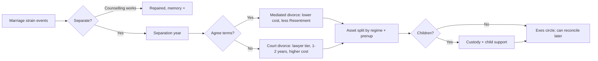
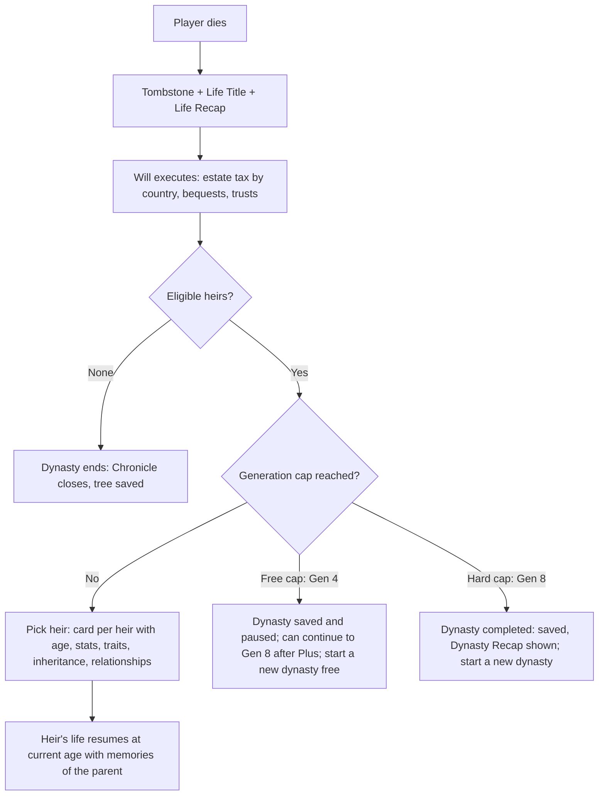
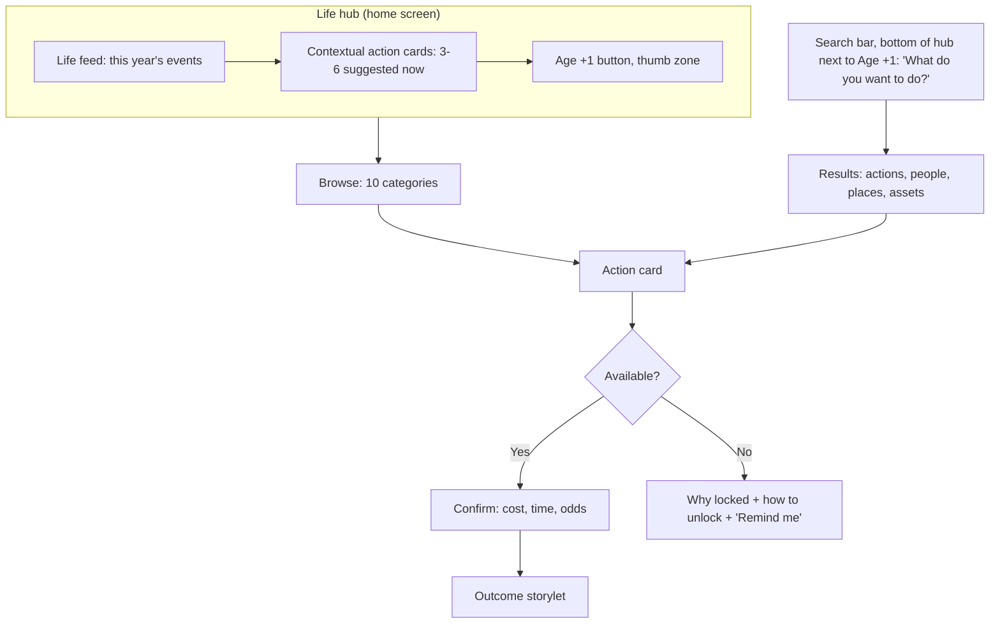
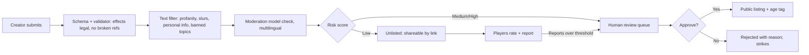
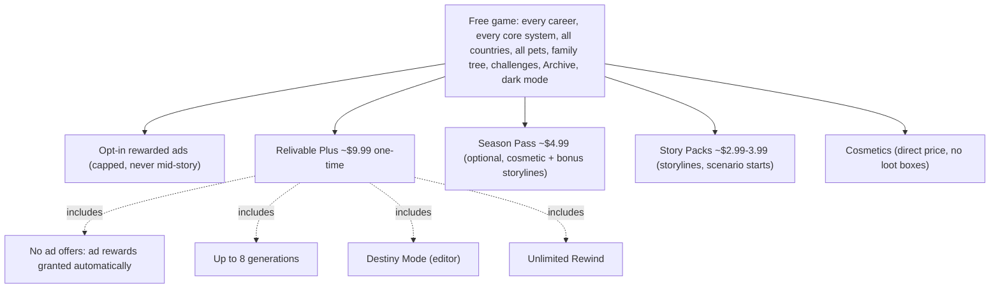
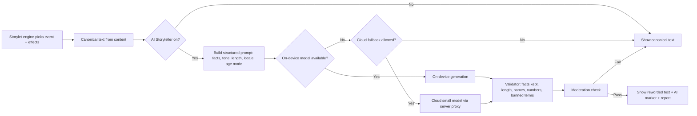

# 04 App Breakdown: Social, Meta and Premium

*Purpose:* Specifies the people, dynasty, meta, social, premium, AI and accessibility layers of Relivable, module by module, with rules, priorities and acceptance criteria.

> [!abstract] What this note covers
> This is the second half of the app breakdown. [[04 App Breakdown - Core Life Systems]] covers stats, life stages, school, careers, money, health, crime and death. This note covers everything about **people** (relationships, love, children, generations, fame, pets), the **Activities hub redesign**, **identity**, the **meta layer** (achievements, Life Titles, Life Recap, challenges), **async social and Creator Mode**, **premium and editor tools**, the **optional AI Storyteller**, and **settings, accessibility and safety**.
>
> It follows the [[_Concept Brief]]. Where it adds a number or a rule that the brief does not set, it marks it as a recommendation for the client to confirm.

> [!info] How to read each module
> Every module uses the same template: **Purpose → BitLife equivalent → Relivable redesign → New features → Detailed sub-features → Key rules, data and examples → UI entry point → Priority and Free vs Plus → Dependencies → Acceptance criteria.**
>
> **Priority labels** follow the phase plan in the [[_Concept Brief]]:
> - **MVP** = needed for the Phase 3 soft launch (full life cycle, about 1,500+ events).
> - **Launch** = needed for the Phase 4 global launch (parity + "better" features, 5 languages).
> - **LiveOps** = Phase 5 and later (seasons, story packs, async social, Creator Mode).
>
> **Free vs Plus:** "Free" means every player gets it. "Plus" means the one-time **Relivable Plus** unlock (about $9.99). "Pack" means an optional Story Pack (about $2.99–3.99). "Season" means the optional Season Pass (about $4.99). Pricing and economy detail live in [[06 Monetization and Economy]].

> [!warning] The one rule that overrides everything in this note
> **No career or core system is ever paywalled.** Plus, Packs and Seasons may sell convenience, cosmetics, extra *storylines* and editor/rewind tools. They never sell a career, a life system, a relationship type, a country, a pet species, or anything a weekly challenge needs. The "Premium boundary" table at the end lists every feature against this rule.

> [!note] Research basis and confidence
> BitLife facts below come from `reports/BitLife complete feature guide.md` and `research_notes/BitLife complete feature guide/*.md`. Player wishes come from `research_notes/Life sim game phase 1/reddit_player_wishlist.md`. The research was gathered through web search rather than full page reads, so BitLife numbers (prices, ages, thresholds) are "last documented" values from fan guides, not verified late-2026 values. Relivable numbers in this note are **design proposals** to be tuned in the Phase 2 prototype and the soft launch.

## Contents

1. [[#1. Relationships]]
2. [[#2. Love and marriage]]
3. [[#3. Children and family]]
4. [[#4. Generations and Dynasty]]
5. [[#5. Fame and social media]]
6. [[#6. Pets and animals]]
7. [[#7. Activities hub redesign]]
8. [[#8. Identity and inclusion]]
9. [[#9. Achievements, Life Titles, Life Recap and collections]]
10. [[#10. Challenges and events]]
11. [[#11. Async social, multiplayer and Creator Mode]]
12. [[#12. Premium and editor tools]]
13. [[#13. Optional AI Storyteller]]
14. [[#14. Settings, accessibility and safety]]
15. [[#Premium boundary]]

### Shared building blocks used across modules

These four building blocks come from the storylet engine described in [[04 App Breakdown - Core Life Systems]] and [[08 Technical Architecture]]. Most modules in this note rely on them.

| Building block | What it is | Used by |
|---|---|---|
| **Person record** | Every human NPC (and the player) has one record: identity, stats, traits, life stage, location, relationships, memories. NPCs are simulated "lightly" (yearly roll-ups) unless they are close to the player. | Modules 1–5, 8, 11 |
| **Bond** | A directed link between two people: type (parent, friend, spouse...), visible **Bond %** (0–100), hidden facets (Trust, Respect, Attraction, Resentment), history. | Modules 1–4, 5, 6 |
| **Memory** | A stored record that "person X remembers event Y" with valence, intensity and decay. It drives callbacks years later ("Every choice remembered" pillar). | Modules 1–5, 9, 13 |
| **Action card** | A UI unit: one thing you can do now, with cost, time, age gate, odds hint and a "why locked" reason. It replaces BitLife's nested menus ("One tap to anything" pillar). | Modules 1–8, 12 |

---

## 1. Relationships

### Purpose
Make the people in a life feel like people. Relationships are the main source of emotion, story callbacks and consequences, and they feed love, family, careers, fame and crime.

### BitLife equivalent
- Every relative has a **relationship bar** with no number. Spending time, conversation, compliments and gifts raise it. Insults, assault and repeated money requests lower it. A low bar makes NPCs more likely to insult, argue with or attack you.
- Arguments offer apologize, agree to disagree, complain to mother, insult or assault.
- "Ask for Money" from parents works better at high bars. A ribbon rewards repeatedly asking after refusal.
- Stepfamilies (v1.24), multiple friends and enemies (v1.28), relationship counselling (v1.31), and co-worker, supervisor and HR interactions (Office update).
- Gaps in the research: no complete per-relative interaction list could be confirmed, and no source documented friend-making or bullying mechanics in detail.

### Relivable redesign
- **Bond % is visible.** A number next to every bar ("Mum · 72%"), as players asked on AppleVis. The bar also has a label (Estranged, Cold, Distant, Warm, Close, Devoted) so screen-reader users and colour-blind players get the same information.
- **Hidden facets explain the number.** Bond % is a weighted blend of Trust, Respect, Affection and (for partners) Attraction, minus Resentment. Players see a one-line "why" on long-press ("Trust is low because you skipped her wedding in 2031").
- **NPC memory and grudges.** NPCs remember significant events with the player and with each other, and those memories surface in later storylets. A grudge is a strong negative memory that has not been resolved.
- **NPCs act, not just react.** Close NPCs have small yearly goals (get married, change job, move away, start a feud) so the cast changes around the player.
- **One "People" screen** groups everyone by circle (Family, Partner, Friends, Work, School, Rivals, Exes, Community) with search and filters, instead of separate tabs.

### New features
- Bond % numbers and labels (player request).
- NPC memory, grudges, forgiveness and reconciliation arcs.
- "Reach out" nudges: the game reminds you when a close bond is fading ("You haven't spoken to Leo in 3 years").
- Relationship counselling for family members, not just couples.
- Social circles that interact: friends meet your partner, your parents dislike your best friend, enemies show up at your party.
- Mentors and protégés at school and work.
- Aging relatives who need care (caregiver storylets, a known gap in the research).

### Detailed sub-features

**Relationship types**

| Circle | Types | How they start | Special rules |
|---|---|---|---|
| Family | Parents, step-parents, siblings (full, half, step, twin), grandparents, aunts/uncles, cousins, nieces/nephews, in-laws | Birth, marriage, remarriage | Cannot be "removed", only estranged. Inheritance and heir rules apply. |
| Partner | Dating, partner, fiancé(e), spouse | See [[#2. Love and marriage]] | Attraction facet is active. |
| Friends | Friend, close friend, best friend (max 3 "best") | School, work, neighbours, activities, apps, random events | Friendships decay without contact. |
| Work | Co-worker, manager, direct report, mentor, client | Getting a job | Bond affects promotion and HR events (see Core Life Systems careers). |
| School | Classmate, teacher, coach, club member | Enrolment | Popularity and cliques (see Core Life Systems school). |
| Rivals | Enemy, rival, nemesis (max 1 nemesis) | Conflicts, grudges, competition | Enemies can sabotage, sue, spread rumours or attack. |
| Exes | Ex-partner, ex-spouse, ex-fling | Breakups, divorce | Can reconcile. Co-parenting if children. |
| Community | Neighbour, faith leader, landlord, fan, stalker (filtered) | Location, religion, fame | Usually light simulation. |

**Interactions** (each is an action card; availability depends on age, type and Bond %)

| Group | Interactions | Notes |
|---|---|---|
| Warm | Spend time, Talk, Compliment, Hug, Share a meal, Call/message, Write a letter | "Spend time" is the safe, reliable option, as in BitLife. |
| Help | Give gift (pick item and value), Give money, Lend money (creates a debt record), Help with a problem, Care for (elderly or sick), Babysit | Lending creates a memory and a repayment storylet. |
| Ask | Ask for money, Ask for advice, Ask for a favour (job reference, a place to stay, bail), Ask to keep a secret | Repeated asks after refusal add Resentment, not just a flat drop. |
| Conflict | Argue, Insult, Prank, Spread a rumour, Snub, Assault (crime system), Report to HR / teacher / police | Assault and rumours link to the crime system and can create grudges. |
| Repair | Apologize, Make amends (gift + apology), Forgive, Ask for forgiveness, Family counselling, Mediation | Repair has better odds when Trust is still above 30. |
| Special | Introduce to someone, Invite to party, Invite to live with you, Cut contact, Block (stops messages), Reconnect | "Introduce" lets two NPCs form their own bond. |
| Teen/child | Play, Ask to sleep over, Ask for a pet, Tattle, Copy homework | Age-gated versions of the above. |

**NPC memory and grudges**

- Each person stores up to **24 active memories about the player** and up to 8 about each other close NPC. Old, low-intensity memories fade out.
- A **grudge** forms when a negative memory has intensity ≥ 4 (on a 1–5 scale) or when 3+ negative memories with the same tag build up (for example `money`, `betrayal`, `absence`).
- Grudges block some interactions ("Ask for a favour" is greyed out with the reason "Sam still resents the $5,000 you never paid back").
- Grudges can **surface years later** as storylets: the enemy who becomes your boss, the sibling who contests the will, the ex who testifies at your trial.
- Grudges resolve through apology + amends, time (slow decay unless renewed), or a dramatic reconciliation event.
- NPCs can hold **grudges against each other** (your parents' feud with your in-laws), which shapes parties, weddings and inheritance.

### Key rules, data and examples

**Bond formula (proposal, tuned in prototype)**

```text
Bond % = clamp(0, 100,
    0.35*Affection + 0.25*Trust + 0.20*Respect + 0.20*Attraction_or_Familiarity
  - 0.50*Resentment )
```
- Facets are 0–100 and hidden by default. Destiny Mode (module 12) can show and edit them.
- **Yearly drift:** close bonds lose 2–6 points a year with no contact; family loses less (1–3), friends more (4–8). Living together stops the drift.
- **Diminishing returns:** the second "Compliment" in one year gives half the effect, the third gives none. This replaces the BitLife "spam talk every year" loop with meaningful choices.
- **Personality modifiers:** NPC traits (Proud, Forgiving, Jealous, Generous, Petty) scale reactions. A Petty NPC doubles Resentment from insults. A Forgiving NPC halves grudge decay time.

**Memory record (data example)**

```yaml
memory:
  holder: npc_8841        # Aunt Rosa
  about: player
  event: skipped_funeral  # storylet id that created it
  year: 2047
  valence: -3             # -3..+3
  intensity: 4            # 1..5
  tags: [absence, family, grief]
  decay_per_year: 0.2     # intensity lost per year without reinforcement
  callbacks: [will_reading_snub, family_reunion_cold]
```

**Example chain**
1. Age 17: you insult your younger brother Theo in front of his friends (memory: humiliation, intensity 3).
2. Age 19: you borrow $800 from Theo and never repay (memory: money, intensity 3 → grudge from 2 negatives with heavy weight).
3. Age 41: Theo is executor of your mother's will. A storylet fires: "Theo hasn't forgotten." Options: apologize and repay (Trust check), argue (lawsuit risk), let it go (you get the smaller share).

### UI entry point
- **People tab** in the bottom navigation (thumb zone). Circles appear as horizontal chips at the top. Each person opens a **Person sheet**: avatar, Bond % and label, facets ("why"), memories timeline ("Things Rosa remembers"), and action cards sorted by relevance.
- Contextual cards also appear on the **Life feed** ("Grandpa is in hospital. Visit?").
- Search bar: "talk to mum", "apologize Theo", "lend money".
- Screen and flow detail: [[05 UX and Screen Map]].

### Priority and Free vs Plus
- **MVP:** family, friends, partner, rivals, school and work bonds; Bond % and labels; core interactions; memory and grudges (basic set of 40 memory tags).
- **Launch:** NPC goals, introductions, family counselling, caregiver arcs, mentors, NPC-to-NPC grudges.
- **Free.** Destiny Mode (Plus) can view and edit hidden facets; that is an editor convenience, not a system.

### Dependencies
- Storylet engine, conditions and weights ([[04 App Breakdown - Core Life Systems]], [[08 Technical Architecture]]).
- Person record and light NPC simulation.
- Crime system (assault, rumours as defamation), careers (HR, promotion), school (popularity).
- Accessibility labels for bars (module 14).

### Acceptance criteria
- Every bond shows a numeric Bond % and a text label, and both are read by VoiceOver/TalkBack.
- Long-press (or "Why?" button) on any bond explains its top two drivers in plain language.
- In automated playtests (life simulator bot, 1,000 lives), at least 60% of lives see one memory callback storylet that references an event 10+ years earlier.
- A grudge-blocked action is never hidden: it is shown greyed out with the reason and a hint on how to repair it.
- Repeating the same positive interaction three times in one year gives no extra Bond gain beyond the second, and the card says so.

---

## 2. Love and marriage

### Purpose
Romance is one of the most played and most shared parts of a life sim. It must be fun, inclusive and dramatic, without explicit content, and its consequences (divorce, affairs, prenups) must be clear.

### BitLife equivalent
- Activities > Love: **dating app** with age and net-worth filters (about $100 a date), hookups, and a separate same-sex app added in the Pride update.
- One lover at a time; either partner can cheat. Ex-flings stay in an Exes tab.
- Buy a ring, **propose** (rejection usually means a low bar), plan a wedding with tiered venues. Fiancés demand a wedding after about three years.
- Rich partners may demand a **prenup**; without one, divorce splits assets 50/50, and a prenup only protects pre-marriage assets.
- **Arranged marriage** happens in some countries (source lists conflict); refusing ruins the bond with both parents.
- You can marry into royalty. Relationship counselling exists.
- No source confirmed polygamy, dowry, custody or child support. Players asked for **parents who divorce and remarry**, with lasting effects on the child.

### Relivable redesign
- **Attraction is two-way and explainable.** Each NPC has preferences (age range, gender(s), values, lifestyle, looks weight, wealth weight). A match screen shows "Why you click" and "Possible friction" instead of hiding the maths.
- **Relationship stages** are explicit: Crush → Dating → Exclusive → Living together → Engaged → Married (or Civil partnership where the country has it) → Separated → Divorced/Widowed. Each stage has its own card set and yearly events.
- **One app, all orientations.** A single in-game dating app (original name **Kindling**) filters by gender(s) sought, so same-sex dating is not a separate feature.
- **No explicit content.** Intimacy is "fade to black" in one line ("You spent the night together."). Content filters (module 14) can make even that more discreet.
- **Divorce is a process, not a button:** separation, negotiation or court, asset split by marital regime and prenup, custody and support if there are children, and emotional effects on everyone.
- **Parents' love lives are simulated** from birth: your parents can fight, separate, divorce, date and remarry, and you feel it.

### New features
- Parents who divorce and remarry, with step-families, two homes and holiday splits (top player request).
- Match explanations and visible "compatibility" bands (not a single opaque number).
- Wedding planner with **guest list** (reuses the party system in module 7), vows, mishap events and in-law dynamics.
- Prenup builder with three readable options.
- Custody and child support (no BitLife source found; requested by players).
- Affairs with discovery mechanics and memory, not just a random "caught" roll.
- Renewal of vows, anniversaries, widowhood and grief, late-life love.
- Arranged marriage driven by a per-country data table, written with sensitivity review.

### Detailed sub-features

**Meeting people**

| Route | Age | Cost (default currency, scaled by country) | Notes |
|---|---|---|---|
| School/college crush | 13+ (dating 15+) | Free | Teen romance is hand-holding level; no intimacy text under 18. |
| Friends of friends / introductions | 16+ | Free | Uses module 1 "Introduce". |
| Work, gym, faith community, hobby club | 18+ | Free | Workplace romance can trigger HR events. |
| **Kindling** app (dating) | 18+ | Free to browse; date ~$40–150 | Filters: age, gender(s), distance/country, wants kids, faith, income band, "looking for" (casual / serious). |
| Nightlife (clubs, bars) | 18+ | Entry + drinks | Can lead to a **fling** (fade to black). Risk events: hangover, STI (health system), bad date. |
| Matchmaker / family introduction | 18+ | Varies | Linked to arranged-marriage countries and royal circles. |
| Celebrity encounters | Fame 30+ | Free | See module 5. |

**Relationship stage actions**

- **Dating:** go on date (type: dinner, movie, walk, adventure), give gift, meet the friends, meet the parents, define the relationship, break up.
- **Exclusive / living together:** move in (shared rent and home), adopt a pet together, plan finances (joint vs separate), argue about chores, travel together.
- **Proposal:** buy a ring (jewellery shop: price tiers, appraised value), choose setting (private, public, at a party). Public proposals increase pressure: acceptance more likely if Bond ≥ 75, humiliation memory if rejected.
- **Engagement:** set a date. If no date after **3 in-game years**, the partner's patience drops each year (BitLife parity), with an ultimatum storylet.
- **Wedding:** venue tier (courthouse, backyard, hall, destination, luxury), guest list from People (capacity by venue), budget, who pays (couple, parents, split), traditions by faith/country, mishaps (rain, ex shows up, drunk uncle). Outcomes: Happiness, Bond with guests (invited / not invited memories), debt.
- **Marriage:** anniversaries (yearly card), date night, counselling, renew vows, have children (module 3), affairs, separation.

**Prenups**

| Option | What it protects | Partner reaction |
|---|---|---|
| None | Nothing; marital assets split by country default | Neutral |
| Standard | Pre-marriage assets and inheritances | Mild drop in Trust if partner is poorer |
| Ironclad | Pre-marriage assets + your business + future inheritances; caps spousal support | Larger Trust drop; may refuse to marry |

- A wealthy NPC may **demand** a prenup (BitLife parity). The pop-up shows both net worths and what each option means in one sentence each.
- Infidelity clauses are **out of scope** (too legalistic); affairs instead affect the divorce negotiation storylet.

**Divorce and separation**



- **Marital regime by country (simplified):** "Community" (marital assets 50/50, the default and BitLife parity) or "Separate" (each keeps what is in their name, with a fairness adjustment). The regime comes from the country data table and is shown before marriage.
- **Spousal support:** paid when the income gap is large and the marriage lasted 5+ years; 2–10 years of payments; Ironclad prenup caps it.
- **Emotional effects:** Happiness drop for both, children's events (module 3), friends pick sides (some friends' Bond shifts toward the ex).
- **Reconciliation:** exes can get back together (BitLife parity), with better odds if no grudge.

**Affairs**
- Start through workplace, nightlife, an ex, or the app while partnered (the app warns "You're married").
- Each year: **discovery chance** = base 15% + 10% per risky action (texts, hotel, being seen) − 5% per "Careful" choice, modified by the partner's Suspicion facet.
- Discovery outcomes: confrontation storylet (deny, confess, blame), divorce trigger, a lasting betrayal memory, and possible fame scandal (module 5).
- You can leave your spouse for the lover (BitLife parity) if the lover agrees.
- The partner NPC can also cheat; hints appear first (late nights, new phone password) so it does not feel random.

**Arranged marriage by country**
- Driven by `country.marriage_customs` data: likelihood (none / low / medium / high), who arranges (parents, matchmaker, family elders), age window, refusal consequences, and whether a later divorce is legal and how it is seen.
- Accept → arranged-marriage storyline (getting to know a stranger, love can grow or not). Refuse → large Bond drop with parents (BitLife parity) plus a chance of later reconciliation, not a permanent 0%.
- **Sensitivity:** written with cultural consultants; never mocks a culture; country lists are data, reviewed per locale. Dowry or bride-price **transactions are not simulated** in Phase 1 to avoid stereotyping (open question for the client).
- Forced-marriage themes appear only as off-screen NPC backstory with a content filter, never as a player-forced outcome under 18.

**Parents who divorce and remarry**
- From birth, the parents' marriage has a hidden **Marriage Health** (0–100) affected by money stress, affairs, kids, and personality fit.
- If it falls below 25 for 2 years: separation storylet (30–60% chance a year). The child (player) gets choices: take a side, stay neutral, act out, try to fix it.
- Custody rules apply to the player as a child: you may live with one parent and visit the other, gaining two homes, two holiday events and a "Split Homes" trait option.
- **Remarriage:** each divorced or widowed parent can date (yearly chance) and remarry, adding step-parents and step-siblings with their own Bond. "Evil step-parent" is one possibility among many, not the default.

### Key rules, data and examples
- **Compatibility bands** shown to the player: Spark (high), Steady, Mixed, Rocky. Computed from shared values, lifestyle, attraction and life goals ("wants kids" mismatch is a big negative and is shown).
- **Age rules:** romantic interactions only between characters of the same age band under 18 (13–17 can date peers 13–17 within 2 years); no romantic content between an adult and a minor, ever. Adult-to-adult gap ≥ 20 years triggers family and friends commentary events.
- **One spouse at a time.** Consensual non-monogamy and polygamous marriage are out of scope for Phase 1 (open question; laws vary by country and it adds a lot of writing).
- **Example:** Marisol (32, Spain) marries Jonah (35, US) without a prenup. Spain's data uses a community regime. After a court divorce at 44, marital assets ($620k) split 50/50; Jonah keeps his pre-marriage house. Their 9-year-old gets joint custody and a "Two Countries" storyline when Jonah emigrates.

### UI entry point
- **People tab → Partner chip** (partner card pinned at the top when you have one).
- **Love card group** in the Activities hub (module 7): "Find love", "Open Kindling", "Go out tonight".
- Life feed cards for anniversaries, proposals expected, suspicion hints.
- Search: "propose", "divorce", "prenup", "date app".

### Priority and Free vs Plus
- **MVP:** meeting routes, Kindling, stages, proposal, wedding (basic guest list), prenup (3 options), divorce (mediated/court, 50/50 default), affairs, exes.
- **Launch:** parents who divorce/remarry, custody/support (module 3), marital regimes by country, arranged marriage data for launch countries, vow renewal, late-life love, royal marriage.
- **Free** in full. Story Packs may add romance *storylines* (for example a "Summer Romance" holiday arc) but never a relationship stage or route.

### Dependencies
- Module 1 (Bonds, memory), module 3 (children, custody), module 7 (party system for weddings), module 14 (content filters, age modes).
- Country data table (laws, customs, regimes) and money system in [[04 App Breakdown - Core Life Systems]].
- Age-rating decisions in [[09 Compliance and Ratings]].

### Acceptance criteria
- Every romantic route works for any gender combination without a separate feature or menu.
- No romance text involving a character under 18 goes beyond hand-holding, and no adult–minor romance is possible; enforced by the content validator in CI.
- The prenup pop-up explains all three options in one sentence each, with both net worths shown.
- A divorce with children always produces a custody outcome and, where applicable, a child-support line in the finances view.
- In a 1,000-life bot run, at least 15% of player childhoods include a parental separation, and at least half of those include a remarriage event.

---

## 3. Children and family

### Purpose
Children are how a life continues into the next one. Parenting must be about real choices that shape the child, so the heir you play next feels like the result of how you raised them.

### BitLife equivalent
- From 18, Activities > **Fertility**: IVF, Surrogate, Donate Sperm, Vasectomy. Surrogacy costs about $25k to $100k+ and is legal only where it is in real life.
- IVF and artificial insemination can produce **twins or triplets**. Partner must agree to IVF.
- **Adoption** needs age 21+, a job and a home, and shows a list of children with stats.
- A "Fertile" ribbon for many children. Continue as any eligible child, adopted children included.
- No sources were found on child-rearing interactions, custody or child support. Players asked for **being born a twin/triplet or with siblings**, child support, and buying cars for children who pass their driving test.

### Relivable redesign
- **Family planning is a conversation with your partner**, not a menu: "Try for a baby", "Not yet", "Never", with partner reactions and arguments when you disagree.
- **Fertility is a hidden stat** that declines with age and is affected by health and habits. The doctor can test it and say "Fertility: below average" so it is not a mystery.
- **Parenting styles and actions shape children's traits**, and the child remembers how you raised them (module 1 memory).
- **Custody and child support** are real systems after divorce or separation.
- **Multiples and siblings at birth**: the player can be born a twin or triplet.

### New features
- Born a twin/triplet (player request), with twin-specific storylets.
- Parenting styles, yearly parenting action cards, and child memories of the player as a parent.
- Custody (sole, joint, visitation) and child support.
- Foster care and foster-to-adopt; sibling-group adoption; international adoption rules by country.
- Egg donation and egg freezing (BitLife only lists sperm donation and vasectomy in sources).
- Tubal ligation and reversals.
- Gifts for children's milestones, including a car when they pass their driving test (player request).
- Pregnancy as a short arc (announcement, scan, cravings, birth story), with a filter for pregnancy loss.

### Detailed sub-features

**Ways to have children**

| Route | Requirements | Cost (US baseline, scaled by country cost index) | Odds and notes |
|---|---|---|---|
| Natural conception | Partner able to conceive with you; both agree | Free | Per-year chance from both partners' Fertility. Twins ~1.5%, identical twins ~0.4%, triplets ~0.02%. |
| Artificial insemination | 18+; donor or partner | ~$1,000 per attempt | 10–20% per attempt; multiples slightly up. |
| IVF | 18+; partner consent if partnered; health ok | ~$12,000–25,000 per cycle | Success by age: <35: 40%; 35–37: 30%; 38–40: 20%; 41–42: 10%; 43+: 4%. Twins 20%, triplets 2% of successes. |
| Egg freezing | 18–40 | ~$10,000 + storage | Uses age at freezing for later IVF odds. |
| Surrogacy | 18+; country allows it (data table) | ~$25,000–120,000 | Legal per country, BitLife parity. "Traveling for surrogacy" option if not legal at home, with legal-risk storylet. |
| Adoption | Age 21+ (country data), stable home, income ≥ threshold, no serious criminal record | Agency fees ~$0–50,000 | Wait 1–3 years. Domestic, international, foster-to-adopt. Sibling groups. Child profiles show age, health, personality, and a short backstory. |
| Fostering | 21+, spare room | Small stipend paid to you | Temporary placements; can lead to adoption. |
| Donating sperm/eggs | 18–35 | Paid to you ($100–$8,000) | Rare future storyline: a biological child finds you. |
| Vasectomy / tubal ligation | 18+ | ~$1,000–6,000 | Reversal possible, 50–70% success. |

**Parenting**

- **Parenting style** (pick at first child, changeable): Warm, Strict, Free-range, Hands-off. Each sets weights for child trait development and event pools.
- **Yearly parenting cards per child**, by age:
  - 0–4: Cuddle, Read a story, Play, Sing, Sleep-train, Choose daycare.
  - 5–12: Help with homework, Sign up for lessons (music, sport, art, languages: feeds special careers in Core Life Systems), Play together, Set rules, Pocket money, Take on a trip, Talk about feelings.
  - 13–17: Talk, Set curfew, Driving lessons, Buy a car (gift), Allowance, Support a crush, Discuss future, Ground them, Give privacy.
  - 18+: Help pay for university, Give a deposit for a home, Lend money, Ask for help in old age.
- **No physical punishment option.** Discipline choices are non-violent (talk, ground, remove privileges). Neglect and abuse appear only as off-screen NPC backstory behind a content filter; the player cannot choose to abuse a child.
- **Child memories of the parent:** children store memories just like other NPCs. A child raised Hands-off with many missed milestones may have Resentment as an adult and refuse to care for you in old age.
- **Child traits** (examples): Curious, Athletic, Rebellious, Anxious, Kind, Competitive, Creative. Traits come from genetics (parents' stats and traits with randomness), parenting style and events.

**Custody and child support**

| Outcome | How it is decided | Effects |
|---|---|---|
| Joint custody | Default when both parents have Bond ≥ 40 with the child and no serious issues | Child alternates homes; both can do parenting cards (each at 75% effect). |
| Primary custody (you) | Court weighs: Bond with child, income stability, criminal record, home, addiction, child's wish (12+) | You get full parenting cards; the other parent pays support. |
| Primary custody (other parent) | Same weighting | You get "Visit" cards (reduced effect); you pay support. |
| Sole custody / no contact | Serious issues (violent crime, abandonment) | Strong child memories; reconnect possible at 18+. |

- **Child support (game rule, not legal advice):** paying parent pays a % of yearly income: 1 child 15%, 2 children 22%, 3+ children 28%, capped by country data; stops at 18 (or 21 in some countries). Missing payments creates debt, a court storylet and a child Resentment memory.
- The player as a child can be the subject of custody (module 2, parents who divorce).

**Family events**
- Sibling rivalry, sibling bonds that last a lifetime, twins' "twin sense" storylets, family holidays, family reunions, grandparent babysitting, family business (Core Life Systems business), family secrets (hidden half-sibling, adoption reveal), elderly parent care, empty nest.

### Key rules, data and examples
- **Age limits:** children with the player only from 18+. Pregnancy age limits for natural conception follow fertility decline; IVF available until 50 by default (country data).
- **Max children:** no hard cap; performance budget allows 20 children per life and 200 living descendants simulated at full detail (others light). Recommendation, see [[08 Technical Architecture]].
- **Example:** Aiko (36) and Dev (38) try for 2 years with no luck. The doctor says Aiko's fertility is "below average" and Dev's "average". IVF cycle 1 fails (30% odds shown). Cycle 2 succeeds with twins. Dev takes the "Warm" style; at 14, twin Ren is Athletic and Competitive (from sport lessons), twin Mei is Creative and Anxious (from a school bullying event Aiko handled with "Talk about feelings", which reduced the anxiety penalty).

### UI entry point
- **People tab → Family chip → Children** (each child has a Person sheet with a "Parenting" section).
- **Family planning card** on the partner's sheet ("Talk about kids").
- **Activities hub → Family & Fertility** card group (module 7), and search ("IVF", "adopt", "foster", "custody").
- Life feed cards for milestones ("Ren passed the driving test. Buy a car?").

### Priority and Free vs Plus
- **MVP:** natural conception, IVF, adoption, multiples, parenting cards (basic 3 age bands), child memories, custody (joint/primary), child support, and a **player-born-a-twin toggle** at life setup.
- **Launch:** surrogacy legality by country, fostering, egg freezing/donation, ligation/reversal, parenting styles, **twin-specific storylines** for player twins, family secrets.
- **Free** in full.

### Dependencies
- Modules 1, 2 and 4; health system (fertility, pregnancy), money (costs, support payments), law/courts (custody), country data table ([[04 App Breakdown - Core Life Systems]]).
- Content filters for pregnancy loss and abuse backstory (module 14).

### Acceptance criteria
- Every fertility route shows its cost and success odds before you confirm.
- A child's adult traits can be traced to at least one parenting choice or event, shown in the child's "How they grew up" summary.
- After any divorce with minor children, a custody result and a support amount (or "none") are visible in both parents' finance and family views.
- The player can be born as a twin or triplet in at least 1.5% of random lives, or by choosing the twin toggle at setup (MVP); twin-specific storylets fire for them from Launch.
- There is no player-selectable action that physically harms a child; verified by content validator rules.

---

## 4. Generations and Dynasty

### Purpose
Turn single lives into a family saga. Generational play is the long-term meta loop and the most shareable output (the family tree), so it must feel rewarding and fair to free players.

### BitLife equivalent
- At death you can continue as an eligible child, including adopted children (since about v1.14).
- **Free players can continue only once; unlimited generations need the paid Bitizenship membership.** Players complain about this ("to continue a family tree... you have to pay").
- A will can leave money to one child, a partner or charity, or split it; estate tax follows real-life countries.
- Heirs inherit houses and cars; if the heir is under 18, assets are auctioned and the heir keeps the cash. As of 2022, startup businesses could not pass to heirs.
- **Heirlooms** come from a daily attic mini-game, count toward net worth and pass to the heir.
- One review says saves were deleted after 4 generations. There is no visual family tree.

### Relivable redesign
- **Dynasties are first-class objects:** each family line has a name, a crest, a tree, goals, a reputation and a history that survive across lives.
- **Every dynasty is capped at 8 generations.** Free players reach **Generation 4** (the founder plus 3 heir continuations); Plus extends a dynasty to **Generation 8**. Reaching a cap never deletes anything: at the free cap the dynasty is saved, its tree stays viewable and shareable, and it can be continued to Generation 8 after buying Plus. At Generation 8 the dynasty is **completed**, saved and shown as a **Dynasty Recap**, and the player starts a new dynasty. There is no limit on the number of dynasties.
- **Better inheritance:** businesses, investments, property and heirlooms all pass on. Heirs under 18 get a **trust** run by a guardian NPC instead of a forced auction.
- **Family tree view** with zoom, search, filters, and an accessible list mode.
- **Dynasty Ambitions and Legacy Points** reward multi-generation goals.

### New features
- Family tree view (pillar 4; free, not paywalled).
- Dynasty Ambitions (multi-generation goals) and Legacy Points.
- Family Name Standing (dynasty reputation), shaped by past lives' fame, crime and charity. It feeds the world-level **family name reputation**, history-book (Almanac) mentions and Echo events in [[04 App Breakdown - Core Life Systems]] (Module 11: World Legacy and History).
- Heirlooms with provenance (who owned them, what happened).
- Wider heir choice: children (biological, adopted, step-children with Bond ≥ 50), then grandchildren, then nieces and nephews ("distant heir").
- Inheritable businesses and trusts for minors.
- Will contests and family feuds over inheritance (uses module 1 grudges).
- "Dynasty Chronicle": an auto-written family history across generations. Notable entries also appear in the shared World Timeline (Core Module 11).

### Detailed sub-features

**Continuing as an heir**



- **Heir cards** show: age, life stage, stats, top traits, career, what they inherit, their memory of the parent ("Mei remembers you as distant but generous"), and Bond with key family.
- The heir **keeps their own relationships and memories**, so the parent's choices shape the next life (pillar 1).
- **Heir eligibility:** alive, not in a coma; prison is allowed (you start in prison, with a "Fresh Start" storyline). Step-children need Bond ≥ 50. Distant heirs (nieces, nephews, grandchildren) start with a "Distant Branch" modifier: Family Name Standing −10.

**Wills and inheritance**

| Feature | Rule |
|---|---|
| Will | Activities → Will (module 7). Assign % or specific assets to people or charities. Default (no will): spouse 50%, children split 50% (country data may differ). |
| Estate tax | Per country table (BitLife parity). Shown as an estimate on the will screen. |
| Trust for minors | Assets held until 18 (or 21/25 by choice); guardian NPC manages; small chance of mismanagement storylet if the guardian has low Discipline. |
| Business succession | Business passes with shares; heir can run, sell or appoint a manager. |
| Debts | Paid from the estate before bequests; heirs never inherit negative net worth. |
| Will contest | Excluded family with a grudge may contest (lawsuit storylet); a recent will update with a lawyer lowers the odds. |

**Family tree view**
- Zoomable tree with portraits (avatars from module 8), birth–death years, Life Title badge, and colour-independent icons (heart = married, broken ring = divorced, link = adopted, star = player lives).
- Filters: show only players, only living, only one branch; search by name.
- **Accessible list mode:** a nested, screen-reader-friendly outline ("Generation 2, Ana Ruiz, 1971–2049, Surgeon, children: 3").
- Tap any past player-life to open its **Life Recap** (module 9).
- Export the tree as an image or share link (module 11).

**Dynasty Ambitions and Legacy Points (LP)**
- At dynasty creation (or later), pick up to **3 Ambitions** from a list of about 40 at launch. Examples:
  - "Healers": 3 generations in a row work in medicine.
  - "Rags to Riches": start Gen 1 in poverty, reach $10M net worth by Gen 3.
  - "Never Forget": 4 generations each visit the family's home town.
  - "Clean Name": 4 generations with no criminal convictions.
  - "Infamous": 3 generations reach crime-family rank.
  - "Big Family": 25 living descendants at once.
- **Ambition length rule:** no Ambition needs more than 4 generations, so every Ambition can be completed on the free tier and well inside the 8-generation cap.
- **LP** come from finished lives (Life Title rarity, Ambition progress, achievements). LP buy **dynasty perks** that are small, thematic and capped so they never feel pay-to-win: a family crest design, a starting heirloom, a +5 starting Family Name Standing, a "family recipe" storylet, a home-town connection. **LP are earned only, never sold.**

**Heirlooms**
- Found through events (attic clear-out storylet, antique shop, gifts, travel, wins), not a daily login mini-game. A once-a-day "Family Vault" peek may reveal one optional item to keep the daily loop (module 10).
- Each heirloom has **provenance**: original owner, year, story line ("Grandpa Elias's pocket watch, carried in the 1956 flood").
- Value can rise (antiques, art), fall (jewellery depreciates, BitLife parity) or be lost (theft, fire, sold in hard times).
- Heirlooms trigger callbacks: a descendant who sells Grandma's ring gets a Resentment memory from the aunt who wanted it.

### Key rules, data and examples
- **Free cap (decided):** Generation 4 (founder + 3 heirs) per dynasty, unlimited dynasties. At the free cap the dynasty is saved and can be resumed with Plus ([[06 Monetization and Economy]]).
- **Plus:** up to Generation 8, the hard cap for every dynasty. At Generation 8 the dynasty is completed, saved and shown as a Dynasty Recap.
- **No save loss:** dynasties are cloud-saved to the account ([[08 Technical Architecture]]). The "deleted after 4 generations" complaint must be impossible: tested with automated dynasties run to the 8-generation cap, plus a 50-generation stress test of the save format.
- **Example:** The Okafor dynasty picks "Healers" and "Clean Name". Gen 1 nurse, Gen 2 surgeon, Gen 3 a vet (counts as medicine in the Ambition data). Gen 3's teenage shoplifting conviction breaks "Clean Name"; the Ambition card shows it as "Failed in Gen 3" with the event, and LP still count for the completed "Healers".

### UI entry point
- **Dynasty tab** (from the main menu and the Profile/More area): tree, Ambitions, Chronicle, Vault, Name Standing.
- **Death flow**: tombstone → Life Recap → Will results → Heir picker.
- Search: "family tree", "will", "heirloom".

### Priority and Free vs Plus
- **MVP:** continue as heir, will, estate tax, trusts, business succession, free cap at Gen 4, basic family tree (list + simple tree).
- **Launch:** full zoomable tree, Ambitions, LP perks, heirloom provenance, Chronicle, will contests, distant heirs.
- **Free:** everything up to Gen 4, tree, Ambitions, LP. **Plus:** up to Generation 8 (hard cap; completed dynasties get a Dynasty Recap).

### Dependencies
- Modules 1–3 (bonds, marriage, children), 8 (avatars), 9 (Life Recap, titles), 11 (sharing), 12 (Plus entitlement).
- Death, money, business and country data in [[04 App Breakdown - Core Life Systems]]; cloud saves in [[08 Technical Architecture]].

### Acceptance criteria
- A free player can play a dynasty from Gen 1 through Gen 4 with no paywall prompt before the Gen 4 life ends.
- At the free cap, the dynasty is saved, its tree and recaps stay viewable, and buying Plus resumes it from the heir picker with no data loss.
- At Generation 8, no heir picker is shown: the dynasty is marked completed, a Dynasty Recap is generated, and a new dynasty can be started immediately.
- Businesses, investments, property and heirlooms appear in the heir's assets after inheritance; minors receive a trust, never a forced auction.
- The family tree has a list mode that VoiceOver/TalkBack read fully in a logical order.
- An automated 8-generation dynasty (and a 50-generation stress-test save) loads in under 2 seconds on the minimum-spec device and passes save/restore.

---

## 5. Fame and social media

### Purpose
Fame is one of the most dramatic and shareable arcs (influencer lives, scandals, comebacks). It also connects many careers (acting, music, sport, politics, business).

### BitLife equivalent
- Fame stat since April 2019; comes from acting, music, sport, modelling or social media.
- Social media accounts grow followers. Verification thresholds conflict across sources (100k + 25 fame, 100k on one platform, or about 250k). "Social Media Star" at about 300–350k followers unlocks the Fame tab.
- A weekly challenge required verified accounts on every platform with 2M+ followers.
- The research found no reliable source on viral-post mechanics, the current platform list, or adult-content platforms.

### Relivable redesign
- **Two separate meters:** **Fame** (0–100, how widely known you are, from any source) and **Followers** (per platform). A famous surgeon can have few followers; an influencer can have huge followers and modest fame.
- **Original fictional platforms** with distinct strengths, so posting strategy matters.
- **Posts are choices with visible risk:** each post type shows its expected reach band and controversy risk.
- **Scandals are storylets with memory**, linked to things you actually did (affairs, crimes, old posts), not random penalties.
- **No explicit adult content.** There is no adult-content platform or career. "Spicy" options do not exist; suggestive content stays at a PG-13 level of implication and is filtered by age mode.

### New features
- Platform ecosystem with trends, algorithm changes and platform decline (a platform can "die" in later decades).
- Viral posts with a transparent reach formula.
- Endorsement deals with brand fit and morality clauses.
- PR team, publicist, crisis-response choices, cancel-and-comeback arcs.
- Fan base types (casual, superfans, haters) and fan mail.
- Privacy and safety: paparazzi, doxxing, stalker storylines (filtered), burnout and "digital detox".
- Family-vlogger ethics: posting your children affects their later Bond and privacy memories.
- Era-aware media: in historical lives (pre-internet eras), fame comes from newspapers, radio and TV.

### Detailed sub-features

**Platforms (original names, trademark check needed)**

| Platform | Type | Best for | Unlock |
|---|---|---|---|
| **Vybe** | Short vertical video | Viral reach, trends | 13+ (account), monetisation 18+ |
| **Lenso** | Photos and stories | Looks, lifestyle, brands | 13+ |
| **Murmur** | Short text posts | Opinions, politics, news; highest controversy | 13+ |
| **Hearthcast** | Long video and live streams | Steady income, gaming, education | 16+ (live streams 18+) |
| **Inkwell** | Newsletters and blogs | Writers, experts, paid subscribers | 16+ |

- Platform list is data-driven. In era mode, platforms appear by year (no Vybe in 1985). A platform can trend up, plateau or decline, and followers can migrate.

**Posting**
- Post types: Selfie, Daily life, Talent clip (uses skills: music, comedy, sport), Opinion, Collab, Challenge/trend, Behind the scenes, Charity, Apology, Product review (sponsored).
- Each post card shows **Reach** (Low / Medium / High / Viral chance %) and **Risk** (None / Low / Hot take).
- **Viral chance (proposal):** `base 1% + 0.1% × relevant skill + trend bonus (0–8%) + collab bonus (0–5%) − fatigue (posting > 4 times a year on one platform)`. Capped at 25%.
- Outcomes: follower change, income (ad share, subs, sponsorships), Fame change, Bond change with people mentioned, and a chance of a hater storyline.

**Verification and tiers**

| Tier | Followers (any one platform) | Unlocks |
|---|---|---|
| Rising | 10k | Collabs, small sponsorships |
| Verified | 100k **and** Fame ≥ 20 (or notable career) | Blue tick, brand deals, press invites |
| Star | 1M | Agent, publicist, events, fan mail |
| Icon | 10M | Own brand/product line, award shows |

- Verification uses an "Apply" card that shows the requirements and your progress (no hidden thresholds, unlike the conflicting BitLife values).

**Endorsements**
- Brands offer deals based on Fame, platform, audience and image tags (Family-friendly, Edgy, Sporty, Luxury). Deal fields: fee, length, posts required, **morality clause**.
- A scandal can break a deal (refund clause) or a brand can drop you. Accepting a brand that conflicts with your image (fast food for a fitness star) loses followers.

**Scandals and PR**
- Sources: affairs (module 2), crimes and arrests, old posts resurfacing (memory records on posts), feuds with other celebrities, leaked messages, tax problems, family members' actions.
- Response choices: Apologize, Deny, Go quiet, Double down, Blame someone, Hire a crisis PR firm. Outcomes depend on truth (did you do it?), evidence and public mood.
- **Cancel and comeback:** severe scandals start a "Cancelled" state (Fame decays, deals lost); comeback storylets open after 1–5 years (charity, documentary, redemption interview).
- Scandal content never includes explicit images or sexual content; leaks are described in text only and are filtered by age mode.

### Key rules, data and examples
- **Age rules:** accounts from 13; earnings and sponsorships from 18 (or parent-managed 13–17 with a "child influencer" storyline that sets later Bond and privacy memories); no live streams under 18.
- **Fame decay:** −2 to −5 a year without new activity; Icons decay slower.
- **Fame benefits:** better restaurant/club access, career auditions, politics campaigns, dating pool (module 2), book deals. **Costs:** privacy loss, paparazzi, stalker risk (filtered), burnout.
- **Example:** Priya (19) posts a guitar talent clip on Vybe during a trend (viral chance 12%). It goes viral: +240k followers, Fame +12. She gets verified at 21 (100k + Fame 24), signs a guitar-brand deal with a morality clause, then a 2014 Murmur post resurfaces at 26 (memory record). She apologizes; the brand keeps her because the Bond with her fan base is high.

### UI entry point
- **Fame card on the Life hub** once you have an account or Fame ≥ 10 (contextual card, not buried in a menu).
- **Social screen**: platform tabs, post composer (cards), followers graph, deals, PR inbox.
- Search: "post on Vybe", "get verified", "hire publicist", "apologize".

### Priority and Free vs Plus
- **MVP:** Fame meter, 3 platforms (Vybe, Lenso, Murmur), posting, verification, basic endorsements, basic scandals.
- **Launch:** all 5 platforms, tiers, PR firm, cancel/comeback, family vlogging, era-aware media.
- **LiveOps:** platform trend events ("Trend of the Week" tied to weekly challenges), seasonal storylines.
- **Free.** Story Packs may add fame *storylines* (for example a reality-TV arc) but not the system.

### Dependencies
- Careers (acting, music, sport, politics) and money in [[04 App Breakdown - Core Life Systems]]; modules 1, 2 (affairs), 9 (achievements), 10 (challenges), 14 (filters, age modes).
- Platform names need trademark clearance ([[09 Compliance and Ratings]]).

### Acceptance criteria
- Every post card shows reach and risk before posting, and the result explains why it did or did not go viral.
- Verification requirements and progress are visible on the Apply card; no hidden thresholds.
- Every scandal links to a recorded event (memory or post) in the player's life; zero "random" scandals in validator checks.
- No platform, post type, career or storylet offers adult or sexually explicit content; enforced by validator tags and age-mode tests.
- A weekly challenge that needs fame can be completed with free content only (verified by the life simulator bot).

---

## 6. Pets and animals

### Purpose
Pets bring warmth, humour and grief. They are a low-stakes emotional system that also feeds achievements, collections and challenges.

### BitLife equivalent
- Pets from shelters and breeders. **Exotic pets, horses and llamas are 18+**; the Exotic Pet Dealer sells one a year; animals can be rescued in random encounters.
- Horses need an "equestrian" property costing about $5–15M, except a rescued unicorn.
- Some sources say non-premium players can own only traditional pets, and that exotic pets and the pet store/breeders are VIP perks.
- The **Zoo** expansion pack (paid, 2024) adds small, medium and large zoos.
- Pet death, vet visits and pet interactions could not be verified in the research. A "Cat Lady" ribbon exists for owning many cats.

### Relivable redesign
- **All pet species are free**, including exotic animals and horses (BitLife gates some behind premium).
- **Pets are characters** with Bond, Health, Age, Temperament and memories (simplified module 1 model).
- **Horses do not need a multimillion estate:** you can board a horse at a stable for a yearly fee, or own land with stables.
- **Exotic pet legality by country**, with welfare consequences and possible legal trouble.
- **Pet aging, illness and death** are handled with care, with a memorial and grief storyline.
- **Zoo ownership** is a free business type; Story Packs can add zoo storylines only.

### New features
- Pet personality and tricks; pet training and shows.
- Pet health, vet, insurance and end-of-life choices.
- Pet memorials and a "Pets I've Loved" collection across all lives.
- Pets in the family: kids ask for a pet (BitLife childhood event), pets react to new babies and partners, pets pass to heirs.
- Strays and rescues, fostering animals, volunteering at a shelter.
- Service and therapy animals (positive health storylines).

### Detailed sub-features

**Species and sources**

| Group | Examples | Source | Age | Notes |
|---|---|---|---|---|
| Common | Dog, cat, rabbit, hamster, guinea pig, fish, budgie, turtle | Shelter, breeder, pet shop, stray, family | Any (child needs parent approval) | Breeder costs more; shelter adds a Karma bonus. |
| Farm | Horse, donkey, goat, pig, chicken, llama, alpaca | Breeder, farm sale, rescue | 18+ | Horses: boarding ($3k–15k/yr) or own land with stables. |
| Exotic | Snake, lizard, parrot, tarantula, tortoise, fennec fox, monkey, big cat (illegal in most countries) | Exotic dealer (1 offer a year, BitLife parity), rescue | 18+ | Legality by country data; illegal ones risk confiscation, fines, injury events. |
| Fantastical (rare) | One rare "legend" animal per dynasty at most | Rare rescue storyline | 18+ | Tongue-in-cheek, original (no unicorn copy needed; e.g. a "two-tailed fox" sighting). Optional by client. |

**Pet stats and care**
- **Bond** (0–100), **Health** (0–100), **Age** (species lifespan data: dog 10–15 years, cat 12–18, hamster 2–3, horse 25–30, tortoise 50–100+), **Temperament** (Calm, Playful, Shy, Aggressive, Clever).
- Care cards: Walk, Play, Feed treat, Groom, Train (tricks: sit, fetch, show skills), Vet visit, Insurance, Pet sitter, Rehome.
- Neglect (no care for 2+ years, unpaid vet) lowers Health and can trigger welfare-officer storylets. **Animal cruelty** is a crime with strong Karma loss; never described graphically and filtered.

**Aging and death**
- Senior pets show an "Elderly" tag and health events. End-of-life choices: treatment (cost), palliative care, euthanasia with the vet (described gently).
- Death triggers a **memorial card** (name, years, favourite memory) and a short grief storyline for the household. Children in the family get a memory ("Ren's first loss").
- Content filter (module 14) can soften pet-death text to a single line.

**Zoo and animal businesses** (free business types)
- Small, medium and large zoo (BitLife parity sizes), animal sanctuary, horse-riding school, dog-grooming salon, kennel.
- Zoo rules: enclosures, staff, welfare rating, visitor income, inspections, escape events (comic, not gory).

### Key rules, data and examples
- **Max pets:** no hard cap; at 15+ pets a "Crowded home" storyline begins (Happiness of others, hygiene, neighbour complaints). Collection achievements reward variety rather than hoarding (an original "Menagerie" title instead of copying BitLife's cat ribbon).
- **Example:** Lucía (8) asks her parents for a dog (childhood card). They agree; she picks "Pepa" from the shelter (Playful). Pepa's Bond with Lucía hits 95. At Lucía's 19, Pepa (13) gets the Elderly tag; at 21 Pepa dies peacefully; a memorial card is added to "Pets I've Loved", and Lucía gets a "First pet" memory that later fires when her own child asks for a puppy.

### UI entry point
- **People tab → Pets chip** (pets share the Person sheet layout with simpler stats).
- **Activities hub → Pets & Animals** card group; contextual cards ("Pepa seems tired. Vet?").
- Search: "adopt a dog", "buy a horse", "vet".

### Priority and Free vs Plus
- **MVP:** common pets, shelter/breeder/stray, Bond/Health/Age, vet, death and memorial.
- **Launch:** exotic and farm animals, legality by country, horse boarding, training and shows, pets inherited, animal businesses including zoo.
- **LiveOps:** seasonal pet events (pet costume contest at Halloween), Story Pack "Wild Kingdom" (zoo storylines).
- **Free** in full, including exotic pets and the zoo business.

### Dependencies
- Modules 1 (bond model), 3 (children asking for pets), 4 (inheritance), 9 (collections), 14 (filters).
- Business and money systems, country law table in [[04 App Breakdown - Core Life Systems]].

### Acceptance criteria
- Every species listed above can be obtained by a free player.
- A pet's age and health change every year, and every pet eventually dies of old age or illness if not lost earlier.
- Each pet death produces a memorial entry in the cross-life "Pets I've Loved" collection.
- Owning an exotic animal that is illegal in the current country shows a warning before purchase, and the legal risk applies.
- A horse can be owned without buying property (boarding option).

---

## 7. Activities hub redesign

### Purpose
Replace BitLife's long, nested Activities list with a hub that shows the **right actions at the right time**, finds any action in one search, and **explains every locked action**. This is pillar 2 ("One tap to anything").

### BitLife equivalent
- A single Activities tab that keeps growing, usable unlimited times a year. Confirmed items in research: Adoption, Casino, Doctor, Emigrate, Fertility, Mind & Body (gym, library, meditation, memory test; from 12), Horse-race betting, Identity, Lawsuit (appears only with a grievance; once missing on Android), Licenses (driver's, boating, pilot), Lottery, Love, Pets, Plastic Surgery, Rehab, Salon & Spa (teen+), Social Media, Vacation, Witch Doctor.
- Mentioned with no mechanics found: Nightlife, Surrender, Shopping, Will, Crime, Sports.
- Accessibility feedback: actions hidden across several menus; ads that interrupted activities (black market, praying) even after buying ad removal.
- Player requests: parties with guest lists, religion system, lawsuits with retaliation, road trips.

### Relivable redesign



- **Three ways in:**
  1. **Contextual cards** on the Life hub (3–6 at a time) chosen by a relevance score: urgent (illness, legal deadline), relationship (fading bonds, partner events), opportunity (job opening, trend), life-stage milestones, and the player's habits.
  2. **Search / command bar** ("What do you want to do?") with synonyms, typos tolerance and natural phrasing ("get fit", "go to church", "sue my boss", "throw a party").
  3. **Browse** by 10 categories when you want to explore.
- **Action card anatomy:** title, one-line description, cost (money, time slot), age gate, odds hint ("Usually works" / "Risky" / "Long shot", plus % in Destiny Mode or an accessibility setting), consequences preview, and a "Why locked" panel when not available.
- **Time slots (proposal):** each year has 6 "free time" slots for leisure actions; work, school and essential actions do not use slots. This keeps unlimited spam in check without a paywall. Exact number tuned in prototype; accessibility setting can relax it.
- **No ads inside actions.** Activities never play ads (module 12 ad rules).

### New features
- Contextual cards and command search (brief pillar 2).
- "Why locked" explanations everywhere, with unlock hints and "Remind me when available".
- **Parties with guest lists** (player request).
- **Religion and spirituality** system (player request).
- Lawsuits with retaliation (player request), road trips (player request), volunteering, hobbies.
- Favourites: pin up to 8 actions to a personal quick bar.

### Categories

| # | Category | Contains |
|---|---|---|
| 1 | Health & Body | Doctor, hospital, therapist, rehab, gym, sports, diet, plastic surgery, salon & spa, alternative healer |
| 2 | Mind & Growth | Library, meditation, memory and puzzle games, hobbies, lessons, online courses, journaling |
| 3 | Love & Social | Dating, Kindling app, nightlife, parties, hang out, social media, volunteering |
| 4 | Family & Fertility | Try for a baby, IVF, surrogacy, adoption, fostering, donation, contraception procedures |
| 5 | Money & Shopping | Shopping (clothes, electronics, gifts, jewellery, cars, homes), lottery, casino, black-market items (crime) |
| 6 | Travel & Places | Vacation, road trip, emigrate, move home/city |
| 7 | Law & Papers | Licenses, lawsuit, will, identity and legal name, citizenship and visas, surrender to police |
| 8 | Crime | Petty crime to heists and organised crime (detail in Core Life Systems) |
| 9 | Faith & Community | Religion, community events, charity |
| 10 | Pets & Animals | See module 6 |

### Full mapping of BitLife Activities items

| BitLife item | Relivable card(s) | Category | Contextual trigger | Search keywords | Age | Redesign notes |
|---|---|---|---|---|---|---|
| Doctor | Visit doctor, Specialist, Hospital, Get a check-up | Health & Body | Illness or injury, yearly check-up after 40 | doctor, sick, cure, check-up | Any (parent takes child) | Diagnosis shown with treatment options, cost, success odds; insurance and free-healthcare countries from country data. |
| Witch doctor (alternative healer) | Alternative healer | Health & Body | Untreated illness + low money or remote area | healer, folk cure | 18+ | Kept for parity as "Alternative healer"; risk shown; written respectfully, not mocking any culture. |
| Gym / Mind & Body | Work out (gym), Run, Yoga, Martial arts, Sports club | Health & Body | Low health, "get fit" goal | gym, workout, fit, run | 12+ (BitLife parity) | Builds Health + Athleticism; injury chance shown. |
| Mind & Body: library, meditation, memory test | Read at library, Meditate, Brain games (memory, puzzle) | Mind & Growth | Low smarts or high stress | read, meditate, puzzle | 12+ | Brain games are optional mini-games with a skip option for accessibility. |
| Lottery | Buy lottery ticket | Money & Shopping | — | lottery, jackpot | 18+ (country data) | Odds stated ("1 in 14 million"). Simulated gambling, no real money; age mode can hide. |
| Emigrate | Emigrate (legal: visa route), Move illegally (risky) | Travel & Places | Fleeing justice, job offer abroad, partner abroad | move abroad, emigrate, visa | 18+ | Approval factors listed (record, money, job, language, family ties); illegal route has deportation storylets. |
| Vacation / Travel | Vacation, Road trip, Visit family abroad, Honeymoon | Travel & Places | Stress high, anniversary, school break | holiday, trip, travel, road trip | Any (with family) / 18+ alone | Road trips use your car (player request). Destinations from country data with events. |
| Nightlife | Go clubbing, Bar, Concert, Comedy night, House party (others') | Love & Social | Weekend card for 18+ singles | club, party, bar, night out | 18+ (bars by country drinking age) | Fling chance (fade to black), drinks/drugs choices link to health and addiction. |
| Casino | Casino: blackjack, roulette, slots, horse racing | Money & Shopping | Visiting a casino city | casino, bet, gamble | 18+/21+ by country | Free set of games for everyone (no paid casino pack). Gambling addiction risk shown (BitLife parity). Hidden in age modes under 18 and by the "Simulated gambling" filter. |
| Salon & Spa | Haircut and style, Nails, Massage, Skin care, Tanning | Health & Body | Before wedding, interview, low looks | haircut, spa, nails | 13+ | Changes avatar (module 8) as well as Looks. |
| Plastic surgery | Cosmetic procedure (list), Consultation | Health & Body | — | surgery, botox, nose job | 18+ | Consultation shows risks, cost and recovery; botched-surgery chance; body-image content filter. |
| Licenses | Driver's licence, Boating licence, Pilot licence, Motorbike licence, Firearms licence (country data) | Law & Papers | Turning driving age | licence, driving test | Country data (driving 16–18) | Tests are short quizzes with an accessible version and a skip-with-study option. |
| Lawsuit | Sue someone, Defend a lawsuit, Settle | Law & Papers | Only when a valid grievance exists (BitLife parity), shown as a card on the feed | sue, lawsuit, lawyer | 18+ | Lawyer tiers, settlement offers, trial; **retaliation**: the defendant remembers (grudge) and may counter-sue or act later. Must exist on both platforms. |
| Adoption | Adopt, Foster | Family & Fertility | Infertility, wanting kids, 21+ | adopt, foster | 21+ | See module 3. |
| Rehab | Rehab (inpatient/outpatient), Support group, Therapy | Health & Body | Addiction detected | rehab, quit, addiction | 13+ (with parent) / 18+ | Success odds by Willpower; relapse storylets; "Successful recovery" achievement. |
| Surrender (to police) | Turn yourself in | Law & Papers | Wanted or committed a crime | turn myself in, surrender | 13+ | Lower sentence chance; shown with a sentence estimate. |
| Surrender (end life) | **End this life** (Settings / life menu, not an activity) | — | Never suggested | end life, start over | Any | Moved out of Activities. Neutral wording, no glamorisation; confirmation step; Safety settings offer support resources (module 14). |
| Fertility | Try for a baby, IVF, Surrogacy, Donate, Procedures | Family & Fertility | Partner conversation | IVF, surrogate, baby | 18+ | See module 3. |
| Love | Date, Kindling app, Hook up, Ask out | Love & Social | Single 16+ with low Happiness, partner events | date, love, app | 15+ (dating), 18+ (app) | See module 2. |
| Crime | Crime cards (shoplift → heists), Organised crime | Crime | Desperation, criminal traits, gang invites | steal, rob, heist | 10+ (petty), 18+ (most) | Heists explain failure (brief "better" list). Detail in [[04 App Breakdown - Core Life Systems]]. |
| Shopping | Shop: clothes, gifts, electronics, jewellery, vehicles, homes, furniture | Money & Shopping | Gift occasions, new home, upgrades | buy, shop, gift | Any (pocket money) / 18+ big items | Clothes change avatar; homes link to home customisation. |
| Identity | Gender identity, Pronouns, Legal name change, Orientation | Law & Papers | — | identity, name change, pronouns | See module 8 | See module 8. |
| Will | Write / update will | Law & Papers | Age 50+, new child, serious illness | will, inheritance | 18+ | See module 4. |
| Parties with guest lists *(new)* | Host a party | Love & Social | Birthdays, graduations, new home, engagement | party, throw a party, invite | 8+ (kids' party with parents) / 16+ | See "Party system" below. |
| Religion *(new)* | Faith & Community actions | Faith & Community | Family faith, life crises, holidays | church, pray, faith, temple, mosque | Any | See "Religion and spirituality" below. |
| Pets | Pets & Animals cards | Pets & Animals | Child asks, loneliness | pet, dog, cat | Any | See module 6. |
| Social media | Social screen | Love & Social | — | post, followers | 13+ | See module 5. |
| Black market | Black-market purchases | Crime | Criminal contacts | buy illegal | 18+ | Free for all (BitLife sells it as a pack). No ads, ever. |
| Prayer (BitLife had ads after praying) | Pray / reflect | Faith & Community | Crisis events | pray | Any | No ads; small Happiness/Stress effects; faith-dependent flavour. |

**Party system (guest lists)**
- **Party types:** birthday, house party, dinner party, graduation, engagement, wedding reception (module 2), baby shower, holiday gathering, memorial/wake, kids' party.
- **Setup steps** (one sheet): type → venue (home, rented hall, bar, beach; capacity) → budget tier → theme → **guest list** (pick from People with suggestions; capacity shown) → extras (DJ, catering, magician).
- **Simulation:** each guest has Bond with the host and with other guests. The party engine picks 2–4 highlight events: two enemies clash, a crush shows up, someone gets too drunk, a surprise proposal, neighbours call police for noise, someone not invited finds out (Resentment memory).
- **Outcomes:** Happiness, Bond changes for every guest, new friendships between guests, memories, costs, and a "Party of the Year" achievement for great ones.
- **Example:** Kai invites 18 people to a 30th birthday at home (capacity 20). Ex-partner Dana is invited; Dana's new partner and Kai's best friend have a grudge. Highlight: an argument on the balcony (Bond −8 between them), but a cousin and a co-worker hit it off (new bond). Kai's sister was not invited and gets a −6 memory.

**Religion and spirituality**
- Each person has a **Faith** (from data: major world faith families, "spiritual but not religious", and non-religious) and a **Devotion** level (0–100).
- Children inherit their family's faith by default; from 13 they can question, and from 16 they can change.
- Actions: Attend services, Pray/reflect, Celebrate holidays (seasonal calendar per faith), Volunteer with community, Pilgrimage/retreat, Convert, Leave faith, Become clergy (career in Core Life Systems; BitLife has monk/nun).
- Effects: community bonds, Happiness and Stress, family reactions (switching faith can lower Bond with devout relatives), marriage compatibility, wedding traditions, and political campaigns in some countries (player request).
- **Neutrality rules:** no faith is "correct" or mechanically superior; no faith-based stat bonuses; all text reviewed by sensitivity readers per faith; satire limited to individuals' behaviour, never beliefs.

### Key rules, data and examples
- **Relevance scoring for contextual cards (proposal):** `urgency (0–50) + relationship stake (0–20) + opportunity (0–15) + player habit (0–10) + novelty (0–5)`; the top 3–6 show; urgent items always pin first.
- **Search** is local and offline (on-device index of action ids, synonyms and translated keywords per locale); works with the screen reader and voice dictation.
- **Every action has an id and a `locked_reason` template** (age, money, location, licence, relationship, cooldown, content filter, "not in this era").
- **Example:** A 15-year-old types "drive". Results: "Driver's licence — Locked: you can take the test at 16 in Ireland (in 1 year). Remind me?" and "Driving lessons with Dad — Available".

### UI entry point
- **Life hub** (home): feed + contextual cards + Age +1 button in the thumb zone.
- **Search bar** pinned at the bottom of the hub, next to the Age +1 button in the thumb zone (and reachable from every screen with one tap).
- **Browse** button opens the 10 categories. Full screen map: [[05 UX and Screen Map]].

### Priority and Free vs Plus
- **MVP:** hub, contextual cards, search (EN), categories, all parity items in the table, locked reasons, time slots.
- **Launch:** party system with guest lists, religion system, road trips, favourites bar, search in 5 languages.
- **LiveOps:** seasonal activity cards (holiday events), Story Pack activities (pack-specific *storylines* only).
- **Free** in full. No activity is a paid pack.

### Dependencies
- Storylet engine, country data, health, money, crime, law ([[04 App Breakdown - Core Life Systems]]); modules 1–6, 8; localisation pipeline ([[08 Technical Architecture]]); UX patterns ([[05 UX and Screen Map]]).

### Acceptance criteria
- Every BitLife Activities item in the mapping table has a working Relivable card or an explicitly moved home (e.g. "End this life" in the life menu).
- Any available action can be reached in at most 2 taps from the Life hub via contextual cards or search, measured in usability tests.
- 100% of locked actions show a reason and an unlock hint; no action silently disappears.
- Search returns the correct top result for at least 90% of a 300-phrase test set per launch language.
- No ad is shown during or after any activity.

---

## 8. Identity and inclusion

### Purpose
Let every player see themselves in the game and live any identity respectfully. Inclusion is also a growth lever: a Change.org petition asked BitLife to improve "the diversity and inclusivity of character customization options".

### BitLife equivalent
- **Identity** (Activities, v1.38 Pride update, June 2020): gender identity (cisgender, genderqueer, non-binary, transgender), orientation and legal name change.
- Name change 18+ for a few hundred dollars; sexuality change from 16; gender change from about 4–5 or any age (sources conflict).
- Random chance of being born to two dads or two moms.
- A critical opinion piece said they/them pronouns were pulled in 1.38.1 and replaced with zie/zir. One guide says surrogacy is unavailable after a sex change.
- Appearance editing is tied to the paid editor and limited to ages 21–44.

### Relivable redesign
- **Identity is part of the person from creation**, not an activity hidden in a menu. Players can set gender identity, pronouns and orientation at character creation and change them in life through storylets and the Identity card.
- **Pronouns are a first-class text system:** he/him, she/her, they/them, and custom sets, with grammar handled by the localisation pipeline. No feature is removed or blocked because of the player's gender history.
- **Inclusive avatar** that ages with the character (brief "better" list), with wide options, free for everyone.
- **Coming-out and acceptance storylines** react to family values, faith and country, written with sensitivity readers. The game never punishes identity mechanically.

### New features
- They/them and custom pronouns in all text and all 5 launch languages (with language-specific solutions, e.g. neutral forms where grammar allows; reviewed by native writers).
- Aging avatar with inclusive options (skin tones, hair textures, body types, disabilities and aids, religious and cultural dress).
- Legal recognition by country (data table): where legal gender change or same-sex marriage is allowed.
- Chosen family: friends can be marked as "chosen family" and count for some family events (holidays, emergency contact, heir if no relatives).
- Intersex and other variations represented only through respectful, opt-in backstory content (written with consultants; optional for the client).

### Detailed sub-features

**Character creation and identity fields**

| Field | Options | When it can change |
|---|---|---|
| Name (first, middle, last) | Free text with a profanity/slur filter; random by country | Legal name change 16+ with parent / 18+ alone (country data), cost from country data |
| Gender identity | Woman, Man, Non-binary, Genderqueer, Agender, Custom label | Explore from 6+ through storylets; formal changes per country age rules |
| Pronouns | she/her, he/him, they/them, custom (subject/object/possessive) | Any age (texted through a "Tell family" storyline or simply set) |
| Sex assigned at birth | Recorded for health storylines only (fertility, some illnesses); can be hidden from UI | — |
| Orientation | Straight, Gay, Lesbian, Bisexual, Pansexual, Asexual, Questioning, Custom | Discovered from 13+; changeable any time (BitLife: 16) |
| Romantic interest settings | Who the character is interested in (multi-select) | Drives dating filters (module 2) |
| Gender-affirming care | Counselling, medical steps, legal steps | 18+ in game by default (country data may set legal rules); described in non-graphic text |

- **Fertility after transition:** handled by health data (egg/sperm freezing options before medical steps); no blanket block on surrogacy or IVF.
- **Families at birth:** same-sex parents, single parents, adoptive parents, grandparents raising kids, multi-generational homes; frequency from realistic data, adjustable in custom lives.

**Avatar (aging, inclusive)**
- Layered 2D avatar ([[08 Technical Architecture]]): face shape, skin tone (40+ tones), freckles, vitiligo, hair (texture, colour, style; greying and hair loss with age), facial hair, makeup, body type, height band, glasses, hearing aids, wheelchair and mobility aids, prosthetics, hijab, turban, kippah and other dress, tattoos and piercings (18+ or with parent permission).
- **Ages automatically** through 8 life stages (baby to elder), influenced by Health, Looks, lifestyle (smoking, sun) and procedures (module 7).
- Salon, shopping and surgery actions change the avatar in place.
- Every avatar has an auto-generated **alt-text description** for screen readers ("Avatar: woman in her 60s, short grey curly hair, glasses, smiling").

**Acceptance storylines**
- Family reaction depends on NPC traits, faith devotion and country climate data (supportive, mixed, hostile). Hostile reactions lower Bond and can be repaired; they never lower stats like Smarts or Health directly.
- LGBTQ+ community events: Pride, support groups, found family, activism (links to politics careers).
- Country legal climate (data): marriage equality, legal gender recognition, criminalisation (shown as a travel/emigration warning). Writing avoids sensationalism and is reviewed per region.

### Key rules, data and examples
- **No mechanical penalties for identity.** Identity can change *events* (family reactions, legal situations) but not base stats or access to careers, packs or features.
- **Pronoun engine:** every storylet line uses tokens (`{they}`, `{them}`, `{their}`, `{is_are}`), validated in CI; untokenised gendered text fails the build.
- **Example:** Sam (born in Portugal) comes out as non-binary at 15 using they/them. Mum (Supportive) +5 Bond; Grandpa (Devoted, Traditional) −10 Bond with a "Grandpa needs time" memory. At 18 Sam does a legal name change (Portugal data: allowed, low cost). At 30 Grandpa's reconciliation storyline fires if Sam kept visiting.

### UI entry point
- **New Life → Create** (custom character) and **Me → Identity** section on the player's own sheet.
- **Activities → Law & Papers → Identity / Legal name** for formal steps.
- **Avatar editor:** creation, Salon/Shopping results, and Destiny Mode (Plus) for any-time edits.

### Priority and Free vs Plus
- **MVP:** identity fields, pronoun engine (EN), orientation, same-sex parents, name change, basic avatar with aging (4 stages).
- **Launch:** full avatar set (8 stages), pronouns in 5 languages, country legal data, acceptance storylines, chosen family.
- **Free** in full. Cosmetic avatar items (outfits, accessories) can be sold or earned (module 12) but **no identity, body or cultural option is ever paid**.

### Dependencies
- Localisation and pronoun tokens ([[08 Technical Architecture]]); module 2 (dating filters), module 3 (fertility), module 7 (salon, surgery), module 12 (cosmetics boundary), module 14 (filters).
- Sensitivity review budget and process ([[09 Compliance and Ratings]]).

### Acceptance criteria
- Players can choose they/them or a custom pronoun set at creation, and 100% of storylet text renders correctly with it (CI token validator).
- No feature, career, pack or storyline is blocked by gender identity or transition history.
- The avatar visibly ages through every life stage and has alt text read by screen readers.
- All skin tones, hair textures, body types, mobility aids and religious dress options are free.
- Sensitivity review sign-off exists for identity, faith and country-climate storylines before launch.

---

## 9. Achievements, Life Titles, Life Recap and collections

### Purpose
Give every life a memorable ending and every player a reason to start another one. This is the main "meta" loop and a key growth channel (shareable recap cards, pillar 4).

### BitLife equivalent
- **Achievements:** totals vary across guides (about 157, 282 or "300+"), growing with each pack.
- **Ribbons:** one per finished life, shown on the tombstone, tracked in a Ribbons tab; about 25–40 depending on the guide; the life's dominant theme wins (the Hero ribbon is hard to get because others override it). No official list exists.
- **Tombstone:** age, net worth, achievements and one ribbon.
- No recap or sharing feature in the official game.

### Relivable redesign
- **Achievements** (hundreds) with tiers, clear requirements shown in-game (no guessing), progress bars, and hidden "secret" ones with hints.
- **Life Titles** replace ribbons: each finished life earns **one main Title** and up to **two minor Titles**, chosen by a transparent theme score. Titles are original names and every requirement is published in-game.
- **Life Recap**: a Spotify-Wrapped-style, 9:16 story sequence at the end of each life (and a yearly "Dynasty Recap"), with one-tap sharing and a deep link.
- **Collections** across all lives: careers, countries, pets, heirlooms, Titles, endings, rare events.

### New features
- Transparent Title scoring (no hidden override rules), with the "almost earned" Titles shown on the tombstone.
- Life Recap cards with a novel headline stat (like Wrapped's "Listening Age"): **Life Archetype** and **Chaos Index**.
- Privacy controls on recaps (hide NPC names, hide crimes, hide net worth).
- Collections and "Life Museum" (your gallery of past lives) that friends can visit (module 11).
- Epitaph writer (choose from generated options, or write your own with a filter).

### Detailed sub-features

**Achievements**
- **Target:** 250 at global launch, +20–40 per LiveOps quarter.
- **Tiers:** Common, Uncommon, Rare, Legendary, Secret (hidden name, visible hint).
- **Categories:** Life stages, Education, Careers, Money, Love, Family, Dynasty, Fame, Crime, Health, Pets, Travel, Faith & Community, Identity & Belonging, Mini-games, Challenges, Oddities.
- **Rules:** every achievement must be earnable with free content (Pack-specific achievements live in a separate "Pack" shelf and never count toward completion %). Achievements earned with Destiny Mode or Rewind still count (single-player), but are marked "assisted" only on leaderboards (module 11).
- Platform sync: Game Center and Google Play Games achievements for a curated subset (100) (see [[08 Technical Architecture]]).

**Life Titles (ribbon equivalent, original names)**

| Title | Theme rule (summary) |
|---|---|
| The Scholar | Finished a doctorate or 2+ graduate degrees |
| The Tycoon | Net worth at death in the top 1% of the country (data table) |
| The Comeback | Went from homeless or prison to top-20% net worth or a happy family |
| The Heartbreaker | 10+ partners, at least 3 left heartbroken (memories) |
| The Devoted | One partner for 40+ years and Bond ≥ 80 at death |
| The Matriarch / The Patriarch / The Elder (pick by identity) | 5+ children, 10+ grandchildren, family Bond average ≥ 70 |
| The Wanderer | Lived in 4+ countries |
| The Legend | Fame ≥ 90 for 10+ years |
| The Outlaw | 3+ major crimes, never convicted |
| The Inmate | 20+ years in prison |
| The Escape Artist | Escaped prison 5+ times |
| The Saint | Very high Karma + 10+ years of charity/volunteering |
| The Villain | Very low Karma + victims in memories |
| The Survivor | Survived 3+ life-threatening illnesses or accidents |
| The Centenarian | Lived to 100+ |
| The Shooting Star | Died before 30 with Fame ≥ 50 |
| The Homebody | Never moved more than one city away; Happiness ≥ 70 |
| The Menagerie | Owned 10+ species of animal |
| The Gambler | Large casino or lottery swings (gambling filter can hide it) |
| The Ordinary | No other Title scored; the game celebrates an ordinary life with warmth (replaces "Lazy/Mediocre") |
| The Idler | Aged up 20+ times in a row with no actions (gentle humour; replaces "Lazy") |

- **Launch target:** 40 Titles; LiveOps adds 2–4 per season.
- **Scoring:** each Title has a score from 0–100 computed at death. The highest becomes the **main Title**; the next two above 60 become minor Titles. Ties go to the rarer Title. The tombstone also shows "Almost: The Saint (54/60)", which teaches the system.

**Tombstone and Life Recap**
- **Tombstone:** name, dates, avatar, epitaph, main Title + minor Titles, age, cause of death (gentle wording), net worth, top 3 moments, achievements earned, "Almost" titles.
- **Life Recap (story sequence, 8–12 cards, 9:16):**
  1. "You were born in Cork, 1994." (birth card with avatar baby)
  2. Childhood highlight (best friend, first pet)
  3. School and first love
  4. Career arc (with a mini chart of income)
  5. Biggest risk you took (and how it went)
  6. Your people: "Your most loyal person was Rosa (98%)."
  7. The grudge you never settled (optional, memory system)
  8. **Life Archetype** (e.g. "The Reluctant Hero", "The Chaotic Romantic") from a 16-type matrix of choices (caution vs risk, people vs ambition)
  9. **Chaos Index** (0–100) compared with friends and global players ("More chaotic than 87% of lives this week")
  10. Main Title + epitaph
  11. "Play their child" / "Try this life" seed card (module 10)
- **Share:** export as image set or short video (no audio by default; captions included), with app link and seed code; system share sheet only (no forced social logins).
- **Privacy toggles before sharing:** hide NPC names (replaced with roles: "your sister"), hide crimes, hide net worth, hide cause of death, hide avatar.
- **Dynasty Recap:** at the end of each generation, a shorter recap of the whole family line.
- **Content filter on recaps:** shared cards never show content above the "share-safe" rating (no drug or sexual references, crimes shown generically) regardless of in-game settings, so recaps are safe for social platforms.

**Collections**
- Careers worked, Countries lived in, Pets I've loved (module 6), Heirlooms (module 4), Titles earned, Causes of death (gentle names), Rare events seen, Dynasties founded, Era lives (by decade or era).
- Each collection page shows progress and "where to find" hints for missing items.

### Key rules, data and examples
- **Life Recap generation** is deterministic from the life log (storylet history, memories, stats over time); the optional AI Storyteller (module 13) may reword captions if enabled, never facts.
- **Example recap headline:** "Mara Ilić, 1988–2071. The Comeback. Chaos Index 81. From a juvenile record at 15 to running Zagreb's biggest bakery chain. Most loyal: her dog Biber (100%). Never forgave: her brother Luka."

### UI entry point
- **Death flow** (tombstone → Recap → share → heir picker).
- **Profile → Achievements / Titles / Collections / Life Museum.**
- A small achievement toast during play (respects reduced motion and screen-reader announcements).

### Priority and Free vs Plus
- **MVP:** 150 achievements, 25 Titles with transparent scoring, tombstone, basic Life Recap (6 cards, image export), collections (careers, countries, Titles).
- **Launch:** 250 achievements, 40 Titles, full Recap (video, Archetype, Chaos Index, privacy toggles), Dynasty Recap, all collections, platform achievement sync.
- **LiveOps:** seasonal Titles, yearly "Relivable Year in Review" for each player.
- **Free.** Seasons/cosmetics can add **recap frames and tombstone styles** (module 12), never Titles or achievements.

### Dependencies
- Life log and memory system (modules 1, 4); module 10 (seed codes); module 11 (Life Museum sharing); module 13 (optional rewording); module 14 (share-safe filter); analytics for "share" funnel ([[07 Retention and LiveOps]]).

### Acceptance criteria
- Every Title and achievement shows its requirement in-game (secret ones show a hint), and the tombstone shows at least one "Almost" Title when one scored ≥ 40.
- A Life Recap is generated for every finished life in under 3 seconds on the minimum-spec device and can be shared as an image in 2 taps.
- Shared recap cards pass the share-safe filter (no drug, sexual or graphic content) in 100% of a 500-life automated test.
- Privacy toggles remove the selected data from every exported card.
- 100% of base-game achievements are completable without any purchase (verified by the life simulator bot plus manual review).

---

## 10. Challenges and events

### Purpose
Give players a reason to come back every day and week, create shared community moments, and drive sharing, without making free players feel locked out.

### BitLife equivalent
- **Weekly challenges** since 22 February 2020 (v1.31): themed task lists tied to holidays, films or YouTubers; each rewards a one-off in-game item. Start time conflicts across sources (Saturday 3pm EST or Sunday, about 5 days).
- Past challenges are in a **paid vault** (about $4.99).
- A player review asked to make challenges easier for players without expansion packs.
- Limited events in 2026: a scavenger hunt (June–July), an anniversary sweepstakes (September), Halloween challenges (October). The Seasons pass reportedly ended in August 2026.
- BitLife had a Scenario Creator (v1.18), but research could not confirm how scenario starts work today; there is no share code system.

### Relivable redesign
- **Weekly challenges are fair for free players, by rule:** every task must be completable with free content, validated by the life simulator bot before publishing.
- **Past challenges are free to replay** in the **Challenge Archive** (completion counts for collections; the original time-limited reward becomes a lower-tier "Archive" variant).
- **Daily goals** (3 small goals a day) with a forgiving streak.
- **Seasonal events** with free tracks, plus an optional Season Pass (module 12) for cosmetics and bonus storylines.
- **Scenario seeds and share codes:** any life start can be shared as a short code that recreates the same starting conditions.

### New features
- Free Challenge Archive (BitLife charges for its vault).
- Fairness validator for every challenge.
- Daily goals and forgiving streaks (streak freeze, repair).
- Scenario seeds, share codes, "Try this life" deep links.
- Friend and global leaderboards for challenge seeds (module 11).
- Community challenge ("Together" goals: all players together reach X).

### Detailed sub-features

**Weekly challenges**
- **Schedule (proposal):** new challenge every **Monday 15:00 UTC**, runs 7 days, plus a weekend "Bonus Task" Friday–Sunday. Set in Remote Config ([[07 Retention and LiveOps]]).
- **Structure:** 3–5 tasks, mix of easy (1–2), medium (1–2), hard (1). Example "The Long Way Home": (1) be born in a coastal country, (2) emigrate twice, (3) own a boat, (4) reconcile with an estranged parent, (5) die in your home town.
- **Rules:**
  - Every task completable with free content (validator bot runs ≥ 500 attempts and must succeed in ≥ 5% with a scripted strategy).
  - No task requires Plus, a Pack, a Season or a purchase.
  - No task requires more than 3 generations (free cap safety).
  - Tasks can require a starting seed ("Start from this seed") to make them fair and comparable.
  - Task tracker shows progress live and which life you are on.
- **Rewards:** a themed cosmetic (avatar item, card theme, tombstone style), a Collection entry, Legacy Points, and a Title-style "Challenge badge". No power items, no premium currency.

**Daily goals**
- 3 goals a day, refreshed at 04:00 local time: small, narrative and quick (1–5 minutes). Examples: "Make a new friend", "Go on a date", "Visit a grandparent", "Age up 5 years without committing a crime".
- **Reward:** +20 Sparks per goal and +50 for all three (Sparks are the only soft currency: earn-only, never sold; see [[06 Monetization and Economy]] §5).
- **Streak:** a day counts if you live at least 1 year (one Age +1); "complete 1 goal" is the A/B alternative ([[07 Retention and LiveOps]] T6). **1 free streak freeze per week**; a missed day can be repaired by completing 2 goals the next day. No paid streak repairs.

**Seasonal events**

| Event | Window (example) | Content |
|---|---|---|
| Halloween "Night of Echoes" | late Oct | Haunted-house storylets, costume party (party system), spooky Titles |
| Winter holidays | Dec | Family gatherings, gift-giving, holiday weddings |
| Lunar New Year | Jan/Feb | Family reunion storylets, red-envelope gifting (in-game) |
| Pride | June | Community storylines, Pride events (respectful, co-written) |
| Summer | Jul–Aug | Travel, road trips, summer romance |
| Relivable anniversary | Launch month | Retrospective, community "Together" goal |

- Every event has a **free track** (storylets, challenges, cosmetics) and optional Season Pass rewards (module 12).
- Events add **storylet pools** remotely (no app update), with a time window, then move to an "evergreen" pool or the Archive.

**Scenario seeds and share codes**
- A **seed** captures: content version, country/city, birth year (era), family setup (parents' wealth, marriage health, siblings, twins), player identity, starting traits, the RNG seed, and optional rule modifiers ("no money from parents", "start as an orphan").
- **Share code format (proposal):** `#RL-` + 10 characters in Crockford Base32 (no I, L, O, U), e.g. `#RL-7K3Q-MX92-HT`; short codes for challenges and pitch materials may use 4 characters (e.g. `#RL-7Q2K`). It maps to a server record (so codes stay short) with an offline fallback "long code" for sharing without network.
- **Entry points:** New Life → "Enter code"; Life Recap's last card ("Try this life"); deep links `relivable://seed/RL-7K3Q-MX92-HT` (the `#` is display-only and is dropped in links) and a web link that opens the app or the store.
- **Determinism:** same seed + same content version + same choices = same outcomes. If content updated, the code shows "made with v1.4; your game uses v1.6: results may differ".
- **Safety:** seeds include no free text except a name (filtered); seeds created by under-18 accounts are shareable only with friends.

### Key rules, data and examples
- **Fairness metric:** challenge completion rate for non-payers within ±5 percentage points of payers in soft-launch analytics; if not, the challenge is flagged and tuned.
- **Example:** Weekly challenge "Small Town Saint" — seed `#RL-2PB4-QW7C-9N` (born 1962, rural Ohio, poor family). Tasks: become a nurse, adopt a child, volunteer 10 years, die with Karma ≥ 80. Leaderboard ranks by completion time in in-game years and by Chaos Index (lowest wins this week).

### UI entry point
- **Challenges tab** (or "Today" panel on the main menu): daily goals, weekly challenge, events, Archive.
- Challenge tracker chip on the Life hub while a challenge life is active.
- **New Life → Enter code**; Life Recap → "Share seed".

### Priority and Free vs Plus
- **MVP:** weekly challenges with fairness validator, daily goals with streak and freeze, seed codes (local long codes), Archive (basic).
- **Launch:** short server codes and deep links, seasonal events (2 per quarter), leaderboards (module 11), community goals.
- **LiveOps:** full event calendar, creator-made challenges (module 11).
- **Free** in full. Season Pass adds cosmetic and bonus-storyline rewards on top; no challenge needs it.

### Dependencies
- Storylet engine, deterministic RNG and content versioning ([[08 Technical Architecture]]); Remote Config and analytics ([[07 Retention and LiveOps]]); module 9 (rewards, Recap), module 11 (leaderboards), module 12 (Season Pass boundary).

### Acceptance criteria
- 100% of published weekly challenges passed the free-content validator before release.
- A share code entered on another device (same content version) reproduces the same starting family, country, year and identity exactly.
- A player who misses one day keeps their streak by using the weekly freeze automatically, with a notice.
- All past weekly challenges are replayable for free from the Archive.
- Non-payer vs payer challenge completion gap stays within 5 percentage points in soft launch (or the challenge is retuned).

---

## 11. Async social, multiplayer and Creator Mode

### Purpose
Turn a single-player game into a shared one without the cost and safety risk of real-time multiplayer: compare lives, visit friends' families, compete on the same seeds, and later let players create and share scenarios.

### BitLife equivalent
- No official multiplayer, friends list or sharing in the research. A Change.org petition asks for **a multiplayer mode**. Comparing progress exists only in unofficial copies.
- The largest BitLife Discord is unofficial (~3,200 members).
- A Scenario Creator existed in v1.18; no UGC sharing found.

### Relivable redesign
- **Async first:** friends, visits to friends' lives (read-only snapshots), shared family trees, challenge leaderboards and small gifts. No live chat, no free-text messages between players in Phase 1 (safety and rating).
- **Real-time later (optional):** "Watch Party" style shared viewing or turn-based co-op are LiveOps experiments, decided after soft-launch data.
- **Creator Mode (later phase):** a constrained scenario editor with moderation, starting with seeds + rules and growing to custom storylets.

### New features
- Friends list via friend codes, contacts (opt-in) or platform friends.
- **Life Museum visits:** browse a friend's finished lives, recaps and dynasty tree.
- **Cameos:** add a friend's past character as an NPC in your life (with their permission).
- **Shared family trees:** merge two dynasties through an in-game marriage of characters (async, both consent).
- **Leaderboards** for seeds and weekly challenges (friends and global).
- **Gifting:** send earned cosmetic items or heirloom replicas to friends.
- **Postcards:** preset reactions on a friend's life ("Legend!", "So sad", "Chaos!").
- Creator Mode with moderation pipeline, ratings and reporting.

### Detailed sub-features

**Friends and visits**
- **Add friends:** friend code (`EV-` + 8 characters), QR code, platform friends (Game Center / Play Games), contacts match (explicit opt-in, hashed).
- **Visit a friend's life:** open their **Life Museum**: recaps, tombstones, Titles, dynasty tree, collections. Content shown follows **their** privacy settings and the **viewer's** age mode and content filters.
- **Postcards:** 12 preset reactions, no free text. Shown as counts on your Museum.
- **Cameo NPCs:** a friend can mark finished characters as "cameo-able". Your life may then include "a stranger named [friend's character] who looks oddly familiar" with their traits; the cameo never carries the friend's personal data, only the in-game character.
- **Shared family trees (Launch+):** two friends can link dynasties by "marrying" characters across saves. Each keeps a copy; the link shows on both trees. Both must accept; either can unlink.

**Leaderboards**
- Scope: friends, country, global; per weekly challenge and per seed.
- Metrics (one per board, chosen by the challenge): completion in fewest in-game years, highest net worth at death, highest/lowest Chaos Index, most generations completed, highest Title rarity.
- **Integrity:** runs that used Destiny Mode, Rewind or a modified seed are tagged "Assisted" and shown on a separate board. Client-reported results are checked against a deterministic replay summary for top entries ([[08 Technical Architecture]]).

**Gifting**
- Send earned cosmetics (duplicates or giftable items), heirloom **replicas** (cosmetic copy, not value), and challenge badges' frames.
- Limits: 5 gifts a day; no gifting of paid currency (there is none) or real-money items in-game. Gifting Plus or Packs to a friend is possible only via platform-supported gift methods or a web shop where allowed ([[06 Monetization and Economy]]).
- Under-18 accounts: gifting only with friends; no contacts matching.

**Real-time (later, optional)**
- Options to evaluate after Launch: "Life Party" (friends vote on choices in your life in real time, like Twitch polls), turn-based co-op (two players play spouses, each controlling one), and live community events. Needs moderation, matchmaking and backend cost analysis ([[08 Technical Architecture]]).

**Creator Mode / UGC scenarios**

| Stage | What creators can make | Moderation | Phase |
|---|---|---|---|
| 1. Seed + rules | Pick start conditions and rule modifiers, title and short description from preset tags | Automated text filter on title/description | LiveOps (early) |
| 2. Goal sets | Custom challenges using the same task builder as weekly challenges | Auto filter + fairness validator | LiveOps |
| 3. Custom storylets | New events built from blocks (conditions, choices, effects) with a text editor | Auto filter + AI moderation + human review before public listing | LiveOps (later) |

- **Creator requirements:** account 18+ for public publishing (16–17 can share with friends only); accept creator terms; a creator profile.
- **Moderation pipeline:**



- **Rules:** no real people (public figures or private individuals) by name, no hate or harassment, no sexual content, no content sexualising minors (zero tolerance, reported per law), no real brands, no copyrighted characters, no personal data. Strike system (3 strikes → creator ban).
- **Player tools:** report button on every UGC item (required by Apple Guideline 1.2 and Google UGC/AI policies), block creator, hide UGC entirely (setting), rating stars and tags.
- **Creator rewards:** featured placement, badges, cosmetic rewards. Revenue sharing is out of scope for Phase 1 (open question).

### Key rules, data and examples
- **No free-text chat between players** at Launch. All social signals are preset (postcards, gifts) to keep the rating and moderation load manageable ([[09 Compliance and Ratings]]).
- **Data minimisation:** friends see in-game data only; real name, email and location are never shown.
- **Example:** Jess visits her friend Omar's Life Museum and sees his "The Outlaw" life (crime details hidden because Jess's account is 16–17 standard mode). She sends a "Chaos!" postcard and starts his seed `#RL-9DX2-RQ4M-7A`. Her run finishes 4 in-game years faster; the friends leaderboard updates.

### UI entry point
- **Friends** section in the main menu (Profile → Friends), Life Museum from any friend's card.
- Recap share screen → "Send to a friend".
- **Creator** section (LiveOps): Browse scenarios (Featured, New, Top, Friends), My creations, Editor.

### Priority and Free vs Plus
- **Launch:** friends list, Life Museum visits, postcards, leaderboards for weekly challenges and seeds, basic gifting.
- **LiveOps:** cameos, shared family trees, Creator Mode stages 1–3, real-time experiments.
- **Free** in full. Plus or cosmetics may give extra profile frames; no social feature is paid.

### Dependencies
- Accounts, backend (Firestore), deterministic replays ([[08 Technical Architecture]]); module 9 (Museum content), module 10 (seeds, leaderboards), module 12 (assisted flags), module 14 (age modes, filters); compliance for UGC and minors ([[09 Compliance and Ratings]]).

### Acceptance criteria
- A player can add a friend by code and view their Life Museum within 30 seconds, respecting both users' privacy and age settings.
- Leaderboards separate assisted runs (Destiny Mode/Rewind) from unassisted ones.
- Every UGC item has a report button, a block-creator option, and reports reach the moderation queue within 1 minute.
- No player-to-player free-text communication exists at Launch.
- Under-18 accounts cannot publish public UGC or be matched through contacts.

---

## 12. Premium and editor tools

### Purpose
Earn revenue in a way that players call fair: one optional premium unlock, opt-in capped ads, small optional extras, and purchases that never disappear. This is pillar 3 ("Fair forever") and the direct answer to BitLife's top complaints (ads, paywall creep, lost purchases, pay-per-use undo).

### BitLife equivalent
- **VIP one-time unlock** (about $7.99 US; older $3.99–4.99): removes ads, unlimited generations, exotic pets, extra interactions, dark mode, pet store, hitmen, bands, prison gangs, mafia events. A separate ad remover (~$2.99) exists.
- **Editor unlock** (about $9.99; v1.33): edits names, looks and stats including hidden ones; limits (no birthday or siblings edits; appearance 21–44).
- **Job-pack bundle** (about $20.99): all current and future job packs, but **not** expansion packs.
- **Expansion packs and Modes** (about $7.99–12 each): Landlord, Investor, C.U.L.T., Black Market, Secret Agent, Zoo, Casino, Outdoors, Political, Vampire, Ultimate Fighter, Movie Director.
- **Time rewind** sold **per use** (~$0.99), with an "unlimited" SKU in some stores.
- **Challenge vault** (~$4.99). **Seasons/pass** reportedly ended in August 2026 (per BitLife's own What's New page; not independently confirmed).
- Complaints: ads after buying no-ads, paywall creep, lost purchases after phone changes, a 2019 subscription test pulled after backlash.

### Relivable redesign



- **Free game is complete:** no career, life system, country, pet species, activity or challenge is paid.
- **Relivable Plus (one-time, ~$9.99):** no ads at all, up to 8 generations, **Destiny Mode** (editor), unlimited **Rewind**, plus convenience (extra save slots, extra profile frames). Includes all future Plus features at no extra cost; the list of what Plus includes is published and versioned.
- **Rewind is included, never pay-per-use.** Free players get 1 per life + 1 per day via an opt-in rewarded ad (below); Plus is unlimited.
- **Season Pass (~$4.99, optional):** cosmetic rewards and bonus storylines on a seasonal track; a **free track** exists for everyone.
- **Story Packs (~$2.99–3.99):** themed storyline sets and scenario starts. **Never** careers, systems or anything a challenge needs.
- **Cosmetics:** avatar outfits, card themes, tombstone styles, recap frames, family crest designs, sold at direct prices. **No loot boxes, no paid random rewards, no premium currency.**
- **Account-based purchases:** every purchase is tied to the Relivable account and restores on any device and platform where store rules allow.

### New features
- Rewind included (no consumable undo).
- Ad rules written into the product (and the store listing).
- Published "What Plus includes" page with version history.
- Account-based restore and cross-device entitlements.
- Destiny Mode with wider edits than BitLife's editor (any age, relationships, facets) but clear tagging for leaderboards.

### Detailed sub-features

**Relivable Plus contents**

| Item | Free | Plus |
|---|---|---|
| Ads | Opt-in rewarded ads only (capped) | No ads; rewarded-ad rewards granted automatically (e.g. daily bonus) |
| Generations per dynasty | Up to Generation 4 (founder + 3 heirs) | Up to Generation 8 (hard cap for every dynasty) |
| Destiny Mode (editor) | Preview only (view hidden facets of your own character in the tombstone) | Full |
| Rewind | 1 per life + 1 per day via opt-in rewarded ad | Unlimited |
| Save slots | 3 active lives / dynasties at once | 10 |
| Profile frames and a Plus crest | — | Included |
| Future Plus features | — | Included at no extra cost |
| Careers, systems, countries, pets, challenges | **All free** | Same |
| Dark mode, themes, text size, accessibility | **All free** | Same |

**Destiny Mode (editor; replaces BitLife's paid stat editor)**
- **Self:** edit name, identity, appearance (any age, unlike BitLife's 21–44 limit), visible and hidden stats (Health, Smarts, Looks, Happiness, Karma, Willpower, Discipline, Fertility, Athleticism, etc.), traits, skills.
- **Others:** edit any NPC's stats, traits, appearance, Bond % and facets with you, memories (delete a grudge). NPC gender identity and orientation are **not** editable (respect rule: identity belongs to the character).
- **World:** set royal status where monarchies exist (BitLife parity), change birth country before birth, change the life's starting family (parents' wealth, marriage health, siblings, twins) before birth.
- **Odds view:** show exact % odds on action cards.
- **Not editable:** past events already in the life log (use Rewind instead), other players' content.
- **Integrity:** lives with any Destiny edit get an "Assisted" tag for leaderboards (module 11). Single-player achievements still count.

**Rewind (replaces BitLife's pay-per-use time rewind)**
- Go back to any earlier birthday in the current life (or the last 5 years after death), with a timeline of key moments to pick from.
- **Free allowance (decided):** **1 Rewind per life**, plus **1 extra a day** from an optional rewarded ad (capped). Never sold for money per use.
- **Plus:** unlimited.
- Rewinds are tagged "Assisted" for leaderboards; Life Recap can show "Rewinds used: 2" (optional, playful).
- Deterministic replay: after a rewind the RNG stream changes (otherwise outcomes would repeat), so rewinding is not a guaranteed "retry until success" on the same roll. Tuned in prototype.

**Season Pass**
- Season length **about 13 weeks**; 4 seasons a year aligned with the event calendar (module 10; [[07 Retention and LiveOps]]).
- **Free track:** about 40% of rewards (cosmetics, a storyline chapter, LP).
- **Paid track (~$4.99):** cosmetics, bonus storyline chapters, a seasonal Title frame (cosmetic only), a profile frame.
- Progress comes from playing (daily goals, challenges, life milestones), never from paid skips. No paid tier-skips (recommendation; [[06 Monetization and Economy]]).
- Past-season storylines move into a Story Pack or the free pool after 6–12 months; past-season cosmetics may return in a cosmetics shop (no FOMO exclusives beyond the season frame).

**Story Packs (examples, original)**

| Pack | Contents | What it never includes |
|---|---|---|
| "Gold Rush" (era) | 1849-style frontier storylines and scenario starts | Mining career (career is free in base game) |
| "Haunted Inheritance" | Gothic mystery arc around an inherited manor | Property or inheritance systems |
| "Wild Kingdom" | Zoo and safari storylines | Zoo business type (free) |
| "Royal Intrigue" | Court politics storylines for royal lives | Royalty system (free) |
| "Superstar Stories" | Reality-TV and tour storylines | Fame system or performer careers (free) |

- Price ~$2.99–3.99 each; a bundle may be offered. Packs show a full contents list before purchase. Pack achievements sit on a separate shelf (module 9).

**Cosmetics**
- Avatar outfits and accessories (no body, identity or cultural items are paid; module 8), Life hub card themes, tombstone styles, recap frames, family crests, Season frames.
- Direct pricing in real currency; earned cosmetics via challenges, daily goals and seasons. **No premium or paid currency.** The only soft currency is **Sparks**, which is earn-only and never purchasable ([[06 Monetization and Economy]] §5), so every price stays in real money, ahead of the EU Digital Fairness Act discussion. Legacy Points are a separate dynasty score (module 4), not a currency for sale.

**Ad rules (product rules, not just settings)**
1. **Rewarded only.** No interstitials, no banners, no forced video, ever.
2. **Opt-in only.** Every ad is behind a clearly labelled button ("Watch an ad for an extra Rewind").
3. **Never mid-story.** Ad offers appear only on the Life hub between years or on the reward screen, never inside an activity, storylet, death flow or recap. No ads during the first life, and no ad offers for 7 days after any purchase.
4. **Caps:** max 4 rewarded ads per session, 8 per day, with a 90-second cooldown (Remote Config; [[06 Monetization and Economy]] §4).
5. **Plus removes all ad offers** and grants their rewards automatically.
6. **Age and consent:** no personalised ads for under-18 or unknown-age users; CMP consent in EU/UK; no ads in any child/teen mode ([[09 Compliance and Ratings]]).
7. **Accessibility:** ads must be dismissible with screen readers; if an ad SDK fails accessibility, the reward is granted without the ad.

**Account-based restore**
- Sign in with Apple, Google or email (anonymous play allowed, with a prompt to link before the first purchase and after the first finished life).
- Entitlements stored server-side (RevenueCat + server-side StoreKit 2 / Play verification); a **"Restore purchases"** button in Settings and in the Store; restores on new devices and after reinstall.
- Cross-platform: entitlements bought on one platform unlock on the other where store rules allow (to confirm per platform policy in [[06 Monetization and Economy]]).
- Support flow: in-app "My purchases" list with order IDs and a one-tap support ticket.

### Key rules, data and examples
- **Store copy promise (recommendation):** "All careers free. No forced ads. One-time Plus. Your purchases follow your account."
- **Example:** Leila plays free for 3 weeks, finishes a Gen 4 dynasty and sees "Your dynasty is saved. Plus extends it to 8 generations, Destiny Mode and unlimited Rewind — $9.99 once." She buys on iPhone; months later she switches to Android, signs in with her account, and Plus is active.

### UI entry point
- **Store** (Profile → Store): the 9-product catalogue in [[06 Monetization and Economy]] §2 (Plus, No Ads + Plus Upgrade, Story Packs, Season Pass, Welcome Pack, cosmetic sets, Founder's Bundle, Complete Collection), "My purchases", Restore.
- **Destiny Mode:** a wand icon on any Person sheet and on the life menu (Plus).
- **Rewind:** life menu → "Rewind", and on the tombstone ("Rewind to age 34").
- Natural upsell moments only: free generation cap, Rewind allowance used, a locked Destiny action. No pop-ups at app launch.

### Priority and Free vs Plus
- **MVP:** Plus (no ads, up to 8 generations, Destiny Mode core, unlimited Rewind), rewarded ads with rules, account restore, cosmetics shelf (small).
- **Launch:** full Destiny Mode, first Season Pass, 2–3 Story Packs, cross-platform entitlements, web shop where store rules allow ([[06 Monetization and Economy]] §7).
- **LiveOps:** season cadence and a new Story Pack about every two months. (The web shop launches at Launch, Phase 4, where allowed.)

### Dependencies
- RevenueCat, Firebase Auth, server validation, Remote Config ([[08 Technical Architecture]]); pricing, economy and revenue model ([[06 Monetization and Economy]]); retention design ([[07 Retention and LiveOps]]); loot-box, ads and minors compliance ([[09 Compliance and Ratings]]).

### Acceptance criteria
- A free player can complete every career, system, challenge and base achievement with no purchase (life simulator bot + QA checklist).
- The app contains no interstitial or banner ads, and no ad plays without an explicit tap on an opt-in button.
- After buying Plus, no ad offer appears anywhere, and all Plus features are active within 5 seconds.
- Reinstalling or switching devices and signing in restores all purchases in at least 99.5% of test cases, with a visible "Restore purchases" button.
- No item is sold per use for Rewind, and no random paid reward exists in the store.

---

## 13. Optional AI Storyteller

### Purpose
Add variety and warmth to text (fighting the "repetitive" complaint) without letting AI decide outcomes, without cost spikes, and without moderation surprises. It is **optional**: the game is complete without it.

### BitLife equivalent
- None. The research found no AI features in BitLife.
- Market context: new LLM-driven "type any action" life sims exist with little validation; inZOI's AI NPCs (PC) showed both interest and backlash, which is why AI in Relivable is optional.

### Relivable redesign
- **Opt-in, off by default.** A clear explanation and toggle in Settings and in a one-time prompt after the first finished life.
- **Rewords only.** The storylet engine decides events, choices and effects. The AI may only rephrase the event text, choice labels (keeping meaning), NPC dialogue flavour and Life Recap captions.
- **On-device first** (Apple Foundation Models on supported iPhones, iOS 26+; Android on-device models where available, to be researched), with a **cloud small-model fallback** behind a server proxy.
- **Guardrails:** structured prompts, fact-locking, output validation, moderation, canned fallback, a report button on every AI line, and an "AI" marker on reworded text.

### New features
- "Storyteller voice" styles: Classic (neutral), Warm, Dry wit, Dramatic, Simple English (accessibility: plain language).
- NPC dialogue flavour: short lines that reflect memories ("You still owe me $800, by the way.").
- Recap captions personalised in tone.
- Plain-language mode for players who want simpler text (accessibility benefit).

### Detailed sub-features

**Pipeline**



**Guardrails**
- **Facts are locked:** prompts carry a list of facts (names, numbers, outcomes) that must appear unchanged; the validator rejects outputs that change or omit them.
- **No new facts:** outputs cannot introduce new people, places, items or outcomes (entity check against the event's allowed list).
- **Length limits:** ±30% of the canonical text.
- **Age mode and filters apply:** the prompt includes the content level; outputs are checked against the same tag list as authored content.
- **Moderation:** a multilingual moderation check on every cloud output; a lightweight on-device classifier and banned-term list for on-device outputs.
- **Fallback:** any failure or timeout (> 800 ms for on-device, > 1.5 s for cloud) shows the canonical text instantly. The game never waits on AI.
- **No free-text player input in Phase 1.** Players cannot type prompts; this keeps the moderation surface small (rating risk with crime, drug and romance themes).
- **Report button:** long-press any AI line → "Report this text" (reason list) → stored with the prompt hash for review (required by Google Play's AI-generated content policy).
- **Disclosure and consent:** explain what runs on-device vs in the cloud; cloud use needs explicit consent (Apple Guideline 5.1.2(i)); no personal data in prompts (only in-game data).
- **Caching:** reworded lines are cached per event + style + locale to cut cost and latency.

**Availability and cost**
- **On-device:** free for every player on supported devices (no inference cost).
- **Cloud fallback:** the research estimates about **$0.27 per user per month** for a cloud flavour pass (300 input + 150 output tokens per event, 100 events a day). Recommendation: cloud fallback available to **Plus** players only, with a monthly budget per user; client decision ([[06 Monetization and Economy]], [[08 Technical Architecture]]).
- **Under-18 / unknown age:** on-device rewording allowed in standard mode with strict filters; cloud fallback disabled (recommendation).

### Key rules, data and examples
- **Never decides outcomes** (core rule): AI cannot change stats, odds, choices, effects, saves or achievements.
- **Example:** Canonical: "Your brother Theo asks you to repay the $800 you borrowed. [Repay] [Ask for more time] [Refuse]" → Warm style: "Theo catches you after dinner, a little awkward. 'About that $800...' [Repay] [Ask for more time] [Refuse]". Facts (Theo, $800, the three choices) unchanged.

### UI entry point
- **Settings → Storyteller (AI)**: on/off, style, cloud fallback consent, "What this does" explainer, report history.
- An "AI" sparkle marker on reworded text, with a tap to see the original.

### Priority and Free vs Plus
- **Launch** (iOS on-device first), **LiveOps** for Android on-device and NPC dialogue flavour.
- **Free** on-device; **Plus** for cloud fallback (recommendation).

### Dependencies
- Storylet engine and text tokens ([[08 Technical Architecture]]); module 14 (filters, age modes); AI disclosures in store forms and age-rating questionnaire ([[09 Compliance and Ratings]]).

### Acceptance criteria
- With the Storyteller off (the default), the game makes zero AI calls.
- In a 10,000-line automated test, 100% of displayed AI lines keep all locked facts, or the canonical text is shown instead.
- Every AI-reworded line has a visible marker, a "see original" option and a report action.
- AI failure or timeout never delays an event by more than the stated timeout; canonical text appears instead.
- No player free text is sent to any model.

---

## 14. Settings, accessibility and safety

### Purpose
Make Relivable playable by everyone and safe by default. Accessibility is pillar 5 and a known BitLife weakness (repeated VoiceOver regressions, unlabeled buttons, menus hard to navigate). Safety settings support the target rating (Apple 16+, Google Mature 17+; see [[_Concept Brief]]) and 2026 age laws.

### BitLife equivalent
- Settings include restore purchases; dark mode was once a paid VIP perk.
- Accessibility: fully accessible around 2020, broke in later updates; a 2022 petition followed a VoiceOver regression; later reports say VoiceOver reads nothing; minigames (prison escape, burglary maze) hard for screen-reader users (players asked for a skip option); ads hard to dismiss with VoiceOver.
- Rating 17+ / Mature 17+ / PEGI 16; terms say not directed to under-16s. No content filters found in research.

### Relivable redesign
- **Accessibility is a release gate,** not a feature: automated and manual screen-reader tests on every build ([[08 Technical Architecture]]).
- **All display options are free** (dark mode, themes, text size, contrast).
- **Content filters** let players soften or hide themes, with safer defaults by age mode.
- **Age modes** follow the age signals APIs (Apple Declared Age Range, Google Play Age Signals) and a neutral age screen.
- **Data rights:** export and delete account data in-app.
- **Parental info:** a clear parent guide and purchase controls.

### New features
- Content filters by theme.
- Age modes with different defaults.
- Mini-game "Auto-resolve" for every mini-game.
- Plain-language and dyslexia-friendly options.
- In-app data export, account deletion, privacy dashboard.
- Support resources page (for heavy themes).

### Detailed sub-features

**Accessibility**

| Area | Feature |
|---|---|
| Screen readers | Full VoiceOver/TalkBack labels, traits and hints on every control; logical focus order; live-region announcements for year results and stat changes; rotor/heading navigation in long feeds; stat bars announced as "Health 72 percent, good". |
| Text | Dynamic Type / font scale up to 310% with reflow (no truncation); dyslexia-friendly font option; line spacing; plain-language mode (simpler authored variants for key events, optional AI help in module 13). |
| Colour and contrast | Colour-blind-safe palettes (protanopia, deuteranopia, tritanopia tested); never colour-only meaning (icons + labels on bars); high-contrast theme; WCAG 2.2 AA-equivalent contrast targets. |
| Motion and sound | Respect Reduce Motion; no flashing; haptics optional; all audio optional with captions. |
| Input | Large touch targets (≥ 44 pt / 48 dp), all actions in the bottom thumb zone, switch control and keyboard support on tablets, voice dictation in search. |
| Time | No timed choices in core play; mini-games have "Auto-resolve" (uses stats, same odds as an average attempt) and "Relaxed" (no timer) options. |
| Cognitive | "What happened this year" summary, undoable settings, confirmation for destructive actions (end life, delete save), life log searchable. |
| Ads | Ads must be screen-reader dismissible; fallback grants the reward without the ad if not. |

**Content filters** (each: Show / Soften / Hide)

| Theme | Show | Soften | Hide |
|---|---|---|---|
| Violence and crime | Described in non-graphic text | One-line summaries | Violent-crime actions hidden; NPC crimes mentioned only generically |
| Drugs and alcohol | Described | Generic ("You partied hard") | Drug actions hidden; alcohol only as "drinks" |
| Romance and intimacy | Fade to black | Even more discreet | Romance limited to dating and marriage, no flings |
| Simulated gambling | Casino and lottery available | Odds shown prominently, spending cap | Casino and lottery hidden |
| Death and grief | Normal | Gentle wording, fewer details | Minimal descriptions |
| Self-harm references | Off for under-18; opt-in for 18+ | — | Default hidden |
| Pregnancy loss | Possible event | Rare and gentle | Hidden |
| Discrimination themes (acceptance arcs, prejudice) | Shown with care | Softer | Hidden |
| Profanity | Mild | Masked | None |

- "End this life" (module 7) stays available in the life menu with neutral wording and a confirmation. Safety settings include a **Support resources** page with region-appropriate helplines, linked from heavy storylines when filters are on "Show" (wording reviewed with experts; [[09 Compliance and Ratings]]).

**Age modes (recommendation; final policy in [[09 Compliance and Ratings]])**

| Age signal | Mode | Defaults |
|---|---|---|
| Under 13 | Blocked | Polite block screen; no data collected beyond the age answer (per COPPA guidance) |
| 13–15 | **Client decision:** blocked (simplest for a 16+ rating) or a separate softened "Teen" build | If allowed: all filters on Soften/Hide, no gambling, no ads personalisation, no social beyond friends, no AI cloud, purchases need parental consent |
| 16–17 | Standard | Romance fade, drugs Soften, gambling Soften, no personalised ads, no public UGC publishing, no contacts matching, AI on-device only |
| 18+ | Full | All filters on Show (except self-harm off by default, opt-in) |
| Unknown | Treated as 16–17 until confirmed | — |

**Themes and display**
- Light, Dark, OLED black, High contrast, plus cosmetic card themes (module 12). Dark mode is free (BitLife once charged for it).
- Customisable HUD: choose which 4–6 stats show on the Life hub (player request).

**Data and privacy**
- **Privacy dashboard:** what is collected (analytics, crash logs, ad IDs), toggles for analytics and personalised ads (where consent applies), and the AI Storyteller consent.
- **Data export:** download account data (JSON) and "My Lives" (PDF/HTML life stories and recaps) from Settings; delivered in-app or by email link within 48 hours.
- **Account deletion:** in-app, with a clear explanation (required by Apple and Google); deletes cloud saves after a 14-day grace period.
- **Cloud save status:** last synced time and a manual "Sync now".

**Parental information**
- A **Parent guide** page (in-app and on the website): rating, themes, content filters, how ads work, purchase controls, data practices, and how to request deletion.
- Purchases for under-16s (or under-18s, per law) go through platform parental approval (Ask to Buy / Family Link); a "Purchases need approval" notice shows in the store.
- Optional **PIN lock** on content filter settings for shared devices.

### Key rules, data and examples
- **Accessibility gate:** a build fails if any interactive element lacks a label in automated checks, or if the manual VoiceOver/TalkBack smoke test (20-step script: create life → age up → act → die → recap → share) fails.
- **Example:** A blind player on Android with TalkBack plays a full life: each year's result is announced, stat changes read as "Happiness up 6 to 78", the prison-escape mini-game offers Auto-resolve, and the Life Recap is read as a sequence of text cards with alt text for the avatar.

### UI entry point
- **Settings** (Profile → Settings): Display, Accessibility, Content, Storyteller (AI), Notifications, Privacy & Data, Account & Purchases, Parent guide, Support.
- First-run: neutral age screen, then a short "Make it yours" step (text size, theme, content level) that can be skipped.

### Priority and Free vs Plus
- **MVP:** full screen-reader support, dynamic type, colour-blind safe palettes, reduce motion, dark mode, mini-game auto-resolve, core content filters (violence, drugs, romance, gambling), age screen and modes, data export and deletion, restore purchases.
- **Launch:** all filters, plain-language mode, dyslexia font, custom HUD, parent guide, PIN lock, support resources page, age signals APIs in required regions.
- **Free** in full.

### Dependencies
- Flutter accessibility and testing ([[08 Technical Architecture]]); compliance policies, age laws, COPPA/GDPR/state laws ([[09 Compliance and Ratings]]); UX layouts ([[05 UX and Screen Map]]); content tagging in the storylet pipeline.

### Acceptance criteria
- A screen-reader user can complete the 20-step full-life script on iOS and Android with no unlabeled control, on every release build.
- Text at the largest system size reflows with no clipped or overlapping text on all core screens.
- Every content filter changes what appears in play, recaps and shared cards, and the setting persists across devices.
- Under-13 users are blocked and 16–17 users receive the Standard defaults, using platform age signals where available.
- Data export and account deletion can be completed in-app without contacting support.

---

## Cross-module priority summary

| Module | MVP (soft launch) | Launch (global) | LiveOps |
|---|---|---|---|
| 1 Relationships | Bonds, %, interactions, memory, grudges | NPC goals, introductions, caregiver arcs | Seasonal social storylets |
| 2 Love & marriage | Dating, app, wedding, prenup, divorce, affairs | Parents divorce/remarry, regimes, arranged marriage | Romance Story Packs (storylines) |
| 3 Children & family | Conception, IVF, adoption, multiples, parenting, custody, born-a-twin toggle | Surrogacy by country, fostering, styles, twin storylines | Family events |
| 4 Generations & Dynasty | Heirs, wills, trusts for minors, free cap Gen 4, hard cap Gen 8 | Tree view, Ambitions, LP, heirloom provenance | Dynasty events |
| 5 Fame | Fame, 3 platforms, verification, scandals | 5 platforms, PR, cancel/comeback | Trend events |
| 6 Pets | Common pets, aging, death | Exotic, horses, zoo business | Pet events, Wild Kingdom pack |
| 7 Activities hub | Hub, cards, search, all parity items | Parties, religion, road trips | Seasonal cards |
| 8 Identity | Identity, pronouns (EN), avatar basic | Full avatar, 5-language pronouns | Cosmetic avatar drops |
| 9 Achievements & Recap | 150 achievements, 25 Titles, basic Recap | 250, 40 Titles, full Recap | Seasonal Titles, Year in Review |
| 10 Challenges | Weekly, daily, local seeds, Archive | Server codes, events, community goals | Full calendar |
| 11 Social & UGC | — | Friends, Museum, leaderboards, gifting | Cameos, shared trees, Creator Mode, real-time tests |
| 12 Premium | Plus, rewarded ads, restore | Seasons, packs, cross-platform, web shop (where allowed) | Cadence |
| 13 AI Storyteller | — | iOS on-device | Android, NPC flavour |
| 14 Settings & safety | Accessibility, filters, age modes, data rights | All filters, parent guide | Ongoing audits |

---

## Premium boundary

> [!important] Rule
> **No career or core system is ever paywalled.** Paid items may only add convenience (Plus), cosmetics, optional storylines and scenario starts (Packs, Season), or editor/rewind tools (Plus). Nothing a weekly challenge, a base achievement or a dynasty under the free cap needs may be paid.

| Feature | Free | Plus | Pack | Season | Notes |
|---|---|---|---|---|---|
| All careers, including special and "pack-style" careers (mafia, politics, actor, musician, athlete, astronaut, spy, landlord, investor, director, fighter, clergy, zookeeper) | ✅ | — | — | — | BitLife sells many of these; Relivable never does |
| All core systems (school, jobs, business, investing, real estate, crime, prison, health, death, inheritance) | ✅ | — | — | — | See [[04 App Breakdown - Core Life Systems]] |
| Relationships, Bond %, memory, grudges | ✅ | Edit facets (Destiny) | — | — | |
| Dating, Kindling app, marriage, prenup, divorce, affairs, arranged marriage | ✅ | — | Romance storylines | Seasonal romance chapters | |
| Parents who divorce/remarry, step-families | ✅ | — | — | — | |
| Fertility, IVF, surrogacy, adoption, fostering, custody, child support | ✅ | — | — | — | |
| Parenting styles and actions | ✅ | — | — | — | |
| Continue as heir | ✅ up to Gen 4 | Up to Gen 8 (hard cap) | — | — | Dynasty saved at the free cap; completed with a Dynasty Recap at Gen 8 |
| Family tree view, Dynasty Ambitions, Legacy Points, heirlooms | ✅ | Plus crest (cosmetic) | — | Crest designs | LP earned only, never sold |
| World legacy: family name reputation, Almanac mentions, Echo events, world effects, World Timeline | ✅ | — | Themed Almanac storylines (LiveOps) | — | Core system, always free |
| Wills, trusts, business succession | ✅ | — | — | — | |
| Fame, all social platforms, verification, endorsements, scandals | ✅ | — | Fame storylines | Trend chapters | |
| All pets incl. exotic, horses (boarding), zoo business | ✅ | — | "Wild Kingdom" storylines | Pet cosmetics | BitLife gates exotic pets and sells zoo |
| Activities hub, search, every Activities item, parties, religion, lawsuits | ✅ | Exact odds view (Destiny) | Pack-themed activity storylines | Seasonal activity cards (free track) | |
| Casino games, lottery | ✅ | — | — | — | No paid casino pack; filter can hide |
| Black market | ✅ | — | — | — | BitLife sells as a pack |
| Identity, pronouns, orientation, name change | ✅ | — | — | — | Never paid |
| Avatar base options (skin, hair, body, disability aids, religious dress) | ✅ | — | — | — | Never paid |
| Avatar outfits and accessories (cosmetic) | Earned set | Plus frame | — | ✅ | Also direct-price cosmetics shop |
| Achievements (base), Life Titles, collections | ✅ | — | Pack shelf only | — | Pack achievements never count toward 100% |
| Life Recap, Dynasty Recap, sharing | ✅ | — | — | Recap frames | |
| Tombstone styles, card themes, crest designs | Earned set | — | — | ✅ | Also direct-price cosmetics |
| Weekly challenges, daily goals, streak freeze | ✅ | — | — | — | Must pass free-content validator |
| Challenge Archive (past challenges) | ✅ | — | — | — | BitLife charges for its vault |
| Seasonal events | ✅ free track | — | — | Paid track: cosmetics + bonus storylines | No paid tier skips |
| Scenario seeds and share codes | ✅ | — | Pack scenario starts | — | |
| Friends, Life Museum, postcards, leaderboards, gifting | ✅ | Profile frames | — | — | Assisted runs on separate boards |
| Creator Mode (UGC scenarios) | ✅ (18+ to publish publicly) | — | — | — | |
| Story Packs (themed storylines, scenario starts, eras' extra arcs) | — | — | ✅ | — | Never careers or systems |
| Destiny Mode (editor) | Preview | ✅ | — | — | Replaces BitLife's paid editor |
| Rewind (time rewind) | 1 per life + 1/day via opt-in ad | Unlimited | — | — | Never sold per use |
| Save slots | 3 | 10 | — | — | Convenience |
| Ads | Opt-in rewarded only, capped (4/session, 8/day, 90 s cooldown) | None (rewards auto-granted) | — | — | No interstitials or banners for anyone |
| AI Storyteller on-device | ✅ | — | — | — | Opt-in |
| AI Storyteller cloud fallback | — | ✅ (recommendation) | — | — | Cost control |
| Dark mode, themes, text size, all accessibility | ✅ | — | — | — | BitLife once charged for dark mode |
| Content filters, age modes, data export/deletion, restore purchases | ✅ | — | — | — | |

---

## Open decisions for the client

| # | Decision | Recommendation in this note | Where it is decided |
|---|---|---|---|
| 1 | Free generation cap | **Decided 2026-10-26:** Generation 4 (founder + 3 heirs) free, Generation 8 with Plus (hard cap for all); dynasty saved at each cap | [[06 Monetization and Economy]] |
| 2 | Free Rewind allowance | **Decided 2026-10-26:** 1 per life + 1 a day via opt-in rewarded ad | [[06 Monetization and Economy]] |
| 3 | Cloud AI fallback access | Plus only, with a per-user budget | [[06 Monetization and Economy]], [[08 Technical Architecture]] |
| 4 | Ages 13–15 | Block (simplest for a 16+ rating) or separate softened build | [[09 Compliance and Ratings]] |
| 5 | Polygamy / consensual non-monogamy; dowry and bride price | Out of scope for Phase 1 | This note (revisit at Launch) |
| 6 | Fantastical rare animals | Optional, one per dynasty | This note |
| 7 | Creator revenue sharing | Out of scope for Phase 1 | [[07 Retention and LiveOps]] |
| 8 | Real-time multiplayer | Evaluate after soft launch | [[07 Retention and LiveOps]], [[08 Technical Architecture]] |
| 9 | Fictional platform and app names (Vybe, Lenso, Murmur, Hearthcast, Inkwell, Kindling) | Keep as working names; trademark search needed | [[09 Compliance and Ratings]] |

## Related notes
- [[_Concept Brief]]: source of truth.
- [[04 App Breakdown - Core Life Systems]]: stats, life stages, school, careers, money, crime, health, death.
- [[05 UX and Screen Map]]: Life hub, People tab, search bar, screen flows.
- [[06 Monetization and Economy]]: prices, Plus, Season Pass, packs, ads economics.
- [[07 Retention and LiveOps]]: challenges calendar, events, KPIs.
- [[08 Technical Architecture]]: storylet engine, saves, entitlements, AI pipeline, accessibility testing.
- [[09 Compliance and Ratings]]: age ratings, age laws, privacy, UGC and AI policy, loot boxes.
