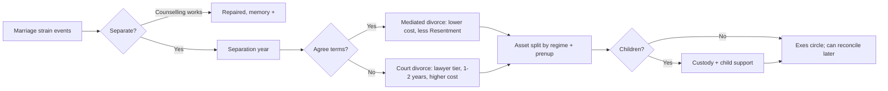

# 04 App Breakdown: Social, Meta and Premium

> [!abstract] What this note covers
> This is the second half of the app breakdown. [[04 App Breakdown - Core Life Systems]] covers stats, life stages, school, careers, money, health, crime and death. This note covers everything about **people** (relationships, love, children, generations, fame, pets), the **Activities hub redesign**, **identity**, the **meta layer** (achievements, Life Titles, Life Recap, challenges), **async social and Creator Mode**, **premium and editor tools**, the **optional AI Storyteller**, and **settings, accessibility and safety**.
>
> It stays consistent with the [[_Concept Brief]]. Where it adds a number or a rule the brief does not set, it says so and marks it as a recommendation for the client to confirm.

> [!info] How to read each module
> Every module uses the same template: **Purpose → BitLife equivalent → EverLife redesign → New features → Detailed sub-features → Key rules, data and examples → UI entry point → Priority and Free vs Plus → Dependencies → Acceptance criteria.**
>
> **Priority labels** follow the phase plan in the [[_Concept Brief]]:
> - **MVP** = needed for the Phase 3 soft launch (full life cycle, about 1,500+ events).
> - **Launch** = needed for the Phase 4 global launch (parity + "better" features, 5 languages).
> - **LiveOps** = Phase 5 and later (seasons, story packs, async social, Creator Mode).
>
> **Free vs Plus:** "Free" means every player gets it. "Plus" means the one-time **EverLife Plus** unlock (about $9.99, per the brief). "Pack" means an optional Story Pack (about $2.99–3.99). "Season" means the optional Season Pass (about $4.99). Pricing and economy detail live in [[06 Monetization and Economy]].

> [!warning] The one rule that overrides everything in this note
> **No career or core system is ever paywalled.** Plus, Packs and Seasons may sell convenience, cosmetics, extra *storylines* and editor/rewind tools. They never sell a career, a life system, a relationship type, a country, a pet species, or anything a weekly challenge needs. The "Premium boundary" table at the end lists every feature against this rule.

> [!note] Research basis and confidence
> BitLife facts below come from `reports/BitLife complete feature guide.md` and `research_notes/BitLife complete feature guide/*.md`. Player wishes come from `research_notes/Life sim game phase 1/reddit_player_wishlist.md`. All research came from web-search snippets because page fetching was blocked, so BitLife numbers (prices, ages, thresholds) are "last documented" values from fan guides, not verified late-2026 values. EverLife numbers in this note are **design proposals** to be tuned in the Phase 2 prototype and the soft launch.

## Contents

1. [[#1. Relationships]]
2. [[#2. Love and marriage]]
3. [[#3. Children and family]]
4. [[#4. Generations and Dynasty]]
5. [[#5. Fame and social media]]
6. [[#6. Pets and animals]]
7. [[#7. Activities hub redesign]]
8. [[#8. Identity and inclusion]]
9. [[#9. Achievements, Life Titles, Life Recap and collections]]
10. [[#10. Challenges and events]]
11. [[#11. Async social, multiplayer and Creator Mode]]
12. [[#12. Premium and editor tools]]
13. [[#13. Optional AI Storyteller]]
14. [[#14. Settings, accessibility and safety]]
15. [[#Premium boundary]]

### Shared building blocks used across modules

These four building blocks come from the storylet engine described in [[04 App Breakdown - Core Life Systems]] and [[08 Technical Architecture]]. Most modules in this note rely on them.

| Building block | What it is | Used by |
|---|---|---|
| **Person record** | Every human NPC (and the player) has one record: identity, stats, traits, life stage, location, relationships, memories. NPCs are simulated "lightly" (yearly roll-ups) unless they are close to the player. | Modules 1–5, 8, 11 |
| **Bond** | A directed link between two people: type (parent, friend, spouse...), visible **Bond %** (0–100), hidden facets (Trust, Respect, Attraction, Resentment), history. | Modules 1–4, 5, 6 |
| **Memory** | A stored record that "person X remembers event Y" with valence, intensity and decay. It drives callbacks years later ("Every choice remembered" pillar). | Modules 1–5, 9, 13 |
| **Action card** | A UI unit: one thing you can do now, with cost, time, age gate, odds hint and a "why locked" reason. It replaces BitLife's nested menus ("One tap to anything" pillar). | Modules 1–8, 12 |

---

## 1. Relationships

### Purpose
Make the people in a life feel like people. Relationships are the main source of emotion, story callbacks and consequences, and they feed love, family, careers, fame and crime.

### BitLife equivalent
- Every relative has a **relationship bar** with no number. Spending time, conversation, compliments and gifts raise it. Insults, assault and repeated money requests lower it. A low bar makes NPCs more likely to insult, argue with or attack you.
- Arguments offer apologize, agree to disagree, complain to mother, insult or assault.
- "Ask for Money" from parents works better at high bars. A ribbon rewards repeatedly asking after refusal.
- Stepfamilies (v1.24), multiple friends and enemies (v1.28), relationship counselling (v1.31), and co-worker, supervisor and HR interactions (Office update).
- Gaps in the research: no complete per-relative interaction list could be confirmed, and no source documented friend-making or bullying mechanics in detail.

### EverLife redesign
- **Bond % is visible.** A number next to every bar ("Mum · 72%"), as players asked on AppleVis. The bar also has a label (Estranged, Cold, Distant, Warm, Close, Devoted) so screen-reader users and colour-blind players get the same information.
- **Hidden facets explain the number.** Bond % is a weighted blend of Trust, Respect, Affection and (for partners) Attraction, minus Resentment. Players see a one-line "why" on long-press ("Trust is low because you skipped her wedding in 2031").
- **NPC memory and grudges.** NPCs remember significant events with the player and with each other, and those memories surface in later storylets. A grudge is a strong negative memory that has not been resolved.
- **NPCs act, not just react.** Close NPCs have small yearly goals (get married, change job, move away, start a feud) so the cast changes around the player.
- **One "People" screen** groups everyone by circle (Family, Partner, Friends, Work, School, Rivals, Exes, Community) with search and filters, instead of separate tabs.

### New features
- Bond % numbers and labels (player request).
- NPC memory, grudges, forgiveness and reconciliation arcs.
- "Reach out" nudges: the game reminds you when a close bond is fading ("You haven't spoken to Leo in 3 years").
- Relationship counselling for family members, not just couples.
- Social circles that interact: friends meet your partner, your parents dislike your best friend, enemies show up at your party.
- Mentors and protégés at school and work.
- Aging relatives who need care (caregiver storylets, a known gap in the research).

### Detailed sub-features

**Relationship types**

| Circle | Types | How they start | Special rules |
|---|---|---|---|
| Family | Parents, step-parents, siblings (full, half, step, twin), grandparents, aunts/uncles, cousins, nieces/nephews, in-laws | Birth, marriage, remarriage | Cannot be "removed", only estranged. Inheritance and heir rules apply. |
| Partner | Dating, partner, fiancé(e), spouse | See [[#2. Love and marriage]] | Attraction facet is active. |
| Friends | Friend, close friend, best friend (max 3 "best") | School, work, neighbours, activities, apps, random events | Friendships decay without contact. |
| Work | Co-worker, manager, direct report, mentor, client | Getting a job | Bond affects promotion and HR events (see Core Life Systems careers). |
| School | Classmate, teacher, coach, club member | Enrolment | Popularity and cliques (see Core Life Systems school). |
| Rivals | Enemy, rival, nemesis (max 1 nemesis) | Conflicts, grudges, competition | Enemies can sabotage, sue, spread rumours or attack. |
| Exes | Ex-partner, ex-spouse, ex-fling | Breakups, divorce | Can reconcile. Co-parenting if children. |
| Community | Neighbour, faith leader, landlord, fan, stalker (filtered) | Location, religion, fame | Usually light simulation. |

**Interactions** (each is an action card; availability depends on age, type and Bond %)

| Group | Interactions | Notes |
|---|---|---|
| Warm | Spend time, Talk, Compliment, Hug, Share a meal, Call/message, Write a letter | "Spend time" is the safe, reliable option, as in BitLife. |
| Help | Give gift (pick item and value), Give money, Lend money (creates a debt record), Help with a problem, Care for (elderly or sick), Babysit | Lending creates a memory and a repayment storylet. |
| Ask | Ask for money, Ask for advice, Ask for a favour (job reference, a place to stay, bail), Ask to keep a secret | Repeated asks after refusal add Resentment, not just a flat drop. |
| Conflict | Argue, Insult, Prank, Spread a rumour, Snub, Assault (crime system), Report to HR / teacher / police | Assault and rumours link to the crime system and can create grudges. |
| Repair | Apologize, Make amends (gift + apology), Forgive, Ask for forgiveness, Family counselling, Mediation | Repair has better odds when Trust is still above 30. |
| Special | Introduce to someone, Invite to party, Invite to live with you, Cut contact, Block (stops messages), Reconnect | "Introduce" lets two NPCs form their own bond. |
| Teen/child | Play, Ask to sleep over, Ask for a pet, Tattle, Copy homework | Age-gated versions of the above. |

**NPC memory and grudges**

- Each person stores up to **24 active memories about the player** and up to 8 about each other close NPC. Old, low-intensity memories fade out.
- A **grudge** forms when a negative memory has intensity ≥ 4 (on a 1–5 scale) or when 3+ negative memories with the same tag build up (for example `money`, `betrayal`, `absence`).
- Grudges block some interactions ("Ask for a favour" is greyed out with the reason "Sam still resents the $5,000 you never paid back").
- Grudges can **surface years later** as storylets: the enemy who becomes your boss, the sibling who contests the will, the ex who testifies at your trial.
- Grudges resolve through apology + amends, time (slow decay unless renewed), or a dramatic reconciliation event.
- NPCs can hold **grudges against each other** (your parents' feud with your in-laws), which shapes parties, weddings and inheritance.

### Key rules, data and examples

**Bond formula (proposal, tuned in prototype)**

```text
Bond % = clamp(0, 100,
    0.35*Affection + 0.25*Trust + 0.20*Respect + 0.20*Attraction_or_Familiarity
  - 0.50*Resentment )
```
- Facets are 0–100 and hidden by default. Destiny Mode (module 12) can show and edit them.
- **Yearly drift:** close bonds lose 2–6 points a year with no contact; family loses less (1–3), friends more (4–8). Living together stops the drift.
- **Diminishing returns:** the second "Compliment" in one year gives half the effect, the third gives none. This replaces the BitLife "spam talk every year" loop with meaningful choices.
- **Personality modifiers:** NPC traits (Proud, Forgiving, Jealous, Generous, Petty) scale reactions. A Petty NPC doubles Resentment from insults. A Forgiving NPC halves grudge decay time.

**Memory record (data example)**

```yaml
memory:
  holder: npc_8841        # Aunt Rosa
  about: player
  event: skipped_funeral  # storylet id that created it
  year: 2047
  valence: -3             # -3..+3
  intensity: 4            # 1..5
  tags: [absence, family, grief]
  decay_per_year: 0.2     # intensity lost per year without reinforcement
  callbacks: [will_reading_snub, family_reunion_cold]
```

**Example chain**
1. Age 17: you insult your younger brother Theo in front of his friends (memory: humiliation, intensity 3).
2. Age 19: you borrow $800 from Theo and never repay (memory: money, intensity 3 → grudge from 2 negatives with heavy weight).
3. Age 41: Theo is executor of your mother's will. A storylet fires: "Theo hasn't forgotten." Options: apologize and repay (Trust check), argue (lawsuit risk), let it go (you get the smaller share).

### UI entry point
- **People tab** in the bottom navigation (thumb zone). Circles appear as horizontal chips at the top. Each person opens a **Person sheet**: avatar, Bond % and label, facets ("why"), memories timeline ("Things Rosa remembers"), and action cards sorted by relevance.
- Contextual cards also appear on the **Life feed** ("Grandpa is in hospital. Visit?").
- Search bar: "talk to mum", "apologize Theo", "lend money".
- Screen and flow detail: [[05 UX and Screen Map]].

### Priority and Free vs Plus
- **MVP:** family, friends, partner, rivals, school and work bonds; Bond % and labels; core interactions; memory and grudges (basic set of 40 memory tags).
- **Launch:** NPC goals, introductions, family counselling, caregiver arcs, mentors, NPC-to-NPC grudges.
- **Free.** Destiny Mode (Plus) can view and edit hidden facets; that is an editor convenience, not a system.

### Dependencies
- Storylet engine, conditions and weights ([[04 App Breakdown - Core Life Systems]], [[08 Technical Architecture]]).
- Person record and light NPC simulation.
- Crime system (assault, rumours as defamation), careers (HR, promotion), school (popularity).
- Accessibility labels for bars (module 14).

### Acceptance criteria
- Every bond shows a numeric Bond % and a text label, and both are read by VoiceOver/TalkBack.
- Long-press (or "Why?" button) on any bond explains its top two drivers in plain language.
- In automated playtests (life simulator bot, 1,000 lives), at least 60% of lives see one memory callback storylet that references an event 10+ years earlier.
- A grudge-blocked action is never hidden: it is shown greyed out with the reason and a hint on how to repair it.
- Repeating the same positive interaction three times in one year gives no extra Bond gain beyond the second, and the card says so.

---

## 2. Love and marriage

### Purpose
Romance is one of the most played and most shared parts of a life sim. It must be fun, inclusive and dramatic, without explicit content, and its consequences (divorce, affairs, prenups) must be clear.

### BitLife equivalent
- Activities > Love: **dating app** with age and net-worth filters (about $100 a date), hookups, and a separate same-sex app added in the Pride update.
- One lover at a time; either partner can cheat. Ex-flings stay in an Exes tab.
- Buy a ring, **propose** (rejection usually means a low bar), plan a wedding with tiered venues. Fiancés demand a wedding after about three years.
- Rich partners may demand a **prenup**; without one, divorce splits assets 50/50, and a prenup only protects pre-marriage assets.
- **Arranged marriage** happens in some countries (source lists conflict); refusing ruins the bond with both parents.
- You can marry into royalty. Relationship counselling exists.
- No source confirmed polygamy, dowry, custody or child support. Players asked for **parents who divorce and remarry**, with lasting effects on the child.

### EverLife redesign
- **Attraction is two-way and explainable.** Each NPC has preferences (age range, gender(s), values, lifestyle, looks weight, wealth weight). A match screen shows "Why you click" and "Possible friction" instead of hiding the maths.
- **Relationship stages** are explicit: Crush → Dating → Exclusive → Living together → Engaged → Married (or Civil partnership where the country has it) → Separated → Divorced/Widowed. Each stage has its own card set and yearly events.
- **One app, all orientations.** A single in-game dating app (original name **Kindling**) filters by gender(s) sought, so same-sex dating is not a separate feature.
- **No explicit content.** Intimacy is "fade to black" in one line ("You spent the night together."). Content filters (module 14) can make even that more discreet.
- **Divorce is a process, not a button:** separation, negotiation or court, asset split by marital regime and prenup, custody and support if there are children, and emotional effects on everyone.
- **Parents' love lives are simulated** from birth: your parents can fight, separate, divorce, date and remarry, and you feel it.

### New features
- Parents who divorce and remarry, with step-families, two homes and holiday splits (top player request).
- Match explanations and visible "compatibility" bands (not a single opaque number).
- Wedding planner with **guest list** (reuses the party system in module 7), vows, mishap events and in-law dynamics.
- Prenup builder with three readable options.
- Custody and child support (no BitLife source found; requested by players).
- Affairs with discovery mechanics and memory, not just a random "caught" roll.
- Renewal of vows, anniversaries, widowhood and grief, late-life love.
- Arranged marriage driven by a per-country data table, written with sensitivity review.

### Detailed sub-features

**Meeting people**

| Route | Age | Cost (default currency, scaled by country) | Notes |
|---|---|---|---|
| School/college crush | 13+ (dating 15+) | Free | Teen romance is hand-holding level; no intimacy text under 18. |
| Friends of friends / introductions | 16+ | Free | Uses module 1 "Introduce". |
| Work, gym, faith community, hobby club | 18+ | Free | Workplace romance can trigger HR events. |
| **Kindling** app (dating) | 18+ | Free to browse; date ~$40–150 | Filters: age, gender(s), distance/country, wants kids, faith, income band, "looking for" (casual / serious). |
| Nightlife (clubs, bars) | 18+ | Entry + drinks | Can lead to a **fling** (fade to black). Risk events: hangover, STI (health system), bad date. |
| Matchmaker / family introduction | 18+ | Varies | Linked to arranged-marriage countries and royal circles. |
| Celebrity encounters | Fame 30+ | Free | See module 5. |

**Relationship stage actions**

- **Dating:** go on date (type: dinner, movie, walk, adventure), give gift, meet the friends, meet the parents, define the relationship, break up.
- **Exclusive / living together:** move in (shared rent and home), adopt a pet together, plan finances (joint vs separate), argue about chores, travel together.
- **Proposal:** buy a ring (jewellery shop: price tiers, appraised value), choose setting (private, public, at a party). Public proposals increase pressure: acceptance more likely if Bond ≥ 75, humiliation memory if rejected.
- **Engagement:** set a date. If no date after **3 in-game years**, the partner's patience drops each year (BitLife parity), with an ultimatum storylet.
- **Wedding:** venue tier (courthouse, backyard, hall, destination, luxury), guest list from People (capacity by venue), budget, who pays (couple, parents, split), traditions by faith/country, mishaps (rain, ex shows up, drunk uncle). Outcomes: Happiness, Bond with guests (invited / not invited memories), debt.
- **Marriage:** anniversaries (yearly card), date night, counselling, renew vows, have children (module 3), affairs, separation.

**Prenups**

| Option | What it protects | Partner reaction |
|---|---|---|
| None | Nothing; marital assets split by country default | Neutral |
| Standard | Pre-marriage assets and inheritances | Mild drop in Trust if partner is poorer |
| Ironclad | Pre-marriage assets + your business + future inheritances; caps spousal support | Larger Trust drop; may refuse to marry |

- A wealthy NPC may **demand** a prenup (BitLife parity). The pop-up shows both net worths and what each option means in one sentence each.
- Infidelity clauses are **out of scope** (too legalistic); affairs instead affect the divorce negotiation storylet.

**Divorce and separation**



- **Marital regime by country (simplified):** "Community" (marital assets 50/50, the default and BitLife parity) or "Separate" (each keeps what is in their name, with a fairness adjustment). The regime comes from the country data table and is shown before marriage.
- **Spousal support:** paid when the income gap is large and the marriage lasted 5+ years; 2–10 years of payments; Ironclad prenup caps it.
- **Emotional effects:** Happiness drop for both, children's events (module 3), friends pick sides (some friends' Bond shifts toward the ex).
- **Reconciliation:** exes can get back together (BitLife parity), with better odds if no grudge.

**Affairs**
- Start through workplace, nightlife, an ex, or the app while partnered (the app warns "You're married").
- Each year: **discovery chance** = base 15% + 10% per risky action (texts, hotel, being seen) − 5% per "Careful" choice, modified by the partner's Suspicion facet.
- Discovery outcomes: confrontation storylet (deny, confess, blame), divorce trigger, a lasting betrayal memory, and possible fame scandal (module 5).
- You can leave your spouse for the lover (BitLife parity) if the lover agrees.
- The partner NPC can also cheat; hints appear first (late nights, new phone password) so it does not feel random.

**Arranged marriage by country**
- Driven by `country.marriage_customs` data: likelihood (none / low / medium / high), who arranges (parents, matchmaker, family elders), age window, refusal consequences, and whether a later divorce is legal and how it is seen.
- Accept → arranged-marriage storyline (getting to know a stranger, love can grow or not). Refuse → large Bond drop with parents (BitLife parity) plus a chance of later reconciliation, not a permanent 0%.
- **Sensitivity:** written with cultural consultants; never mocks a culture; country lists are data, reviewed per locale. Dowry or bride-price **transactions are not simulated** in Phase 1 to avoid stereotyping (open question for the client).
- Forced-marriage themes appear only as off-screen NPC backstory with a content filter, never as a player-forced outcome under 18.

**Parents who divorce and remarry**
- From birth, the parents' marriage has a hidden **Marriage Health** (0–100) affected by money stress, affairs, kids, and personality fit.
- If it falls below 25 for 2 years: separation storylet (30–60% chance a year). The child (player) gets choices: take a side, stay neutral, act out, try to fix it.
- Custody rules apply to the player as a child: you may live with one parent and visit the other, gaining two homes, two holiday events and a "Split Homes" trait option.
- **Remarriage:** each divorced or widowed parent can date (yearly chance) and remarry, adding step-parents and step-siblings with their own Bond. "Evil step-parent" is one possibility among many, not the default.

### Key rules, data and examples
- **Compatibility bands** shown to the player: Spark (high), Steady, Mixed, Rocky. Computed from shared values, lifestyle, attraction and life goals ("wants kids" mismatch is a big negative and is shown).
- **Age rules:** romantic interactions only between characters of the same age band under 18 (13–17 can date peers 13–17 within 2 years); no romantic content between an adult and a minor, ever. Adult-to-adult gap ≥ 20 years triggers family and friends commentary events.
- **One spouse at a time.** Consensual non-monogamy and polygamous marriage are out of scope for Phase 1 (open question; laws vary by country and it adds a lot of writing).
- **Example:** Marisol (32, Spain) marries Jonah (35, US) without a prenup. Spain's data uses a community regime. After a court divorce at 44, marital assets ($620k) split 50/50; Jonah keeps his pre-marriage house. Their 9-year-old gets joint custody and a "Two Countries" storyline when Jonah emigrates.

### UI entry point
- **People tab → Partner chip** (partner card pinned at the top when you have one).
- **Love card group** in the Activities hub (module 7): "Find love", "Open Kindling", "Go out tonight".
- Life feed cards for anniversaries, proposals expected, suspicion hints.
- Search: "propose", "divorce", "prenup", "date app".

### Priority and Free vs Plus
- **MVP:** meeting routes, Kindling, stages, proposal, wedding (basic guest list), prenup (3 options), divorce (mediated/court, 50/50 default), affairs, exes.
- **Launch:** parents who divorce/remarry, custody/support (module 3), marital regimes by country, arranged marriage data for launch countries, vow renewal, late-life love, royal marriage.
- **Free** in full. Story Packs may add romance *storylines* (for example a "Summer Romance" holiday arc) but never a relationship stage or route.

### Dependencies
- Module 1 (Bonds, memory), module 3 (children, custody), module 7 (party system for weddings), module 14 (content filters, age modes).
- Country data table (laws, customs, regimes) and money system in [[04 App Breakdown - Core Life Systems]].
- Age-rating decisions in [[09 Compliance and Ratings]].

### Acceptance criteria
- Every romantic route works for any gender combination without a separate feature or menu.
- No romance text involving a character under 18 goes beyond hand-holding, and no adult–minor romance is possible; enforced by the content validator in CI.
- The prenup pop-up explains all three options in one sentence each, with both net worths shown.
- A divorce with children always produces a custody outcome and, where applicable, a child-support line in the finances view.
- In a 1,000-life bot run, at least 15% of player childhoods include a parental separation, and at least half of those include a remarriage event.

---

## 3. Children and family

### Purpose
Children are how a life continues into the next one. Parenting must be about real choices that shape the child, so the heir you play next feels like the result of how you raised them.

### BitLife equivalent
- From 18, Activities > **Fertility**: IVF, Surrogate, Donate Sperm, Vasectomy. Surrogacy costs about $25k to $100k+ and is legal only where it is in real life.
- IVF and artificial insemination can produce **twins or triplets**. Partner must agree to IVF.
- **Adoption** needs age 21+, a job and a home, and shows a list of children with stats.
- A "Fertile" ribbon for many children. Continue as any eligible child, adopted children included.
- No sources were found on child-rearing interactions, custody or child support. Players asked for **being born a twin/triplet or with siblings**, child support, and buying cars for children who pass their driving test.

### EverLife redesign
- **Family planning is a conversation with your partner**, not a menu: "Try for a baby", "Not yet", "Never", with partner reactions and arguments when you disagree.
- **Fertility is a hidden stat** that declines with age and is affected by health and habits. The doctor can test it and say "Fertility: below average" so it is not a mystery.
- **Parenting styles and actions shape children's traits**, and the child remembers how you raised them (module 1 memory).
- **Custody and child support** are real systems after divorce or separation.
- **Multiples and siblings at birth**: the player can be born a twin or triplet.

### New features
- Born a twin/triplet (player request), with twin-specific storylets.
- Parenting styles, yearly parenting action cards, and child memories of the player as a parent.
- Custody (sole, joint, visitation) and child support.
- Foster care and foster-to-adopt; sibling-group adoption; international adoption rules by country.
- Egg donation and egg freezing (BitLife only lists sperm donation and vasectomy in sources).
- Tubal ligation and reversals.
- Gifts for children's milestones, including a car when they pass their driving test (player request).
- Pregnancy as a short arc (announcement, scan, cravings, birth story), with a filter for pregnancy loss.

### Detailed sub-features

**Ways to have children**

| Route | Requirements | Cost (US baseline, scaled by country cost index) | Odds and notes |
|---|---|---|---|
| Natural conception | Partner able to conceive with you; both agree | Free | Per-year chance from both partners' Fertility. Twins ~1.5%, identical twins ~0.4%, triplets ~0.02%. |
| Artificial insemination | 18+; donor or partner | ~$1,000 per attempt | 10–20% per attempt; multiples slightly up. |
| IVF | 18+; partner consent if partnered; health ok | ~$12,000–25,000 per cycle | Success by age: <35: 40%; 35–37: 30%; 38–40: 20%; 41–42: 10%; 43+: 4%. Twins 20%, triplets 2% of successes. |
| Egg freezing | 18–40 | ~$10,000 + storage | Uses age at freezing for later IVF odds. |
| Surrogacy | 18+; country allows it (data table) | ~$25,000–120,000 | Legal per country, BitLife parity. "Traveling for surrogacy" option if not legal at home, with legal-risk storylet. |
| Adoption | Age 21+ (country data), stable home, income ≥ threshold, no serious criminal record | Agency fees ~$0–50,000 | Wait 1–3 years. Domestic, international, foster-to-adopt. Sibling groups. Child profiles show age, health, personality, and a short backstory. |
| Fostering | 21+, spare room | Small stipend paid to you | Temporary placements; can lead to adoption. |
| Donating sperm/eggs | 18–35 | Paid to you ($100–$8,000) | Rare future storyline: a biological child finds you. |
| Vasectomy / tubal ligation | 18+ | ~$1,000–6,000 | Reversal possible, 50–70% success. |

**Parenting**

- **Parenting style** (pick at first child, changeable): Warm, Strict, Free-range, Hands-off. Each sets weights for child trait development and event pools.
- **Yearly parenting cards per child**, by age:
  - 0–4: Cuddle, Read a story, Play, Sing, Sleep-train, Choose daycare.
  - 5–12: Help with homework, Sign up for lessons (music, sport, art, languages: feeds special careers in Core Life Systems), Play together, Set rules, Pocket money, Take on a trip, Talk about feelings.
  - 13–17: Talk, Set curfew, Driving lessons, Buy a car (gift), Allowance, Support a crush, Discuss future, Ground them, Give privacy.
  - 18+: Help pay for university, Give a deposit for a home, Lend money, Ask for help in old age.
- **No physical punishment option.** Discipline choices are non-violent (talk, ground, remove privileges). Neglect and abuse appear only as off-screen NPC backstory behind a content filter; the player cannot choose to abuse a child.
- **Child memories of the parent:** children store memories just like other NPCs. A child raised Hands-off with many missed milestones may have Resentment as an adult and refuse to care for you in old age.
- **Child traits** (examples): Curious, Athletic, Rebellious, Anxious, Kind, Competitive, Creative. Traits come from genetics (parents' stats and traits with randomness), parenting style and events.

**Custody and child support**

| Outcome | How it is decided | Effects |
|---|---|---|
| Joint custody | Default when both parents have Bond ≥ 40 with the child and no serious issues | Child alternates homes; both can do parenting cards (each at 75% effect). |
| Primary custody (you) | Court weighs: Bond with child, income stability, criminal record, home, addiction, child's wish (12+) | You get full parenting cards; the other parent pays support. |
| Primary custody (other parent) | Same weighting | You get "Visit" cards (reduced effect); you pay support. |
| Sole custody / no contact | Serious issues (violent crime, abandonment) | Strong child memories; reconnect possible at 18+. |

- **Child support (game rule, not legal advice):** paying parent pays a % of yearly income: 1 child 15%, 2 children 22%, 3+ children 28%, capped by country data; stops at 18 (or 21 in some countries). Missing payments creates debt, a court storylet and a child Resentment memory.
- The player as a child can be the subject of custody (module 2, parents who divorce).

**Family events**
- Sibling rivalry, sibling bonds that last a lifetime, twins' "twin sense" storylets, family holidays, family reunions, grandparent babysitting, family business (Core Life Systems business), family secrets (hidden half-sibling, adoption reveal), elderly parent care, empty nest.

### Key rules, data and examples
- **Age limits:** children with the player only from 18+. Pregnancy age limits for natural conception follow fertility decline; IVF available until 50 by default (country data).
- **Max children:** no hard cap; performance budget allows 20 children per life and 200 living descendants simulated at full detail (others light). Recommendation, see [[08 Technical Architecture]].
- **Example:** Aiko (36) and Dev (38) try for 2 years with no luck. The doctor says Aiko's fertility is "below average" and Dev's "average". IVF cycle 1 fails (30% odds shown). Cycle 2 succeeds with twins. Dev takes the "Warm" style; at 14, twin Ren is Athletic and Competitive (from sport lessons), twin Mei is Creative and Anxious (from a school bullying event Aiko handled with "Talk about feelings", which reduced the anxiety penalty).

### UI entry point
- **People tab → Family chip → Children** (each child has a Person sheet with a "Parenting" section).
- **Family planning card** on the partner's sheet ("Talk about kids").
- **Activities hub → Family & Fertility** card group (module 7), and search ("IVF", "adopt", "foster", "custody").
- Life feed cards for milestones ("Ren passed the driving test. Buy a car?").

### Priority and Free vs Plus
- **MVP:** natural conception, IVF, adoption, multiples, parenting cards (basic 3 age bands), child memories, custody (joint/primary), child support.
- **Launch:** surrogacy legality by country, fostering, egg freezing/donation, ligation/reversal, parenting styles, twins at birth for the player, family secrets.
- **Free** in full.

### Dependencies
- Modules 1, 2 and 4; health system (fertility, pregnancy), money (costs, support payments), law/courts (custody), country data table ([[04 App Breakdown - Core Life Systems]]).
- Content filters for pregnancy loss and abuse backstory (module 14).

### Acceptance criteria
- Every fertility route shows its cost and success odds before you confirm.
- A child's adult traits can be traced to at least one parenting choice or event, shown in the child's "How they grew up" summary.
- After any divorce with minor children, a custody result and a support amount (or "none") are visible in both parents' finance and family views.
- The player can be born as a twin or triplet in at least 1.5% of random lives, and twin storylets fire for them.
- There is no player-selectable action that physically harms a child; verified by content validator rules.

---
