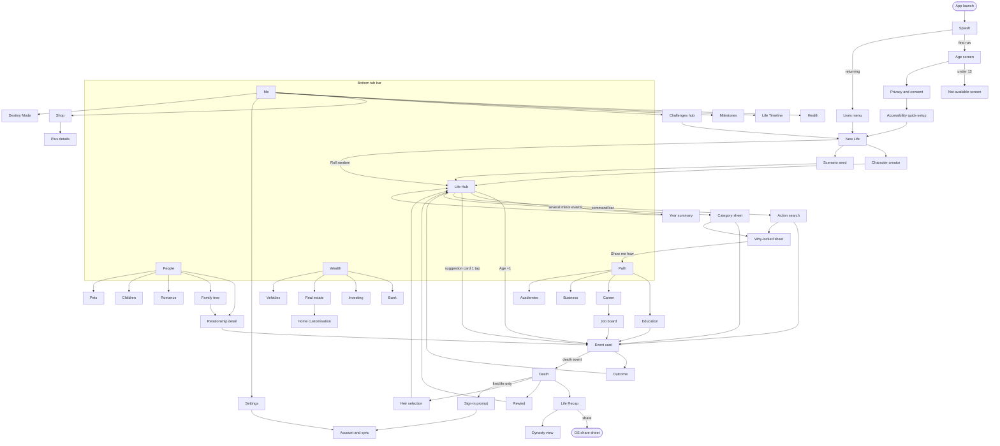

# 05 UX and Screen Map

*Purpose:* Defines how Relivable looks and feels: the screen inventory, navigation, wireframes, first-time experience, visual direction and accessibility spec.

> [!summary] In one paragraph
> Relivable keeps BitLife's one-thumb, one-year-per-tap rhythm, but rebuilds everything around it. There is a **thumb-zone Life Hub**, **card-based events**, a **bottom command bar** ("What do you want to do?") instead of nested Activities menus, **no silent failures** (every locked action says why and when it unlocks), and **accessibility as a release gate**. This note is the screen inventory, navigation map, wireframes, FTUE, visual direction and accessibility spec. Its source of truth is [[_Concept Brief]] (pillars 2 and 5). The systems behind each screen are in [[04 App Breakdown - Core Life Systems]] and [[04 App Breakdown - Social, Meta and Premium]], and the implementation (Flutter `Semantics`, remote content) is in [[08 Technical Architecture]].

Related: [[00 Home]] · [[06 Monetization and Economy]] (shop/paywall screens) · [[07 Retention and LiveOps]] (daily goals, challenges, push) · [[09 Compliance and Ratings]] (age gate, consent) · [[12 Risks and KPIs]] (UX KPIs).

---

## 1. Design principles

| # | Principle | Rule we enforce | Why (evidence) |
|---|---|---|---|
| P1 | **Thumb zone first** | Primary actions (Age +1, command bar, choice buttons, tab bar) live in the bottom 40% of the screen. Nothing the player taps every year goes in the top corners. Swipes run bottom to top. | Hoober's thumb-zone research; avoid primary buttons in top corners ([Fluid UI](https://blog.fluidui.com/the-thumb-zone/), [Smashing](https://smashingmagazine.com/2020/02/design-mobile-apps-one-hand-usage/), [BrightHR](https://engineering.brighthr.com/blog-post/designing-for-thumbs)); in a small study 8 of 10 participants preferred bottom-up swipes ([UX Collective](https://bootcamp.uxdesign.cc/52-weeks-of-interaction-design-f09e9fb145d7)) |
| P2 | **Card-based events** | Every event is one card: illustration, 1–3 sentences, 2–4 choices stacked at the bottom. Outcomes come back on the same card (it flips), with stat deltas shown as numbers. | Cards handle mixed content without overload ([UX Design Institute](https://www.uxdesigninstitute.com/blog/wp-json/wp/v2/posts/10413)); the Reigns/Tinder swipe-deck lineage ([CareerFoundry](https://careerfoundry.com/en/wp-json/wp/v2/posts/5118)) |
| P3 | **No silent failures** | A locked action is always shown greyed out with a lock icon and a reason ("Unlocks at 16", "Needs a driving licence", "Needs $2,000, you have $340"). Every failure explains the cause and gives the next step ("The heist failed: guard rotation. Scout first next time"). | AppleVis users report BitLife activities that silently refuse to open when the character is too young ([AppleVis](https://applevis.com/comment/92232)); the train heist always says "too early" with no explanation ([Redlib mirror of r/bitlife](https://redlib.belloworld.it/user/Alexio8008/submitted)) |
| P4 | **Max 2 taps to any action** | From the Life Hub, every action is reachable in **at most 2 taps**: (a) a contextual suggestion card, which is 1 tap; (b) a category sheet then the action, which is 2 taps; or (c) the command bar, then typing, then a result, which is 2 taps plus text. Confirmation steps count only for irreversible or money-spending actions. | BitLife spreads activities across School, Relationships and "More", unlocked by age ([AppleVis](https://www.applevis.com/apps/ios/games/bitlife)) |
| P5 | **Search / command bar** | A persistent bottom pill ("What do you want to do?") opens a sheet with fuzzy search over every action, person, asset and setting. It accepts synonyms ("ask out" → Romance > Ask on a date), shows recent and suggested actions, and lists locked results with their reasons. | Pillar 2 of [[_Concept Brief]] |
| P6 | **Show the numbers** | Every bar shows its number (Happiness 72) and every relationship shows a percentage, plus a short "why it changed" line. | Players ask for percentages on relationship bars ([AppleVis](https://www.applevis.com/comment/110061)) |
| P7 | **Consequences are visible** | When a choice will be remembered, the card shows a small "◆ Remembered" marker. When the memory resurfaces years later, the card links back to the original moment in the Life Timeline. | Pillar 1, and the "repetitive / passive" criticism ([Blackscreen Gaming](https://blog.blackscreengaming.com/audio-games/bitlife-review/01/25/2019/)) |
| P8 | **Monetisation never interrupts** | No interstitials, no ad after an action, no purchase prompt mid-event. The shop is reachable from the Me tab and from end-of-life only. | Ad complaints are the top quit reason ([Google Play reviews](https://play.google.com/store/apps/eventdetails/4831791308351315470)); see [[06 Monetization and Economy]] |
| P9 | **Accessible by default** | Every control has a label, text scales without truncation, colour is never the only signal, every animation has a reduced-motion version, and no timed choices. Accessibility QA blocks a release. | Pillar 5; BitLife's VoiceOver regressions ([AppleVis](https://applevis.com/comment/134996)) |
| P10 | **One-handed, interruptible** | The game saves after every year and every choice. Sessions can stop mid-card and resume in the same place. Nothing requires two hands. | Commute or queue play; Hoober's finding that grips change constantly |

> [!tip] Tap budget, measured
> UX QA runs a "tap budget" script on every build. For the 60 most-used actions it counts taps from the Hub, and any action over 2 taps fails CI. Targets and telemetry are in [[12 Risks and KPIs]].

---

## 2. Information architecture

**Bottom tab bar (5 tabs, labels always visible):**

| Tab | Icon | Contains |
|---|---|---|
| **Life** (home) | sun-ring | Life Hub: avatar, stats, the year's feed, suggestions, Age +1 |
| **People** | two heads | Family, partner, friends, exes, coworkers, pets, family tree |
| **Path** | signpost | School/university, job/career, business, military/police academy, freelance |
| **Wealth** | coin-stack | Bank, investing, real estate, vehicles, belongings, home customisation |
| **Me** | person-badge | Stats detail, traits, life chapters, health, Life Timeline, milestones, challenges, shop, settings |

**Persistent bottom cluster** (above the tab bar): `[ 🔍 What do you want to do? ]  [ AGE +1 ]`. The Age button is the largest target on screen, at least 64×64 pt, on the right for right-hand use. It mirrors to the left with the **Left-hand layout** setting.

---

## 3. Full screen inventory

Legend: **M** = modal or sheet, **F** = full screen, **T** = tab root. "Unlock" is the earliest age or event at which the screen appears. Locked screens still show in search with their reason.

### 3.1 Launch, account and setup

| # | Screen | Type | Purpose | Key components | Entry → Exit |
|---|---|---|---|---|---|
| S01 | Splash / loading | F | Brand, content-bundle check | Logo, progress, offline badge | App launch → S02 (first run) or S05 |
| S02 | Age screen | F | Neutral age gate (compliance) | Month/year wheel pickers (no default age), "Why we ask" link | S01 → S03; under-13 → S02b block screen. See [[09 Compliance and Ratings]] |
| S03 | Privacy and consent | M | CMP for ads/analytics, per region | Plain-language toggles, "Accept all / Only needed / Choose" (equal visual weight) | S02 → S04 |
| S04 | Accessibility quick-setup | M | Detects OS settings and confirms them | Text-size preview, reduced motion, colour-vision mode, left-hand layout; auto-skipped if OS defaults are fine (with a "Change later" note) | S03 → S06 |
| S05 | Lives menu (title) | F | Continue, new life, saved lives | Continue card (avatar, age, year), New Life, Saved Lives (slots), Dynasty, Challenges | Launch → S06/S10/S40 |
| S06 | New Life | F | Start a life in 1 tap | **Roll a random life** (primary), Custom life, Scenario seed (import code), Era picker (later phase) | S05 → S07 or S10 |
| S07 | Character creator | F | Custom life | Name, gender, country/city, birth era, avatar base, optional traits (Plus: full Destiny Mode) | S06 → S10 |
| S08 | Account and sync | F | Link Apple/Google/email to the anonymous account, restore purchases, device list | Sign-in buttons, last sync time, **Restore purchases** (always visible), export save | Me → Settings → S08; prompted after the first life ends |
| S09 | Sign-in prompt | M | Save-protection prompt | "Protect this life and your purchases on every device" | After first death or first purchase → S08 or dismiss |

### 3.2 Core loop

| # | Screen | Type | Purpose | Key components | Entry → Exit |
|---|---|---|---|---|---|
| S10 | **Life Hub** | T | Home: who I am, what happened this year, what I can do | Avatar (ages visually), name/age/year/country, 4 stat chips with numbers, chapter banner, year feed, 3 suggestion cards, command bar, Age +1 | Tab "Life" → anywhere |
| S11 | **Event card** | M (full-height sheet) | One storylet moment with choices | Illustration, title, body, 2–4 choices, "◆ Remembered" marker, AI-text badge + report (if AI flavour is on) | Age +1 / action → S12 (same card flips) |
| S12 | Outcome face | M (same card) | Result and consequences | Outcome text, stat deltas (+3 Smarts ▲), relationship deltas, "Why?" expander, Continue | S11 → S10 or chained S11 |
| S13 | Year summary | M | Batch of minor events when several fire at once | Collapsible list, one line each, "Open" for detail | Age +1 → S10 |
| S14 | **Action search / command bar** | M | Do anything fast | Search field, recent, suggested for your age, results grouped (Actions/People/Assets/Settings), locked results with reasons | Bottom pill on any tab → target screen or action |
| S15 | Category sheet | M | Browse actions by category (the replacement for Activities) | Grid of 8–12 categories (Wellbeing, Romance, Nightlife, Shopping, Travel, Health, Legal, Crime, Faith, Licences, Identity, Social Media), each listing its actions with lock reasons | Hub "All actions" / S14 → action |
| S16 | Why-locked sheet | M | Explains a lock | Requirement checklist (✓ Age 18 · ✗ Licence · ✓ $500), "Show me how" (deep link to the step that unlocks it) | Tap any locked item → target |
| S17 | Rewind | M | Time rewind | Life timeline scrubber by year, "Rewind to age N", remaining rewinds (1 free per life + 1 per day via opt-in rewarded ad; unlimited with Plus) | Death screen / Me → S10 |

### 3.3 People

| # | Screen | Type | Purpose | Key components | Entry → Exit |
|---|---|---|---|---|---|
| S20 | People list | T | Everyone in your life | Segments (Family, Partner, Friends, Work, Exes, Pets), Bond % (relationship), mood icon, "needs attention" dot | Tab → S21 |
| S21 | **Relationship detail** | F | One NPC: state, memories, actions | Portrait, Bond % (relationship percentage), trend sparkline, traits, **shared memories** (from NPC memory), actions (Spend time, Talk, Gift, Ask for money, Argue, Romance…) | S20 / hub card → S11 (event) |
| S22 | Family tree | F | Generations and branches | Zoomable tree, deceased greyed with a dagger marker plus the word "Deceased", tap a node → S21 | People → S22 |
| S23 | Romance / dating | F | Dating app, hookups, proposals, wedding | Filtered match cards, date planner, ring/venue pickers | S15/S21 → S11 |
| S24 | Children and family planning | F | Kids, adoption, IVF, surrogacy | Child cards, options with costs and legal-in-country flags | People → S11 |
| S25 | Party planner | F | Host parties with a guest list (new) | Guest picker from People, venue, theme, budget → event chain | Wealth > Home / S15 |
| S26 | Pets | F | Pets, shelter, breeders, exotics (18+) | Pet cards, care actions, adoption flow | People → S21-style detail |
| S27 | Visit a friend's life (async, later phase) | F | Read-only view of a friend's shared life snapshot | Their recap, invite to challenge, react | Social → S27 |

### 3.4 Path (education and work)

| # | Screen | Type | Purpose | Key components | Entry → Exit |
|---|---|---|---|---|---|
| S30 | Education | T | School → university → grad school | Current school card, grades %, popularity %, clique, electives (new), teachers (new), study/skip/drop-out actions with consequences | Tab Path → S11 |
| S31 | **Career** | F | Current job and progression | Job card (title, salary, performance %, satisfaction, coworkers), ladder view of promotion steps, actions (Work harder, Ask raise, Quit…), special-career progress | Path → S11 |
| S32 | Job board | F | Find a job | Filters (part-time / full / freelance / special), requirement badges (met/unmet), apply → interview event | S31 / S14 → S11 |
| S33 | Business | F | Start and run a business | P&L summary, staff, products, decisions, sell | Path → S11 |
| S34 | Service academies (new) | F | Military / police academy paths | Phase tracker (application, training, assignment), fitness and record requirements | Path → S11 |

### 3.5 Wealth

| # | Screen | Type | Purpose | Key components | Entry → Exit |
|---|---|---|---|---|---|
| S40 | Wealth overview | T | Net worth at a glance | Net-worth number + trend, cash, debts, income/expenses per year | Tab → S41–S45 |
| S41 | Bank and loans | F | Accounts, loans, mortgage | Balances, rates, payoff | S40 |
| S42 | Investing | F | Stocks, funds, crypto (simulated) | Portfolio, buy/sell, history (no real-money anything) | S40 |
| S43 | Real estate | F | Buy, sell, rent, flip | Listings with clear amenities (pool, bedrooms, condition), mortgage calculator | S40 → S11 |
| S44 | Vehicles and belongings | F | Cars, boats, heirlooms | Asset cards, condition, sell/gift to child | S40 |
| S45 | Home customisation (new) | F | Decorate your home (cosmetic + small stat effects) | Room view, decor slots, themes (some cosmetic IAP; see [[06 Monetization and Economy]]) | S40 / S43 |

### 3.6 Me, meta and risky systems

| # | Screen | Type | Purpose | Key components | Entry → Exit |
|---|---|---|---|---|---|
| S50 | Me overview | T | Stats, traits, chapter | Visible stats with numbers, discovered hidden stats (revealed by events), traits, current chapter | Tab → S51–S59 |
| S51 | Health and doctor | F | Conditions, treatments, rehab, therapy, cosmetic surgery | Condition list with severity labels, treatment options with cost and risk % | Me / S15 → S11 |
| S52 | Crime and heist planner | F | Crimes up to heists | Heist planner (crew, scouting, gear, odds shown as a band with reasons), outcome breakdown | S15 → S11 |
| S53 | Prison | F | Prison life | Sentence timer (in years), behaviour, gang, appeal, escape (puzzle **optional and skippable**, with a text-choice alternative) | Arrest → S53 |
| S54 | Legal / lawsuits (new) | F | Sue and be sued | Case cards, lawyer choice, odds band, retaliation risk | S15 → S11 |
| S55 | Fame and social media | F | Followers, posts, verification, brand deals | Per-platform follower counts, post composer (choice-based), fame % | S15 → S11 |
| S56 | Faith (new) | F | Religion system | Faith, attendance, family reactions | S15 → S11 |
| S57 | **Life Timeline (memory journal)** | F | Timeline of everything that happened, plus "remembered" moments | Year-by-year list, filters (People, Money, Crime…), ◆ markers, jump-to-year | Me / any "◆" link |
| S58 | Milestones and Life Titles | F | Achievements and the end-of-life title collection | Grid with locked hints ("Live past 100"), progress | Me / S60 |
| S59 | Challenges hub | F | Daily goals, weekly challenge, season | Daily goals (3), weekly challenge card, season track, archive | Me / push → S06 with seed |
| S60 | Death | F | The end of a life | Epitaph, cause, age, net worth, Life Title earned, **View Life Recap**, Rewind, Continue as heir | Death event → S61/S17/S62 |
| S61 | **Life Recap** | F (story pager) | Shareable, Wrapped-style recap | 6–8 vertical 9:16 story cards, share/export, "Try my life" seed code | S60 / S57 → share sheet / S62 |
| S62 | Heir selection | F | Continue the dynasty | Eligible heirs (children, including adopted), inheritance preview, generation counter "Gen 3 of 4" free / "of 8" with Plus (caps shown clearly) | S60 → S10 (new character) |
| S63 | Dynasty view | F | Multi-generation family legacy | Generations strip (up to 8), Dynasty Ambitions, family crest, total wealth over time; **Dynasty Recap** when a dynasty completes at Generation 8 | S05 / S22 |

### 3.7 Shop, settings and support

| # | Screen | Type | Purpose | Key components | Entry → Exit |
|---|---|---|---|---|---|
| S70 | Shop | F | Everything for sale, in real-money prices | Relivable Plus card (exact contents list), No Ads (+ Plus Upgrade for No-Ads owners), Story Packs, Season Pass, Welcome Pack, cosmetic sets, Founder's Bundle / Complete Collection, Restore Purchases (catalogue: [[06 Monetization and Economy]] §2) | Me → S70; Death screen secondary link |
| S71 | Plus details | M | One-time unlock explained | Checklist of contents, "Not included" list, price, "Already own it? Restore" | S70 → OS purchase sheet |
| S72 | Rewarded ad offer | M | Opt-in ad for a perk | Exact reward, ad length estimate, remaining today (e.g. "3 of 8 left"), No thanks (same size) | Only from explicit "Watch for…" buttons |
| S73 | Settings | F | App settings | Text size, theme (light/dark/system), motion, haptics, colour-vision mode, left-hand layout, AI flavour text on/off, content filters, notifications, language | Me → S73 |
| S74 | Notification preferences | F | Push categories | Toggles per category, quiet hours | S73 / after first life ends |
| S75 | Help and report | F | FAQ, contact, bug report, report AI text | Searchable FAQ, auto-attached log (with consent) | S73 / card overflow menu |
| S76 | Destiny Mode (Plus) | F | Edit stats and people (our original name for the editor) | Stat sliders incl. revealed hidden stats, NPC editor | Me → S76 (Plus) or S71 |
| S77 | Scenario seed share/import | M | Share or play a seeded life | Seed code + QR, preview of the starting conditions | S61 / S06 |

**Total: 60+ screens.** About 15 are needed for the Phase 2 prototype: S01, S05, S06, S10–S16, S20, S21, S30, S50, S57 and S60–S61 (see [[11 Roadmap Team and Budget]]).

---

## 4. Navigation map



---

## 5. Wireframes (6 key screens)

Phone frame shown at 360 dp wide. `▓` = thumb zone (bottom ~40%).

### 5.1 Life Hub (S10)

```
┌────────────────────────────────────┐
│ ☰ Lives        Relivable      ⚙︎ 🔔 │  ← low-frequency only (top)
├────────────────────────────────────┤
│   ╭─────╮   Maya Okafor, 17        │
│   │ ◕‿◕ │   Lagos → Dublin · 2009  │
│   ╰─────╯   Chapter: "Restless Teen"│
│ ┌──────┬──────┬──────┬──────┐      │
│ │☺ 72 ▲│✚ 88  │◆ 64 ▼│✦ 55  │      │  ← Happiness Health Smarts Looks
│ └──────┴──────┴──────┴──────┘      │     numbers + icon + arrow
├──── This year (age 17) ────────────┤
│ • Passed driving test (1st try)    │
│ • Dad moved out. Parents separated │
│   ◆ Remembered                     │
│ • Joined the debate club   +2 ◆    │
├──── Suggested for you ─────────────┤
│▓┌──────────┐┌──────────┐┌────────┐▓│
│▓│📚 Study   ││📞 Call    ││🎉 Throw ││▓│  ← 1-tap contextual cards
│▓│for exams ││Dad       ││a party  ││▓│     (horizontal scroll)
│▓└──────────┘└──────────┘└────────┘▓│
│▓          All actions ›           ▓│
│▓┌───────────────────────┐ ┌──────┐▓│
│▓│🔍 What do you want to do?│ │ AGE  │▓│  ← command bar + Age +1
│▓└───────────────────────┘ │  +1  │▓│     (64pt min target)
│▓                          └──────┘▓│
├────────────────────────────────────┤
│ ☀ Life │ 👥 People │ ⇢ Path │ ¤ Wealth │ ◉ Me │
└────────────────────────────────────┘
```

### 5.2 Event card (S11, then S12 on flip)

```
┌────────────────────────────────────┐
│               ━━━━                 │  ← sheet grabber (swipe down = "Decide later" only if not forced)
│  ┌──────────────────────────────┐  │
│  │      [ illustration 16:9 ]   │  │
│  └──────────────────────────────┘  │
│  AGE 17 · FAMILY            ◆      │
│  Dad's new partner                 │
│  Your dad introduces you to Lena,  │
│  his new partner. She's trying     │
│  very hard. Dad watches you.       │
│                                    │
│  ✦ AI-reworded · ⋯ Report          │  ← only if AI flavour text is on
│▓┌────────────────────────────────┐▓│
│▓│  Be warm and welcoming         │▓│
│▓└────────────────────────────────┘▓│
│▓┌────────────────────────────────┐▓│
│▓│  Be polite but distant         │▓│
│▓└────────────────────────────────┘▓│
│▓┌────────────────────────────────┐▓│
│▓│  Tell Lena she'll never be Mum │▓│
│▓└────────────────────────────────┘▓│
│▓┌────────────────────────────────┐▓│
│▓│ 🔒 Ask Dad to talk alone       │▓│  ← locked choice with reason:
│▓│    Needs Dad ≥ 60% (now 48%)   │▓│     "no silent failure"
│▓└────────────────────────────────┘▓│
└────────────────────────────────────┘

        ── flips to Outcome (S12) ──
┌────────────────────────────────────┐
│  You were polite but distant.      │
│  Lena smiled anyway. Dad looked    │
│  relieved, then a bit sad.         │
│   Dad        48% → 52%  ▲ +4       │
│   Lena       new · 35%             │
│   Happiness  72 → 70    ▼ −2       │
│  ◆ Lena will remember this.        │
│   Why? ›                           │
│▓┌────────────────────────────────┐▓│
│▓│            Continue            │▓│
│▓└────────────────────────────────┘▓│
└────────────────────────────────────┘
```

### 5.3 Action search / command bar (S14)

```
┌────────────────────────────────────┐
│ (Hub dimmed behind)                │
├────────────────────────────────────┤
│ Recent:  Gym · Call Dad · Study     │
│ ─────────────────────────────────── │
│ ACTIONS                            │
│  💘 Ask someone on a date    Romance│
│  📱 Dating app               Romance│
│  🔒 Propose          needs partner ›│  ← lock reason inline
│ PEOPLE                             │
│  👤 Dara Kim (classmate, 61%)       │
│ PLACES & ASSETS                    │
│  🍸 Nightclub      🔒 unlocks at 18 ›│
│ SETTINGS                           │
│  ⚙︎ Content filters: romance        │
│ ─────────────────────────────────── │
│▓┌────────────────────────────────┐▓│
│▓│ 🔍 date|                    ✕ │▓│  ← field stays at the bottom,
│▓└────────────────────────────────┘▓│     results grow upward
│▓[ q w e r t y u i o p ]           ▓│
│▓[ keyboard ...        ]           ▓│
└────────────────────────────────────┘
```
Behaviour: fuzzy and synonym matching ("ask out", "hook up", "find love" → Romance). Results are ranked by age-relevance and recency. Voice dictation works through the OS keyboard. An empty query shows "Suggested for age 17".

### 5.4 Relationship detail (S21)

```
┌────────────────────────────────────┐
│ ‹ People                     ⋯     │
│   ╭─────╮  Dad, Tunde Okafor, 46   │
│   │ ◔_◔ │  Father · Lives apart     │
│   ╰─────╯  Traits: Proud · Stubborn │
│  Relationship  52%  ▁▂▃▂▁▂▃  ▲ +4  │  ← number + trend (not colour only)
│  Why: "Polite to Lena" (+4)        │
├──── Shared memories ◆ ─────────────┤
│ Age 6  Taught you to ride a bike   │
│ Age 15 Missed your recital (−8)    │
│ Age 17 Moved out after the divorce │
│        See all 14 ›                │
├──── Family ────────────────────────┤
│ Partner: Lena (35%) · Ex: Mum      │
├────────────────────────────────────┤
│▓┌───────────┐┌───────────┐┌──────┐▓│
│▓│ Spend time ││ Talk      ││ Gift │▓│
│▓└───────────┘└───────────┘└──────┘▓│
│▓┌───────────┐┌───────────┐┌──────┐▓│
│▓│ Ask money  ││ Argue     ││ More▾│▓│  ← More = full action list
│▓└───────────┘└───────────┘└──────┘▓│
└────────────────────────────────────┘
```

### 5.5 Career (S31)

```
┌────────────────────────────────────┐
│ ‹ Path                             │
│  JUNIOR NURSE · St. Brigid's       │
│  $41,200 / yr · 3 yrs in role      │
│  Performance  78%  ▇▇▇▇▇▇▇▇░░      │
│  Satisfaction 61%  ▇▇▇▇▇▇░░░░      │
│  Stress       High ⚠ (text label)  │
├──── Ladder ────────────────────────┤
│  ● Student nurse     ✓             │
│  ● Junior nurse      ← you         │
│  ○ Staff nurse   needs Perf 85%,   │
│                  2 more yrs        │
│  ○ Charge nurse  needs Nursing MSc │
│  ○ Nurse manager                   │
├──── Coworkers ─────────────────────┤
│  Dr. Ama Owusu (boss, 44%) ›       │
│  Kev (friend, 70%) ›               │
├────────────────────────────────────┤
│▓┌──────────────┐┌────────────────┐▓│
│▓│ Work harder  ││ Ask for a raise │▓│
│▓└──────────────┘└────────────────┘▓│
│▓┌──────────────┐┌────────────────┐▓│
│▓│ Find new job ││ Quit / Retire ▾ │▓│
│▓└──────────────┘└────────────────┘▓│
└────────────────────────────────────┘
```
All careers are free, including special careers. The ladder always shows the next requirement, so the player never wonders "why can't I get promoted?".

### 5.6 Life Recap (S61): story pager, 9:16, export-ready

```
┌────────────────────────────────────┐
│ ▬▬▬▬ ▬▬▬▬ ▬▬▬▬ ░░░░ ░░░░ ░░░░  ✕   │  ← story progress (tap/hold, or swipe)
│                                    │
│         MAYA OKAFOR                │
│         1992 – 2071 · 79 yrs       │
│                                    │
│   ╭─────╮ ╭─────╮ ╭─────╮           │
│   │ ◕‿◕ │→│ ◕_◕ │→│ ◔‿◔ │  avatar   │
│   ╰─────╯ ╰─────╯ ╰─────╯  ages     │
│     5       30      79             │
│                                    │
│   LIFE TITLE: "The Quiet Healer"    │
│   Your archetype: Steady Caregiver │  ← novel stat (Wrapped's "Listening Age" idea)
│   Top 4% of lives for kindness     │
│                                    │
│   3 kids · 2 marriages · 1 lawsuit │
│   Net worth $1.2M · Died: old age  │
│                                    │
│▓┌───────────────┐┌───────────────┐▓│
│▓│ ↗ Share story ││ ⧉ Try my life │▓│  ← share 9:16 PNG/MP4 + seed code
│▓└───────────────┘└───────────────┘▓│
│▓┌────────────────────────────────┐▓│
│▓│     Continue as heir (gen 2)   │▓│
│▓└────────────────────────────────┘▓│
└────────────────────────────────────┘
```
Card sequence: (1) Born → (2) Childhood moment → (3) Biggest choice ◆ → (4) Love & family → (5) Career peak → (6) Scandal or proudest moment → (7) Life Title + archetype → (8) Epitaph + share. Story cards do not auto-advance when Reduce Motion or VoiceOver/TalkBack is on. Cards export with an app link and seed QR. Spotify Wrapped's story-format slides with a share button are the model ([The Hustle](https://thehustle.co/12062021-spotify-wrapped)); Wrapped 2025 was reportedly shared 500M+ times on day one ([RouteNote](https://routenote.com/blog/spotify-wrapped-2025-record-breaking-launch/)).

---

## 6. FTUE / onboarding

> [!important] Target: first funny, meaningful choice within 60 seconds of first launch
> Players should reach core gameplay within about 1 minute; delays past about 90 s lose many users (rule of thumb, [Playio](https://blog.playio.co/mobile-game-onboarding-retention)). FTUE is measured by D1 retention ([Roblox](https://create.roblox.com/docs/production/game-design/onboarding)), and every step below is a tracked funnel event ([GameAnalytics](https://gameanalytics.com/blog/tips-for-a-great-first-time-user-experience-ftue-in-f2p-games)).

### 6.1 First 60 seconds (step by step)

| t (s) | Step | Player sees / does | Teaching goal | Funnel event |
|---|---|---|---|---|
| 0–3 | Splash | Logo, then straight in | – | `ftue_launch` |
| 3–10 | Age screen | Month + year wheels (required by law; we keep it to one screen) | – | `ftue_age_ok` |
| 10–15 | Consent | One sheet, three equal buttons | – | `ftue_consent` |
| 15–18 | New Life | One giant button: **"Roll a life"** (custom is secondary) | One tap starts everything | `ftue_life_start` |
| 18–25 | Birth card | "You're born a girl in Lagos, 1992. Your mother names you Maya." Avatar appears. One choice: **"Cry loudly"** / **"Stare suspiciously at the doctor"** | Cards and choices | `ftue_first_choice` |
| 25–30 | Hub reveal | Stat chips glow once with a coach mark: "These are your stats. Numbers, not guesses." | Stats are readable | `ftue_hub_seen` |
| 30–35 | Age +1 | Pulse on Age +1: "Tap to live a year." | The core verb | `ftue_age_1` |
| 35–45 | Age 1–3 | Two quick funny cards (e.g. "You bit a cousin." → "Blame the dog" / "Own it"). The second shows **◆ Remembered** with "Cousin Ada will remember this." | Consequences | `ftue_memory_seen` |
| 45–55 | Age 4 | Suggested card appears: "📚 Read with Mum". Tap → +Smarts, +Mum % | Suggestions = 1 tap | `ftue_suggestion_used` |
| 55–60 | Age 5 | The command bar unlocks with a coach mark: "Try typing what you want to do." Prefilled ghost text "sing" | Search exists | `ftue_search_seen` |
| 60–120 | Age 5–8 | School card, first friend, first locked tap → **Why-locked sheet** ("Nightclub unlocks at 18") | No silent failure | `ftue_lock_explained` |

No forced tutorial screens, no account wall, no shop, no ads and no push prompt in the first life.

### 6.2 Progressive unlocks (age-gated, mirrored by "unlocks at N" hints)

| Age / trigger | Unlocks (screen or feature) | Coach mark (once, dismissible) |
|---|---|---|
| 0 | Hub, Age +1, parents in People | "Tap a person to see how they feel about you" |
| 5 | Education tab section, command bar | "Type anything" |
| 8 | Hobbies, pets (ask parents), first electives | – |
| 12 | Mind & Body, Faith | – |
| 13 | Phone and social media, Life Timeline tip | "Every big moment is saved in your Life Timeline" |
| 14 | Part-time jobs, Job board | – |
| 16 | Driving licence, dating, parties | "Parties: pick your guest list" |
| 18 | Full careers, crime and heists, Wealth tab full, nightlife, fertility, exotic pets | Wealth tab tour (3 steps, skippable) |
| 21 | Adoption | – |
| First death | Death screen, Life Recap, Heir, **then** Challenges hub, sign-in prompt, push permission ask | "Share your life story" |
| Life 2 start | Daily goals, Shop visible in Me tab, scenario seeds | – |
| Life 3 or Day 3 | Weekly challenge, Season track | – |

Push permission is asked after the first memorable life ends, not at launch (see [[07 Retention and LiveOps]] §4.5). Opted-in users retain about 2x better (correlational vendor data, [Chartboost](https://www.chartboost.com/?p=5759)).

---

## 7. Visual direction

### 7.1 Style
- **"Warm storybook, crisp UI."** Flat vector illustration with soft grain for event cards and avatars. The UI chrome stays clean and system-like (rounded 16 dp cards, generous spacing). Flat and minimal styles read well on small screens and are cheap to produce ([Udonis](https://blog.udonis.co/mobile-marketing/mobile-games/mobile-game-art-styles)).
- An illustrated layer sets us apart from BitLife's text lists, and The Sims Mobile's 2026 shutdown leaves a gap for visual life sims ([SimsCommunity](https://simscommunity.info/2025/10/20/the-sims-mobile-shutting-down/)).
- Illustration budget: about **120 reusable scene illustrations** for MVP (tagged by context: hospital, school, club, courtroom…) plus about 40 hero illustrations for rare events. Storylets reference scenes by tag (see [[08 Technical Architecture]]).

### 7.2 Palette tokens (light / dark)

| Token | Light | Dark | Use |
|---|---|---|---|
| `bg.base` | `#FBF7F2` (warm paper) | `#14131A` | App background |
| `bg.card` | `#FFFFFF` | `#1F1E27` | Cards, sheets |
| `bg.raised` | `#F2ECE4` | `#2A2934` | Chips, tab bar |
| `text.primary` | `#1D1B22` | `#F3F0EA` | Body (≥ 12:1 on bg) |
| `text.secondary` | `#5A5663` | `#B9B4C2` | Meta text (≥ 4.5:1) |
| `brand.primary` | `#5B3FD9` (ever-violet) | `#9E8BFF` | Age +1, primary CTA |
| `brand.accent` | `#FF7A59` (coral) | `#FF9478` | Highlights, ◆ memory marker |
| `stat.happiness` | `#E69F00` orange | `#F0B43C` | ☺ icon + number |
| `stat.health` | `#009E73` bluish green | `#33C49B` | ✚ icon + number |
| `stat.smarts` | `#0072B2` blue | `#4DA3E0` | ◆ icon + number |
| `stat.looks` | `#CC79A7` reddish purple | `#E19CC4` | ✦ icon + number |
| `state.positive` | `#1B7F4B` + ▲ | `#4CC38A` + ▲ | Deltas up (always with arrow and sign) |
| `state.negative` | `#B3261E` + ▼ | `#FF8A80` + ▼ | Deltas down |
| `state.locked` | `#8C8794` + 🔒 | `#6F6A78` + 🔒 | Locked actions (always with a reason line) |
| `focus.ring` | `#1A73E8` 3 dp | `#8AB4F8` 3 dp | Keyboard / switch / screen-reader focus |

Stat colours use the Okabe–Ito colour-blind-safe set, and every stat also has a unique icon and a number. Colour is never the only cue ([Games for Change](https://gamesforchange.org/studentchallenge/wp-content/uploads/2022/01/Tips_Resources_for-Considering-the-Needs-of-Disabled-Gamers-in-Design.pdf)). Tokens are themeable through remote config for seasonal skins, but the contrast rules are validated in CI.

### 7.3 Typography

| Role | Font (OFL licence) | Base size (scales with Dynamic Type / font scale) |
|---|---|---|
| Display (names, recap titles) | **Fraunces** SemiBold | 28 sp |
| Event title | Fraunces SemiBold | 22 sp |
| Body / event text | **Atkinson Hyperlegible Next** Regular | 17 sp (iOS body default) |
| Choice buttons | Atkinson Hyperlegible Next Bold | 17 sp, min height 52 dp |
| Numbers (stats, money) | Atkinson Hyperlegible Next, tabular figures | 15–20 sp |
| Optional dyslexia-friendly toggle | OpenDyslexic | – |

Line length is 30–45 characters per line on phones and line height 1.4. No all-caps body text. No text is baked into images (so it stays translatable and readable by screen readers).

### 7.4 Iconography
- A 24 dp outline set with a 2 dp stroke and rounded joins. Every icon is paired with a text label in the tab bar, choices and stats. Icon-only buttons are allowed only for universal actions (close, back, share), and each still has an accessibility label.
- Category icons are distinct in **shape**, not just colour (heart = romance, scales = legal, mask = crime).

### 7.5 Avatar style
- Layered 2D paper-doll avatar: head shape, skin tone (12+ tones), hair (40+ styles including textured and protective styles), facial hair, eyes, glasses, hijab/turban/headwear, mobility aids, freckles/vitiligo/birthmarks, clothing.
- **The avatar ages:** 7 age stages (baby, child, teen, young adult, adult, middle age, elder) with greying, wrinkles and posture, plus life-event overlays (scrubs, prison orange, wedding outfit). This answers the Change.org request for more inclusive character customisation ([Change.org](https://www.change.org/topic/bitlife-en-us)).
- NPCs use the same system at portrait scale. Pets get a separate simple rig.

### 7.6 Micro-animations (all with reduced-motion fallbacks)

| Moment | Animation | Duration | Reduced Motion |
|---|---|---|---|
| Age +1 | Year counter rolls, avatar crossfades to new age | 350 ms | Instant number change + 120 ms fade |
| Event card in | Slides up from the button tapped, slight scale | 220 ms ease-out | 120 ms opacity fade |
| Card flip to outcome | 3D flip on Y axis | 300 ms | Crossfade |
| Stat delta | Number ticks up/down, chip pulses once | 400 ms | Static delta label "▲ +3" |
| ◆ Memory created | Diamond sparkles into Life Timeline icon | 500 ms | Static marker + toast |
| Life Recap | Story pager parallax | per card | No parallax, manual advance |
| Death | Gentle desaturate and fade to epitaph | 800 ms | Cut to epitaph |

Micro-interactions such as press feedback are a 2026 UI trend ([ABP.io](https://abp.io/community/articles/UI-UX-Trends-That-Will-Shape-2026-bx4c2kow)). We keep them short and never block input.

### 7.7 Haptics (sparing, following the Apple HIG patterns)

| Event | iOS pattern | Android | Notes |
|---|---|---|---|
| Choice selected | `selection` | `CLOCK_TICK` | – |
| Positive major outcome (promotion, wedding) | `notification.success` | `CONFIRM` | Max once per card |
| Negative major outcome (arrest, diagnosis) | `notification.warning` | `REJECT` | – |
| Death | single soft `impact(.soft)` | `EFFECT_HEAVY_CLICK` (low) | – |
| Locked tap | `notification.error` (light) | `REJECT` | Paired with the Why-locked sheet |
| Age +1, navigation, scrolling | **none** | none | Haptics on every tap are excessive ([FanDuel design](https://fanduel.design/formation/guidelines/haptics)) |

There is a haptics toggle (On / Important only / Off), and the game respects the OS haptics setting ([Apple HIG](https://developer.apple.com/design/human-interface-guidelines/playing-haptics.md)).

### 7.8 Dark mode
- **Free, and follows the system by default.** BitLife gates dark mode behind Bitizenship, and players complain ("Why make people pay for dark mode?", [Google Play](https://play.google.com/store/apps/eventdetails/4831791308351315470)).
- Options are System / Light / Dark / **High-contrast dark** (pure `#000000` background, `#FFFFFF` text, 3 dp borders).
- Illustrations get a dark-mode variant through a tone-mapped palette swap rather than second assets, which keeps art cost flat.

---

## 8. Accessibility spec

> [!warning] Release gate
> Every build runs automated semantics checks (Flutter `SemanticsTester` / accessibility guideline tests) plus a manual VoiceOver and TalkBack smoke script on 3 devices. A regression on any P0 flow (FTUE, Hub, Event card, Search, Death/Recap, Shop, Restore purchases) blocks release. BitLife's history (fully accessible around 2020, broken by a 2022 update, then "VoiceOver reads nothing") shows how silently this breaks ([AppleVis](https://applevis.com/comment/135435), [AppleVis](https://applevis.com/comment/210590)). We will also recruit 5–10 blind or low-vision testers from the AppleVis community for every major release.

### 8.1 Screen reader (VoiceOver / TalkBack)

| Element | Label / value / hint (example) | Implementation notes |
|---|---|---|
| Stat chip | "Happiness, 72 out of 100, up 3 this year" | `Semantics(label, value, increasedValue)` grouped per chip |
| Age +1 | "Age up. Currently 17. Lives one year." | Large target. Announces a summary of the new year after tap |
| Event card | Title read first, then body, then "4 choices" | Card is a `Semantics` container. Focus moves to the title on open |
| Choice button | "Be polite but distant. Choice 2 of 4." | Locked: "Ask Dad to talk alone. Locked. Needs relationship with Dad 60 percent, currently 48." |
| Outcome deltas | "Dad, relationship 52 percent, up 4. Happiness 70, down 2." | Live region (`liveRegion: true`) announcement |
| ◆ marker | "Remembered. Lena will remember this." | Not decorative. Read as text |
| Relationship trend | "Trend: rising over last 5 years" | The sparkline is hidden from readers; a summary text replaces it |
| Avatar | "Maya, 17, short braids, school uniform" | Generated from avatar data |
| Tab bar | "Life, tab, 1 of 5, selected" | Native tab semantics |
| Life Recap card | Full text of the card, "Card 3 of 8" | No auto-advance. Swipe actions to next/previous |
| Images / illustrations | Decorative by default; rare-event heroes get a short alt description | Authored in the storylet data (`alt` field) |

- **Custom actions:** on the Event card and Relationship detail, the VoiceOver rotor and TalkBack actions menu list every choice and action, so users don't have to navigate a long list.
- **Focus order** follows the visual order top to bottom. When a sheet closes, focus returns to the control that opened it.
- **No timed choices anywhere.** Minigames (prison escape, burglary maze, heists) always offer a text-choice alternative and a "Skip puzzle" option, as requested by screen-reader users ([AppleVis](https://applevis.com/comment/94502)).
- Rewarded ad modals must have a labelled, reachable close and decline. BitLife users report ads that are hard to dismiss with VoiceOver ([AppleVis](https://www.applevis.com/comment/135452)).

### 8.2 Dynamic type / font scaling
- Text follows iOS Dynamic Type up to **AX5 (~310%)** and Android font scale up to **200%** with no truncation. Cards grow vertically and scroll, and choice buttons wrap to multiple lines. Icons scale with text ([WWDC19](https://wwdcnotes.com/documentation/wwdc19-244-visual-design-and-accessibility/)).
- At ≥ 200%, the stat chips row reflows to a 2×2 grid and the tab bar switches to icon + short label.
- An in-game text size slider is offered for players who don't use the OS setting.

### 8.3 Colour and contrast
- WCAG 2.2 AA equivalent: 4.5:1 for body text, 3:1 for large text and UI glyphs. EN 301 549 is the European Accessibility Act harmonised standard (see [[09 Compliance and Ratings]]).
- **Colour-vision modes:** Default (already Okabe–Ito safe), Protan/Deutan tuned, Tritan tuned, and Monochrome (patterns + icons only). Every state also uses a shape or arrow and a sign (▲ +3, ▼ −2) ([Game Accessibility Guidelines](https://gameaccessibilityguidelines.com/basic/)).

### 8.4 Reduced motion
- Honour iOS Reduce Motion and Android "Remove animations" automatically, plus an in-game toggle (Full / Reduced / None). Fallbacks are listed in §7.6. No parallax, no auto-playing loops, and no screen shake ([WWDC19](https://wwdcnotes.com/documentation/wwdc19-244-visual-design-and-accessibility/)).

### 8.5 One-handed and motor
- Minimum touch target **48×48 dp** (Android) / **44×44 pt** (iOS), with ≥ 8 dp spacing. Age +1 is 64 pt.
- **Left-hand layout** mirrors the Age +1 / command bar cluster.
- **Reachability:** a pull-down on the Hub moves the top half of the content into the thumb zone.
- No gestures are required. Every swipe has a button equivalent, and there are no long-press-only actions.
- Switch Control, Voice Control and Android Switch Access work through the semantics tree. Every interactive element is focusable.
- "Confirm big decisions" setting (default on for spending > 50% of cash, crime, quitting a job, divorce) prevents accidental taps.

### 8.6 Cognitive and content
- Plain-language event text at about reading age 12 (copy guideline in the storylet style guide).
- A "Why?" expander on outcomes, and a glossary for finance, legal and medical terms.
- Content filters for romance detail level, drugs/alcohol and violence, plus a content-warning line on heavy events (death of a child, abuse) with a "skip details" choice.

---

## 9. BitLife UX problems → our fix

| # | BitLife problem (evidence) | Impact | Relivable fix | Screen(s) |
|---|---|---|---|---|
| 1 | Activities split across School, Relationships and "More", unlocked by age, hard to find ([AppleVis](https://www.applevis.com/apps/ios/games/bitlife)) | Discovery friction, feels shallow | Command bar + category sheet + contextual suggestions; ≤2 taps rule | S10, S14, S15 |
| 2 | Activities silently fail to open when too young ([AppleVis](https://applevis.com/comment/92232)) | Confusion, "is it broken?" | Locked items are visible with a reason and a "Show me how" path | S16 |
| 3 | Unlabelled School buttons for VoiceOver ([AppleVis](https://applevis.com/comment/92141)) | Unplayable for blind players | Mandatory semantics labels; accessibility CI gate | All |
| 4 | Repeated VoiceOver regressions after updates ([AppleVis](https://applevis.com/comment/132456)) | Community trust loss, petition | Release-blocking a11y QA + tester panel | Process |
| 5 | Opaque relationship bars; players ask for percentages ([AppleVis](https://www.applevis.com/comment/110061)) | Decisions feel random | Numbers, deltas, trend and a "why" line everywhere | S21, S12 |
| 6 | Heists fail with an unexplained "too early" ([Redlib](https://redlib.belloworld.it/user/Alexio8008/submitted)) | Frustration | Heist planner shows the odds band, factors and a failure breakdown | S52 |
| 7 | Ads interrupt small actions; 40 s ads for gifts and music lessons ([Google Play](https://play.google.com/store/apps/eventdetails/4831791308351315470)) | Top quit reason | No interstitials; opt-in rewarded ads only, with a visible reward and remaining count | S72 |
| 8 | Ads still shown after buying ad removal ([ComplaintsBoard](https://www.complaintsboard.com/bitlife-life-simulator-b150146)) | Broken promise | Plus/No-Ads removes **every** ad surface; rewarded perks are auto-granted | S70/S71 |
| 9 | Dark mode is paywalled ([Google Play](https://play.google.com/store/apps/eventdetails/4831791308351315470)) | Feels greedy | Dark mode free, follows the system | S73 |
| 10 | Lost purchases and saves on a new phone; Restore fails ([Google Play](https://play.google.com/store/apps/eventdetails/4831791308351315470), [DroidWin](https://droidwin.com/bitlife-crashing-when-opening-menu-how-to-fix/)) | 5★ → 1★ reviews | Account-linked cloud saves, Restore always visible, sync status shown | S08 |
| 11 | Players want to choose which stats appear in the HUD ([AppleVis](https://www.applevis.com/comment/98871)) | – | Long-press or settings to pin any 4 stats (including revealed hidden stats) to the Hub | S10, S73 |
| 12 | Maze/escape minigames inaccessible ([AppleVis](https://applevis.com/comment/94502)) | Blocks progress | Text alternative + skip | S53 |
| 13 | House listings don't show amenities such as a pool ([AppleVis](https://www.applevis.com/comment/98871)) | Poor decisions | Structured listing cards with amenities and condition | S43 |
| 14 | "Passive decision-making", repetitive random events ([Blackscreen Gaming](https://blog.blackscreengaming.com/audio-games/bitlife-review/01/25/2019/)) | Churn after several lives | Memory markers, chapter banners, consequence callbacks linked from the Life Timeline | S11, S57 |
| 15 | Tombstone summary is static and not shareable | Missed virality | Wrapped-style Life Recap with export and seed codes | S61, S77 |
| 16 | Pay-per-use undo ([AppleVis](https://www.applevis.com/comment/98823)) | Feels exploitative | 1 free Rewind per life + 1 per day via opt-in rewarded ad; unlimited with one-time Plus; never sold per use | S17 |

---

## 10. Open UX questions (for Phase 2 playtests)
1. Swipe-to-choose (Reigns style) as an *optional* input mode, or buttons only? Default is buttons; swipe is behind a setting.
2. Command bar placement: bottom pill (current) vs a floating button. A/B test in the prototype ([[07 Retention and LiveOps]] §7).
3. How many suggestion cards: 3 vs 5. Test the effect on actions per year and session length.
4. Whether the Recap auto-plays (for players not using a screen reader) or advances manually.
