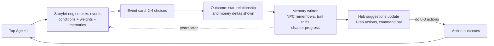
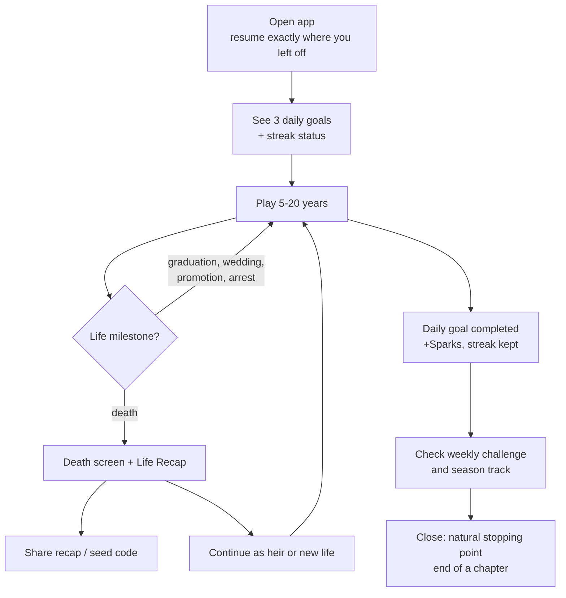
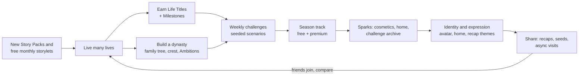

# 07 Retention and LiveOps

> [!summary] In one paragraph
> EverLife retains through **story**, not pressure. The year-by-year core loop has to make each life feel different (memory, chapters, consequences). A short session loop is built around 3 daily goals and a one-year-a-day streak with free freezes. The meta loop of dynasties, Life Titles, weekly challenges and quarterly seasons gives a reason to come back for months. We target **top-decile retention: D1 40% / D7 13% / D30 5%** against a market median of about 22% / 4% / 0.7% ([GameAnalytics 2026 via gamedevreports](https://gamedevreports.substack.com/p/gameanalytics-mobile-and-pc-game)). LiveOps runs a weekly challenge every Monday, two weekend events a month, a Story Pack every two months and four seasons a year. All of it is delivered as data through remote config and storylet bundles, so no app update is needed. Source of truth: [[_Concept Brief]] (pillars 1 and 4, Phase 5 LiveOps).

Related: [[00 Home]] · [[04 App Breakdown - Core Life Systems]] · [[04 App Breakdown - Social, Meta and Premium]] · [[05 UX and Screen Map]] (Challenges hub S59, Recap S61) · [[06 Monetization and Economy]] (Season Pass, Sparks) · [[08 Technical Architecture]] (Remote Config, content pipeline) · [[10 Go-to-Market]] · [[11 Roadmap Team and Budget]] (writer capacity) · [[12 Risks and KPIs]].

---

## 1. Loops

### 1.1 Core loop (seconds: one year)

### 1.2 Session loop (5–12 minutes, est.)

### 1.3 Meta loop (weeks to months)

Where retention comes from: novelty (new storylets every month), mastery (Titles, hard challenges), identity (dynasty, avatar, home), and social (shared seeds, recaps). Pressure mechanics (energy, timers, loss aversion) are deliberately absent.

---

## 2. Retention targets vs benchmarks

| Metric | Market median | Top quartile | Top 10% | **EverLife target (global launch)** | **Soft-launch gate to go global** |
|---|---|---|---|---|---|
| D1 | ~22% | just above 30% | ~40% | **40%** | ≥ 35% |
| D7 | just under 4% | 6–7% | ~11–12% | **13%** | ≥ 10% |
| D30 | 0.69–0.79% | ~1.6–1.8% | ~4% | **5%** | ≥ 3.5% |
| D90 (secondary) | n/a | n/a | n/a | 2% (est.) | ≥ 1.2% |

Sources: GameAnalytics 2026 benchmarks (2025 data) ([gamedevreports](https://gamedevreports.substack.com/p/gameanalytics-mobile-and-pc-game), [PDF](https://investgame.net/wp-content/uploads/2026/01/2026-01-27-2026-mobile-pc-benchmarks_compressed.pdf)). Top-quartile figures are from the 2025 edition ([gamedevreports](https://gamedevreports.substack.com/p/gameanalytics-mobile-gaming-benchmarks)). For context, Sensor Tower puts D7 for the top-25 games at 14.9% in December 2025 ([gamedevreports](https://gamedevreports.substack.com/p/sensor-tower-state-of-gaming-2026)). We do **not** use unsourced "simulation D30 20–30%" blog figures ([Playio](https://blog.playio.co/retention-by-game-genre)). No credible published retention exists for life sims specifically, so these targets are aspirational and top-decile.

> [!note] Why top-decile is plausible (and the risk)
> BitLife-style games have a strong "one more year" pull and short, interruptible sessions. Management sims exceed 50% D1 on US Android ([Appodeal](https://gameindustrylibrary.com/documents/mobile-casual-benchmarks-report-2025/read)). The risk is the **repetition wall after 5–10 lives** ([Common Sense Media](https://www.commonsensemedia.org/app-reviews/bitlife-life-simulator), [Metacritic](https://www.metacritic.com/game/bitlife-life-simulator/user-reviews/)). D30 therefore depends on content depth (1,500+ storylets at soft launch, per [[_Concept Brief]]) and the memory system, not on daily-reward mechanics. That risk is tracked in [[12 Risks and KPIs]].

**Supporting engagement KPIs (targets, est.):**

| KPI | Target |
|---|---|
| Time to first choice | ≤ 25 s (FTUE, see [[05 UX and Screen Map]] §6) |
| FTUE completion (reaches age 18 in life 1) | ≥ 75% of installs |
| Sessions per DAU per day | 2.5–3.5 |
| Average session length | 6–10 min |
| Lives completed by D7 (D7 retained users) | ≥ 4 |
| Recap share rate (shares ÷ completed lives) | ≥ 4% |
| Push opt-in (asked after first life) | iOS ≥ 55%, Android ≥ 80% |
| Streak ≥ 7 days (share of D7 retained) | ≥ 30% |
| Weekly challenge participation (share of WAU) | ≥ 25% |
| DAU/MAU | ≥ 22% |

Push opt-in benchmarks: about 81% on Android and 51% on iOS ([Pushwoosh](https://cdc.pushwoosh.com/blog/increase-push-notifications-opt-in)).

---

## 3. Retention feature list

| Feature | How it works | Fairness rule | Unlock | Evidence |
|---|---|---|---|---|
| **Daily goals** | 3 goals a day, refreshed at 04:00 local. Mix: 1 easy ("Live 5 years"), 1 system ("Make a friend at work"), 1 story ("Find out what happened to Cousin Ada"). +20 Sparks each, +50 for all three | Always completable in one 5–10 min session, with any free life. 1 free reroll/day plus 1 via opt-in ad | Life 2 | Daily goals as a habit lever ([monetization research §4](../../research_notes/Life%20sim%20game%20phase%201/monetization_retention.md)) |
| **Streaks with freeze** | The streak counts days with **at least 1 year lived** (one Age +1). Milestones at 7/30/100/365 days give Sparks + a cosmetic | **1 free auto-freeze every week**; bank up to 2 more with Sparks (200). Repair within 48 h by completing 2 daily goals, for free. **Never sold for money** | Life 2 | Duolingo: 10-day streak users churn less, and relaxing the streak to "one lesson a day" improved retention ([Business of Apps](https://www.businessofapps.com/news/duolingos-streak-feature-drives-record-17-million-daus)); losing long streaks drives users away ([Indie Hackers](https://www.indiehackers.com/post/a-streak-feature-increases-retention-ed65a9d3de)) |
| **Weekly challenges** | New seeded challenge every **Monday 15:00 UTC**, runs 7 days: a scenario start + 3–5 tasks ("Become a surgeon, adopt twins, never commit a crime"). Reward: 200 Sparks, a unique Milestone, a cosmetic | **Completable with the free base game**. Never needs a Story Pack. Past challenges sit in the Challenge Archive (Sparks, not cash) | Life 3 or day 3 | BitLife players say challenges are "very hard for those who don't have expansion packs" ([Sensor Tower review dump](https://app.sensortower.com/api/ios/apps/1374403536?country=GB)) |
| **Weekend events** | 2 per month, Fri–Sun. Boosted storylet weights for a theme ("Crime Wave Weekend": heist events ×3, special heist outcomes) + a community counter ("Players solved 1.2M heists") | No paid component. Free reward for participation | Day 3 | Weekend timing peaks ([Sensor Tower Royal Match calendar](https://sensortower.com/blog/what-royal-matchs-calendar-teaches-about-live-ops-in-2026)) |
| **Seasonal events** | 4 seasons a year, about 13 weeks each. Each has a themed storyline (8 chapters released weekly), a free track (~20 rewards) and a premium track ($4.99, ~30 cosmetics + 2 bonus chapters) | Main storyline free for all. Premium is cosmetic + bonus story only | Life 3 | Half of top-grossing titles used a season pass in 2021, and casual games adopted them ([Sensor Tower](https://sensortower.com/blog/state-of-mobile-game-monetization-2022)). BitLife ended its Seasons/pass system in Aug 2026 ([BitLife What's New](https://bitlifeapp.com/whats-new)), which leaves the format open |
| **Dynasty Ambitions** | Long goals across generations ("3 generations of doctors", "Family net worth $100M"), plus Legacy Points per [[04 App Breakdown - Social, Meta and Premium]] | Free tier: up to Generation 4 per dynasty, shown clearly. No goal needs more than 3 generations | First heir | Pillar 4 |
| **Life Titles and Milestones** | End-of-life title (one per life) + ~300 Milestones at launch, with locked hints | Hints are always shown (no silent mystery) | Life 1 death | BitLife ribbons drive community decoding ([Gamezebo](https://www.gamezebo.com/walkthroughs/bitlife-guide-how-to-get-the-model-bitizen-ribbon/)) |
| **Life Recap sharing** | Wrapped-style 9:16 cards + "Try my life" seed | Free | Life 1 death | Wrapped credited with a 21% rise in app downloads ([Idomoo](https://www.idomoo.com/blog/why-spotify-wrapped-works-and-how-you-can-do-it-too/)) |
| **Friend seeds and async visits** (Phase 5) | Play a friend's seed and compare outcomes; visit a friend's shared life snapshot | Free | Account linked | Change.org multiplayer petition ([Change.org](https://www.change.org/topic/bitlife-en-us)) |
| **Comeback flow** | After 7+ days away: "While you were away…" a family-news card for the active life, a small Sparks welcome-back bonus, and a summary of new content | No pressure copy | Auto | – |

### 3.5 Push notification policy

> [!important] Rules
> 1. **Permission is asked after the first life ends**, on a pre-prompt screen that explains the value ("Get told when a new weekly challenge drops"). It is never asked at launch. If declined, we ask again once at most, after the third completed life. Many games ask too early without explaining the value ([ContextSDK](https://contextsdk.com/blogposts/gaming-push-strategy-overcoming-the-63-5-industry-opt-in-challenge)).
> 2. **Caps:** max **1 push per day** and **4 per week** by default (remote-config). Max 2/week for users inactive 14+ days, and **stop entirely after 30 days** of inactivity, apart from one "new season" notice.
> 3. **Quiet hours** 21:00–09:00 local (user-editable). No pushes during school hours (08:00–15:00 local, weekdays) for 13–17 age-band users.
> 4. **Categories, each toggleable:** Weekly challenge · Season and events · Streak reminder (opt-in, default **off**) · Story callbacks ("Your daughter just called…") · News and updates.
> 5. **Copy rules:** no guilt ("Your family misses you!"), no fake urgency, no monetisation pushes (we never push an offer). Story callbacks are written in character and link to a real pending in-game event.
> 6. All pushes are measured for opt-out rate. Any template with an opt-out rate above 1.5% is retired.

Opted-in users are about 2x more likely to be retained, though that is correlational vendor data ([Chartboost](https://www.chartboost.com/?p=5759)).

---

## 4. LiveOps 12-month calendar (Year 1)

Months are calendar-aligned so holiday beats line up. Shift the table to the actual global launch month ([[11 Roadmap Team and Budget]]). Every month also has 4–5 weekly challenges (§3) and the free monthly storylet drop (§5). "SP" = Story Pack ($2.99/3.99), "S" = Season.

| Month | Season (free storyline + $4.99 pass) | Story Pack release | Weekend events (2/mo) | Weekly challenge themes (examples) | Market beats (localised) |
|---|---|---|---|---|---|
| **Jan** | **S1 "Fresh Start"** begins: New Year resolutions arc | – | Resolution Weekend · Lunar New Year Family Feast | "Clean Slate" (no crime, get a degree after 30), "Gym Rat" | Lunar New Year (late Jan/Feb) |
| **Feb** | S1 ch. 4–7 | **SP1 *Spotlight*** (film and stage fame) | Love Week (romance ×3) · Carnival Weekend | "Hopeless Romantic", "Starstruck" | Carnival (BR), Valentine's |
| **Mar** | S1 finale: "Turning Point" | – | Crime Wave Weekend · Spring Break | "Self-Made" (rags to riches), "Perfect Student" | Soft-launch anniversary of the beta community |
| **Apr** | **S2 "Bloom"**: families and new beginnings | **SP2 *Night Shift*** (hospital drama) | Baby Boom Weekend · Earth Weekend | "Big Family" (5+ kids), "Green Life" | Easter |
| **May** | S2 ch. 4–8 | – | Graduation Weekend · Mother's Day Callbacks | "Valedictorian", "Mama's Favourite" | Mother's Day (varies by country) |
| **Jun** | S2 finale | **SP3 *Old Money*** (aristocratic family saga) | Pride Weekend (identity, found family) · Festa Junina | "Love Is Love", "Small-Town Hero" | Pride month, Festa Junina (BR) |
| **Jul** | **S3 "Summer of Chaos"**: wild, comedic, high-risk lives | – | Heatwave Holidays (travel ×3) · Heist Weekend | "World Traveller", "Chaos Agent" (creator-designed) | Summer creator push ([[10 Go-to-Market]]) |
| **Aug** | S3 ch. 4–8 | **SP4 *Frontier 1850*** (first era start) | Sports Weekend · Back-to-School Prep | "Pioneer", "Gold Medal" | – |
| **Sep** | S3 finale | – | Back to School (school events ×3) · **Anniversary Weekend** | "Teacher's Pet", "Anniversary Dynasty" (3 gens) | Launch anniversary: free cosmetic for all |
| **Oct** | **S4 "Hauntings & Homecomings"**: ghosts of past choices (memory callbacks) | **SP5 *The Uncanny*** (light supernatural) | Oktoberfest · Halloween Weekend | "Haunted House", "Witching Hour" | Oktoberfest (DE), Halloween |
| **Nov** | S4 ch. 4–8 | – | Día de Muertos (honour ancestors, dynasty callbacks) · Thanksgiving Family Dinner | "Remember Me" (ancestor goals), "Grateful" | Día de Muertos (ES/LatAm), US Thanksgiving |
| **Dec** | S4 finale + **Life Recap of the Year** (player-level "Year in Lives" recap) | **SP6 *Hometown*** (small-town politics and community) | Holiday Homecoming · New Year's Eve Countdown | "Holiday Spirit", "Last Year Standing" | Year-end recap campaign (Wrapped-style) |

**Annual totals (Year 1 plan):** 52 weekly challenges · 24 weekend events · 4 seasons (32 free chapters + 8 premium bonus chapters) · 6 Story Packs · 12 free monthly storylet drops · 1 Year-in-Lives recap. BitLife's own cadence was an update every 2–4 weeks ([BitLife Fandom wiki](https://bitlife-life-simulator.fandom.com/wiki/Updates)). Leading casual games layer several overlapping events ([Sensor Tower](https://sensortower.com/blog/what-royal-matchs-calendar-teaches-about-live-ops-in-2026)); we cap ourselves at **3 concurrent** (weekly challenge + season + at most one weekend event) to avoid the Monopoly GO-style 6–8 parallel-event overload ([GamerBraves](https://gamerbraves.com/?p=183836)).

---

## 5. Content cadence

| Content stream | Per month (Year 1) | Size per unit | Free or paid | Notes |
|---|---|---|---|---|
| **Free storylet drop** | **≈ 120 new storylets** + ~60 revisions | 1 storylet ≈ 80–250 words + conditions/effects | Free | Shipped via remote content bundle, no app update |
| Season chapters | ~2.7 (8 per season) | ~10–15 storylets each | Free (main) / premium (2 bonus) | Weekly release |
| Weekly challenges | 4–5 | 1 seed + 3–5 tasks + 2–4 bespoke storylets | Free | Data only |
| Weekend events | 2 | Weight overrides + 5–10 bespoke storylets | Free | Data only |
| Story Pack | 0.5 (1 every 2 months) | 60–120 storylets + 1 scenario start | Paid | Written 3 months ahead |
| Cosmetics | 8–12 items | Avatar, decor, recap themes | Season + earnable rotation + cosmetic sets | Art pipeline in [[11 Roadmap Team and Budget]] |
| Localisation | All of the above × 4 languages (ES, PT-BR, DE, FR) | – | – | 2-week loc lag max; challenges localised before release |

**Total new storylets per month ≈ 120 (free) + ~35 (season) + ~25 (events/challenges) + ~45 (packs, averaged) ≈ 225/month (est.).** Assuming one writer produces about 50–70 polished storylets a month (an estimate to validate in Phase 2), LiveOps needs a **3–4 writer content team + 1 narrative designer/editor**. Writing, not engineering, is the critical path ([[_Concept Brief]]). The storylet validator and the life-simulator bot (which plays 10,000 lives per build) check every drop for broken conditions, unreachable events and stat exploits before release ([[08 Technical Architecture]]).

**Freshness KPI:** in a player's 10th life, at least 35% of events seen should be first-time events for that player (tracked through event-seen telemetry; see [[12 Risks and KPIs]]).

---

## 6. A/B test plan

Tool: **Firebase Remote Config + A/B Testing**, with BigQuery export ([Firebase](https://firebase.google.cn/learn/pathways/firebase-remote-config-unity-games)). Pricing tests run through RevenueCat Offerings experiments. Rule: one test per surface at a time, minimum 2 weeks or until the pre-registered sample size is reached, with guardrails checked daily.

| # | Phase | Test | Variants | Primary metric | Guardrails (stop if worse by >X) |
|---|---|---|---|---|---|
| T1 | Prototype / soft | FTUE first event | Funny birth card vs dramatic birth card | D1 | FTUE completion −3 pp |
| T2 | Soft | Command bar placement | Bottom pill vs floating search button | Actions per year | D1 −2 pp |
| T3 | Soft | Suggestion cards count | 3 vs 5 | Actions per year, session length | D1 −2 pp |
| T4 | Soft | Push pre-prompt timing | After life 1 vs after life 2 | Opt-in rate × D7 | D7 −1 pp |
| T5 | Soft | Daily goals unlock | Life 2 vs day 2 | D7 | D1 −1 pp |
| T6 | Soft | Streak definition | 1 year/day vs 1 daily goal/day | D30, streak ≥ 7 share | D7 −1 pp |
| T7 | Soft | Plus price | $9.99 vs $12.99 (per geo) | Net revenue per DAU | Store rating −0.1, conversion −30% |
| T8 | Soft | Welcome Pack timing | After life 1 vs age 18 in life 1 | First-purchase conversion by D7 | D1/D7 −1 pp |
| T9 | Soft / global | Rewarded cap | 8/day vs 10/day | Ad ARPDAU | D7 −1 pp, session length −5% |
| T10 | Global | Free generation cap | Gen 4 vs Gen 6 | D30, Plus conversion | D30 −0.5 pp |
| T11 | Global | Season premium contents | +2 story chapters vs +4 cosmetics instead | Pass conversion | Free track completion −10% |
| T12 | Global | Recap share CTA | "Share story" vs "Challenge a friend" (seed) | K-factor proxy: installs from shared links per 1,000 lives | – |
| T13 | Global | Storylet weighting | Memory-callback weight ×1.0 vs ×1.5 | Lives per user D30, freshness KPI | Session length −5% |

Tests that will **never** run: interstitials, paid streak repair, pay-per-use rewind, countdown offer pop-ups ([[06 Monetization and Economy]] §9).

---

## 7. Remote config

Everything below can change without an app release. Each key has a default in the binary, so the game works offline (local cache) and reverts safely. All features controlled this way ship in the reviewed binary and are documented in review notes (Apple Guideline 2.5.19, [letsdatascience](https://letsdatascience.com/news/apple-revises-app-review-guidelines-for-ai-deepfakes-and-hid-76fdff63)).

| Group | Keys (examples) |
|---|---|
| **Content** | `content_bundle_version`, `storylet_weight_overrides` (per event tag), `event_active_window`, `season_id`, `season_chapter_unlock_dates[]`, `weekly_challenge_seed`, `weekend_event_id` |
| **Economy** | `sparks_rewards{daily_goal, life_complete, challenge, ad}`, `sink_prices{archive_challenge, streak_freeze, save_slot}`, `free_generation_cap`, `free_rewinds_per_life`, `free_save_slots` |
| **Ads** | `ads_enabled`, `rewarded_cap_session`, `rewarded_cap_day`, `rewarded_cooldown_s`, `rewarded_placements_enabled[]`, `ad_free_days_after_purchase` (7), `ftue_ad_block_until_first_death` (true) |
| **Store** | RevenueCat `offering_id` per segment/geo, `founders_bundle_end_date`, `welcome_pack_trigger` |
| **Retention** | `daily_goal_pool_id`, `daily_reset_hour_local`, `streak_rule`, `streak_free_freeze_per_week`, `comeback_threshold_days` |
| **Push** | `push_max_per_day`, `push_max_per_week`, `quiet_hours`, `inactive_stop_days`, `template_ids_enabled[]` |
| **UX** | `suggestion_card_count`, `command_bar_variant`, `coach_marks_enabled`, `theme_skin_id` (seasonal colour skin within contrast rules) |
| **AI flavour** | `ai_flavour_enabled_default` (false), `ai_provider` (on-device / cloud), `ai_daily_quota`, `ai_kill_switch` |
| **Safety** | `content_filter_defaults_by_age_band`, `report_button_enabled`, `kill_switch_event_ids[]` (disable a broken or offensive storylet instantly) |

Scheduling: Firebase Remote Config conditions with date windows are enough for MVP. If calendar complexity grows, move to a calendar or cron LiveOps layer (e.g. Satori or Metaplay; [Metaplay comparison](https://www.metaplay.io/comparisons/liveops-platforms-compared)). That decision is made in Phase 5 ([[08 Technical Architecture]]).

---

## 8. Community ops

| Channel | Purpose | Cadence / owner | Notes |
|---|---|---|---|
| **Official Discord** (open at T-12 months, per [[10 Go-to-Market]]) | Home base: playtest sign-ups, bug reports, challenge discussion, seed sharing, creator hub | Daily moderation; weekly dev post; monthly AMA. 1 community manager (CM) + volunteer mods | BitLife's largest Discord is unofficial (~3,187 members) ([Discord listing](https://discord.com/servers/coral-eclipse-or-formerly-bitlife-792224999581810720)), which leaves an opening. Start early to avoid a "ghost town" ([Wayline](https://www.wayline.io/blog/discord-community-indie-game-marketing)) |
| Reddit (r/EverLife) | Stories, suggestions, Title decoding | 2–3 dev posts/week, weekly "Suggestion Megathread" | Suggestions are tagged and fed to the content backlog. Monthly "You asked, we built" post |
| TikTok / Instagram / YouTube Shorts | Recap clips, wild-life POV content, creator duets | 4–5 posts/week | UGC-style creative lifts IPM by 152% on average ([Liftoff](https://www.newswire.ca/news-releases/liftoff-s-2025-mobile-ad-creative-index-reveals-ugc-is-a-key-differentiator-for-top-apps-837345804.html)) |
| **Creator program** | Early builds, custom seeded challenges ("Chaos Agent" in July), creator-named Milestones | 10–20 creators per launch market | Model: CallMeKevin-style chaotic play; local creators per market as Goodgame did with Gnu (DE) and Jazzghost (BR) ([Goodgame](https://goodgamestudios.com/company/press/releases/72-million-virtual-lives-in-one-year-bitlife-impresses-internationally/)) |
| **Accessibility council** | 5–10 blind and low-vision players (AppleVis outreach) test every major release before it ships | Per release | Answers BitLife's accessibility trust breakdowns ([AppleVis](https://www.applevis.com/blog/updated-now-resolved-candywriters-betrayal-blind-low-vision-gaming-community-announcing-forced)) |
| **Player council** | 20 engaged players (mixed free/paid, regions) for monthly feedback on pricing, season themes and challenge difficulty | Monthly | Paid in cosmetics, not currency |
| Patch notes + "What's new" in-app | Every content drop, in plain language, including fixes | Every release | Also an in-app changelog in Settings |
| Support | In-app Help (S75), 48 h first response, **purchase-restore issues prioritised (24 h)** | Support lead + outsourced tier 1 at scale | Lost purchases turn 5★ into 1★ ([Google Play](https://play.google.com/store/apps/eventdetails/4831791308351315470)) |
| UGC moderation (Creator Mode, Phase 5) | Review player-made scenarios before they go public | Tooling + human review | Large teen audience means moderation is required ([market research §5](../../research_notes/Life%20sim%20game%20phase%201/market_competitors.md)) |

**Community KPIs:** Discord members at launch ≥ 10K (est.), suggestion-to-ship ratio reported monthly, support CSAT ≥ 85%, median restore-ticket resolution ≤ 24 h, and the share of 1★ reviews that cite ads or purchases ≤ 10% (BitLife baseline: the top complaint themes, [reddit_player_wishlist research Q2](../../research_notes/Life%20sim%20game%20phase%201/reddit_player_wishlist.md)).

---

## 9. LiveOps operating rhythm

| When | What |
|---|---|
| Monday 15:00 UTC | Weekly challenge goes live; previous one moves to the Archive |
| Tuesday | KPI review: D1/D7/D30 by cohort, ARPDAU split, ad caps hit, freshness KPI, top reported storylets |
| Wednesday | Content lock for the next week's bundle (validator + 10K-life bot run) |
| Thursday | Bundle staged to 5% of players → 100% if no crash or exploit spike |
| Friday 15:00 UTC | Weekend event starts (2 per month) |
| Monthly | Free storylet drop, economy balance review, player council, "You asked, we built" post |
| Every 2 months | Story Pack launch (written 3 months ahead, localised 2 weeks before) |
| Quarterly | New season; LiveOps retro; next-quarter calendar locked; pricing test review |
