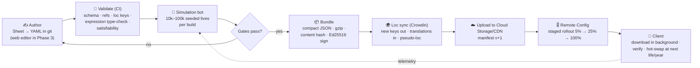

# 08 Technical Architecture

*Purpose:* Describes how Relivable is built and run: the stack, architecture, storylet engine and schema, saves and purchases, content pipeline and quality gates.

> [!summary] Decision in one paragraph
> Relivable is built in **Flutter (Dart)**, with **Shorebird** for Dart code patches, a **pure-Dart deterministic storylet engine**, an **offline-first local save** synced to **Firebase** (Auth, Firestore, Remote Config, Cloud Storage/CDN, Analytics, Crashlytics, Cloud Functions), and **RevenueCat** for purchases with server-side StoreKit 2 / Play verification. Content (events, strings, art atlases) ships as **signed remote bundles**, so new storylets go live without an app update. AI is **optional**: it only rewords text, runs on-device first (Apple Foundation Models), and falls back to a moderated cloud proxy. **Unity 6 LTS is the documented alternative.** We would switch to it only if the Phase 2 spike shows the art direction needs heavy 2D animation, or if the team we hire is Unity-native.
>
> Sources: [[_Concept Brief]] (locked decisions), `research_notes/Life sim game phase 1/tech_compliance_budget.md`. Related: [[05 UX and Screen Map]], [[06 Monetization and Economy]], [[07 Retention and LiveOps]], [[09 Compliance and Ratings]], [[11 Roadmap Team and Budget]].

---

## 1. Stack decision

### 1.1 Engine / framework comparison

| Criterion (weight) | **Flutter 3.x + Flame (chosen)** | **Unity 6 LTS (alternative)** | Godot 4.5 | React Native / Expo |
|---|---|---|---|---|
| **Screen reader on iOS/Android** (high, Pillar 5) | ✅ Standard widgets build the accessibility tree automatically. `Semantics` customises it for VoiceOver/TalkBack ([Flutter docs](https://docs.flutter.dev/ui/accessibility/assistive-technologies)) | ⚠️ The Accessibility module (Unity 2023.2+/6) supports VoiceOver/TalkBack, but the hierarchy is **separate from GameObjects and has to be kept in sync by hand** ([Unity blog](https://unity.com/en/blog/engine-platform/mobile-screen-reader-support-in-unity), [manual](https://docs.unity3d.com/Manual/mobile-accessibility.html)). One user blamed BitLife's VoiceOver regression on a Unity plug-in (anecdotal) ([AppleVis](https://applevis.com/comment/210590)) | ❌ AccessKit screen reader is experimental and desktop-focused. A forum report says it does **not work with Android TalkBack** ([Godot 4.5](https://godotengine.org/releases/4.5/), [forum](https://forum.godotengine.org/t/question-about-accessibility-on-android/122578)) | ✅ Native accessibility props, mature for apps |
| **Text-heavy UI, dynamic type, layout** (high) | ✅ Native-quality text, scales with OS font size, rich layout | ⚠️ UI Toolkit/uGUI works, but dynamic type and RTL take more effort | ⚠️ Control nodes are adequate. Mobile polish is rated lower ([Oceanview](https://oceanviewgames.co.uk/blog/posts/unity-vs-godot-vs-unreal-2026)) | ✅ Native text |
| **2D avatar / animation** (medium) | ✅ Layered paper-doll sprites via Flame/Rive. Fine for illustrated cards | ✅✅ Best-in-class 2D/particles/animation | ✅ Strong 2D | ⚠️ Skia + Reanimated possible ([Expo](https://expo.dev/blog/build-2d-game-style-physics-with-matter-js-and-react-native-skia)) |
| **Ads / IAP SDK maturity** (high) | ✅ RevenueCat Flutter SDK, AdMob/AppLovin MAX plugins (wrappers lag native slightly) | ✅✅ Most mature mobile ad/IAP pipeline ([tech-insider](https://tech-insider.org/godot-vs-unity-2026/)) | ⚠️ Thin plugin ecosystem | ✅ Good app SDKs, weaker game ad mediation |
| **OTA code updates** (medium) | ✅ Shorebird (Dart patches, rollback, signing) ([Bitrise](https://bitrise.io/blog/post/codepush-alternatives)) | ⚠️ Content only (Addressables). No code push | ⚠️ PCK content only | ⚠️ EAS Update covers JS/assets. **CodePush retired 31 Mar 2025** ([Capgo](https://capgo.app/blog/best-live-updates-system-for-mobile-app/)) |
| **Licence cost** | Free (BSD) | Free under **$200K** revenue/funding (12 mo), then **$2,310/seat/yr** Pro (raised from $2,200 on 12 Jan 2026; $210/seat/mo if paid monthly). Runtime Fee cancelled ([Unity](https://unity.com/pricing-updates); [80.lv](https://80.lv/articles/unity-announces-its-upcoming-2026-price-changes)) | Free (MIT) | Free (MIT) |
| **Hiring pool / rates** (high) | Large app-developer pool. Small *game* pool | Deepest mobile *game* pool. BitLife's studio hires Unity/C# ([Stillfront job](https://stillfrontgroup.teamtailor.com/jobs/7180715-senior-unity3d-developer)) | Smaller pool | Very large app pool |
| **Binary size / cold start** (medium) | Good (AOT-compiled). Engine adds a few MB *(estimate)* | Heavier runtime. Slower cold start on low-end Android *(estimate)* | Light | Good with Hermes |
| **Verdict** | **Chosen**: best accessibility-by-default for a UI-heavy text game, cheaper hiring, Shorebird | **Alternative**: pick it if visuals or animation become the hook | Not recommended until mobile TalkBack works | Viable for text, but weaker game tooling and no code-push parity |

> [!note] Deviation from the research recommendation, and why
> The tech research note recommended **Unity 6 LTS as the lowest-risk default** (hiring pool, SDK maturity) and Flutter as the "credible lower-cost alternative". The [[_Concept Brief]] locks **Flutter**, and this note follows the brief for three reasons:
> 1. **Pillar 5 (Accessible by default)** is a headline differentiator. Flutter gives a screen-reader tree for free, while Unity needs a hand-synced parallel hierarchy, which is exactly the failure mode behind BitLife's regressions.
> 2. Relivable is about **90% UI and text**. Rendering performance is not the deciding factor (the research says 2D paper-doll rendering is "trivial in all four").
> 3. App-developer rates are lower and the pool is larger than for Unity game developers.
>
> **Unresolved risk:** the research did not verify how Flame canvas content interacts with Flutter `Semantics`. The Phase 2 spike must prove it (see [[12 Risks and KPIs]]).

### 1.2 Switch criteria (decided at the end of the Phase 2 spike)

| Signal in Phase 2 | Stay on Flutter | Switch to Unity 6 |
|---|---|---|
| Avatar/animation spec | Layered 2D sprites, Rive micro-animations | Skeletal animation, particles, scene-based "moments" |
| VoiceOver/TalkBack spike on hub + event card + Flame avatar | Passes the scripted audit | Fails, and the fix cost is above 2 engineer-weeks |
| Ad mediation (AppLovin MAX/AdMob) Flutter plugin | Rewarded flow stable on 10 test devices | Blocking bugs with no workaround |
| Team hired | App/Flutter engineers | Unity engineers available at the same rate |

---

## 2. System architecture

```mermaid
flowchart TB
  subgraph Client["📱 Relivable client (Flutter, iOS + Android)"]
    UI["UI shell<br/>Hub · Action cards · Command bar · Settings"]
    A11Y["Accessibility layer<br/>Semantics labels · dynamic type · reduced motion · colour-safe tokens"]
    ENG["Storylet engine (pure Dart pkg)<br/>condition eval · salience/weights · seeded RNG"]
    SIM["Simulation core<br/>stats · economy · careers · relationships · NPC memory"]
    CR["Content runtime<br/>bundle loader · signature check · ICU strings"]
    SAVE["Save system<br/>local DB · versioned migrations · autosave per year"]
    SYNC["Sync service<br/>offline queue · conflict resolver"]
    MON["Monetization<br/>RevenueCat SDK · rewarded ads (capped) · entitlements cache"]
    AN["Analytics wrapper<br/>typed events · consent/age-band gating"]
    SHARE["Share renderer<br/>Life Recap 9:16 cards · seed deep links"]
    AIA["AI flavour adapter<br/>optional · rewording only"]
    UI --> A11Y
    UI --> ENG --> SIM
    ENG --> CR
    SIM --> SAVE --> SYNC
    UI --> MON
    UI --> SHARE
    ENG -. "text only" .-> AIA
    UI --> AN
  end

  subgraph Device["On-device services"]
    AFM["Apple Foundation Models<br/>(iOS 26, Apple Intelligence devices)"]
    AGE["Age signals<br/>Declared Age Range · Play Age Signals"]
  end
  AIA --> AFM
  UI --> AGE

  subgraph Firebase["☁️ Firebase (Blaze)"]
    AUTH["Auth<br/>anonymous → Apple/Google link"]
    FS["Firestore<br/>save slots · profile · entitlement mirror"]
    RC["Remote Config + A/B<br/>bundle manifest pointer · ad caps · prices · kill switches"]
    CS["Cloud Storage + CDN<br/>signed content bundles · art atlases"]
    CF["Cloud Functions<br/>RevenueCat webhook · AI proxy · share links · account deletion"]
    FA["Analytics → BigQuery export"]
    CL["Crashlytics"]
    FCM["Cloud Messaging (opt-in push)"]
    AC["App Check"]
  end

  subgraph Commerce["💳 Commerce"]
    RCAT["RevenueCat<br/>receipts · entitlements · webhooks"]
    ASSA["App Store Server API<br/>+ Notifications v2"]
    GPD["Google Play Developer API<br/>+ RTDN"]
    WEB["Optional web shop<br/>(US link-out where allowed)"]
  end

  subgraph AI["🤖 Optional cloud AI"]
    LLM["Small model<br/>(Flash-Lite / nano class)"]
    MOD["Moderation<br/>(omni-moderation)"]
  end

  subgraph Pipeline["🛠️ Content pipeline (CI)"]
    AUTHR["Authoring<br/>Sheets/YAML in git · Ink for long scenes"]
    VAL["Validator<br/>JSON Schema + semantic checks"]
    BOT["Simulation bot<br/>10k+ seeded lives"]
    BUN["Bundler<br/>compact · gzip · hash · Ed25519 sign"]
    LOC["Crowdin<br/>string sync · LQA"]
  end

  SYNC <--> FS
  SYNC --> AUTH
  CR <-- "manifest" --> RC
  CR <-- "bundles" --> CS
  MON <--> RCAT
  RCAT <--> ASSA
  RCAT <--> GPD
  RCAT -- webhook --> CF --> FS
  WEB --> RCAT
  AIA -- "consented, rate-limited" --> CF
  CF --> LLM --> MOD --> CF
  AN --> FA
  Client --> CL
  Client --> AC
  FCM --> UI
  AUTHR --> VAL --> BOT --> BUN --> CS
  AUTHR <--> LOC
  BUN --> RC
```



### 2.1 Module responsibilities

| Module | Responsibility | Key rules |
|---|---|---|
| **Storylet engine** | Picks the next event(s) each year from eligible storylets by salience, weight, cooldown and memory. Resolves choices and outcomes | A **pure Dart package** with no Flutter imports, so it runs unchanged in the app, in CI (the simulation bot) and in tests. **Deterministic**: a seeded PRNG per life, so a seed reproduces a life (needed for shareable scenario seeds and bug repro) |
| **Simulation core** | Visible and hidden stats, money, assets, careers, relationships (%), NPC memory, traits, life chapters | Owns **all** game-state numbers. AI can never write here ([itch.io lesson](https://cynthiachen2023.itch.io/life-simulation-monopoly)) |
| **Content runtime** | Downloads the manifest, verifies signatures, caches bundles, falls back to the bundle embedded in the app | The app always ships a full "base" bundle, so first launch works offline |
| **Save system** | Local persistence (SQLite via Drift; the alternative is Isar). Autosaves every Age +1 and on app background | Versioned schema with forward migrations, checksummed |
| **Sync service** | Pushes and pulls save slots to Firestore. Resolves conflicts | Never blocks play. See §5 |
| **Monetization** | Paywall, purchase flow, restore, entitlement cache, rewarded ad offers with caps from Remote Config | "Remove ads" removes **every** ad surface ([player complaint](https://www.complaintsboard.com/bitlife-life-simulator-b150146)) |
| **Share renderer** | Renders Life Recap story cards (1080×1920) and dynasty cards offscreen. Generates seed deep links | Never shows real names or PII. Shares the in-game name only |
| **AI flavour adapter** | Rewrites event prose for variety. Optional NPC chat later | Off unless the player opts in. Canned text is always the fallback. See §10 |

---

## 3. Storylet event data schema

Events are **storylets** (Failbetter's "mosaic tiles, not pipes", gated by qualities) ([Emily Short](https://emshort.blog/2016/04/12/beyond-branching-quality-based-and-salience-based-narrative-structures/)). Each one is a data file validated against a JSON Schema (draft 2020-12). Long multi-beat scenes can be written in Ink and compiled into the same choice and effect structure. Whether an Ink runtime exists for Dart is unverified, so the Phase 2 spike evaluates it ([inkle](https://inklestudios.com/ink/)).

```json
{
  "id": "school.bully.confront_v2",
  "schema": 3,
  "version": 4,
  "pack": "base",
  "tags": ["school", "conflict", "childhood"],
  "contentFlags": ["violence_mild"],
  "minRating": "13",
  "stage": "teen",
  "salience": 40,
  "weight": {
    "base": 12,
    "modifiers": [
      { "if": "stat.looks < 30", "mul": 1.5 },
      { "if": "trait.has('shy')", "mul": 1.3 },
      { "if": "memory.has('bullied_by:{npc.bully}')", "mul": 2.0 }
    ]
  },
  "cooldown": { "years": 2 },
  "maxPerLife": 2,
  "conditions": {
    "all": [
      "age >= 11 && age <= 17",
      "school.enrolled == true",
      "npc.exists(role='bully', relation='classmate') as bully"
    ],
    "none": ["flag.homeschooled", "memory.has('made_peace_with:{npc.bully}')"]
  },
  "textKey": "ev.school.bully.confront.body",
  "textParams": { "bully": "{npc.bully.firstName}", "pronoun": "{npc.bully.pronoun}" },
  "art": { "card": "atlas/school/hallway_03", "altKey": "ev.school.bully.confront.alt" },
  "choices": [
    {
      "id": "stand_up",
      "labelKey": "ev.school.bully.confront.c1",
      "a11yHintKey": "ev.school.bully.confront.c1.hint",
      "outcomes": [
        {
          "chance": "clamp(0.35 + stat.strength*0.004 + trait.bonus('brave',0.15), 0.1, 0.9)",
          "textKey": "ev.school.bully.confront.c1.win",
          "effects": [
            { "stat": "happiness", "add": 8 },
            { "rel": "{npc.bully}", "add": -15 },
            { "memory.set": "stood_up_to:{npc.bully}", "ttlYears": 30, "weight": 3 },
            { "npcMemory": { "npc": "{npc.bully}", "key": "humiliated_by_player", "ttlYears": 40 } },
            { "schedule": { "storylet": "adult.reunion.bully_apology", "inYears": [10, 20], "chance": 0.4 } }
          ]
        },
        {
          "chance": "rest",
          "textKey": "ev.school.bully.confront.c1.lose",
          "effects": [
            { "stat": "health", "add": -6 },
            { "stat": "happiness", "add": -5 },
            { "memory.set": "bullied_by:{npc.bully}", "ttlYears": 25 }
          ]
        }
      ]
    },
    {
      "id": "tell_teacher",
      "labelKey": "ev.school.bully.confront.c2",
      "effects": [
        { "npcMemory": { "npc": "{npc.teacher}", "key": "trusted_by_player", "ttlYears": 8 } },
        { "rel": "{npc.bully}", "add": -5 }
      ]
    },
    {
      "id": "walk_away",
      "labelKey": "ev.school.bully.confront.c3",
      "effects": [{ "stat": "happiness", "add": -2 }]
    }
  ],
  "lockedReasonKey": null,
  "analytics": { "category": "school", "arc": "bully" },
  "authoring": { "owner": "writer.mk", "status": "approved", "lqa": ["es", "pt-BR", "de", "fr"] }
}
```

| Field group | Purpose |
|---|---|
| `conditions` (`all` / `any` / `none`) | A small, sandboxed expression language (no arbitrary code). It covers age, stats, flags, country, era, NPC roles, and memory queries. Binding with `as bully` lets text and effects refer to the matched NPC |
| `salience` + `weight` + `modifiers` | Salience tiers pick *which class* of event fires (story callbacks outrank filler). Weights pick *among* the eligible events. Modifiers let memory and traits bias the draw. This is how "every choice remembered" is implemented (Pillar 1) |
| `cooldown`, `maxPerLife` | Prevents the repetition the research flags as BitLife's main gameplay criticism ([Mechanics of Magic](https://mechanicsofmagic.com/?p=5062); [Penguin March postmortem](https://ilprinni.itch.io/penguin-march/devlog/143863/ludum-dare-46-postmortem)) |
| `memory.set` / `npcMemory` / `ttlYears` | The player's and NPCs' memory of each other. Entries decay after a TTL, so a save doesn't grow without bound |
| `schedule` | Plants a **callback** storylet years ahead, which creates consequences that come back later |
| `textKey` / `labelKey` / `altKey` / `a11yHintKey` | Every visible string is a localisation key (ICU MessageFormat with `select` for gender and pronouns, and plurals). Every illustration has alt text |
| `contentFlags`, `minRating` | Drive the content toggles and the regional or age-band filtering in [[09 Compliance and Ratings]] |
| `lockedReasonKey` | For actions: the explanation shown when an action is locked ("Unlocks at 18"). No action fails silently (Pillar 2) |

---

## 4. Content pipeline: authoring → validation → simulation bot → bundle → remote delivery



| Stage | Tooling | Gate / output |
|---|---|---|
| **Authoring** | Phase 2: Google Sheets → YAML export into git. Phase 3: a lightweight internal web editor with live preview and a condition linter. Ink only for long scenes | Every event has an owner, a status (`draft → review → approved`) and content flags |
| **Validation** | Dart CLI run in GitHub Actions on every PR | Fails on: schema errors, unknown storylet or NPC refs, missing loc keys, type errors in expressions, unsatisfiable conditions (e.g. `age > 80 && stage == 'teen'`), effects that write unknown stats |
| **Simulation bot** | The same engine package, run headless with random and heuristic "player personas" (cautious, chaotic, criminal, careerist). The research suggests 10k lives per run ([tech note](../../research_notes/Life%20sim%20game%20phase%201/tech_compliance_budget.md)) | Report: never-fired (dead) events, over-frequent events, average repeats per life, stat and money curves, death-age distribution, callback hit rate. **Draft gates** *(targets, to tune in Phase 2)*: dead events < 2%, no non-`common` event in > 15% of lives, repeats per life < 5%, at least 3 memory callbacks per average life |
| **Bundle** | Bundler CLI | `content-<semver>-<hash>.bin.gz`, plus a manifest with `minClientVersion` and an Ed25519 signature. The private key lives in CI secrets only |
| **Remote delivery** | Cloud Storage behind CDN. The manifest pointer lives in Remote Config | Staged rollout, an instant rollback (flip the pointer), and a kill switch per storylet ID |

> [!warning] Store-policy boundary for remote content
> Stores allow interpreted code and asset updates that stay **within the reviewed app experience**. Native changes still need a store release ([Capgo](https://capgo.app/blog/best-live-updates-system-for-mobile-app/)). Apple's Oct 2026 Guideline **2.5.19** reportedly bans hidden, dormant or undocumented features that differ from the reviewed build ([letsdatascience](https://letsdatascience.com/news/apple-revises-app-review-guidelines-for-ai-deepfakes-and-hid-76fdff63)). Rules we follow:
> - Bundles add **storylets, strings and art inside existing systems** only.
> - New *systems*, such as a new screen or minigame, ship in a store build.
> - The review notes describe the remote content model.
> - Feature flags are never used to hide reviewed-out functionality.

---

## 5. Save, cloud sync and offline-first

**Principle:** the device is authoritative while you play. The cloud is a backup and a way to move between devices. The game must be **100% playable offline**, a feature rivals advertise ([SourceForge InstLife](https://sourceforge.net/app/instlife/iphone/)). Lost saves and lost purchases are top BitLife complaints: saves are local-only with no Game Center or Play sync, a reinstall wipes them, and saves have been lost after updates ([DroidWin](https://droidwin.com/bitlife-crashing-when-opening-menu-how-to-fix/); [Digistatement](https://digistatement.com/how-to-get-bitlife-progress-back/)).

| Topic | Design |
|---|---|
| **Data model** | Per slot: `profile` (dynasty, unlocked ribbons/achievements, settings) plus `life` (the current character: compressed JSON state, RNG seed and cursor, memory store, NPC table). Past lives become compact **Life Records** (summary, recap data, family-tree node). These are not full states, so dynasties don't bloat ([player complaint: "deletes your save after 4 generations"](https://play.google.com/store/apps/eventdetails/4831791308351315470)) |
| **World Ledger** | One `world` record per player account (one world, one continuous history, never reset), shared by every life and dynasty: notable people, companies, landmarks, events, name-reputation axes and active world effects (see [[04 App Breakdown - Core Life Systems]], Module 11). Capped at about 250 entries (lower tiers summarised first), synced like a slot, so it stays small |
| **Local storage** | SQLite (Drift). A write-ahead journal. Autosave on every Age +1 and on app background. 3 rolling local snapshots |
| **Identity** | Anonymous Firebase Auth from first launch, so there is no sign-up wall before the fun (FTUE in under 60 s). The player is prompted to link Apple or Google after the first finished life, or at first purchase |
| **Sync** | A background push after each save once the network is available (debounced to about 30 s). Pull on launch and on sign-in. Firestore doc per slot: `{rev, deviceId, updatedAt, schema, blob(gz, ~50–150 KB est.)}` |
| **Conflicts** | Compare `rev` and `deviceId`. If both changed, show a **"Keep this device / Keep cloud / Keep both"** sheet with a summary (character, age, last played). Never overwrite silently. "Keep both" forks to a new slot |
| **Migrations** | `schema` int, forward-only migration functions with golden-file tests. The cloud keeps the last 5 revisions for 30 days *(estimate)* for support restores |
| **Account deletion** | In-app, removes Auth, Firestore docs and analytics user ID via a Cloud Function. Apple and Google both require it ([tech note §5 checklist](../../research_notes/Life%20sim%20game%20phase%201/tech_compliance_budget.md)) |
| **Cost** | Saves are small and infrequent. At 100K MAU the estimate is tens to low hundreds of USD per month (inference from free quotas: 50K reads/day, 20K writes/day, overage about $0.03–0.06 per 100K reads) ([Verdent](https://www.verdent.ai/guides/devtools/firebase-pricing)). Cloud Storage requires Blaze since 3 Feb 2026 |

---

## 6. Purchase verification and entitlements

| Step | Implementation |
|---|---|
| Catalogue | The 9 products in [[06 Monetization and Economy]] §2, all **non-consumable**: `relivable_plus` (P1, $9.99), `no_ads` (P2, $2.99), `plus_upgrade` (P3, $6.99, offered only to No-Ads owners), `pack_<id>` (P4, $2.99 small / $3.99 large), `season_<yyyy>_<n>` (P5, $4.99 per season, non-renewing), `welcome_pack` (P6, $1.99, once per account, cosmetic), `cosmetic_<id>` (P7, $0.99–1.99), `bundle_founders` (P8, $14.99, 60-day launch window), `bundle_complete` (P9, $24.99). **No consumables, no purchasable currency (Sparks are earn-only), no per-use Rewind, no subscriptions and no loot boxes** |
| Entitlements | `plus` (granted by P1, P3, P8, P9), `no_ads` (granted by P2 and by `plus`), `pack_<id>`, `season_<yyyy>_<n>`, `cosmetic_<id>`. `plus` implies `no_ads`: ad offers are hidden and their rewards auto-granted. Prices come from RevenueCat Offerings via Remote Config |
| Client | RevenueCat Flutter SDK. StoreKit 2 on iOS, Play Billing on Android. Entitlements are cached locally (signed), so Plus works offline |
| Server verification | RevenueCat validates StoreKit 2 JWS transactions via the **App Store Server API + Notifications v2**. `verifyReceipt` and Notifications v1 are deprecated ([Apple forums](https://developer.apple.com/forums/thread/731550)). Play purchase tokens go through the Play Developer API with RTDN |
| Entitlement mirror | A RevenueCat webhook calls a Cloud Function, which writes `entitlements/{uid}` in Firestore. Security rules make it **server-write-only**. Used for support tooling and the web shop |
| Restore | Automatic on sign-in on any device, plus a visible "Restore purchases" in Settings and on the paywall. Purchases are tied to the **account**, not the device (Pillar 3) |
| Refunds / revocation | Webhook `CANCELLATION`/`REFUND` revokes the entitlement. Story content already played stays readable, but the remaining pack beats lock *(policy, to confirm with legal)* |
| Web shop (Phase 4, where allowed) | US link-outs currently carry a **0% Apple commission** pending a court-approved rate (Apple proposed 15%). EU link-out is 15% from 1 Oct 2026. Google allows alternative billing from 30 Jun 2026 (reported service fees about 10–20%, details still settling; see [[06 Monetization and Economy]] §7) ([iPhone in Canada](https://www.iphoneincanada.ca/2026/08/14/apple-proposes-15-cut-purchases-outside-app-store/); [MacRumors](https://macrumors.com/2026/08/19/ec-epic-apple-app-store-changes); [MacRumors](https://macrumors.com/2026/06/24/google-play-store-fee-change/)). Web purchases still grant entitlements through RevenueCat, keyed to the Firebase UID. Launches in Phase 4 (US first) |
| Cost | RevenueCat is free up to **$2.5K monthly tracked revenue**, then **1%** ([RevenueCat](https://www-docs.revenuecat.com/pricing)) |
| Anti-fraud | Server-side validation plus App Check is enough for a single-player game. Local stat tampering is low-stakes unless leaderboards exist (research inference) |

---

## 7. Analytics event taxonomy

**Conventions:** `snake_case`, `object_action`. Max 25 custom params (Firebase limit, verify). Every event carries `life_id`, `life_year`, `content_ver`, `client_ver`, `age_band` (from the age signal or self-declared: `u13`/`13_15`/`16_17`/`18p`/`unknown`) and `ab_cohorts`. Under-18 and `unknown` users get **no advertising ID and no third-party ad sharing** (see [[09 Compliance and Ratings]]). Firebase Analytics exports to BigQuery. Dashboards are in Looker Studio.

| Domain | Event | Key params | Answers |
|---|---|---|---|
| Lifecycle | `app_open`, `session_start`, `session_end` | `cold_start_ms`, `offline` | DAU, session length, cold-start budget |
| FTUE | `ftue_step` | `step` (1–8), `ms_since_install` | Tutorial funnel. Time to first wild event (target < 60 s) |
| Life loop | `life_start`, `age_up`, `life_end` | `country`, `era`, `seed_source`, `cause_of_death`, `age_at_death`, `years_played` | Lives per user, years per session |
| Storylets | `storylet_shown`, `choice_made` | `storylet_id`, `salience`, `is_callback`, `choice_id`, `outcome` | Event frequency, callback hit rate, choice balance (sampled 10–20% to control volume) |
| Actions | `action_used`, `action_locked_viewed`, `command_search` | `action_id`, `entry` (`card`/`hub`/`command_bar`), `query_len`, `result_count`, `no_result` | Pillar 2: findability, zero-result searches |
| Generations | `generation_continue`, `dynasty_view` | `generation_n`, `heir_relation` | Meta loop depth |
| Sharing | `recap_viewed`, `recap_shared`, `seed_shared`, `seed_opened`, `install_from_share` | `channel`, `card_type`, `seed_id` | Virality and K-factor ([[10 Go-to-Market]]) |
| Challenges | `challenge_start`, `challenge_complete`, `challenge_abandon` | `challenge_id`, `week` | LiveOps engagement ([[07 Retention and LiveOps]]) |
| Monetization | `paywall_view`, `purchase_start`, `purchase_complete`, `purchase_fail`, `restore_complete`, `refund` | `sku`, `placement`, `price_tier`, `error` | Conversion, ARPPU, restore success |
| Ads | `ad_offer_shown`, `ad_offer_accepted`, `ad_rewarded_complete`, `ad_cap_reached` | `placement`, `network`, `ecpm_bucket` | Opt-in rate, cap tuning |
| AI | `ai_toggle`, `ai_flavour_shown`, `ai_report_submitted`, `ai_fallback` | `source` (`on_device`/`cloud`), `latency_ms`, `moderation_block` | Cost, safety, Google report-button compliance |
| Quality | `save_sync`, `save_conflict`, `bundle_loaded`, `bundle_failed`, `a11y_mode_snapshot` (once a day: screen reader on/off, text scale bucket, reduced motion) | `result`, `bytes`, `ms` | Save-loss detection, accessibility usage (aggregate only) |
| Push | `push_prompt_shown`, `push_opt_in`, `push_open` | `trigger` (e.g. after the first life ends) | Prompt timing |

---

## 8. Performance budgets

These are **targets (estimates)**, set for a mid-range reference Android phone (about 4 GB RAM, 2021 SoC) and for iPhone 12. They are enforced in CI with Firebase Performance and Test Lab where possible.

| Budget | Target | Hard ceiling (release blocker) |
|---|---|---|
| Cold start to interactive hub (p50 / p90) | ≤ 1.5 s / ≤ 2.5 s | p90 > 3.5 s |
| Age +1 tick (storylet selection over 5,000 events + effects + autosave) | ≤ 50 ms p95 | > 120 ms p95 |
| Frame rate (hub scroll, card transitions) | 60 fps, jank < 1% frames | > 3% janky frames |
| **Android download size** (AAB per-ABI split) | ≤ 30 MB | > 45 MB |
| **iOS download size** | ≤ 45 MB | > 70 MB |
| Embedded base content bundle | ≤ 8 MB compressed (text + low-res atlases). Hi-res art is downloaded on demand | > 15 MB |
| Content delta update | ≤ 2 MB typical | > 10 MB without a Wi-Fi prompt |
| Peak memory (resident) | ≤ 220 MB | > 300 MB (OOM risk on 3 GB devices) |
| Save write | ≤ 30 ms | > 100 ms |
| Battery | No background work except sync and bundle fetch (OS-scheduled) | — |
| Stability | Crash-free users ≥ 99.5%. ANR rate < 0.47% (Play "bad behaviour" threshold; verify current value) | Crash-free < 99.0% |
| AI flavour latency (when on) | First token < 500 ms. The canned text renders instantly and the AI text swaps in ([Cinevva](https://app.cinevva.com/guides/ai-npcs-dialogue)) | Never blocks the Age +1 button |

---

## 9. QA and test strategy

| Layer | What | Cadence / gate |
|---|---|---|
| Engine unit + property tests | Condition parser, weight math, effect application, memory TTL, deterministic seeds (same seed and choices give a byte-identical state) | Every PR. Coverage ≥ 85% on the engine package *(target)* |
| Golden lives | 50 recorded seeds plus choice scripts replayed against the expected states. Catches unintended balance changes | Every PR. Diffs need designer sign-off |
| Simulation bot | See §4 gates | Every content PR plus nightly with 100k lives |
| Save migration tests | Every historical schema fixture migrates to the current one and loads | Every PR touching models |
| Widget / golden UI tests | Hub, event card, paywall, settings in light/dark, at 100%/200%/310% text scale, in LTR and pseudo-loc | Every PR |
| **Accessibility automation** | Flutter `meetsGuideline` checks (tap target, labelled tap target, text contrast). Custom lint: no `GestureDetector` without `Semantics` | Every PR. **Blocks merge** |
| **Accessibility manual** | Scripted VoiceOver (iOS) and TalkBack (Android) runs through FTUE, one full life, purchase, restore and settings. Testers include screen-reader users (recruit via the AppleVis community, paid) | **Release gate on every store build.** BitLife's VoiceOver broke silently across updates ([AppleVis](https://www.applevis.com/comment/135452)) |
| Device matrix | Firebase Test Lab: 15 Android devices (Android 8–15, 3–12 GB RAM) plus 6 iOS devices | Nightly smoke. Full matrix before each release |
| Monetization | StoreKit Testing / Play license testers: buy, restore, refund, family sharing, interrupted purchase, offline entitlement | Every release touching commerce |
| Localisation | Pseudo-loc (+35% length, accents), truncation screenshots, LQA by native reviewers on 10% of events plus all UI | Every language drop |
| Content QA | Writers' peer review, sensitivity review on flagged tags (see [[09 Compliance and Ratings]]), a playtest "read-through" of new packs | Per bundle |
| Playtests | Phase 2: 5–8 moderated sessions + 30–50 unmoderated (PlaytestCloud-style) ([PlaytestCloud](https://start.playtestcloud.com/blog/perfecting-the-first-time-user-experience-in-mobile-games)). Phase 3+: TestFlight / Play closed track with Discord testers | Each phase gate |
| Release | Staged rollout 1% → 10% → 50% → 100% with crash-free and ANR monitors and automatic halt | Every store release |

---

## 10. Optional AI service (rewording only)

| Rule | Implementation | Source |
|---|---|---|
| AI never decides outcomes | The engine computes all effects first. AI only receives the resolved prose plus context and returns reworded text | [itch.io lesson](https://cynthiachen2023.itch.io/life-simulation-monopoly) |
| On-device first | iOS 26 Apple Foundation Models (iPhone 15 Pro+). Offline, no inference cost, supports EN/FR/DE/IT/PT-BR/ES/zh/JA/KO, which matches our launch languages ([9to5Mac](https://9to5mac.com/2025/09/29/apple-intelligence-ios-26-models-developers/)) | |
| Cloud fallback | Cloud Function proxy → small model (Gemini 2.5 Flash-Lite / GPT-4.1 nano class at **$0.10 / $0.40 per 1M tokens**) ([Simon Willison](https://www.simonwillison.net/2025/Jul/22/gemini-25-flash-lite)). Keys stay server-side. Per-user daily budget and rate limits | |
| Cost | About **$0.27/user/month** at 100 events/day (research estimate). Gate cloud AI behind **Relivable Plus** or a daily free quota, and cache by `(storylet_id, outcome, locale, persona)` | tech note §3 |
| Moderation | Every cloud output goes through `omni-moderation-latest` (free) ([OpenAI](https://developers.openai.com/api/docs/models/omni-moderation-latest.md)). A block shows the canned text. On-device output passes a local blocklist plus the same content-flag rules | |
| Constrained input | No free-text prompts in Phase 3/4. The AI rephrases preset options only, which lowers rating and moderation risk | tech note §3 inference |
| Policy | In-app **report button** on every AI-generated text (Google Play) ([policy](https://support.google.com/googleplay/android-developer/answer/13985936?hl=en)). Disclosure and explicit consent before sending data to a third-party AI (Apple 5.1.2(i)). AI declared in the Apple age questionnaire. Toggle in Settings. See [[09 Compliance and Ratings]] | |

---

## 11. Security

| Area | Control |
|---|---|
| Backend access | Firebase **App Check** (App Attest / Play Integrity) on Firestore, Functions and Storage. Firestore rules: a user can read and write only `users/{uid}/**`, and `entitlements` is server-write-only |
| Secrets | No API keys with spend power in the client (AI and RevenueCat secret keys are server-only). CI secrets are in GitHub Encrypted Secrets / OIDC to GCP |
| Content integrity | Ed25519-signed manifests and bundles. The client rejects unsigned or downgraded bundles (`minVersion` check) |
| Transport and storage | TLS 1.2+. Firebase encryption at rest. Entitlement cache HMAC'd with a device-bound key |
| Data minimisation | No real names, contacts or location. Country comes from store locale only. Analytics user ID is pseudonymous. No ad ID for under-18/unknown users. iOS ATT prompt only for 18+ users who reach an ad surface |
| AI proxy | Auth required. Rate limits per UID and IP. Prompt template is fixed server-side (no client-supplied system prompt), which guards against prompt-manipulation (a Google policy requirement) |
| Supply chain | Dependabot / `dart pub outdated` checks, pinned versions, SBOM per release, a licence audit (Phase 3) |
| Incident response | Kill switches in Remote Config for ads, AI, any storylet ID, and the web shop. On-call runbook for save or purchase incidents |

---

## 12. Localisation pipeline

| Item | Decision |
|---|---|
| Format | Flutter ARB with **ICU MessageFormat** from day 1: `plural`, `select` for gender and pronouns, named params. Event strings are extracted from storylet `*Key` fields into per-pack ARB namespaces |
| TMS | **Crowdin** (from about **$59/mo**, range $0–450) over Lokalise (Explorer **$144/mo** to Advanced **$999/mo**, per-word billing, no free plan since Nov 2025) ([Locize](https://www.locize.com/compare/lokalise-alternatives); [Capterra](https://www.capterra.com/compare/162858-163509/Lokalise-vs-Crowdin)). CI pushes new keys and pulls approved translations. The bundler fails if a shipped locale is under 100% for that pack (English fallback only in beta) |
| Languages | EN at soft launch, then **ES (LatAm), PT-BR, DE, FR** for global launch (brief). IT/JA/KO post-launch. BitLife's separate ES/BR apps and 72M lives/yr show demand ([Goodgame](https://goodgamestudios.com/company/press/releases/72-million-virtual-lives-in-one-year-bitlife-impresses-internationally/)) |
| Cultural data | Per-locale name lists, currencies and formatting (`intl`), country packs (laws, school systems) as data, not translation |
| Text expansion | UI designed for +35% (DE/FR) and tested at 310% dynamic type |
| Quality | Glossary and style guide per language (tone: wry, not mean). Translator context screenshots auto-generated from golden tests. LQA on 10% of events plus 100% of UI and store text |
| Volume | About 240–360K source words by global launch (*estimate*: about 3,000 events × 80–120 words). See [[11 Roadmap Team and Budget]] for cost. Per-word rates were **not** researched (gap) |

---

## 13. Tooling, CI/CD and observability

| Need | Tool | Cost (see [[11 Roadmap Team and Budget]]) |
|---|---|---|
| Source + CI | GitHub + **GitHub Actions** (validator, bot, tests). **Codemagic** or Actions macOS runners for iOS builds | ~$0–200/mo *(estimate)* |
| Release automation | **Fastlane** (signing, TestFlight, Play tracks, metadata), staged rollout scripts | Free |
| OTA patches | **Shorebird** (Dart code push, rollback). Used for hotfixes only, not features (2.5.19) | Plan pricing not researched, verify |
| Crash + perf | **Firebase Crashlytics** (free) + Firebase Performance. Alerts to Slack/Discord | Free |
| Device testing | Firebase Test Lab | Pay-per-use *(estimate $50–300/mo)* |
| Analytics | Firebase Analytics → BigQuery → Looker Studio. GameAnalytics optional | Free / BigQuery usage |
| Experiments | Firebase Remote Config + A/B Testing (BigQuery export) ([Firebase](https://firebase.google.cn/learn/pathways/firebase-remote-config-unity-games)) | Free |
| Attribution | An MMP (AppsFlyer/Adjust/Singular) from soft launch. SKAdNetwork / AdAttributionKit on iOS | Quote needed |
| Design | Figma (design tokens exported to Dart theme) | ~$15–45/editor/mo *(estimate)* |
| Content | Sheets/YAML → custom editor (Phase 3). Ink (inky) for long scenes. Crowdin | See above |
| Project | Linear/Jira + Notion/Obsidian (this vault) | ~$10/user/mo *(estimate)* |

> [!tip] Phase 2 technical spikes (2 weeks inside the prototype)
> 1. VoiceOver/TalkBack across hub, card, command bar and a Flame avatar (go/no-go for Flutter).
> 2. Storylet engine at 5,000 synthetic events: tick ≤ 50 ms on the reference Android phone.
> 3. RevenueCat + rewarded ad mediation sample on 10 devices.
> 4. Bundle sign → download → hot-swap.
> 5. Apple Foundation Models rewording of 20 events, with a quality and latency review.
> 6. Ink → storylet compile path.
