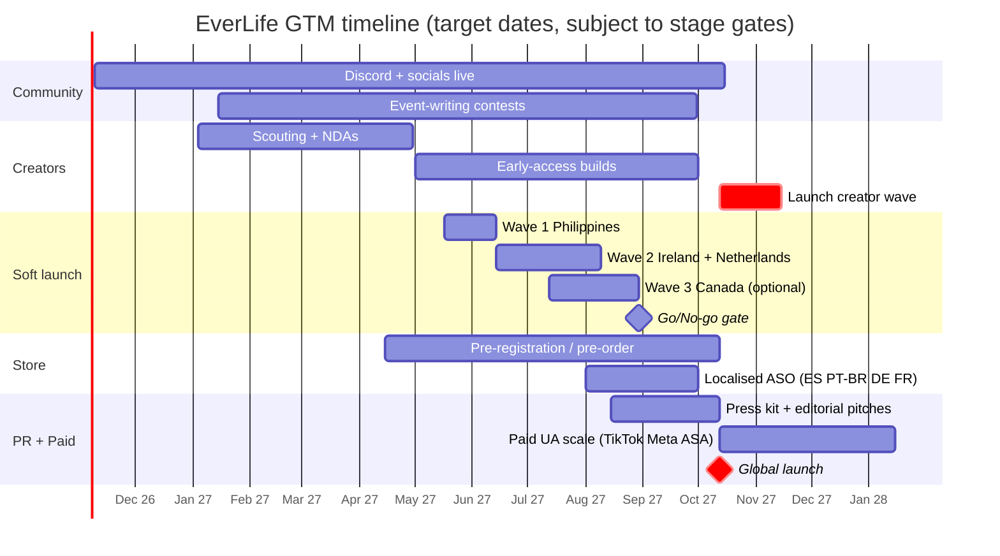

# 10 Go-to-Market

> [!summary] GTM in one paragraph
> EverLife launches **organic-first**. BitLife's own revenue fell **19% YoY in H1 2026** when Stillfront tightened paid UA ([Stillfront Q2 2026](https://www.stillfront.com/en/stillfronts-interim-report-q2-2026-strengthened-profitability-and-continued-revenue-stability/)), and our illustrative unit economics (LTV about $2–2.50 against a US iOS CPI of about $2–3) make paid UA marginal until retention proves top-decile ([monetization research §6](../../research_notes/Life%20sim%20game%20phase%201/monetization_retention.md)). The engine of growth is therefore **shareable stories**: Life Recap cards, scenario seeds and weekly challenges, amplified by a **creator program** (chaotic-playthrough YouTubers and TikTokers plus local-language creators, the BitLife/Goodgame playbook) and an **official Discord opened now** (about 12 months before global launch). Soft launch runs in the **Philippines + Ireland/Netherlands (+ Canada if budget allows)** with hard KPI gates. Global launch adds 5 languages, localised ASO and a coordinated creator wave.

Related: [[_Concept Brief]] · [[01 Executive Summary]] · [[06 Monetization and Economy]] · [[07 Retention and LiveOps]] · [[11 Roadmap Team and Budget]] · [[12 Risks and KPIs]] · Source: `research_notes/Life sim game phase 1/ux_gtm_pitch.md`, `market_competitors.md`, `monetization_retention.md`, `reddit_player_wishlist.md`.

---

## 1. Positioning and messaging

### 1.1 Positioning statement
> **For** players who love living wild, whole lives on their phone, **EverLife is** the life simulator where **every choice is remembered**: your bully shows up at your wedding, your kids inherit your grudges, and your story is worth sharing. **Unlike** BitLife, every career and system is free, ads are opt-in, there is no pay-per-undo, your purchases follow your account, and it works fully with a screen reader.

### 1.2 Why now (market context)
- **The category leader is mature and UA-dependent.** BitLife made SEK 95M (Q1), 109M (Q2) and about 100M (Q3) in 2026, with organic growth of −19%, −19% and −2% ([Yahoo Q1](https://finance.yahoo.com/markets/stocks/articles/stillfront-group-ab-stlff-q1-070405250.html); [Stillfront Q2](https://www.stillfront.com/en/stillfronts-interim-report-q2-2026-strengthened-profitability-and-continued-revenue-stability/); [Q3 call](https://finance.yahoo.com/quote/SFS.XC/earnings/SFS.XC-Q3-2026-earnings_call-537398.html)). It still earns about US$38–42M a year annualised (research inference), so demand is proven.
- **Visual competitors have left.** The Sims Mobile servers closed **20 Jan 2026**, and Life by You was cancelled ([SimsCommunity](https://simscommunity.info/2025/10/20/the-sims-mobile-shutting-down/)).
- **Trust gaps are documented:** paywall creep, ads after buying "no ads", lost purchases, VoiceOver regressions ([ComplaintsBoard](https://www.complaintsboard.com/bitlife-life-simulator-b150146); [Google Play review](https://play.google.com/store/apps/eventdetails/4831791308351315470); [AppleVis](https://www.applevis.com/comment/135452)).

### 1.3 Messaging pillars → proof → where used

| Pillar ([[_Concept Brief]]) | Message | Proof point in product | Primary channels |
|---|---|---|---|
| Every choice remembered | "Your past comes back." | Callback storylets (e.g. bully apology 15 years later), NPC memory, life chapters | TikTok/Shorts hooks, screenshot 1, trailer opening |
| One tap to anything | "Do anything in one tap." | Command bar, contextual action cards, locked actions explain why | Screenshot 2, creator demos |
| Fair forever | "Every career free. No pay-to-undo." | One ~$9.99 Plus unlock, capped opt-in ads, account-tied restore | Store description, PR, Reddit and Discord AMAs |
| Share your story | "Your life, Wrapped." | 9:16 Life Recap cards, family tree, seeds | In-product share loop, creator challenges |
| Accessible by default | "Built for everyone to play." | Full VoiceOver/TalkBack, dynamic type, colour-safe | PR (AppleVis, Can I Play That), Apple/Google editorial pitch |

> [!warning] Messaging guardrails
> - **Don't name BitLife** in store metadata or paid ads (trademark; see [[09 Compliance and Ratings]] §10). Comparative framing ("no pay-per-undo") is fine.
> - **Don't headline AI.** inZOI's AI announcement drew review-bombing and Peridot is shutting down ([Wikipedia: inZOI](https://en.wikipedia.org/wiki/InZOI); [Wikipedia: Peridot](https://en.wikipedia.org/wiki/Peridot_(franchise))). Mention optional AI flavour text only in feature lists.
> - **Don't target children.** No placements on kids' channels and no child-appealing creative (COPPA; see [[09 Compliance and Ratings]]).

### 1.4 Audience hypotheses (to validate)
- **Core:** teens and young adults, 16–24, in the US and English-speaking markets, with a substantial female share. Simulation audiences run 51–76% female by ad-platform signal ([Start.io](https://www.start.io/audience/online-simulation-gamers-in-texas)), and 70% of family/farm-sim players were women in 2017 ([Kotaku/Quantic Foundry](https://kotaku.com/study-shows-which-video-game-genres-women-play-most-1791435415)). *No BitLife demographic data exists publicly (gap).*
- **Lapsed BitLife players** frustrated by paywalls and ads.
- **Blind and low-vision gamers** (AppleVis community, petitions) ([AppleVis](https://applevis.com/comment/134996)).
- **Spanish- and Portuguese-speaking players**, a market BitLife served with separate apps (72M lives/yr across localised editions) ([Goodgame](https://goodgamestudios.com/company/press/releases/72-million-virtual-lives-in-one-year-bitlife-impresses-internationally/)).

---

## 2. Pre-launch (T-12 → T-0)

Global launch target: **12 Oct 2027** (≈ 11 months from the Phase 2 start on 9 Nov 2026; range 9–14 months, see [[11 Roadmap Team and Budget]]). **"Discord 12 months out" therefore means opening it now, at the start of Phase 2.**

| When | Workstream | Actions | Output / KPI *(targets)* |
|---|---|---|---|
| **T-12 (Nov 2026)** | Clarity + Discord | Lock the audience and one-line hook (FirstLook spends months 1–2 on this) ([FirstLook](https://firstlook.gg/blog/how-to-build-a-game-community-from-scratch)). Open the **official Discord**, designed around "what do people do here?": weekly "worst life" story share, event-idea voting, dev diaries ([Discord](https://discord.com/blog/the-game-developer-playbook-part-two-early-access-and-pre-launch)). BitLife has **no official Discord**. The largest server is unofficial at about 3.2K members ([Discord listing](https://discord.com/servers/coral-eclipse-or-formerly-bitlife-792224999581810720)) | 500 members by T-9 |
| T-11 → T-9 | Social seeding | TikTok, Shorts and IG accounts: "storylet of the day" text-on-video, "what would you do?" polls, dev-log clips. All feed into Discord, so the server isn't a ghost town ([Wayline](https://www.wayline.io/blog/discord-community-indie-game-marketing)) | 3–5 posts/week. 5K followers across platforms by T-6 |
| T-10 → T-8 | Creator scouting | Build a list of 60–100 creators (see §6), tiered and mapped by language | Signed early-access NDA with 10–15 creators by T-6 |
| T-9 (Phase 2 playtests) | Community playtests | Discord testers join the prototype unmoderated tests. Event-writing contests (the winners' events ship in-game, credited) | 2 player-written events per month |
| **T-7 → T-5 (soft launch)** | Soft launch | See §3. Discord becomes the feedback desk, with a "seed swap" channel | Gates in §3.3 |
| T-6 | Store pages | Google Play **pre-registration** live (global minus soft-launch geos). iOS **pre-order** (App Store allows pre-orders up to about 180 days ahead; verify). Pre-reg reward: an exclusive cosmetic avatar outfit (no gameplay power) | 50–150K pre-regs by launch *(target, low confidence: no conversion data found)* |
| T-4 → T-2 | Press + editorial | Press kit. Pitches for Apple "Apps & Games" and Google Play editorial featuring, focused on accessibility and fairness. AppleVis outreach | ≥ 1 featuring placement in 1 major market |
| T-2 → T-0 | Creator wave prep | Creators receive custom challenge seeds (e.g. "Born a twin in 1950s Brazil, become President"). Embargo set for launch day | 20–40 creator videos scheduled for launch week |
| **T-0** | Launch | Coordinated creator drop, launch trailer, store featuring ask, paid UA on (§5), Discord launch event | §8 |

---

## 3. Soft launch plan

### 3.1 Markets and rationale

| Wave | Markets | Language | Purpose | Why |
|---|---|---|---|---|
| **Wave 1 (Tech + FTUE)** | **Philippines** | EN | Retention, FTUE funnel, crashes on a wide device spread, cheap installs | A classic cheap soft-launch market, but its behaviour differs from Western players, so it is **not** used for monetization reads ([PocketGamer.biz](https://www.pocketgamer.biz/new-soft-launch-countries/)) |
| **Wave 2 (Monetization)** | **Ireland + Netherlands** | EN (NL plays EN apps widely; verify with local data) | Payer conversion, ARPDAU, ad opt-in, paywall placement | Cheaper than CA/AU, which "have become pricey" (Chartboost via search) ([PocketGamer.biz](https://www.pocketgamer.biz/new-soft-launch-countries/)) |
| **Wave 3 (optional)** | **Canada** | EN (+ FR-CA readiness test) | Validation in a US-like market. Store featuring readiness | Closest to US spending behaviour ([CGMagazine](https://www.cgmagonline.com/articles/phone-gets-new-games/)). Only if budget allows |

> [!note] 2026 practice
> 2026 soft launches focus on **fine-tuning onboarding, monetization fit and scalability** rather than "cheap volume" ([PocketGamer.biz 2026](https://www.pocketgamer.biz/soft-launch-is-changing-in-2026-how-and-where-should-you-release-your-game)). Small titles typically soft-launch for **1–3 months** ([PayPro Global](https://payproglobal.com/pt_br/respostas/o-que-e-estrategia-de-soft-launch-de-jogo/)). We plan **about 12 weeks** across the waves.

### 3.2 Timeline and goals

| Weeks | Wave | Installs per cohort *(estimate)* | Goals |
|---|---|---|---|
| SL 1–4 | PH | 5–10K over 2–3 cohorts | Crash-free ≥ 99.5%, FTUE funnel ≥ 85% completion, D1 read, storylet repetition telemetry |
| SL 4–8 | PH + IE/NL | ≥ 1K players per geo cohort, aiming for ≥ 100 payers in IE/NL (an investor-style bar the research calls restrictive) ([EGD #30](https://elitegamedevelopers.substack.com/p/egd-news-30)) | D7, payer conversion, ARPDAU, ad opt-in, paywall A/B tests |
| SL 8–12 | + CA (optional) | 5–10K | D30 read, LTV curve fit, CPI/IPM by creative, share rate, K-factor |

### 3.3 KPI gates (go / iterate / stop)

All values are **targets** set against GameAnalytics 2026 benchmarks. The retention gates (35% / 10% / 3.5%) sit below the global-launch targets of **D1 40% / D7 13% / D30 5%** ([[07 Retention and LiveOps]] §2). Benchmarks: **median D1 ≈ 22%, D7 < 4%, D30 < 1%; top 10% ≈ 40% / 11–12% / 4%** ([GameDevReports](https://gamedevreports.substack.com/p/gameanalytics-mobile-and-pc-game)). Full framework in [[12 Risks and KPIs]].

| Metric | 🟢 Go to global | 🟡 Iterate (extend 4–8 weeks) | 🔴 Stop / rethink |
|---|---|---|---|
| D1 retention (IE/NL/CA) | ≥ 35% | 30–35% | < 30% |
| D7 retention | ≥ 10% | 7–10% | < 7% |
| D30 retention | ≥ 3.5% | 2.5–3.5% | < 2.5% |
| Crash-free users | ≥ 99.5% | 99.0–99.5% | < 99.0% |
| Payer conversion (D30, Tier-1 geos) | ≥ 2.5% | 1.5–2.5% | < 1.5% |
| ARPDAU (IAP + ads, Tier-1) | ≥ $0.20 | $0.12–0.20 | < $0.12 |
| Life Recap share rate (shares / lives completed) | ≥ 8% | 4–8% | < 4% |
| Store rating (soft-launch geos) | ≥ 4.5★ | 4.2–4.5★ | < 4.2★ |
| Accessibility P0 bugs open | 0 | — | > 0 blocks launch |

---

## 4. ASO

| Element | Plan |
|---|---|
| **Title (iOS 30 chars)** | `EverLife: Life Simulator` (24 chars). **Pending trademark clearance** ([[09 Compliance and Ratings]] §10) |
| **Subtitle (iOS 30) / short description (Play 80)** | iOS: `Choices that remember you`. Play: `Live a whole life. Every choice remembered. Every career free.` |
| **Keyword field (iOS 100 chars)** | `life,sim,simulator,choices,story,text,adventure,rpg,family,tree,career,dating,generations,legacy` (no spaces after commas, no repeats of title words). Sub-genre keywords beat broad ones ([Appdrift](https://appdrift.co/top-apps/games)). **No competitor names** |
| **Play description** | First 167 chars carry the hook plus "life simulator". Natural keyword density. Feature bullets mirror the messaging pillars |
| **Icon** | An aging face motif (baby → elder morph) on a distinct palette. A/B test 3 variants via Play experiments and App Store Product Page Optimization. Must not echo BitLife trade dress |
| **Localisation** | Fully localised metadata and screenshots for ES/PT-BR/DE/FR at global launch, with keyword research per locale. Top games localise into 15+ languages ([Appdrift](https://appdrift.co/top-apps/games)) |
| **Ratings prompt** | Native in-app review prompt after a **positive peak**: the first life ends with a Life Title earned, or a recap is shared. Never after a death or a purchase failure |
| **Custom pages** | iOS Custom Product Pages and Play custom store listings per creative angle (Drama, Dynasty, Fairness, Accessibility), so ad → page messaging matches |

### 4.1 Screenshot plan
Only the **first 3 portrait screenshots** show in App Store search, and Play now shows screenshots in search too. Use **one feature per shot, with large caption text** ([AppTweak](https://www.apptweak.com/en/aso-blog/best-aso-practices-for-your-app-game-creatives?lang=en-US)).

| # | Caption (≤ 6 words) | Shows |
|---|---|---|
| **1** | "Your past comes back." | A callback event card: "Remember Jake from 8th grade? He's your new boss." |
| **2** | "Do anything in one tap." | The command bar with "rob a bank" typed, plus the action card |
| **3** | "Every career. Free." | The career map with no locks, and a "No pay-to-undo" badge |
| 4 | "Your life, Wrapped." | A Life Recap card sequence |
| 5 | "Build a dynasty." | The family tree across 5 generations |
| 6 | "Made for everyone." | VoiceOver focus ring, large text, colour-safe stats |
| 7 | "Weekly challenges." | Challenge card + seed share |
| 8 | "Your choices. Your rules." | Content toggles and settings |

### 4.2 App preview video
15–30 s, **works muted** with burned-in captions, real in-game footage, and **the best moment in the first 3 seconds** (a wild event plus a choice) ([AppTweak](https://www.apptweak.com/en/aso-blog/best-aso-practices-for-your-app-game-creatives?lang=en-US)). Structure: 0–3 s hook event → 3–10 s three rapid choices with consequences → 10–20 s a callback years later → 20–25 s recap card → 25–30 s "Every career free" end card. A video plus screenshot refresh is claimed to lift conversion 10–30% (vendor claim) ([Dogtown Media](https://www.dogtownmedia.com/?p=22102)). Rotate screenshots for live events ([Appdrift](https://appdrift.co/top-apps/games)).

---

## 5. UA channels and creative strategy

### 5.1 Benchmarks that set the budget

| Metric | Figure | Source |
|---|---|---|
| Casual CPI, global | **iOS $1.41 / Android $0.14** | [Liftoff & Singular 2025](https://liftoff.ai/?p=34267) |
| Casual/puzzle CPI, North America | ~$3.00 iOS / ~$2.00 Android (secondary estimate) | [Segwise](https://segwise.ai/blog/cpi-ipm-roas-benchmarks-optimizing-ad-spend/) |
| Meta and TikTok CPI trend | +15–20% YoY | [Admiral Media](https://admiral.media/mobile-game-marketing-benchmarks/) |
| Casual D30 ROAS | iOS 47% / Android 15% | [Liftoff](https://liftoff.ai/?p=34267) |
| UGC creative | +152% avg IPM | [Liftoff Creative Index 2025](https://www.newswire.ca/news-releases/liftoff-s-2025-mobile-ad-creative-index-reveals-ugc-is-a-key-differentiator-for-top-apps-837345804.html) |
| Playables | 8× (top spenders) to 16× (others) impression-to-install vs. non-playables | same |
| Video share of game ad creatives | 80%+ | [PlayTurbo](https://www.playturbo.com/blog/scaling-playables-and-ai-creatives-in-2026) |

### 5.2 Channel plan

| Channel | Role | Phase | Notes |
|---|---|---|---|
| **TikTok Ads (incl. Spark Ads on creator posts)** | Primary discovery for the core audience | SL wave 2 → launch | Boost the best organic and creator posts as Spark Ads |
| **Meta (IG Reels, FB)** | Scale + lookalikes | SL → launch | Still dominant in mobile game UA ([ContentGrip](https://www.contentgrip.com/mobile-game-ua-report/)) |
| **Apple Search Ads** | Capture high-intent searches ("life simulator") | Launch | iOS drives most US revenue for BitLife (US iOS weekly revenue peaked at $414K vs. a $497K all-platform peak) ([Sensor Tower](https://sensortower.com/blog/2025-q2-ios-top-5-simulator%20games-units-us-60416e41241bc16eb8905c2f)) |
| **Google App Campaigns** | Android scale | SL → launch | tROAS once there is enough purchase data |
| **AppLovin / Unity-ironSource** | **Playables** | Launch + 1 mo | Playables run at volume mainly here ([PlayTurbo](https://www.playturbo.com/blog/scaling-playables-and-ai-creatives-in-2026)) |
| Reddit Ads | Niche test (sim and story subs) | Launch | Small test budget |

**Bid strategy:** CPI tests in SL, then event-optimised (D1 retained / `life_end`), then tROAS. **Targets:** D7 ROAS 20–35%, D30 50–70%, payback D90–D180 *(targets, calibrated to Liftoff's 47% iOS D30 average)*.

### 5.3 Creative strategy

| Concept family | Hook (first 2 s) | Format |
|---|---|---|
| **POV "my life went wrong"** | "POV: you married your high-school bully" | UGC-style selfie video plus screen recording (TikTok-native). Matches April 2025 trends in AI 5-second hooks and POV playables ([Braberg](https://felixbraberg.substack.com/p/the-latest-wtf-ads-pushing-the-creative-2d0)) |
| **Callback reveal** | "This choice at age 8 ruined me at 40" | Split-screen: age 8 → age 40 |
| **"What would you do?"** | A choice card with 3 options and "comment yours" | Static, carousel and short video. Doubles as a playable |
| **Dynasty** | "5 generations of crime" | Family-tree time-lapse |
| **Fairness** | "Every career free. Finally." | Text-on-screen, aimed at lapsed BitLife players (no BitLife naming) |
| **Recap** | A real player's Life Recap (with permission) | Story-format 9:16 |
| **Playable** | 3 choices → outcome → "Live the rest" CTA | AppLovin/Unity HTML5 |

Cadence: **8–12 new concepts per week** at launch. Kill a concept if IPM is below 50% of the account median after about $300 spend *(rule of thumb, estimate)*. AI-assisted variant generation is used for hooks and captions only, and every claim is reviewed for accuracy.

---

## 6. Influencer / creator program

**Precedent:** CallMeKevin ran a long BitLife series from Dec 2019 in a "chaotic playstyle" format ([TheTVDB](https://www.thetvdb.com/series/bitlife-callmekevin/seasons/official/1); [OutlierKit](https://outlierkit.com/channel/callmekevin)). Goodgame grew BitLife internationally with **local creators (Gnu in Germany, Jazzghost in Brazil)** and PT-language social channels that passed 100K fans ([Goodgame](https://goodgamestudios.com/company/press/releases/72-million-virtual-lives-in-one-year-bitlife-impresses-internationally/)). *No data quantifies creator impact on BitLife installs (gap).*

| Tier | Who | Count (launch) | Offer | Ask |
|---|---|---|---|---|
| **Anchor** | 100K–2M subs, chaotic or comedy let's-players (YouTube, Twitch) | 3–5 | Paid integration ($2–15K each, *estimate*), early build, **custom storylet named after them**, a bespoke challenge seed | Launch-week video + follow-up series |
| **Core** | 10–100K TikTok/Shorts story-game creators | 20–40 | $200–1.5K each *(estimate)* or rev-share via tracked links. Early access | 2–3 shorts across launch week |
| **Local** | ES/LatAm, PT-BR, DE, FR creators | 3–6 per language | Same as Core. Localised seeds | Native-language content at language launch |
| **Community** | Accessibility creators, Discord power users, fan writers | 10–20 | Free Plus, credits, featured storylets | Honest reviews, event submissions |

**Creator toolkit:** Creator Mode build flags (no ads, all content unlocked, a watermark-free recap), seed generator, B-roll, brand guide, FAQ, disclosure guidance (#ad/FTC). **Measurement:** unique deep links and codes per creator, `install_from_share` attribution, view → install estimates.

---

## 7. Virality: Life Recap, seeds and challenges

| Mechanic | Design | Benchmark / precedent |
|---|---|---|
| **Life Recap ("Your Life, Wrapped")** | At death: a 6–8 card 9:16 story sequence (birth → milestones → biggest choice → callback → Life Title → epitaph), plus a novel stat (e.g. **"Life Archetype"**: *The Lovable Menace*, *The Quiet Tycoon*). One-tap export to TikTok, IG Stories, Snapchat and WhatsApp with an app link and seed | Spotify Wrapped: +21% downloads in the first week of Dec 2020, 2B+ social impressions in 2023, **500M+ shares on day one in 2025 (+41% YoY)**. "Listening Age" was the novel stat ([Idomoo](https://www.idomoo.com/blog/why-spotify-wrapped-works-and-how-you-can-do-it-too/); [RouteNote](https://routenote.com/blog/spotify-wrapped-2025-record-breaking-launch/)) |
| **Scenario seeds** | "Try my life" codes and deep links: the same birth setup and early events (the deterministic engine, [[08 Technical Architecture]] §2.1). The friend's result compares against the sharer's | Mirrors Wrapped's friend-comparison and "Wrapped Party" mechanics ([Thred](https://thred.com/newsletters/its-a-wrapped-analysing-spotifys-gen-z-success/)) |
| **Weekly challenges** | Every Monday, free for all players (not pack-gated, which answers a BitLife complaint) ([AppleVis](https://applevis.com/comment/98850)). Shareable completion card | BitLife: 6,800+ challenges played and 72M lives a year ([Goodgame](https://goodgamestudios.com/company/press/releases/72-million-virtual-lives-in-one-year-bitlife-impresses-internationally/)) |
| **Life Title hunting** | Rare Life Titles with hinted (never hidden) conditions that players work out and share. Discord channels and Reddit threads form around them | BitLife ribbons spawned Reddit guides ([Gamezebo](https://www.gamezebo.com/walkthroughs/bitlife-guide-how-to-get-the-model-bitizen-ribbon/)) |
| **Year-end "EverLife Wrapped"** | Every December, a player's year: lives lived, deaths, dynasties | The Wrapped calendar moment |

**Virality targets (estimates):** share rate ≥ 8% of completed lives, seed-open → install ≥ 15%, K-factor 0.15–0.30 at launch. Tracked via `recap_shared`, `seed_opened` and `install_from_share` ([[08 Technical Architecture]] §7).

---

## 8. PR

| Element | Plan |
|---|---|
| Angles | (1) "The fair life sim": a published **Fairness Pledge** (every career free, no pay-per-undo, no loot boxes, remove-ads means all ads). (2) "Accessible from day one": VoiceOver/TalkBack and blind-player testers. (3) "Stories that remember", with an engine deep-dive for dev press. (4) Founder story |
| Targets | Mobile trade (PocketGamer.biz, Game Developer, Mobilegamer.biz), consumer (TouchArcade, Pocket Tactics, Droid Gamers), accessibility (**AppleVis, Can I Play That**), LatAm and PT-BR gaming press at language launch |
| Assets | Press kit (fact sheet, logo, key art, screenshots, trailer, GIFs, founder bios, Fairness Pledge, accessibility statement). Promo codes. Embargoed review builds 10–14 days before launch |
| Platform editorial | Apple and Google featuring pitches 6–8 weeks before launch, leading with accessibility and inclusive design. Accessibility awards/showcases where available |
| Community-led PR | Discord AMA, a Reddit AMA on sim-game subs (follow sub rules), dev diaries |
| Crisis prep | Holding statements for purchase or save incidents, AI content reports, and IP claims |

*Gap: the research found no primary source on mobile PR effectiveness. Treat PR as a supporting channel, not a growth driver.*

---

## 9. Launch timeline (relative to Phase 2 start, Nov 2026)

| Milestone | Target date | Dependency |
|---|---|---|
| Discord + socials open | Nov 2026 | Name cleared enough for social handles (use a working-title handle if needed) |
| Pre-registration live | Apr 2027 | Store listing approved, rating questionnaire done |
| Soft launch W1 (Philippines) | 17 May 2027 | Phase 3 MVP gate ([[11 Roadmap Team and Budget]]) |
| Go/No-go | end Aug 2027 | §3.3 gates |
| **Global launch** | **12 Oct 2027** (range Aug 2027 – Jan 2028) | 5 languages, 3,000+ events, accessibility audit passed |

---

## 10. Budget split (estimates, excluding dev cost)

> [!info] Assumption
> The research gives no life-sim-specific UA budget. Figures below are **planning estimates** sized to the dev budget in [[11 Roadmap Team and Budget]] and will be re-based on soft-launch LTV.

| Bucket | Pre-launch (T-12 → SL) | Soft launch (12 wk) | Global launch (first 90 days) |
|---|---|---|---|
| Paid UA (TikTok, Meta, ASA, Google, AppLovin/Unity) | $0–5K (tests) | **$25–60K** | **$120–400K** |
| Creator program | $5–15K (seeding) | $5–10K | $40–120K |
| Creative production (UGC actors, editing, playables, trailer) | $5–15K | $8–15K | $25–60K |
| Community (Discord mod, events, prizes) | $3–8K | $2–4K | $5–15K |
| PR (press kit, distribution, optional agency retainer) | $2–5K | — | $10–40K |
| ASO tools, MMP, store testing | $1–3K | $2–5K | $5–15K |
| Contingency (10%) | ~$2–5K | ~$4–9K | ~$20–65K |
| **Total** | **~$18–56K** | **~$46–103K** | **~$225–715K** |

**Split rule of thumb at launch:** about 55–60% paid UA, 15–20% creators, 10% creative, 5% PR, 3–5% community and tools, 10% contingency. **Scale gate:** raise UA spend only when cohort LTV (D90 projection) ≥ 1.2× blended CPI in a geo (Game Developer LTV method: invest where LTV > CPI) ([Game Developer](https://www.gamedeveloper.com/business/calculating-ltv-for-a-mobile-game-methods-for-different-stages)).
