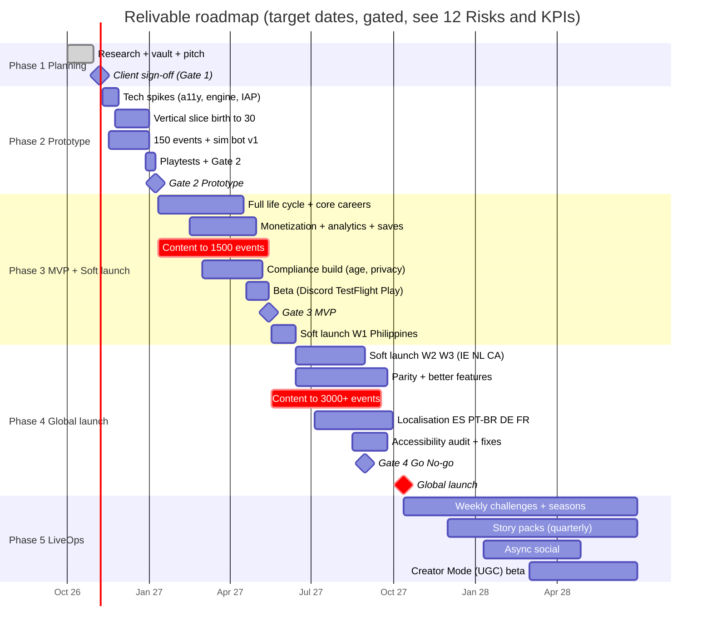

# 11 Roadmap, Team and Budget

> [!summary] Headline (estimates, not quotes)
> | Phase | Duration | Team (avg FTE) | Budget, low to high *(excl. UA)* | US-team reference |
> |---|---|---|---|---|
> | 2 Prototype | 8 weeks (Nov 2026 – Jan 2027) | 3.0 | **$25K – $60K** | ~$105K |
> | 3 MVP + Soft launch | ~5 months build + soft-launch start (Jan – Jun 2027) | 4.4 | **$82K – $264K** (labour $60K – $210K) | ~$440K |
> | 4 Global launch | ~4 months (Jun – Oct 2027) | 9 – 10.5 | **$400K – $700K** | ~$884K – $1.08M |
> | **Cumulative to launch** | **~11 months** (brief range 9–14) | — | **≈ $505K – $1.03M** | **≈ $1.43M – $1.62M** |
> | 5 LiveOps | Ongoing from Oct 2027 | 6 – 8 | **$54K – $90K / month** | ~$136K / month |
>
> These figures are the resolved budget used across the vault ([[_Concept Brief]], resolved decisions 2026-10-26): prototype ~$25–60K; MVP labour ~$60–210K (US reference ~$385K); total to global launch ≈ $505K (low) – $1.03M (high), US team ≈ $1.43–1.62M, excluding UA. **Writing, not engineering, is the critical path** (§6). UA and marketing budgets are in [[10 Go-to-Market]] §10.

Related: [[00 Home]] · [[01 Executive Summary]] · [[08 Technical Architecture]] · [[09 Compliance and Ratings]] · [[12 Risks and KPIs]] · Source: `research_notes/Life sim game phase 1/tech_compliance_budget.md` §6.

---

## 1. Roadmap (Phases 1–5)

> [!note] Schedule risk
> The global launch target of **12 Oct 2027** sits about 11 months after Phase 2 starts, inside the brief's 9–14 month window. A missed gate moves everything after it. The most likely slip is **content volume** (§6). The fallback launch window is **Jan 2028**, which avoids launching into the US holiday UA price peak in Nov–Dec *(inference)*.

---

## 2. Milestones and deliverables per phase

| Phase | Milestone / gate | Deliverables | Exit criteria (detail in [[12 Risks and KPIs]] §3) |
|---|---|---|---|
| **1 Planning** (done) | Gate 1: client sign-off | This vault: [[01 Executive Summary]], app breakdowns ([[04 App Breakdown - Core Life Systems]], [[04 App Breakdown - Social, Meta and Premium]]), [[05 UX and Screen Map]], [[06 Monetization and Economy]], [[07 Retention and LiveOps]], tech, compliance, GTM, budget, risks. Pitch deck outline | Scope, budget and stack approved. Name clearance started |
| **2 Prototype** (8 wk) | Gate 2: prototype | Storylet engine (pure Dart pkg) + validator + **sim bot v1**. Redesigned hub, command bar, event cards. **Birth to age 30** vertical slice. **150 events** with ≥ 15 callback arcs. VoiceOver/TalkBack spike report. Flutter-vs-Unity switch decision. Apple/IARC questionnaire dry-run. 5–8 moderated + 30–50 unmoderated playtests | Playtest "fun" and clarity scores at target. Tick ≤ 50 ms. Screen-reader pass. Writers producing ≥ 6 events/writer-day |
| **3 MVP + Soft launch** (~5 mo) | Gate 3: MVP → soft launch | Full life cycle (birth → death → heir). Core careers, school/university, relationships, crime/prison, health, assets, death/inheritance. **1,500+ events**. Cloud save + sync, RevenueCat (Plus + 1 pack), capped rewarded ads, analytics taxonomy, Crashlytics. Age screen + age-signal APIs, CMP, privacy docs, account deletion. Life Recap v1. Weekly challenge v1. EN only | Crash-free ≥ 99.5% in beta. FTUE ≥ 85% completion. All compliance items for Phase 3 done ([[09 Compliance and Ratings]] §12) |
| **4 Global launch** (~4 mo) | Gate 4: soft-launch go/no-go → launch | Parity + "better" features (parents divorce/remarry, twins, electives, parties, religion, lawsuits, heists that explain failure, traits, life chapters, family tree/dynasty, aging avatar). **3,000+ events**. **5 languages**. Season Pass v1. Web shop (US) optional. External accessibility audit. Localised ASO. Creator wave | Soft-launch KPI gates met ([[10 Go-to-Market]] §3.3). Audit pass. Rating confirmed |
| **5 LiveOps** (ongoing) | Quarterly reviews | Weekly challenges (52/yr), monthly themed events, a quarterly **Story Pack**, seasons, era/historical mode, **async social** (visit friends' lives, shared challenges), **Creator Mode/UGC** beta with moderation, optional AI NPC chat | Retention and monetization KPIs. Content cadence held for 3 straight months |

---

## 3. Team composition per phase

FTE = full-time equivalent averaged over the phase. "C" = contract. Rates are in §4.

| Role | P2 Prototype | P3 MVP | P4 Launch | P5 LiveOps | Notes |
|---|---|---|---|---|---|
| Tech lead / engine engineer (Flutter + Dart) | 1.0 | 1.0 | 1.0 | 1.0 | Owns the storylet engine, sim bot, architecture |
| Flutter / UI engineer | 0.5 | 1.0 | 1.0 | 0.5 | Hub, a11y, monetization UI |
| Backend / tools / LiveOps engineer | — | (in above) | 1.0 | 0.5 | Firebase, Functions, content editor, bundler |
| Narrative lead / game designer | 1.0 | 1.0 | 1.0 | 1.0 | Systems design, voice, review of all events |
| Writers | 0.25 C | 0.6 C | 2.0 C | 1.5–2.0 C | **The critical path.** Scale through a vetted contract pool |
| UX/UI designer + 2D artist | 0.25 | 0.3 | 1.0 | 0.5–1.0 | Card art, avatar layers, recap templates |
| QA + accessibility tester | (playtest vendor) | 0.3 | 1.0 | 0.5 | Includes screen-reader-user testers (paid) |
| Producer / PM | founder (uncosted) | 0.2 | 1.0 | 0.5 | Release, compliance checklist, vendors |
| Localisation manager | — | — | 0.5 | 0.25 | Crowdin, LQA, vendors |
| Community manager | (founder) | — | 0.5 | 0.5 | Discord, creators |
| UA / marketing lead | — | — | 0.5 | 0.5–1.0 | Can be an agency |
| Data analyst | — | — | (0.25 C) | 0.25 | Dashboards, LTV model |
| **Total (costed)** | **≈ 3.0** | **≈ 4.4** | **≈ 9.0 – 10.5** | **≈ 6 – 8** | |

---

## 4. Budget per phase

### 4.1 Rate assumptions (2025–26, vendor sources, wide variance)

| Region | Range found | Blended rate used | Source |
|---|---|---|---|
| US | game freelancers ~$85–135/h, mid-level mobile $120–160/h, agencies $150–250+ | **$110/h** | [SecondTalent](https://www.secondtalent.com/cost-to-hire/game-developer/); [Flexiple](https://flexiple.com/cost-to-hire/game-developer); [LowCode Agency](https://www.lowcode.agency/blog/mobile-app-developer-hourly-rates) |
| Eastern Europe | ~$50–80/h games, $45–70/h mobile | **$60/h** | same + [Whimsy Games](https://whimsygames.co/blog/complete-guide-to-game-development-outsourcing-costs/) |
| LatAm | ~$30–70/h | **$50/h** | same |
| India / South Asia | ~$19–50/h | **$30/h** | same |
| Hybrid (founder-led, offshore engineers, some roles part-paid or equity) | — | **~$17–43/h effective** *(estimate)* | Matches the low end of the resolved $60–210K MVP labour range |

Hours: **160 h per FTE-month** (the research's 22 person-months ≈ 3,500 h). Effective cost should also allow for PM, reviews and rework overhead (research note).

### 4.2 Phase 2: Prototype (8 weeks, ~3.0 FTE, ~890 h)

| Line item | Low (hybrid ~$25/h) | High (EE $60/h) | US ref ($110/h) |
|---|---|---|---|
| Labour (~890 h) | $22K | $53K | $98K |
| Playtests (moderated + unmoderated) | $1.5K | $3K | $3K |
| Tools/services (2 months, §5) | $0.5K | $1K | $1K |
| Test devices (3 low/mid Android + 1 iPhone) | $1K | $2K | $2K |
| Trademark/name search (preliminary) | — (client) | $1K | $1K |
| **Total** | **≈ $25K** | **≈ $60K** | **≈ $105K** |

### 4.3 Phase 3: MVP + soft-launch start (~5 months, ~4.4 FTE, ~3,520 h)

| Line item | Low (hybrid) | Mid (India $30/h) | High (EE $60/h) | LatAm $50/h | US ref ($110/h) |
|---|---|---|---|---|---|
| Labour (3,520 h) | **$60K** | $105K | **$210K** | $175K | **$385K** |
| Legal/privacy counsel (tranche 1: privacy policy, ToS, DPIA, COPPA retention policy) | $8K | $12K | $20K | $15K | $20K |
| Sensitivity review (external reader) | $2K | $3K | $5K | $4K | $5K |
| Art outsourcing (event card illustrations, avatar layers) | $5K | $8K | $15K | $10K | $15K |
| Tools/services (5 months) | $3K | $4K | $6K | $5K | $6K |
| Playtests + devices | $4K | $5K | $8K | $6K | $8K |
| **Total (excl. soft-launch UA)** | **≈ $82K** | **≈ $137K** | **≈ $264K** | **≈ $215K** | **≈ $439K** |

> [!warning] Content scope deviation
> The research's MVP costing assumed **500–800 events**. The [[_Concept Brief]] sets **1,500+** for MVP. The same 3,520 h only covers this if the writing team (narrative lead 1.0 + contract writer 0.6) averages **about 8 polished events per writer-day** (1,350 new events ÷ ~168 writer-days). If throughput measured in Phase 2 is lower, add contract writers. Each +0.5 writer FTE for 5 months costs about +$12K (LatAm-rate writer at $30/h) to +$44K (US) *(estimate)*.

### 4.4 Phase 4: Global launch (~4 months, ~9–10.5 FTE)

| Line item | Low (LatAm $50/h, 36 PM = 5,760 h) | High (EE $60/h, 47 PM = 7,520 h) | US ref ($110/h) |
|---|---|---|---|
| Labour | **$288K** | **$451K** | $634K – $827K |
| Localisation: ~300K source words × 4 languages = 1.2M words at **$0.06–0.12/word** *(assumption: per-word rates were NOT researched; MT + post-edit at the low end)* | $72K | $144K | $144K |
| LQA + localised store assets | $8K | $15K | $15K |
| External accessibility audit (WCAG 2.2 AA / EN 301 549) | $8K | $20K | $25K |
| Legal tranche 2 (Brazil/LGPD, EU consumer, web shop, rating review) | $7K | $30K | $30K |
| Trailer + key art + store creative | $5K | $15K | $20K |
| Tools/services (4 months, scaling, §5) | $4K | $8K | $8K |
| QA device lab / Test Lab overage | $3K | $8K | $8K |
| Contingency (~5%) | $3K | $10K | — |
| **Total (excl. UA)** | **≈ $398K** | **≈ $701K** | **≈ $884K – $1.08M** |

### 4.5 Cumulative to global launch (excl. UA)

| Scenario | P2 | P3 | P4 | **Total** | Original brief range |
|---|---|---|---|---|---|
| Low (hybrid → LatAm) | $25K | $82K | $398K | **≈ $505K** | ~$0.5M (EE/LatAm low) ✅ |
| High (EE) | $60K | $264K | $701K | **≈ $1.03M** | ~$1.1M (EE/LatAm high) ✅ |
| US team | $105K | $439K | $884K – $1.08M | **≈ $1.43M – $1.62M** | $1.2–2M ✅ |

Add the GTM budget ([[10 Go-to-Market]] §10): about **$46–103K** for soft launch and **$225–715K** for the first 90 days after launch.

### 4.6 Phase 5: LiveOps run rate (per month)

| Line item | Low (LatAm, 6 FTE) | High (EE, 8 FTE) | US ref (7 FTE) |
|---|---|---|---|
| Labour (960–1,280 h) | $48K | $77K | $123K |
| Services (Firebase, Crowdin, MMP, CI, ASO tool) | $1K | $3K | $3K |
| RevenueCat | 1% of tracked revenue above $2.5K/mo | same | same |
| Cloud AI (if enabled) | ~$0.27 per opted-in cloud-AI user per month ([tech note §3](../../research_notes/Life%20sim%20game%20phase%201/tech_compliance_budget.md)) | same | same |
| Localisation of new content (~20–30K words/mo × 4) | $5K | $10K | $10K |
| **Total (excl. UA and revenue-share fees)** | **≈ $54K** | **≈ $90K** | **≈ $136K** |

---

## 5. Tools and services: monthly cost

| Tool / service | Phase 2 | Phase 3 | Phase 4 | Phase 5 (≈100K MAU) | Source / note |
|---|---|---|---|---|---|
| Apple Developer Program | $8 ($99/yr) | $8 | $8 | $8 | From knowledge, verify |
| Google Play developer account | $25 one-time | — | — | — | From knowledge, verify |
| Firebase (Auth, Firestore, Storage/CDN, Functions, Analytics, Crashlytics, Remote Config) | $0 | $0–25 | $25–100 | **$25–300** | Free quotas: 50K reads/day, 20K writes/day. Blaze needed for Storage since Feb 2026 ([Verdent](https://www.verdent.ai/guides/devtools/firebase-pricing)). At 100K MAU: an inference |
| RevenueCat | $0 | $0 | $0 | **1% of MTR above $2.5K** | [RevenueCat](https://www-docs.revenuecat.com/pricing) |
| Crowdin (TMS) | — | $59 | $59–450 | $59–450 | [Capterra](https://www.capterra.com/compare/162858-163509/Lokalise-vs-Crowdin). Lokalise alternative $144–999 ([Locize](https://www.locize.com/compare/lokalise-alternatives)) |
| Shorebird (code push) | free tier | TBD | TBD | TBD | Pricing **not researched, verify** |
| GitHub + Actions / Codemagic (iOS builds) | $20–50 | $50–150 | $100–200 | $100–200 | Estimate |
| Firebase Test Lab | $0–50 | $50–150 | $150–300 | $100–200 | Estimate |
| Figma | $15–45 | $30–90 | $60–180 | $45–90 | Estimate |
| Linear/Jira + Notion | $0–30 | $30–60 | $60–120 | $60–100 | Estimate |
| MMP (AppsFlyer/Adjust/Singular) | — | quote | $300–1,000 | $500–1,500 | **Quote needed**, estimate |
| ASO tool (AppTweak/Sensor Tower lite) | — | — | $100–700 | $100–700 | Estimate |
| Cloud AI (Flash-Lite / nano class) + moderation | $0–20 (spike) | $0–50 | $50–300 | ~$0.27 × opted-in cloud users | $0.10/$0.40 per 1M tokens ([Simon Willison](https://www.simonwillison.net/2025/Jul/22/gemini-25-flash-lite)). Moderation free ([OpenAI](https://developers.openai.com/api/docs/models/omni-moderation-latest.md)) |
| Discord | $0 | $0 | $0–50 | $0–50 | Server boosts optional |
| *Unity Pro (only if alternative chosen)* | $0 | $0 | $0 | ~$183/seat/mo after $200K revenue | $2,200/seat/yr ([Unity](https://unity.com/pricing-updates)) |
| **Approx. total / month** | **≈ $70–250** | **≈ $250–600** | **≈ $1–3.5K** | **≈ $1–4K + 1% MTR + AI** | |

---

## 6. Content volume plan (writing is the critical path)

> [!important] Why writing gates the schedule
> Repetition is BitLife's main gameplay criticism ([Mechanics of Magic](https://mechanicsofmagic.com/?p=5062); [Common Sense Media](https://www.commonsensemedia.org/app-reviews/bitlife-life-simulator)). Small event pools make repetition obvious ([Penguin March postmortem](https://ilprinni.itch.io/penguin-march/devlog/143863/ludum-dare-46-postmortem)). A commercial Steam life sim advertises "2000+ random events" ([tech note §2](../../research_notes/Life%20sim%20game%20phase%201/tech_compliance_budget.md)). The research's throughput guess of **10–30 polished events per writer-day** is **unsourced**. We plan at **6–8 net** (after peer review, sim-bot fixes and loc prep) and **measure it in Phase 2**.

| Phase | New events | Cumulative | Callback arcs (multi-year) | Long scenes (Ink) | Weekly challenges ready | Source words, cumulative *(est. ~100/event)* | Writer FTE (incl. lead) | Required net throughput |
|---|---|---|---|---|---|---|---|---|
| 2 Prototype | 150 | **150** | 15 | 2 | 0 | ~15K | 1.25 | ~3–4/day (lead also designs systems) |
| 3 MVP | 1,350 | **1,500** | 120 | 15 | 12 | ~150K | 1.6 | **~8/day** ⚠️ |
| 4 Launch | 1,500+ | **3,000+** | 300 | 40 | 26 banked | ~300K | 3.0 | ~6–7/day + translation queries |
| 5 LiveOps (per quarter) | 450–900 (1 Story Pack of ~80–120 events + seasonal 40–60 + challenge content + free updates) | ~4,800–6,600 after 12 months | +60/qtr | +8/qtr | 13/qtr | +45–90K/qtr | 2.5–3.0 | ~4–6/day |

**Mix at global launch (3,000 events, target):**

| Domain | Share | ~Events | Notes |
|---|---|---|---|
| Childhood + school (electives, teachers, siblings/twins) | 15% | 450 | Player wishlist: school depth ([AppleVis](https://mail.applevis.com/comment/99019)) |
| Relationships + family (divorce/remarry parents, kids, adoption) | 20% | 600 | Most requested theme ([AppleVis](https://applevis.com/comment/98850)) |
| Career, business, money, real estate | 20% | 600 | All careers free (Pillar 3) |
| Crime, legal (lawsuits, retaliation), prison, heists | 10% | 300 | Heists explain failure ([Redlib/r/bitlife](https://redlib.belloworld.it/user/Alexio8008/submitted)) |
| Health, aging, death, inheritance | 10% | 300 | Sensitive-content review ([[09 Compliance and Ratings]] §11) |
| Activities, home, parties, religion, pets | 10% | 300 | |
| Fame, social media | 5% | 150 | |
| Callback / consequence arcs + life chapters | 10% | 300 | Pillar 1 differentiator |

**Throughput levers:**
- Templated storylet families (one structure, many locale/role variants).
- The validator plus sim bot catches dead or over-frequent events before review.
- A vetted contract-writer pool of 6–10 people onboarded in Phase 3 with a style bible.
- Player event-writing contests via Discord ([[10 Go-to-Market]] §2).
- AI is **not** used to write shipped event text (IP and quality risk; see [[09 Compliance and Ratings]] §10). It may be used for internal brainstorming only, with that policy written down.

---

## 7. Phase 2 next-steps checklist

- [ ] **Gate 1 sign-off:** client approves scope, stack (Flutter, with the Unity switch criteria), budget envelope and rating target (16+)
- [ ] Start **trademark / store-name clearance** for "Relivable" plus 3 backup names ([[09 Compliance and Ratings]] §10)
- [ ] Reserve social handles. **Open the Discord** (T-12) ([[10 Go-to-Market]] §2)
- [ ] Hire or contract: tech lead (Flutter + Dart), Flutter UI engineer (0.5), narrative lead, contract writer (0.25), UX/UI + 2D designer (0.25)
- [ ] Set up the repo, CI (GitHub Actions), Firebase project (dev/stage/prod), Crashlytics, RevenueCat sandbox, Crowdin trial
- [ ] Write the **storylet JSON Schema v1** + validator + sim bot v1 ([[08 Technical Architecture]] §3–4)
- [ ] Narrative **style bible** (voice, humour line, sensitive-topic rules, banned-terms list)
- [ ] Draft the content-flag taxonomy and toggles ([[09 Compliance and Ratings]] §3)
- [ ] Run **technical spikes**: VoiceOver/TalkBack incl. Flame avatar; 5,000-event tick benchmark; RevenueCat + rewarded ad sample; signed bundle hot-swap; Apple Foundation Models rewording; Ink compile path
- [ ] Build the **birth → age 30 vertical slice**: hub, command bar, action cards with locked reasons, event cards, stats with numbers
- [ ] Author **150 events** with ≥ 15 callback arcs. **Measure writer throughput** (events/writer-day)
- [ ] Analytics taxonomy v1 instrumented for playtests ([[08 Technical Architecture]] §7)
- [ ] Apple age-rating questionnaire + IARC **dry-run**
- [ ] Playtests: 5–8 moderated (including 2 screen-reader users) + 30–50 unmoderated
- [ ] Prototype readout: KPIs vs. Gate 2 criteria ([[12 Risks and KPIs]] §3), the Flutter/Unity decision, a re-estimated Phase 3 budget
- [ ] Draft the pitch deck from the vault ([[01 Executive Summary]])
